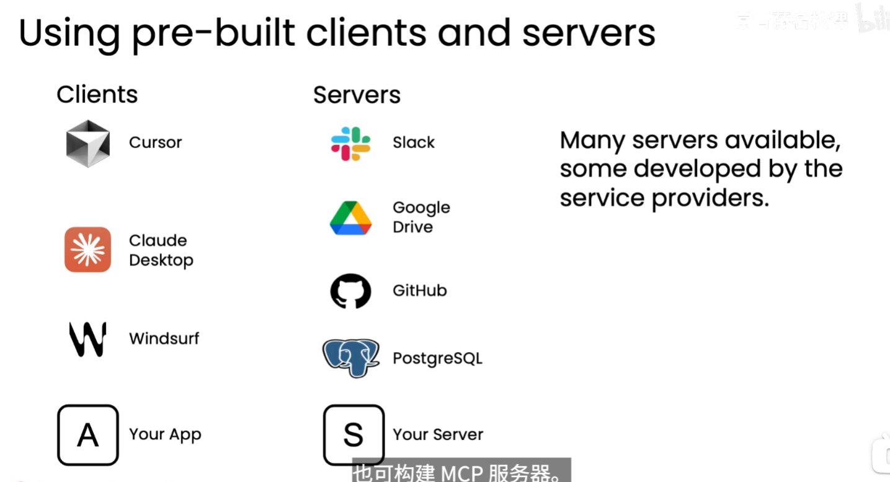
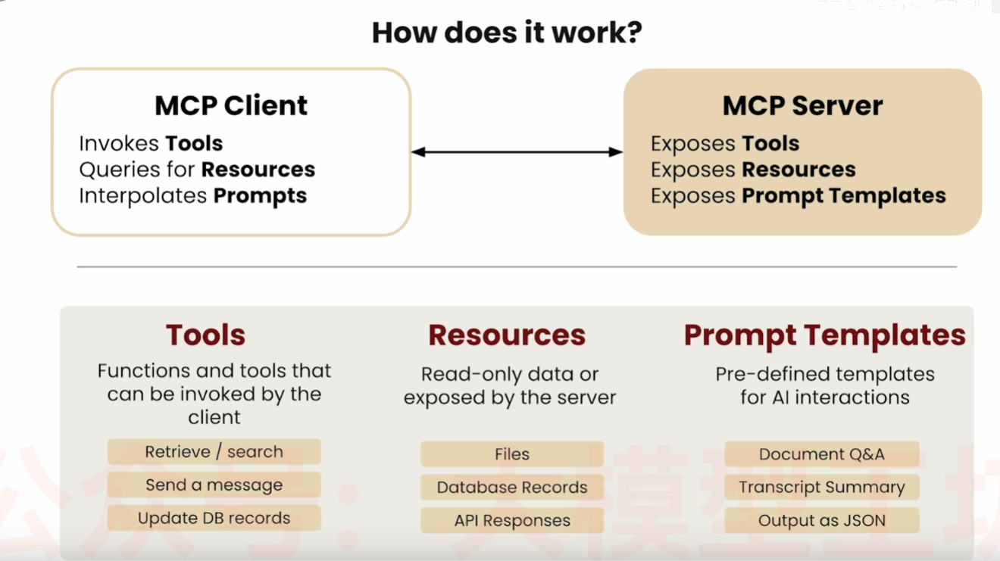
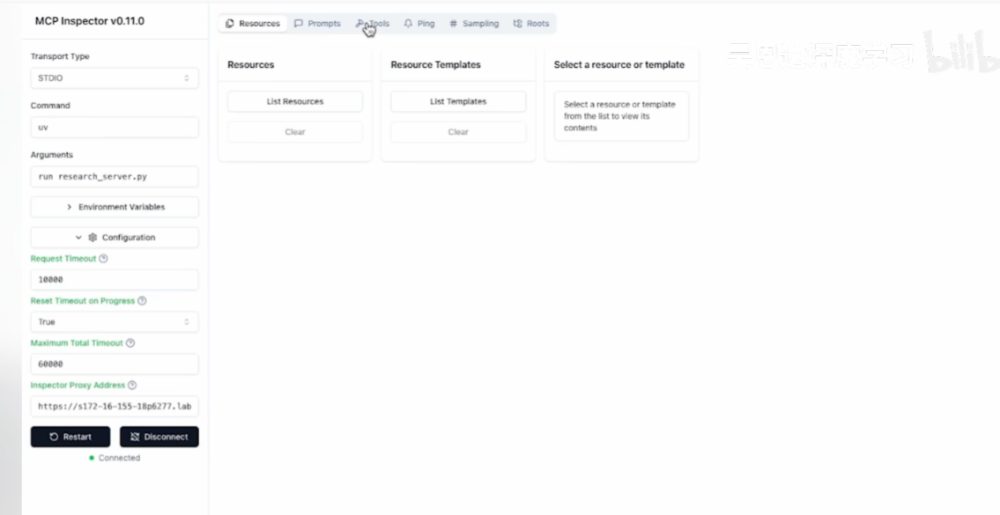

# MCP：模型上下文协议

## 1. 定义

MCP（Model Context Protocol，模型上下文协议）是一个开放协议，用于标准化语言模型应用获取工具和数据资源上下文的方式。

MCP 基于客户端—服务器架构，定义了语言模型应用中的 MCP 客户端与 MCP 服务器之间的通信方式。通过统一的协议，应用可以用一致的方式发现和使用外部能力，而不必为每个工具或数据源单独设计一套集成接口。

## 2. 客户端与服务器

| 角色 | 主要职责 | 典型位置 |
| --- | --- | --- |
| MCP 客户端 | 连接 MCP 服务器、发现服务器提供的能力、发起请求，并把结果提供给语言模型 | Cursor、Claude Desktop 或自建 AI 应用 |
| MCP 服务器 | 向客户端提供工具、数据资源和提示模板，并连接具体的外部系统执行请求 | 数据库、文件系统、第三方 API 或自建业务服务 |

一个 MCP 客户端可以连接多个 MCP 服务器；一个 MCP 服务器也可以被多个客户端连接。客户端负责连接和协调，服务器负责暴露能力并处理具体操作。



## 3. MCP 服务器提供的能力

MCP 服务器主要可以提供以下三类能力：

1. **工具（Tools）**：可被语言模型调用的操作，例如搜索信息、查询数据库、创建文件或调用业务 API。
2. **数据资源（Resources）**：供应用读取的上下文数据，例如文件、文档、数据库记录或实时状态信息。
3. **提示模板（Prompts）**：可复用的提示词模板，用于指导模型完成特定类型的任务。

服务器通过协议声明这些能力及其描述，客户端据此发现能力、组织请求，并将结果传回语言模型继续处理。

## 4. 典型通信流程

```text
语言模型应用启动
  → MCP 客户端连接 MCP 服务器
  → 客户端发现服务器提供的工具、资源和提示模板
  → 语言模型根据任务选择需要的能力
  → 客户端向服务器发送结构化请求
  → 服务器访问数据或执行工具
  → 服务器返回结果
  → 客户端把结果提供给语言模型
  → 语言模型继续推理并生成回答
```

MCP 规定的是客户端与服务器之间的通信约定，并不替代语言模型的推理过程，也不直接规定具体业务系统的实现方式。

### 4.1 图示说明



图中左侧的 MCP 客户端负责使用服务器提供的能力：调用工具、查询资源，并对提示模板进行插值处理。右侧的 MCP 服务器负责暴露三类能力：可被客户端调用的工具、供客户端读取的资源，以及用于 AI 交互的提示模板。

三类能力的典型例子包括：

| 能力 | 作用 | 示例 |
| --- | --- | --- |
| 工具（Tools） | 客户端可以调用的函数或操作 | 检索或搜索、发送消息、更新数据库记录 |
| 资源（Resources） | 服务器暴露的只读数据或上下文 | 文件、数据库记录、API 响应 |
| 提示模板（Prompt Templates） | 预先定义的 AI 交互模板 | 文档问答、转录内容摘要、按 JSON 格式输出 |

客户端与服务器之间是双向通信关系：客户端发起能力发现、资源查询和工具调用，服务器返回能力描述、资源内容或工具执行结果。

## 5. 主要特点

### 5.1 开放和标准化

MCP 通过开放协议统一能力发现、请求调用和结果返回的方式，降低不同 AI 应用与外部系统之间的集成成本。

### 5.2 基于客户端—服务器架构

语言模型应用通过客户端访问服务器提供的能力。工具和数据源可以独立部署、维护和升级，应用本身不必把所有连接逻辑都内置其中。

### 5.3 模型无关

MCP 不依赖某一个特定的语言模型。只要应用能够实现 MCP 客户端，就可以把协议接入不同的模型和模型服务。

### 5.4 易于集成

同一个 MCP 服务器可以面向多个支持 MCP 的应用复用。开发者也可以为数据库、内部 API、文件系统或其他业务系统构建专用 MCP 服务器。

## 6. 与工具调用的关系

普通工具调用通常由应用直接注册函数或 API；MCP 则提供了跨应用发现和使用工具、资源的标准协议。可以把 MCP 理解为连接语言模型应用与外部能力的协议层：

```text
MCP 服务器声明能力
  → MCP 客户端发现能力
  → 语言模型选择工具或资源
  → 客户端发送请求
  → 服务器执行并返回结果
```

MCP 不等于语言模型，也不等于某一个具体工具。实际系统仍需要在客户端、服务器和执行环境中实现身份认证、权限控制、参数校验、超时、审计和错误处理。

## 7. 核心理解

MCP 的核心价值，是用统一的开放协议把语言模型应用与外部工具、数据资源和提示模板连接起来。

> **MCP 客户端负责连接和协调，MCP 服务器负责提供能力和执行请求，语言模型负责理解任务并决定如何使用这些能力。**

## 8. 借助 MCP 标准化 AI 开发

MCP 通过统一的连接方式，让 AI 应用、工具服务和企业团队可以围绕清晰的职责边界协作。

| 参与者 | MCP 带来的价值 |
| --- | --- |
| AI 应用开发者 | 无需为每个外部工具单独开发适配逻辑，即可让应用连接到支持 MCP 的服务器，快速扩展应用能力。 |
| 工具或 API 开发者 | 一次构建 MCP 服务器，即可让多个 AI 应用发现并采用所提供的工具和数据资源。 |
| AI 应用用户 | 使用的 AI 应用可以接入更广泛的工具、数据和业务能力，完成更多类型的任务。 |
| 企业 | 在 AI 产品团队之间实现清晰的关注点分离：服务器团队负责提供和维护业务能力，应用团队负责用户体验、模型编排和任务流程。 |

这种分工减少了重复集成工作，也使工具能力可以独立演进。应用可以更换模型或调整交互方式，服务器则可以独立升级底层 API、数据源和业务实现，只要对外保持 MCP 能力契约稳定即可。

## 9. MCP 支持的 Transport Type

按照当前 MCP 规范，标准传输方式主要有两种：

| Transport Type | 连接方式 | 适用场景 | 当前定位 |
| --- | --- | --- | --- |
| `stdio` | 客户端启动服务器子进程，通过标准输入/输出交换 JSON-RPC 消息 | 本机工具、桌面 AI 应用、开发和调试 | 推荐用于本地集成 |
| `Streamable HTTP` | 通过 HTTP 端点传输 MCP 消息，支持流式返回；可结合 Server-Sent Events（SSE）推送消息 | 远程服务器、云服务、多客户端访问 | 推荐用于远程部署 |

早期 MCP 版本还使用过独立的 `HTTP+SSE`（通常在 Inspector 中显示为 `SSE`）传输。它已经被 `Streamable HTTP` 取代，主要为了兼容旧服务器而保留；新项目应优先选择 `Streamable HTTP`。

传输方式只决定客户端和服务器如何交换 MCP 消息，不会改变 Tools、Resources 和 Prompts 的语义。选择时可以按以下原则判断：

- 本地运行 Python 服务：使用 `stdio`；
- 服务部署在远程主机或容器中：使用 `Streamable HTTP`；
- 连接旧版 MCP 服务器：必要时使用兼容模式 `SSE`。

FastMCP 示例可以通过 `mcp.run(transport="stdio")` 显式使用标准输入输出，也可以通过 `mcp.run(transport="streamable-http")` 启动 HTTP 传输。HTTP 模式下通常还需要配置监听地址、端口、认证和跨域策略。

## 10. 使用 FastMCP 编写并测试服务

下面的示例使用 Python 和 FastMCP 创建一个最小 MCP 服务器。完整代码见：[mcp_fastmcp_demo.py](mcp_fastmcp_demo.py)。示例同时注册一个工具、一个资源和一个提示模板，便于观察 MCP 的三类能力。

### 9.1 创建 uv 虚拟环境

在 `AgenticAI` 目录执行：

```powershell
uv venv
uv add "fastmcp>=2.0.0"
```

`uv venv` 会创建 `.venv` 虚拟环境，`uv add` 会更新 `pyproject.toml` 并生成或更新锁文件。也可以直接使用项目中已配置的依赖同步环境：

```powershell
uv sync
```

### 9.2 FastMCP 服务代码

```python
from fastmcp import FastMCP

mcp = FastMCP("Research Demo")

@mcp.tool
def add_numbers(a: int, b: int) -> int:
    """Add two integers and return the result."""
    return a + b

@mcp.resource("research://topics/{topic}")
def research_topic(topic: str) -> str:
    """Return a short read-only research note for a topic."""
    return f"Research note: {topic} is a useful topic for an MCP demonstration."

@mcp.prompt
def summarize_topic(topic: str) -> str:
    """Create a prompt for summarizing a research topic."""
    return f"请用三句话总结主题“{topic}”，并列出两个需要进一步查证的事实。"

if __name__ == "__main__":
    mcp.run()
```

启动服务：

```powershell
uv run mcp_fastmcp_demo.py
```

默认情况下，`mcp.run()` 使用 STDIO 传输。启动后进程会等待 MCP 客户端连接，因此终端看起来没有新的输出是正常现象。

### 9.3 使用 MCP Inspector 测试

可以使用 `npx` 启动 MCP Inspector，并让 Inspector 通过 `uv` 启动上面的服务：

```powershell
npx @modelcontextprotocol/inspector uv run mcp_fastmcp_demo.py
```

也可以先启动 Inspector，再在左侧配置面板填写：

| 配置项 | 值 |
| --- | --- |
| Transport Type | `STDIO` |
| Command | `uv` |
| Arguments | `run mcp_fastmcp_demo.py` |

如果测试的是 HTTP 传输服务，应在 Inspector 中选择 `Streamable HTTP`，并填写服务端提供的 MCP URL；只有连接旧版服务时才选择 `SSE`。

连接成功后，在 Inspector 中进行以下检查：

1. **Tools**：找到 `add_numbers`，输入 `a=2`、`b=3`，调用后应返回 `5`。
2. **Resources**：列出资源模板，选择 `research://topics/{topic}`，将 `{topic}` 替换为 `MCP`，读取后应看到研究说明文本。
3. **Prompts**：找到 `summarize_topic`，传入 `MCP`，检查生成的中文总结提示词。



图中 Inspector 的左侧用于选择传输类型、命令和参数；连接成功后，可以在顶部的 Resources、Prompts 和 Tools 页面分别测试服务器暴露的资源、提示模板和工具。
