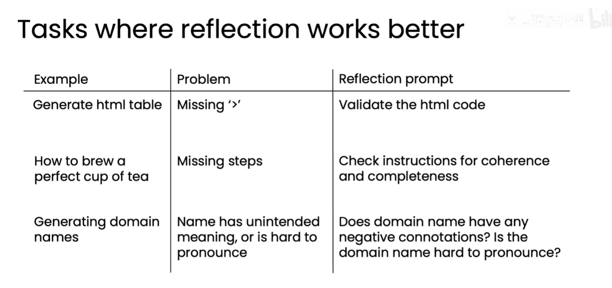
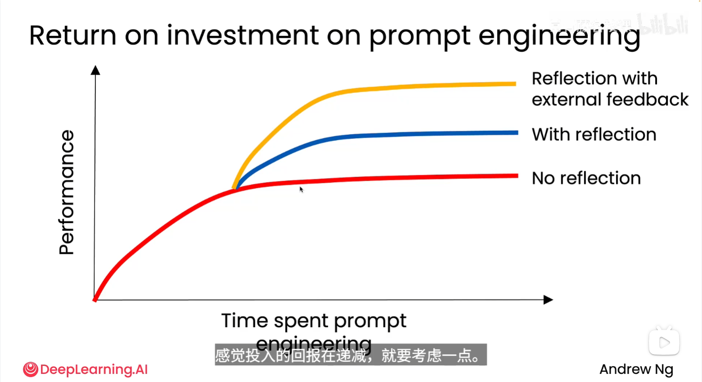

# 反思（Reflection）

反思是让语言模型检查自己的输出，或者引入外部反馈，再根据反馈继续迭代，从而得到更好的版本。

反思时，如果能输入新的外部信息，效果通常会好很多。单纯让模型重复检查原来的答案，可能只是重复原有的判断和错误；加入编译器报错、单元测试结果、检索到的资料、用户反馈或其他评审意见后，模型获得了新的证据，更容易发现问题并修正原来的结论。

反馈可以来自：

- 语言模型对当前输出的自我检查；
- 编译器、单元测试或程序运行结果；
- 外部评估程序和明确的规则；
- 另一个专门负责评审的评估型智能体。

典型流程是：

```text
生成初稿 → 检查或评审 → 获得反馈 → 修改 → 重新检查
```

例如，在代码任务中，一个 LLM 负责生成代码，另一个批评者 Agent 检查代码的正确性、风格和效率，指出错误及改进方向；生成者再根据反馈产生新版本，直到通过测试或达到要求。

反思模式适合需要多轮改进的任务，但会增加执行时间和模型调用成本。评审标准越明确，反思过程通常越稳定。

## 更适合使用反思的任务

- **生成 HTML 表格**：检查缺少结束符号 `>` 等语法错误，验证 HTML 代码是否符合语法。
- **编写完美冲泡一杯茶的说明**：检查是否遗漏必要步骤，以及说明是否连贯、完整。
- **生成域名**：检查名称是否有负面联想，以及是否容易发音。



## 编写反思 Prompt 的技巧

- **明确审查对象和任务**：直接告诉 LLM 需要审查或反思哪一份初稿，以及审查后需要输出什么。
- **提供具体评判标准**：列出准确性、完整性、连贯性、格式、风格或其他任务相关标准，让 LLM 逐项检查。
- **要求给出问题和修改建议**：让 LLM 指出具体问题、解释原因，并提出可执行的修改方案，必要时给出修订版本。
- **参考高质量 Prompt**：阅读优秀的反思或评审提示词，学习其上下文、评判标准、输出格式和边界条件，再结合自己的任务改写。

## 使用不同的 LLM 进行反思

反思不一定要由同一个 LLM 完成。可以让不同模型承担生成和评审角色，利用它们在代码、视觉理解、推理或语言表达方面的不同优势。

- **代码和图表场景**：LLM1 读取数据、编写代码并生成图表；支持多模态的 LLM2 读取图表和评判标准，检查可读性、准确性和是否符合要求，提出代码修改建议；LLM1 根据建议修改代码并重新生成图表。
- **文本生成场景**：LLM1 先输出文本，LLM2（例如更擅长推理的模型）依据指定标准进行反思和评审，再输出修改后的版本。

这种方式可以形成“生成模型 + 评审模型”的协作闭环，但需要明确模型之间传递的输入、评判标准、输出格式和迭代终止条件。

## 外部输入对反思的影响

反思效果通常取决于是否能获得新的外部信息。通过代码、工具或其他可验证的反馈把外部信息提供给 LLM，可以让模型基于证据改进输出，而不是重复原来的判断。

例如，LLM 生成一段代码后，可以运行代码、执行单元测试、检查编译器报错或读取生成的图表，再把这些结果作为反馈输入给 LLM。LLM 根据反馈修改代码并重新运行，形成“生成 → 执行 → 获取反馈 → 修改”的循环。



图示表达的趋势是：不使用反思时，性能较低；加入反思后，性能进一步提升；如果反思包含外部反馈，通常能达到更高的效果。随着提示词工程投入增加，外部反馈带来的收益也可能更明显。

## 帮助反思的其他工具

下表将图片中的内容翻译并整理为中文：

| 挑战 | 示例 | 反馈来源 |
| --- | --- | --- |
| 提到竞争对手 | “我们公司的鞋比 RivalCo 更好” | 对竞争对手名称进行模式匹配 |
| 检查文章事实 | “泰姬陵建于 1648 年” | 网页搜索结果 |
| LLM 不遵守输出长度要求 | 文章超过字数限制 | 字数统计工具 |

这些工具可以把原本主观或难以发现的问题转化为明确的外部反馈，再交给 LLM 进行反思和修改。

## 客观标准的反思评估

要客观评估反思是否有效，可以建立一组带有标准答案的问题数据集，并比较加入反思前后的结果。

### 评估步骤

1. **创建问题和答案数据集**：准备一组有代表性的 Prompt，并为每个问题记录标准答案（Ground Truth）。
2. **运行无反思版本**：直接让 Agent 生成答案，记录每个问题的输出、耗时和是否正确。
3. **运行反思版本**：加入反思步骤后再次运行，记录相同指标。
4. **比较评估结果**：计算两种版本的正确率、正确率提升、平均耗时和额外调用成本。
5. **迭代反思 Prompt**：每次修改反思 Prompt，都重新运行完整数据集，确认改动是否真的带来改进。

### 可记录的指标

- **正确率**：输出正确的问题数 ÷ 问题总数；
- **正确率提升**：反思版本正确率 − 无反思版本正确率；
- **耗时**：单个问题和整批问题的平均执行时间；
- **成本**：额外的模型调用次数、Token 消耗或 API 费用；
- **错误类型**：统计计算错误、SQL 错误、遗漏信息等具体问题的频率。

### SQL 查询示例

对于“哪个产品颜色的总销量最高”这类问题，可以设计如下流程：

```text
用户问题
  → LLM 生成 V1 版 SQL 查询
  → LLM 反思 V1 SQL，并生成 V2 版 SQL
  → 执行 V2 SQL
  → LLM 根据查询结果回答问题
```

数据集可以包含“2025 年 5 月销售了多少件”“最昂贵的商品是什么”“一共销售了多少种款式”等问题，并记录标准答案、无反思结果和有反思结果。例如，无反思版本正确率为 87%，加入反思后正确率为 95%，则正确率提升了 8 个百分点。同时还应记录反思带来的额外耗时和调用成本，判断准确率收益是否值得。

## 主观任务的反思效果评估

对于图表质量、表达效果或设计是否合理等主观任务，通常没有唯一的标准答案，需要设计更稳定的评估方法。

### 避免直接比较两个输出

可以把没有反思的输出和有反思的输出都交给 LLM，让它直接判断哪个更好，但这种做法效果可能不好。LLM 往往会受到输入顺序影响，倾向于选择第一个输出，导致比较结果不够可靠。

### 使用二元标准组成评分量表

更好的方法是给 LLM 一组明确的评判标准（rubric），不要让它直接给出 1 到 5 的主观总分。将每个标准设计成一个可以回答“是/否”的问题，并分别记为 1 或 0，再把各项分数相加。

例如评估图表时，可以检查：

1. 是否有清晰的标题；
2. 是否存在坐标轴标签；
3. 是否选择了合适的图表类型；
4. 坐标轴是否使用了合适的数值范围；
5. 图例、单位和数据标注是否清楚；
6. 图表是否准确呈现了数据；
7. 图表是否容易阅读；
8. 是否存在误导性的视觉设计。

要求评估 LLM 为每个标准返回 `0` 或 `1`，最好使用结构化 JSON 输出。例如：

```json
{
  "clear_title": 1,
  "axis_labels": 1,
  "appropriate_chart_type": 0,
  "appropriate_axis_range": 1
}
```

将所有二元标准相加得到总分，再分别统计无反思和有反思版本在整套数据集上的得分。相比直接给出 1 到 5 分，这种方法能让评分依据更明确、结果更一致，也更容易定位具体改进项。

### 持续优化评估流程

评估流程搭建完成后，每次修改反思 Prompt 都重新运行同一套问题和评分量表，记录无反思分数、有反思分数、分数差异、耗时和成本。通过持续比较分数，判断 Prompt 修改是否真正改善了结果，并避免只凭个别样例做出结论。
