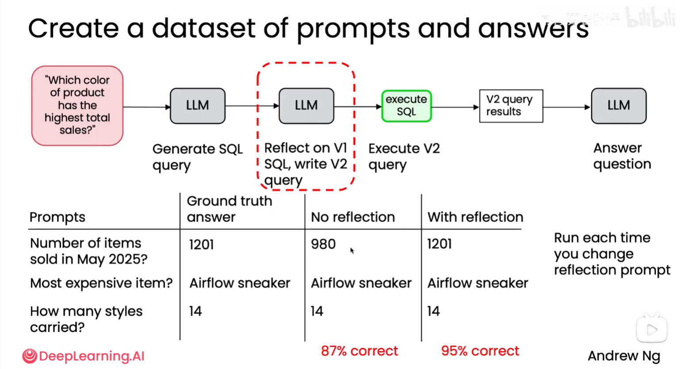
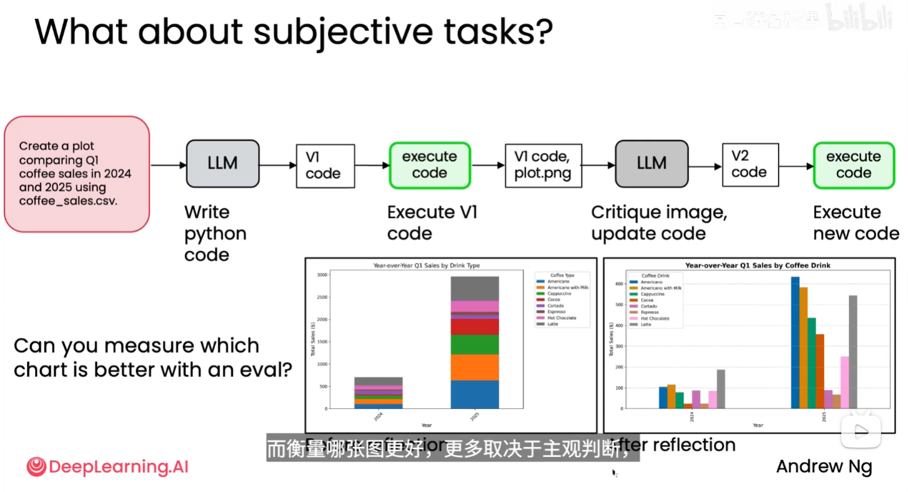
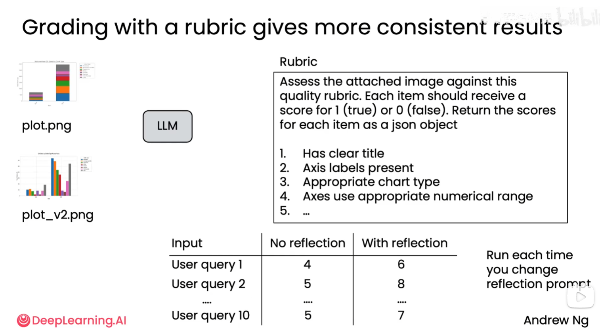

# 智能体评估（Eval）

## 1. 为什么需要评估

智能体做得是否好，最大的预测因素之一，是能否推动一套非常严谨的评估能力。

智能体通常包含多个步骤、多个模型和多个工具。只看某一次输出，无法稳定判断系统是否可靠；需要建立可重复的评估方法，用数据发现问题，并根据评估结果持续修改工作流。

## 2. 基本评估方法

最直接的流程是：

1. 先构建一个可运行的智能体；
2. 运行一组具有代表性的任务并查看输出；
3. 找出不满意的地方，明确问题类型；
4. 增加评估指标或评估程序；
5. 修改智能体后重新运行，比较改进效果。

评估的重点是把“感觉不太好”转化为可以重复检查的问题。例如：

- 统计输出中提到竞争对手的次数；
- 统计全部输出中错误的比例；
- 用代码检查必填字段、格式、数值范围和引用是否存在；
- 统计某类特定错误的出现频率；
- 比较修改前后的成功率、耗时和成本。

### 2.1 客观标准：用程序检查

对于有明确答案或明确规则的标准，优先编写代码进行评估。代码检查具有一致、快速、可重复的特点，适合检查格式、结构、关键词、数值和错误率等指标。

### 2.2 主观标准：使用 LLM 评估

如果标准涉及表达质量、相关性、完整性或可读性等主观判断，往往难以完全用代码评估，可以让 LLM 对输出进行评分，并提供初版的评判标准和理由。

LLM 评估不应只给出一个分数，还应尽量要求它说明扣分原因、引用具体问题，并使用固定的评分量表，以提高不同样本之间的可比性。更完善的评估方式可以在后续继续建设。

### 2.3 评估的两个维度

评估方法可以从两个维度来区分：一是使用代码还是使用 LLM 作为评判者，二是是否有带答案的示例（ground truth）。两者组合后形成四种常见方式：

| 是否有示例答案 | 用代码评估（客观） | 用 LLM 评估（主观） |
| --- | --- | --- |
| 有示例答案 | **对照标准答案检查**：例如比较发票中提取的日期与真实日期是否一致。 | **统计标准答案中的要点**：例如检查回答覆盖了多少个金标准（gold standard）要点。 |
| 没有示例答案 | **检查固定规则**：例如判断营销文案长度是否不超过 10 个字符。 | **按评分标准打分**：例如依据图表是否有清晰坐标轴、标注和其他要求进行评分。 |

这里的“有示例答案”并不要求输出必须与答案逐字相同，也可以比较字段、要点或结构；“没有示例答案”时，则需要先定义可执行的规则或评分量表。代码评估适合确定性强的检查，LLM 评估适合相关性、完整性、表达质量等难以形式化的判断。

## 3. 评估标准

### 3.1 端到端评估

评估整个 Agent 从输入任务到最终输出的质量，关注它是否完成了用户目标，以及结果是否准确、完整、可用。

常见指标包括：

- 任务成功率；
- 最终答案的准确性和完整性；
- 输出格式是否符合要求；
- 事实错误或特定错误的比例；
- 单次任务的耗时、调用次数和成本。

端到端评估最接近真实用户体验，但当结果不好时，不能直接说明是哪一个环节出了问题。

### 3.2 组件评估

衡量智能体工作流中单个组件的输出质量，例如规划器、检索器、工具调用器、信息提取器、总结器或最终生成器。

组件评估可以回答：

- 规划步骤是否合理；
- 检索结果是否相关；
- 工具参数是否正确；
- 信息提取是否遗漏或编造内容；
- 某个模型是否适合当前组件。

组件评估有助于缩小问题范围，避免只根据最终结果进行猜测。

### 3.3 查看中间输出和 LLM traces

通过查看智能体执行过程中的中间输出、工具调用记录和 LLM traces，逐步读一遍工作流，弄清楚哪里没有达到预期，并进行错误分析。

重点检查：

- LLM 是否正确理解了任务；
- 计划是否遗漏关键步骤；
- 是否选择了错误的工具；
- 工具返回后是否正确理解结果；
- 哪一步开始产生错误；
- 后续步骤是否放大了早期错误。

这种逐步检查能够找到可以改进的具体位置，并为新增指标、修改提示词或调整工作流结构提供依据。

## 4. 评估闭环

一个可持续的评估闭环是：

```text
构建智能体
  → 运行代表性任务
  → 评估最终输出
  → 检查组件和中间 traces
  → 分析错误原因
  → 修改提示词、模型、工具或流程
  → 重新评估并比较结果
```

评估不是上线前的一次性检查，而是智能体开发过程中的持续能力。每次发现重要问题，都应尽量把它转化为测试样例或评估指标，防止后续修改再次引入同类错误。






