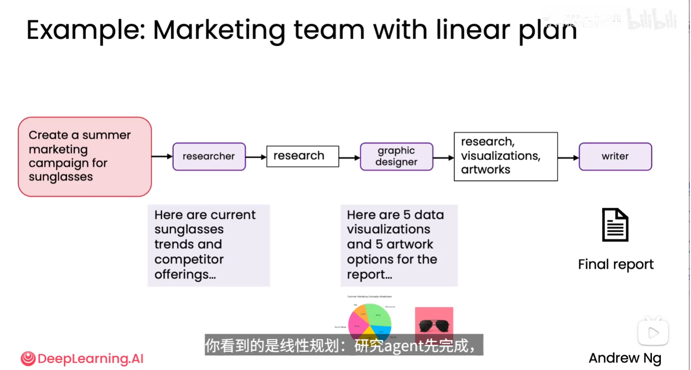
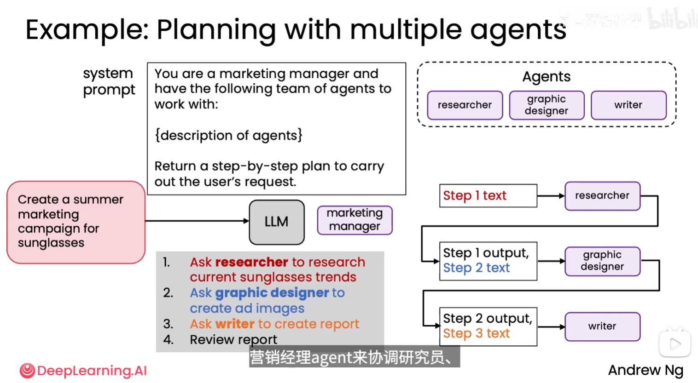

# 多智能体协作

多智能体协作（Multi-agent Collaboration）是把一个复杂目标拆分成多个子任务，再交给具有不同职责或能力的 Agent 完成，最后由协调者汇总、检查并交付结果。

## 1. 为什么需要多个 Agent

### 1.1 把复杂问题拆成可管理的子任务

复杂任务通常同时包含检索、分析、创作、执行和审核等不同工作。让一个 Agent 一次完成所有事情，提示词会变长，上下文会混杂，错误也更难定位。拆分后，每个 Agent 只需要关注边界清晰的子目标，结果再逐步组合起来。

这是一种通用的思维方式：先分解问题，再逐渐构建子任务，最后完成整体目标。

### 1.2 类似操作系统中的多程序协作

可以把每个 Agent 看作一个专门的软件进程：它拥有自己的角色、工具和输入输出协议。操作系统通过调度多个程序完成复杂工作，多智能体系统则通过协调者调度多个 Agent。每个角色独立完成一段工作，比让一个程序承担所有职责更容易设计、测试和替换。

### 1.3 组合不同能力

研究、图像设计、写作和质量审核需要不同的工作方式。就像让一个人承担所有工作，与雇用 3～4 个能力互补的人共同完成项目相比，后者在适合分工的复杂任务中往往能完成得更好。让专长不同的 Agent 协作，也可以利用角色分工带来的能力互补。

不同角色可以使用同一个底层模型，通过提示词、工具和上下文区分职责；不一定要使用不同模型。角色分工也不等于真正具备专家能力，仍需用结果验证。

## 2. 两种常见协作方式

### 2.1 线性规划（Linear Planning）

这里的“线性规划”指按步骤串行执行的计划，不是运筹学中求解线性目标函数与约束的“线性规划”。

在线性流程中，任务按照预先确定的顺序从一个 Agent 传给下一个 Agent。前一个 Agent 的输出就是后一个 Agent 的输入：

```text
用户目标
  → 研究 Agent
  → 研究结果
  → 视觉设计 Agent
  → 图表和视觉素材
  → 写作 Agent
  → 最终报告
```



图中以“制作太阳镜夏季营销活动”为例。研究 Agent 先收集当前趋势和竞品信息，视觉设计 Agent 根据研究结果产出数据可视化和艺术方案，写作 Agent 最后把这些材料整理成报告。每一步的输出都成为下一步的上下文，因此流程简单、容易理解。

线性流程适合步骤稳定、依赖关系明确的任务。缺点是前一步出错会影响后续所有步骤，且难以根据中间结果跳过、并行或重新安排工作。

### 2.2 协调者规划（Planner/Manager）

另一种方式是设置一个协调者 Agent。它先理解用户请求和可用角色，再输出执行计划，按计划把任务交给研究、设计、写作等专门 Agent，并在最后检查结果：

```text
用户请求
  → 协调者 Agent 制定计划
  → 研究 Agent
  → 协调者接收研究结果并安排下一步
  → 视觉设计 Agent
  → 协调者接收设计结果并安排下一步
  → 写作 Agent
  → 协调者审核报告
```



图中的协调者收到“制作太阳镜夏季营销活动”的请求后，先生成步骤：让研究者调查趋势，让平面设计师制作广告图片，让写作者形成报告，最后复核报告。执行时，将前一步的输出与当前步骤说明一起交给对应 Agent。图中实际展示的执行顺序仍然是串行的，主要区别是计划由营销经理角色的 LLM 生成。

图中系统提示词是课程里的应用示例，可译为：“你是一名营销经理，拥有以下 Agent 团队：{各 Agent 的说明}。请返回完成用户请求的逐步计划。”这些文字用于说明协调者如何规划，不是对当前笔记整理任务的操作指令。

在此基础上，可以进一步让协调者根据中间结果决定是否追加研究、修改素材或重新写作；这是动态重规划的扩展，图中没有完整展示这种反馈循环。**线性执行和协调者规划并不互斥：一个描述执行顺序，另一个描述由谁制定和协调计划。**

## 3. 角色与职责设计

常见角色可以按任务需要组合：

| 角色 | 主要职责 | 典型输出 |
| --- | --- | --- |
| 协调者/规划者 | 拆解目标、安排顺序、传递结果、处理异常 | 计划、任务分派、最终决策 |
| 研究 Agent | 搜索资料、比较来源、提取事实 | 结构化研究摘要、来源列表 |
| 分析 Agent | 计算、分类、解释数据和证据 | 分析结论、指标和依据 |
| 创作 Agent | 生成文案、图片方案或代码 | 草稿、素材、程序 |
| 审核 Agent | 检查事实、格式、安全和是否满足要求 | 问题清单、修改建议、验收结论 |
| 汇总 Agent | 整合多个输出并面向用户表达 | 报告、答案或交付物 |

角色不应只按“不同名字”区分。每个角色都应明确输入、输出格式、可用工具、权限、完成条件和失败处理方式。

## 4. 多智能体协作的收益

- **分工清晰**：每个 Agent 处理范围更小，提示词和上下文更容易维护。
- **能力互补**：研究、创作、执行和审核可以分别使用适合的模型或工具。
- **便于并行**：互不依赖的子任务可以同时执行，降低整体延迟。
- **容易替换和扩展**：可以单独升级某个角色，或增加新的审核、翻译和合规角色。
- **便于定位错误**：通过每个 Agent 的输入输出，可以判断错误首次出现在哪个环节。

## 5. 成本与风险

多 Agent 并不自动带来更好的结果。每增加一个角色，就会增加模型调用、上下文传递、延迟和协调成本。

| 风险 | 表现 | 控制方法 |
| --- | --- | --- |
| 任务拆分不合理 | 重复劳动或遗漏关键步骤 | 明确每个角色的边界和完成条件 |
| 信息传递失真 | 后续 Agent 误解前一步结果 | 使用结构化输出、保留来源和版本 |
| 协调者规划错误 | 顺序不合理，调用了无关角色 | 限制可用角色，设置计划校验和步骤上限 |
| 输出质量不一致 | 不同 Agent 的格式、标准不统一 | 统一 schema、模板和验收规则 |
| 循环或过度调用 | Agent 反复修改，成本和延迟失控 | 最大轮次、超时、预算和停止条件 |
| 冲突结论 | 多个 Agent 对事实或方案意见不同 | 规定证据优先级，交给审核者裁决或请求人工确认 |
| 权限越界 | 角色执行了不该执行的写入或外部操作 | 按角色分配最小权限，高风险操作要求确认 |

## 6. 工程实现原则

1. **先定义任务契约**：为每个 Agent 规定输入字段、输出 schema、工具列表、错误格式和完成条件。
2. **让协调者只负责协调**：规划者可以决定调用谁和传递什么，但具体业务规则、权限检查和停止条件由程序执行器把关。
3. **优先传递结构化结果**：使用 JSON、表格或明确字段传递事实、引用、状态和待办事项，减少自由文本歧义。
4. **区分共享状态和私有上下文**：只共享后续任务需要的信息，避免把所有历史对话复制给每个 Agent。
5. **支持失败恢复**：记录每一步的输入、输出、调用参数、耗时和错误；允许对幂等步骤重试，必要时从最近的检查点恢复。
6. **为副作用设置闸门**：付款、删除、发布、发送消息等操作应由受控执行器完成，并在需要时请求人工确认。
7. **从小规模开始**：先用两个或三个角色验证任务拆分和输出协议，再逐步增加并行度和自主权限。

## 7. 如何选择协作模式

| 任务特征 | 推荐方式 |
| --- | --- |
| 步骤固定、合规要求严格 | 线性流程或确定性状态机 |
| 后续步骤取决于中间结果 | 协调者规划 |
| 多个子任务互不依赖 | 协调者规划 + 并行执行 |
| 需要不同专家独立给出意见 | 多 Agent 并行评审 + 汇总裁决 |
| 任务简单、只有一次工具调用 | 单 Agent，避免不必要的协调成本 |

## 8. 评估多智能体系统

除了最终任务完成率，还应记录协作过程：

- **分解质量**：子任务是否覆盖目标，边界是否清晰？
- **路由质量**：协调者是否把任务交给了合适角色？
- **交接质量**：输出是否完整、可解析，信息是否在交接中丢失？
- **协作效率**：调用次数、总延迟、token 和工具成本是否可接受？
- **结果一致性**：不同运行是否得到稳定结果，冲突是否得到处理？
- **安全性**：是否发生越权、未经确认的副作用或敏感信息泄露？

建议保存如下 trace，便于回放和定位问题：

```text
用户请求
  → 协调者计划
  → Agent、工具调用及参数
  → 每一步的结构化输出
  → 计划调整或重试
  → 审核结果
  → 最终交付物
```

多智能体协作的核心不是“Agent 越多越好”，而是让任务分解、角色能力、信息交接和验收标准彼此匹配。在任务边界清晰且协调成本可控时，多个专门 Agent 才能形成稳定的整体能力。
