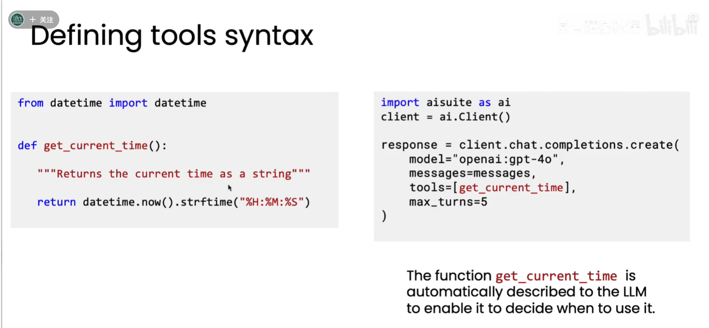
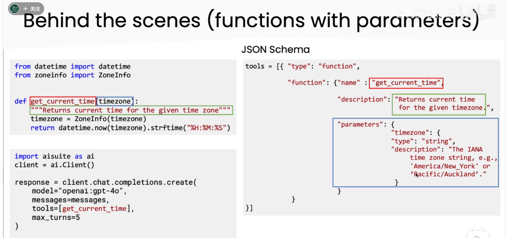
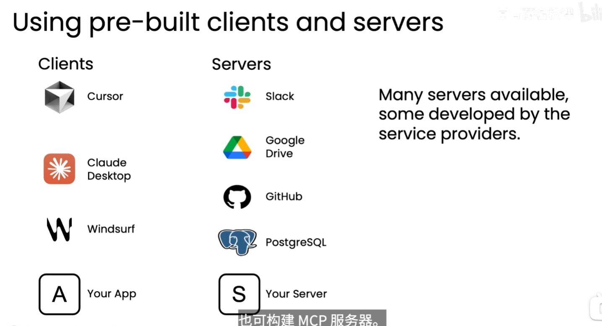

# 工具使用（Tool Use）

## 1. 定义

工具使用是指：让 LLM 自己决定是否调用某个工具，由外部函数或程序实际执行操作，再把结果返回给 LLM。工具可以用于获取实时信息、访问数据源、执行计算、修改系统状态或完成模型不擅长的任务。

工具本身不是 LLM 的“能力”或记忆，而是 LLM 可以请求宿主程序执行的一段代码、函数或外部服务。LLM 负责决策和生成参数，宿主程序负责校验、执行、处理错误和返回结果。

## 2. LLM 如何决定调用工具

LLM 并不会直接运行函数。典型的工具调用循环如下：

```text
用户请求
  → 应用把工具名称、用途和参数 Schema 提供给 LLM
  → LLM 判断是否需要工具，并生成结构化调用请求
  → 应用校验参数并执行函数或服务
  → 应用把执行结果作为 tool message 返回给 LLM
  → LLM 根据结果继续调用、修正参数，或生成最终回答
```

决定调用哪个工具，主要依据以下信息：

1. 用户目标是否需要外部信息或实际操作；
2. 工具的名称和描述是否与当前任务匹配；
3. 参数 Schema 要求哪些参数、参数类型是什么；
4. 已有工具结果是否足以回答问题；
5. 系统提示词、权限策略和调用次数限制是否允许调用。

因此，工具描述不是注释，而是模型进行工具选择的重要上下文。描述应明确说明工具能做什么、不能做什么、参数含义、单位、格式和副作用。

## 3. 从函数定义到工具 Schema

在部分 SDK 中，可以直接把带有清晰名称、类型标注和文档字符串的函数传给模型客户端。SDK 会读取函数签名和文档字符串，自动生成工具定义及 JSON Schema。



图中 `get_current_time` 函数通过函数名和文档字符串说明“返回当前时间”。调用 `tools=[get_current_time]` 后，客户端会把这些信息描述给 LLM，使模型能够判断什么时候需要当前时间。

对于带参数的函数，函数参数的类型标注和文档字符串会进一步生成参数 Schema：



例如，`get_current_time(timezone)` 的参数可以生成如下定义（示意）：

```json
{
  "type": "function",
  "function": {
    "name": "get_current_time",
    "description": "返回指定时区的当前时间。",
    "parameters": {
      "type": "object",
      "properties": {
        "timezone": {
          "type": "string",
          "description": "IANA 时区字符串，例如 America/New_York 或 Pacific/Auckland。"
        }
      },
      "required": ["timezone"]
    }
  }
}
```

自动生成 Schema 的前提是 SDK 能正确读取函数签名和文档。如果 API 不支持直接传入函数，或需要更严格的约束，就要手动构建 JSON Schema。手动 Schema 应至少明确工具类型、函数名、描述、参数对象、属性类型和必填字段。

## 4. 一次工具调用的消息形态

模型通常不会直接返回函数结果，而是返回一个包含工具名和参数的调用请求：

```json
{
  "tool_calls": [
    {
      "name": "get_current_time",
      "arguments": {
        "timezone": "Asia/Shanghai"
      }
    }
  ]
}
```

应用收到请求后，应按工具注册表查找函数，解析并校验 `arguments`，执行函数，再将结果关联到这次调用并回传给模型：

```text
assistant: tool_call(get_current_time, {timezone: "Asia/Shanghai"})
tool: 09:30:12
assistant: 现在是上海时间 09:30:12。
```

生产系统通常还需要处理参数校验失败、工具超时、网络错误、权限拒绝、重复调用和返回结果过大等情况。工具应尽量设计为幂等操作；对发送消息、删除文件、扣款等有副作用的操作，应增加授权和人工确认。

## 5. LLM 的代码执行工具

代码执行工具的做法是：在提示词中告诉 LLM 可以编写代码解决问题，约定模型用特定标签返回代码，例如：

```text
<execute_python>
print(sum([1, 2, 3]))
</execute_python>
```

宿主程序用正则或结构化解析提取标签内的代码，在执行环境中运行，再把标准输出、错误和退出状态返回给 LLM。模型可以据此继续调试、修改代码或解释结果。

代码执行比普通函数调用更灵活，但风险也更高。LLM 生成的代码可能误删文件、泄露数据、消耗过多 CPU 或访问内部网络，因此应在沙箱中运行，并设置文件系统隔离、网络策略、资源配额、超时和允许的依赖。不要仅依赖提示词约束代码行为；权限边界必须由执行环境强制实施。

## 6. MCP：模型上下文协议

MCP（Model Context Protocol，模型上下文协议）是一种开放协议，用于让 AI 应用以统一方式访问工具和数据源。它把“如何发现工具、读取资源、调用工具、传输结果”标准化，减少每个客户端都要为每个服务单独编写适配器的工作。

MCP 中有两个核心角色：

| 角色 | 职责 | 示例 |
| --- | --- | --- |
| MCP 客户端 | 运行在 AI 应用中，连接服务器、发现能力、发起调用并把结果提供给 LLM | Cursor、Claude Desktop、Windsurf、自建应用 |
| MCP 服务器 | 暴露工具、资源或提示词，连接具体系统并执行实际操作 | Slack、Google Drive、GitHub、PostgreSQL、自建服务 |



图中左侧的客户端是使用能力的应用，右侧的服务器是提供能力的服务。一个客户端可以连接多个 MCP 服务器，一个服务器也可以服务多个客户端。服务提供商可以维护官方服务器，开发者也可以为自己的数据库、内部 API 或业务系统构建 MCP 服务器。

MCP 不等于 LLM，也不等于某一个具体工具。它提供的是连接模型应用与外部能力的协议层；真正的权限控制、参数校验、审计、超时和业务安全仍由客户端、服务器及其执行环境负责。

## 7. 三种方式的关系

| 方式 | 工具描述来源 | 执行位置 | 适用场景 | 主要风险 |
| --- | --- | --- | --- | --- |
| 函数工具调用 | 函数签名、文档字符串或手动 JSON Schema | 应用进程或受控服务 | 明确、边界清晰的 API 操作 | 参数错误、越权和副作用 |
| 代码执行工具 | 提示词中的代码格式约定 | 沙箱或隔离执行器 | 数据处理、计算、临时脚本 | 任意代码、资源消耗和数据泄露 |
| MCP | MCP 服务器声明的工具和资源 | MCP 服务器 | 跨应用复用外部工具和数据源 | 第三方服务权限、供应链和连接管理 |

它们可以组合使用：Agent 通过 MCP 发现数据库工具，通过函数调用传递结构化参数，再在沙箱中运行代码分析查询结果。组合越灵活，越需要明确权限边界、记录调用轨迹并评估失败恢复策略。

## 8. 工具设计检查清单

- 工具名是否能表达动作和对象，例如 `get_current_time`、`search_orders`；
- 描述是否说明用途、限制、单位、时区和副作用；
- 参数是否使用明确的类型、枚举和必填约束；
- 是否在执行前做身份、权限和参数校验；
- 是否设置超时、重试上限、返回大小和调用次数上限；
- 是否记录调用者、参数摘要、结果状态和错误原因；
- 对写入、删除、发送和支付类操作，是否需要二次确认或人工审批；
- 工具失败时，模型是否能得到可理解的错误信息并采取下一步行动。

## 9. 核心理解

工具使用的核心不是“让模型拥有执行权限”，而是建立一个受控闭环：

> **模型选择 → 应用校验 → 外部执行 → 结果回传 → 模型继续推理**

模型擅长理解目标、选择工具和组织参数；程序和执行环境负责可靠执行、权限隔离与安全审计。只有把两部分职责分清，工具调用才能同时具备灵活性、可控性和可观测性。
