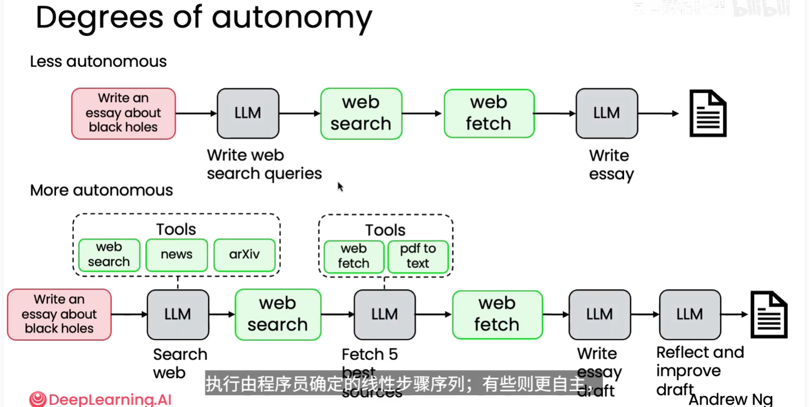
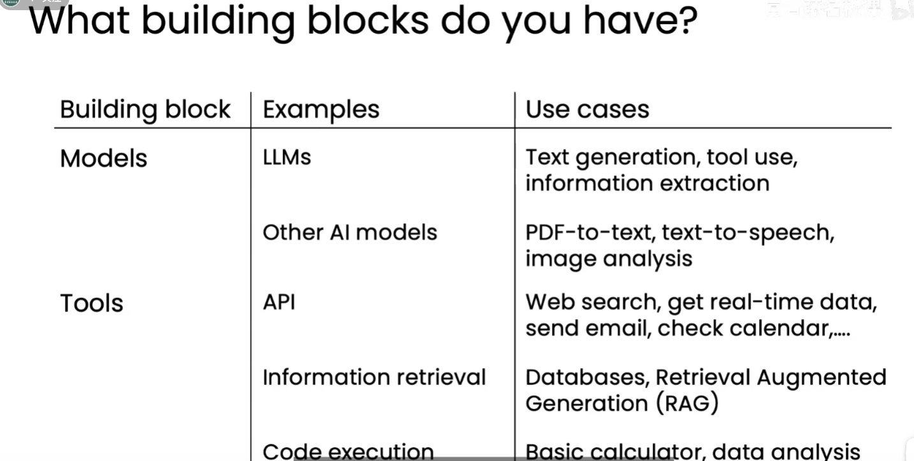

# 智能体 AI（Agentic AI）

## 1. 什么是智能体 AI

智能体 AI 是一类**基于大语言模型（LLM）的应用**。它不会只生成一次回答，而是会把目标拆成多个步骤，在执行过程中调用工具、获取信息、判断结果，并持续推进任务，直到得到最终产物。

可以把它概括为：

> 基于 LLM 的应用，分多个步骤完成任务的过程。

典型过程包括：

1. 理解用户目标；
2. 制定或调整执行计划；
3. 调用搜索、数据库、代码执行器等工具；
4. 读取工具返回的结果；
5. 根据结果决定下一步；
6. 生成、检查并改进最终结果。

## 2. 关注 Agentic，而不只是 Agent

讨论智能体时，不应只关注“什么是 Agent”。更重要的是关注 **Agentic**：这个智能体到底有多强的自主性、推理能力和任务完成能力。

同样都可以被称为“智能体”的系统，智能程度可能差异很大。有些智能体只是把几个固定步骤串起来，遇到异常就停止；有些智能体能够自主规划、选择工具、验证结果、发现错误并重新尝试。

因此，评价重点应从“它是不是 Agent”转向：

- 能否理解开放式目标，而不是只执行固定指令；
- 能否自主拆解任务并安排步骤；
- 能否根据环境和中间结果动态调整计划；
- 能否正确选择和使用工具；
- 能否检查结果、反思错误并改进；
- 能否在较少人工干预的情况下完成任务。

## 3. 自主程度的层次

智能体的自主程度可以从低到高分为三类。区分标准主要是：任务流程由谁决定，以及工具由谁选择。

### 3.1 低自主性 Agent：程序员预先定义流程

大部分步骤由程序员预先定义并硬编码，LLM 只负责其中某些环节。流程、分支和工具调用顺序基本固定，例如：

```text
用户任务 → LLM 生成搜索词 → 网页搜索 → 网页抓取 → LLM 撰写文章
```

这类系统有清晰、可控的步骤，但很难根据实际情况改变流程，智能程度和自主性相对较低。

### 3.2 半自主 Agent：能做决策，但工具预定义

这类 Agent 能根据任务和中间结果进行一定程度的规划、判断和决策，但可用工具集合是程序员预先定义好的。LLM 决定“什么时候调用哪个工具”，但不能任意发现或接入新的工具。

例如，系统预先提供网页搜索、网页抓取和 PDF 转文本三个工具，LLM 可以根据需要选择调用顺序。

### 3.3 高度自主 Agent：LLM 主导决策和工具调用

大部分决策由 LLM 完成。智能体可以根据目标自主制定计划、选择或组合工具、决定执行顺序，并根据结果反思和调整。例如：

```text
用户任务
  → LLM 规划搜索策略
  → 选择网页搜索、新闻、论文等工具
  → 获取并筛选多个来源
  → LLM 整理内容
  → 反思和改进草稿
  → 输出最终文档
```

这种系统不再完全依赖固定的线性步骤，而是能根据中间结果作出下一步决定，因此具有更高的自主性。

## 4. 核心理解

智能体 AI 的关键不在于给系统贴上“Agent”的标签，而在于它能否围绕目标形成一个有效的闭环：

> **目标理解 → 规划 → 行动 → 观察 → 评估 → 调整 → 完成任务**

Agentic 程度越高，系统越能自主处理不确定性、使用多种工具、验证输出并持续改进。但自主性越高，也越需要关注权限边界、执行成本、结果可靠性和人工监督。



## 5. 智能体工作流的好处

### 5.1 高效完成以前难以完成的任务

智能体可以把复杂目标拆成多个可执行步骤，并结合模型推理、工具调用和结果检查，完成过去需要大量人工协调、甚至难以完成的任务。

### 5.2 并行化加快任务完成速度

对于可以独立处理的子任务，可以同时交给多个智能体或多个工作流分支执行，最后再汇总结果。并行化能够减少等待时间，特别适合资料搜索、信息提取和多方案比较。

### 5.3 模块化组合最佳组件

工作流可以拆成多个模块，并把来自不同模型、工具或服务的优势组合起来。例如使用一个模型负责规划，另一个模型负责总结，再用专门的检索、代码执行或文档处理工具完成具体操作，从而搭建更高效的工作流。

## 6. 如何拆解智能体工作流

### 6.1 观察已有实现

先研究一个人或一家公司是如何完成这项任务的，记录其输入、关键步骤、使用的工具、判断依据和最终输出。已有实现能帮助我们发现任务中真正需要的环节。

### 6.2 先实现简单流程，再定位瓶颈

先用尽可能少的步骤做出一个可运行的版本，观察哪个环节效果不好、耗时较长或容易出错，再针对问题增加步骤、分支、工具或校验。这样可以避免一开始就把工作流设计得过于复杂。

### 6.3 了解可用的构建模块

设计工作流前，需要了解手上有哪些模型和工具，以及它们分别适合解决什么问题。图片中的构建模块可以总结为：

| 构建模块 | 典型例子 | 适用场景 |
| --- | --- | --- |
| 模型 | LLM（大语言模型） | 文本生成、工具调用、信息提取 |
| 其他 AI 模型 | PDF 转文本、语音合成、图像分析模型 | 文档转换、文本转语音、图像理解 |
| 工具/API | API 接口 | 网页搜索、获取实时数据、发送邮件、查看日历等 |
| 信息检索 | 数据库、检索增强生成（RAG） | 查询知识库、补充外部信息、基于资料生成内容 |
| 代码执行 | 计算器、代码运行环境 | 基础计算、数据分析和其他可程序化处理 |

选择模块时，应先根据任务需要确定能力，再选择合适的模型或工具，并通过组合、串联和并行调用形成完整工作流。



### 6.4 任务分解：把目标变成可执行步骤

任务分解可以按以下顺序进行：

1. **先拆解为离散步骤**：把完整目标拆成边界清晰、能够单独描述的子任务。
2. **判断每个步骤的实现方式**：逐一询问该步骤能否通过 LLM 完成，或者能否通过工具调用实现，例如 API、函数、数据库查询或代码执行。
3. **继续细分无法直接实现的步骤**：如果某个步骤既不能由 LLM 可靠完成，也不能通过现有工具调用实现，就把它进一步拆解为更小的步骤，直到每一步都有明确的执行方式。
4. **组合并验证**：将这些步骤按依赖关系串联或并行组合，检查每个步骤的输入、输出和失败处理是否清楚。

可以用下面的判断链来辅助设计：

```text
完整任务
  → 离散步骤
  → LLM？工具/API/函数？
  → 无法实现时继续细分
  → 串联或并行组成工作流
```
