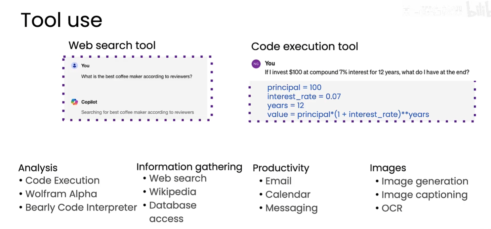
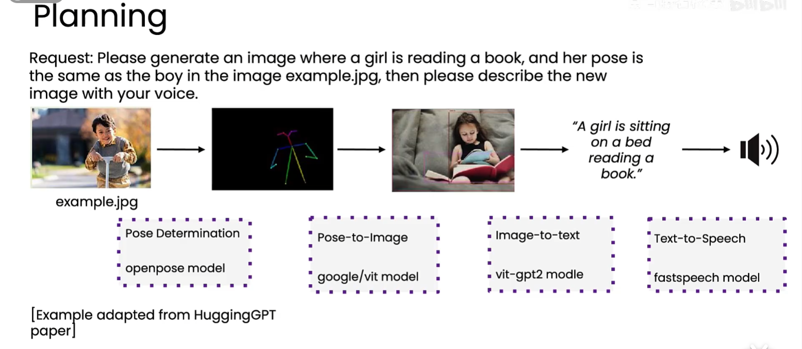
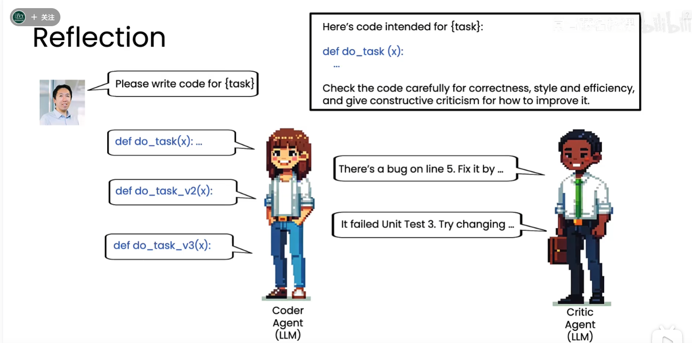

# 智能体设计模式

智能体工作流可以通过不同设计模式增强任务完成能力。常见的四种设计模式是：反思、工具使用、规划和多智能体协作。

## 1. 反思（Reflection）

让 LLM 检查自己的输出，或根据编译器、测试、检索资料和其他评审意见等外部反馈持续迭代，从而得到更好的结果。详细内容见：[agent-反思.md](agent-反思.md)。

## 2. 工具使用（Tool Use）

让 LLM 根据任务需要调用 API、函数、搜索、数据库、代码执行、图像处理等外部工具，获得实时信息或完成模型本身不擅长的操作。



## 3. 规划（Planning）

由 LLM 决定完成任务需要执行哪些步骤，以及每一步调用哪些 API 或工具。规划型 Agent 更灵活，但也更难控制，通常需要权限限制、过程记录和评估机制。



## 4. 多智能体协作（Multi-agent Collaboration）

使用一组专精不同角色的 Agent，例如规划、检索、执行、评审和汇总 Agent，共同完成复杂任务。它能组合不同角色的专长，但需要处理协调、共享状态和冲突问题。

## 5. 模式组合

四种模式可以组合使用。例如，一个研究型系统可以由规划 Agent 制定检索步骤，工具使用模块获取资料，多个专门 Agent 并行分析，最后由反思或评审 Agent 检查并改进结果：

```text
规划 → 工具调用 → 多智能体并行处理 → 汇总 → 反思和改进
```

实际设计时，应根据任务复杂度、可控性要求、准确率目标和成本约束选择合适的模式组合。


