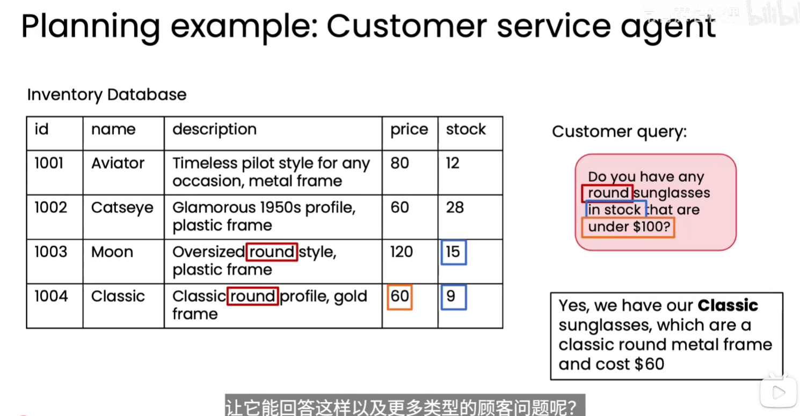
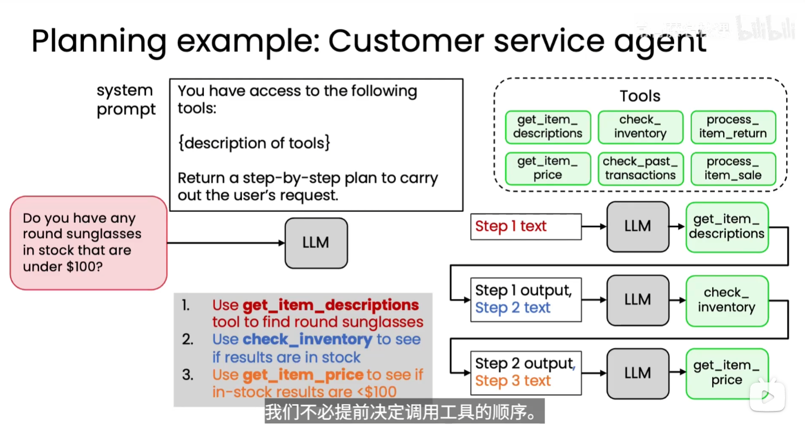
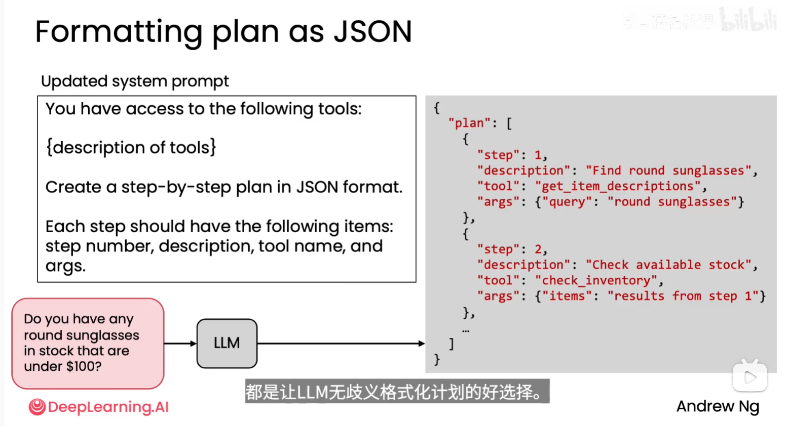
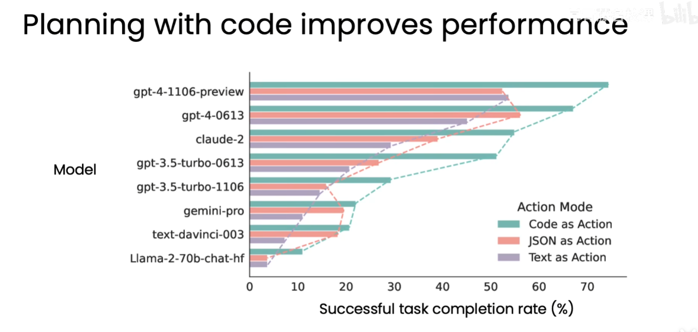

# 构建高度自主工作流

高度自主的 Agent 不要求开发者预先写死每一次工具调用的顺序，而是让 LLM 根据用户请求、可用工具和中间结果，动态列出并执行计划。这样可以覆盖更多未预先枚举的任务路径，但也把一部分运行时控制权交给了模型，因此必须同时设计边界、观测和评估机制。

## 1. 核心思想：让 LLM 负责运行时规划

传统工作流通常由开发者固定调用顺序：

```text
输入 → 工具 A → 工具 B → 工具 C → 输出
```

自主工作流则把工具说明和任务目标交给 LLM，由它生成逐步计划，并在每一步根据上一步结果决定下一步：

```text
用户请求
  → LLM 生成步骤 1
  → 调用工具
  → 将工具结果交回 LLM
  → LLM 生成步骤 2
  → 调用工具
  → ……
  → 汇总并回答
```

计划不是一次性执行的脚本，而是一个可根据新信息调整的中间状态。模型可以提前决定大方向，也可以在每一步重新规划。

## 2. 客户服务示例：查询库存和价格

假设系统提供以下工具：

| 工具 | 用途 |
| --- | --- |
| `get_item_descriptions` | 查询商品描述，找到符合外观或类别的商品 |
| `check_inventory` | 查询商品库存 |
| `get_item_price` | 查询商品价格 |
| `check_past_transactions` | 查询历史交易 |
| `process_item_return` | 处理退货 |
| `process_item_sale` | 处理销售 |

用户提出：“有没有库存中、价格低于 100 美元的圆形太阳镜？”LLM 可以根据工具描述生成如下计划：

1. 使用 `get_item_descriptions` 找到描述中包含圆形特征的太阳镜。
2. 对候选商品调用 `check_inventory`，筛选仍有库存的商品。
3. 对库存商品调用 `get_item_price`，筛选价格低于 100 美元的商品。
4. 根据筛选结果生成面向客户的回答。

计划执行时，每一步的输出会成为下一步的上下文。库存结果为空时，可以提前结束；如果候选很多，也可以先按描述或类别进一步缩小范围。开发者不必为每一种商品查询组合单独编写流程。





## 3. 自主性带来的收益

- **适应任务变化**：面对未预先枚举的问题，模型可以组合已有工具。
- **减少固定编排**：开发者只需维护工具契约、系统约束和目标，降低流程分支数量。
- **利用中间结果**：模型可以根据工具返回值跳过无关步骤、补充查询或改变顺序。
- **支持更复杂的任务**：当任务涉及检索、判断、执行和总结时，动态计划比单一调用更灵活。

自主性不等于无限制。模型只能在授权工具、参数校验和资源预算内行动。

## 4. 为什么规划会降低可控性

规划内容由模型在运行时产生，开发者事先不知道它会选择哪些步骤、调用多少次工具或如何解释返回结果。主要风险包括：

| 风险 | 表现 | 控制方法 |
| --- | --- | --- |
| 工具选错 | 漏查库存，或调用与任务无关的工具 | 明确工具描述；限制可用工具集合；评估工具选择准确率 |
| 顺序不合理 | 先做昂贵操作，再进行简单过滤 | 设置规划约束、成本预算和步骤上限 |
| 参数错误 | 商品 ID、价格条件或筛选范围不正确 | JSON Schema 校验；枚举值和类型检查；失败重试 |
| 过度调用 | 重复查询、循环调用或无限规划 | 最大步骤数、超时、调用次数和 token 预算 |
| 权限越界 | 未经确认执行销售、退货等有副作用操作 | 读写工具分级；高风险动作要求用户确认 |
| 结果误读 | 工具返回正确，但模型筛选或总结错误 | 记录完整 trace；对中间结果做结构化校验 |
| 不可复现 | 同一请求产生不同计划 | 固定模型配置、保存计划和工具版本，使用回放评估 |

因此，自主规划的设计目标不是“让模型想做什么就做什么”，而是让模型在明确的行动空间内自主决策。

## 5. 约束自主规划的设计层次

### 5.1 工具层

- 为每个工具写清楚用途、输入字段、返回结构、失败条件和副作用。
- 使用结构化参数校验，拒绝未知字段、非法类型和超出范围的值。
- 将查询工具与修改数据的工具分开，并为高风险工具增加人工确认。

### 5.2 规划层

- 要求模型先输出目标、步骤、依赖关系和完成条件。
- 规定最大步骤数、最大工具调用次数、超时和预算。
- 允许在工具结果到达后重新规划，但要求说明变更原因。
- 对必须遵守的顺序使用工作流约束或状态机，不完全交给模型决定。

### 5.3 执行层

- 执行器只接受经过 schema 校验和权限检查的工具调用。
- 对幂等查询可以安全重试；对销售、退货等操作使用幂等键和确认机制。
- 每次调用记录请求、参数、结果摘要、耗时、成本和错误。
- 发现循环、异常增长或不符合策略的行为时，立即暂停并返回可诊断错误。

### 5.4 输出层

- 只依据已验证的工具结果回答，不把计划中的假设当作事实。
- 对没有找到结果、库存变化或价格不确定等情况明确说明。
- 面向客户隐藏内部实现细节，但保留审计所需的运行记录。

## 6. 评估自主工作流

端到端结果之外，还要评估中间过程，因为最终答案正确可能只是偶然，错误也可能在早期步骤就已经发生。

| 评估维度 | 关键问题 |
| --- | --- |
| 任务完成率 | 是否完成用户真正的目标？ |
| 计划质量 | 步骤是否完整、必要且顺序合理？ |
| 工具选择 | 是否选择了正确工具并避免无关调用？ |
| 参数正确性 | 参数是否符合 schema 和业务约束？ |
| 资源效率 | 调用次数、延迟和 token 成本是否可接受？ |
| 安全边界 | 是否发生越权或未经确认的副作用操作？ |
| 可恢复性 | 工具失败、空结果或中断后能否安全结束或重试？ |

建议保存每次运行的 trace：

```text
用户请求
  → 模型计划
  → 工具调用及参数
  → 工具返回结果
  → 计划修订
  → 最终答案
```

评估集应覆盖正常请求、空库存、多个候选、工具报错、参数歧义、价格边界和高风险操作等场景。除成功率外，还应统计错误首次出现的步骤，从而定位是规划、工具、执行还是总结组件的问题。

## 7. 何时使用固定流程，何时使用自主规划

| 场景 | 推荐方式 | 原因 |
| --- | --- | --- |
| 步骤固定、合规要求严格 | 固定工作流或状态机 | 行为容易审计和验证 |
| 查询组合多、路径随数据变化 | 自主规划 | 能根据中间结果动态选择工具 |
| 涉及付款、删除、退货等副作用 | 受约束的自主规划 + 人工确认 | 保留灵活性，同时控制风险 |
| 工具数量少、任务简单 | 单次工具调用 | 避免不必要的规划成本 |
| 研究、诊断、复杂检索 | 分阶段自主规划 | 需要探索、筛选和反复修订 |

实践中常用混合方式：让 LLM 规划查询和分析步骤，把关键业务规则、权限判断和副作用操作放在确定性的代码中。

## 8. 实践原则

- **把自主性限制在明确的行动空间内**：工具、参数、权限和预算都应可验证。
- **让模型规划，让执行器把关**：模型提出行动，程序负责校验、授权和停止条件。
- **记录计划和中间结果**：没有 trace 就难以解释错误，也无法可靠改进。
- **先从只读任务开始**：验证规划质量后，再逐步开放具有副作用的工具。
- **用评估驱动开放权限**：每增加一种工具或放宽约束，都要补充回归样本并重新测量安全性、质量和成本。

## 9. 创建计划：使用 JSON 和指定字段

让 LLM 创建计划时，应明确指定输出格式和字段。**JSON 或 XML 更适合交给程序解析，Markdown 更适合给人阅读**：自由文本中的步骤边界、工具名称、参数和依赖关系容易产生歧义。结构化格式可以减少这些歧义，但格式正确并不代表计划在业务上正确。



图中把可用工具说明和用户请求交给 LLM，要求它输出 JSON 计划。每一步包含四个字段：

| 字段 | 含义 | 示例 |
| --- | --- | --- |
| `step` | 步骤编号 | `1` |
| `description` | 该步骤要完成的任务 | 查找圆形太阳镜 |
| `tool` | 要调用的工具名称 | `get_item_descriptions` |
| `args` | 工具调用参数 | `{"query": "round sunglasses"}` |

图中提示词可整理为以下模板，作为应用中的规划提示词示例：

```text
你可以使用以下工具：
{工具说明，包括输入参数和返回结构}

请根据用户请求创建逐步计划，仅返回合法 JSON。
顶层字段为 plan，其值为步骤数组。
每一步必须包含 step、description、tool 和 args。
工具名称和参数必须符合给定的工具定义。
```

### 9.1 明确定义步骤间的数据引用

截图使用 `"items": "results from step 1"` 表示“使用第 1 步的结果”。这便于展示思路，但对执行器而言仍然是自然语言，不能直接当作实际商品列表传给库存工具。

工程上可以约定显式引用语法，例如下面的 `$ref`。**这里的 `$ref` 是应用自定义的结果引用协议，不是 JSON 自动具备的执行能力，也不是 JSON Schema 的引用解析。**

```json
{
  "plan": [
    {
      "step": 1,
      "description": "查找圆形太阳镜",
      "tool": "get_item_descriptions",
      "args": {"query": "round sunglasses"}
    },
    {
      "step": 2,
      "description": "查询候选商品的库存",
      "tool": "check_inventory",
      "args": {"items": {"$ref": "steps.1.output.item_ids"}}
    }
  ]
}
```

上述示例假设第 1 个工具返回 `item_ids`，第 2 个工具接受商品 ID 数组。执行器必须先解析引用、取出真实数据，再校验并调用工具；后续价格筛选可以按相同规则继续编排。

### 9.2 结构化计划的校验

执行前至少检查：字段是否齐全、类型是否正确、步骤编号是否唯一、工具是否在允许列表内、引用是否存在，以及依赖是否构成循环。参数中的引用解析完成后，还要按工具的参数 schema 再次校验。

XML 也可以表达相同信息，关键是预先规定标签、字段和校验规则。**固定字段与明确的数据传递约定，比单纯要求“输出 JSON”更重要。**

## 10. 创建计划：让 LLM 编写代码执行

另一种方式是让 LLM 直接生成代码，用变量、循环、条件分支和函数调用表达计划，再由执行环境运行。例如，用户要求读取 CSV 并完成统计时，模型可以编写 Python，将读取、清洗、分组和汇总串成一个程序。

```text
用户提出统计需求
  → LLM 查看数据列和样本，明确统计口径
  → 生成 Python 代码
  → 在沙箱中执行
  → 检查结果或根据报错修改代码
  → 返回统计结果及口径说明
```

与 JSON 计划相比，代码可以直接表达循环、计算和数据变换；JSON 计划则通常需要执行器解释并调度。两者也可以组合：先用 JSON 描述整体步骤，再在某个步骤中生成和执行代码。

### 10.1 CSV 统计示例

假设用户要求“按地区统计销售额”，CSV 包含 `region` 和 `amount` 两列，`amount` 为同一币种的十进制金额。以下为在沙箱内运行的 Python 示例，使用标准库读取数据，并用 `Decimal` 汇总金额：

```python
import csv
from collections import defaultdict
from decimal import Decimal
from pathlib import Path

source = Path("/input/sales.csv")
totals = defaultdict(Decimal)

with source.open(encoding="utf-8-sig", newline="") as file:
    reader = csv.DictReader(file)
    if not {"region", "amount"}.issubset(reader.fieldnames or []):
        raise ValueError("CSV 必须包含 region 和 amount 两列")

    for row in reader:
        region = row["region"].strip()
        amount = Decimal(row["amount"])
        if not region or not amount.is_finite():
            raise ValueError("地区不能为空，金额必须是有限数值")
        totals[region] += amount

for region, total in sorted(totals.items()):
    print(f"{region}: {total}")
```

这里假设输入数据合法；遇到缺失值或非法金额会报错，不会静默跳过。实际任务还应明确重复记录、退款、日期范围、币种和舍入规则，避免代码能够运行，却统计了错误的业务指标。

### 10.2 必须在沙箱中执行

**模型生成的代码应在受隔离、受限制的沙箱中运行。** 仅使用 Python 虚拟环境只能隔离依赖，不能限制代码访问宿主机文件、网络或进程。

- **文件访问**：只挂载本次任务必需的输入，尽量设为只读；输出写入指定目录。
- **网络和凭据**：默认关闭不需要的网络访问，不向环境暴露宿主机密钥或凭据。
- **资源限制**：限制运行时间、CPU、内存、进程数量和输出大小，避免无限循环或资源耗尽。
- **结果检查**：保存代码、运行日志和产物，检查数据范围、统计口径与最终结果是否符合请求。

代码审查可以辅助发现问题，但不能代替执行隔离。脚本中的 `/input/sales.csv` 只是沙箱路径约定，本身不会创建沙箱。

## 11. 代码规划的实验结果与应用



图中横轴为成功完成任务的比例，纵轴为不同模型，三种颜色分别代表：

| 图例 | 中文含义 |
| --- | --- |
| Code as Action | 使用代码表达并执行行动 |
| JSON as Action | 使用 JSON 表达行动 |
| Text as Action | 使用自然语言文本表达行动 |

**在图中展示的实验条件下，代码行动方式在各模型上的任务完成率均高于 JSON 和文本方式。** 代码能够明确表达变量、控制流和组合操作，可能有助于复杂任务执行。

该图使用的是较早一代模型，且截图未提供完整的数据集、执行环境和实验配置。它说明代码行动具有应用潜力，不代表所有任务或当前模型都必然得到相同提升；实际选型仍应通过自己的任务集验证。

这类能力的重要应用是**编程智能体软件**，例如 Claude Code、Codex 和 Cursor。它们体现了让模型编写代码、调用工具、观察运行反馈并迭代解决问题的工作方式。对于读 CSV、做统计、处理文件等适合程序化的任务，代码执行是很实用的途径；具体效果取决于模型能力、工具环境和权限配置。
