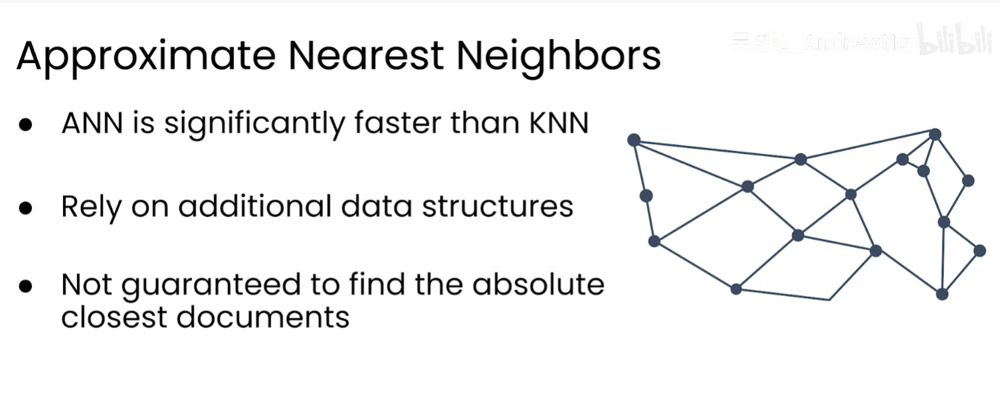
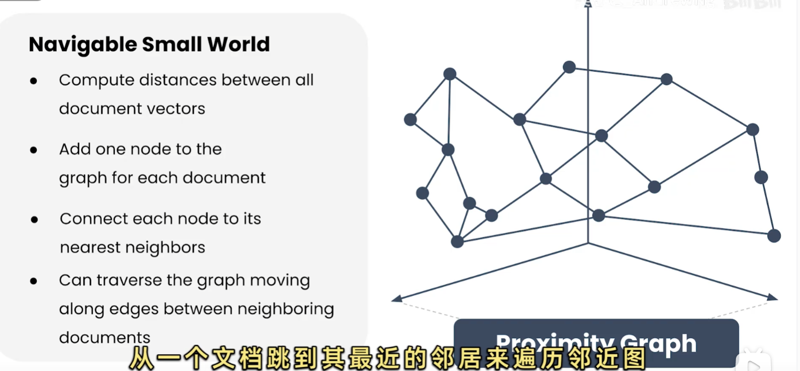
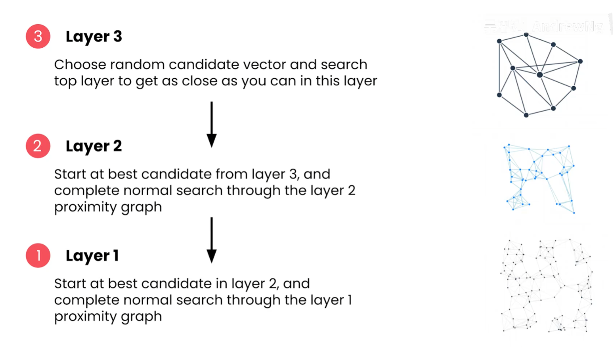

# RAG 中的 KNN 与 ANN

## 1. 为什么需要向量近邻搜索

语义检索会把查询和文档编码成向量，然后按距离或相似度返回 Top-K。核心问题是：给定查询向量，哪些文档向量最接近？

- **KNN（K-Nearest Neighbors，K 近邻）**：遍历全部向量，计算每个向量与查询的距离，再严格排序。
- **ANN（Approximate Nearest Neighbor，近似最近邻）**：借助额外索引结构只访问部分候选，牺牲少量召回率换取更低延迟。

## 2. 精确 KNN

### 2.1 基本流程

```text
查询向量 q
  → 计算 q 与每个文档向量的距离
  → 选择距离最小的 K 个向量
  → 按距离排序并返回
```

假设有 `N` 个向量、维度为 `D`，一次朴素查询大致需要 `O(N × D)` 次距离计算；排序还需要额外开销。数据量增大时，延迟近似线性增长。

### 2.2 优点与局限

| 优点 | 局限 |
| --- | --- |
| 返回真正的最近邻，结果准确 | 必须访问全部向量，查询成本随数据量增长 |
| 结果稳定、容易解释 | 高并发或大规模向量库下延迟较高 |
| 适合作为 ANN 的离线基准 | 需要较多 CPU/内存带宽 |

精确 KNN 的结果可作为 Ground Truth，用来计算 ANN 的 Recall@K 或召回率损失。

## 3. ANN：近似最近邻

ANN 通过倒排分区、量化或图索引等额外数据结构减少实际访问的向量数量，因此通常比精确 KNN 快很多，但**不保证找到绝对最近的文档**。



图中表达了三点：ANN 通常比 KNN 快；需要额外索引结构；结果可能不是绝对最近邻。实际系统应使用召回率、P95 延迟和内存占用共同选择参数。

常见 ANN 索引包括：

| 索引类型 | 核心思想 | 常见取舍 |
| --- | --- | --- |
| HNSW | 在多层近邻图上导航 | 查询快、召回高，但内存和构建成本较高 |
| IVF | 将向量分到多个聚类桶，只搜索部分桶 | 内存较可控，需要调探测桶数 |
| PQ/量化 | 压缩向量或距离计算 | 节省内存，但会损失精度 |

## 4. HNSW：Hierarchical Navigable Small World

HNSW（分层可导航小世界图）把向量组织成多层近邻图。底层包含全部节点，上层是逐渐稀疏的子图；上层用于快速跨越较远距离，底层用于精细搜索。



图中每个节点代表一个文档向量，边连接相近节点。查询可以沿边从一个文档跳到更相近的文档，避免扫描整个向量库。

### 4.1 分层搜索流程



1. 从顶层入口点开始，在稀疏图中贪心移动，找到更接近查询的候选。
2. 下降到下一层，以当前最佳候选作为起点，扩大搜索范围。
3. 重复下降，直到第 1 层或底层。
4. 在底层执行更充分的邻居搜索，返回最终 Top-K。

顶层节点少，负责快速定位区域；底层节点多，负责提高召回率。它不是先把全部距离算完再排序，而是通过图上的局部导航逐步逼近目标。

### 4.2 建图与查询参数

| 参数 | 作用 | 调大后的影响 |
| --- | --- | --- |
| `M` | 每个节点在索引中保留的最大连接数 | 召回率和导航能力可能提高，但内存、构建时间增加 |
| `efConstruction` | 建图时搜索候选的范围 | 索引质量提高，构建更慢 |
| `efSearch` | 查询时维护的候选范围 | 召回率提高，查询延迟增加 |
| `top_k` | 最终返回的结果数 | 返回更多上下文，延迟和噪声也可能增加 |

通常先用精确 KNN 建立基准，再调 `M`、`efConstruction` 和 `efSearch`，比较 Recall@K、P95 延迟、索引大小和构建时间。不同向量库的默认值和参数名称可能不同，应以具体实现为准。

### 4.3 HNSW 的优缺点

**优点**：查询延迟低；召回率通常较高；适合内存中动态插入；不要求先做固定数量的聚类。

**局限**：图结构占用额外内存；建索引较慢；删除和大量更新需要实现层面的墓碑标记或重建；参数增大后资源消耗明显。

## 5. KNN 与 ANN 的选择

| 场景 | 建议 |
| --- | --- |
| 数据量小、结果必须精确 | 精确 KNN |
| 大规模在线语义检索 | HNSW 或其他 ANN |
| 内存非常有限 | IVF、量化或压缩索引 |
| 离线评估 ANN 是否漏召回 | 用精确 KNN 生成基准 |

RAG 中常见做法是：先用 ANN 召回较大的候选集，再用精确距离、交叉编码器或业务规则重排，最后把较小的 Top-K 交给 LLM。

```text
ANN 召回 Top-50/100
  → 权限和元数据过滤
  → 精确距离或重排模型排序
  → 返回 Top-5/10 给生成模型
```

## 6. 最小距离排序示例

```python
from math import dist

def exact_knn(query, vectors, k):
    return sorted(
        ((dist(query, vector), doc_id) for doc_id, vector in vectors.items()),
    )[:k]


if __name__ == "__main__":
    rows = {"a": [0.0, 0.0], "b": [1.0, 0.0], "c": [3.0, 0.0]}
    assert exact_knn([0.2, 0.0], rows, 2) == [(0.2, "a"), (0.8, "b")]
```

## 7. 评估 ANN 是否值得

至少同时记录：

- **Recall@K**：ANN 返回的真实近邻占精确 KNN 结果的比例；
- **P50/P95/P99 延迟**：尤其关注长尾延迟；
- **吞吐量**：并发查询下的 QPS；
- **索引内存和构建时间**：影响部署成本和更新频率。

ANN 的“近似”不是固定的准确率，而是由索引类型和搜索参数决定的工程折中。参数应在代表真实问题分布的评估集上调优。
