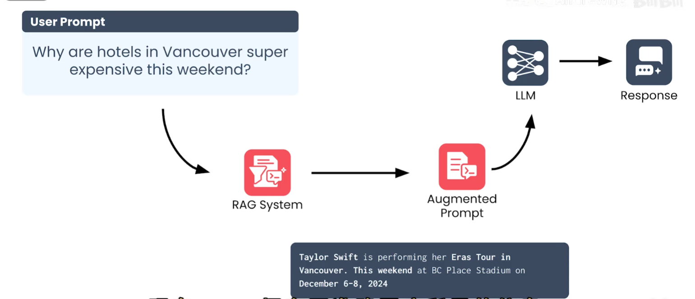
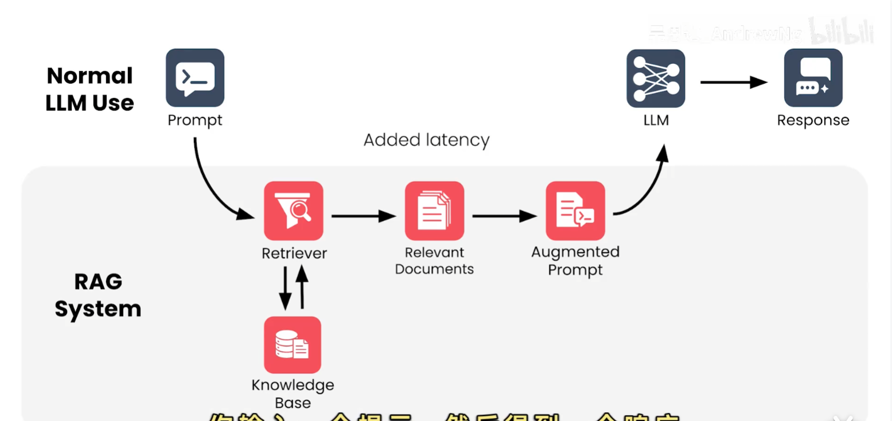

# RAG：介绍和架构

## 1. 定义

RAG（Retrieval-Augmented Generation，检索增强生成）是一种把外部知识检索结果加入语言模型输入，从而改进模型生成文本的方法。

RAG 适合处理以下信息：

- 公司内部资料和私有知识；
- 模型训练数据中没有的新内容；
- 需要依据可信来源回答的问题；
- 不适合直接全部写入模型上下文或重新训练模型的资料。

RAG 的核心思想是：**先从知识库检索相关信息，再让 LLM 基于用户问题和检索结果生成回答。**

## 2. 为什么需要 RAG

LLM 的预训练知识存在范围和时间边界，通常不知道企业内部文档、最新业务数据或刚发生的事件。直接要求模型回答，可能产生知识缺失或幻觉。

RAG 将知识维护从模型参数中分离出来：知识库可以独立更新，模型在请求到来时读取最新的相关内容。这样可以在不重新训练模型的情况下，增强回答的时效性、相关性和可追溯性。

## 3. 核心组件

| 组件 | 主要职责 |
| --- | --- |
| 用户提示（User Prompt） | 描述用户的问题、任务或约束 |
| 知识库（Knowledge Base） | 保存文档、网页、数据库记录等可信资料 |
| 检索器（Retriever） | 根据问题从知识库中找到最相关的内容 |
| RAG 系统 | 负责查询改写、检索、过滤、排序和上下文组织 |
| 增强提示（Augmented Prompt） | 将原始问题与检索到的上下文组合成新的模型输入 |
| LLM | 使用问题和上下文生成最终回答 |
| 响应（Response） | 返回给用户的自然语言或结构化结果 |

其中，检索器管理并访问一个可信、相关且具有权限边界的知识库。RAG 系统通常还需要处理文档切分、向量化、元数据过滤和结果排序等工作。

## 4. 端到端工作流程

```text
用户提出问题
  → RAG 接收用户提示
  → 检索器查询知识库
  → 返回最相关的文档片段
  → RAG 组织原始问题和检索上下文
  → 形成增强提示
  → LLM 基于增强提示生成回答
  → 返回响应
```

一个最小的实现逻辑可以表示为：

```python
def answer(question):
    contexts = retriever.search(question, top_k=5)
    prompt = build_prompt(question=question, contexts=contexts)
    return llm.generate(prompt)
```

## 5. 架构图



图中流程如下：

1. 用户提出问题：“为什么温哥华的酒店这个周末特别贵？”
2. 问题先进入 RAG 系统，而不是直接交给 LLM。
3. RAG 系统从知识库中检索到相关事实，例如 Taylor Swift 正在温哥华举行 Eras Tour，演出时间为 2024 年 12 月 6—8 日。
4. 检索结果与用户问题合并，组成增强提示（Augmented Prompt）。
5. LLM 使用增强提示生成回答，说明酒店价格上涨可能与大型活动带来的需求增加有关。

这张图体现了 RAG 的关键边界：**RAG 负责提供相关外部上下文，LLM 负责理解上下文并生成语言回答。**

## 6. 知识库与检索器

### 6.1 知识库内容

知识库可以包含：

- Markdown、PDF、Word 等文档；
- 企业内部规章、产品手册和技术文档；
- 数据库记录、工单和 FAQ；
- 网页、新闻或其他经过授权的数据源。

### 6.2 常见检索方式

| 方式 | 特点 |
| --- | --- |
| 关键词检索 | 根据词项匹配，简单、可解释，适合精确术语 |
| 向量检索 | 将问题和文档转换为向量，按语义相似度检索 |
| 混合检索 | 结合关键词和向量检索，兼顾精确匹配与语义理解 |
| 重排序（Rerank） | 对初步检索结果再次排序，提高上下文相关性 |

实际系统还应使用元数据进行权限、部门、时间范围和文档类型过滤，避免把无权访问或已经过期的内容提供给模型。

## 7. RAG 的价值与边界

### 7.1 主要价值

- **时效性**：知识库更新后即可参与回答；
- **私有性**：企业资料可以保留在受控的数据环境中；
- **可追溯性**：回答可以关联检索到的来源；
- **成本可控**：避免为了少量新知识频繁重新训练模型；
- **知识复用**：同一知识库可服务多个问答和业务场景。

RAG 可以通过提供相关、可信且较新的上下文，减少 LLM 因知识缺失产生的幻觉和误导性响应。它让 LLM 能够接入最新数据，而不必为了每次知识更新都重新训练模型。

检索器还承担了信息筛选工作：它从大量知识中找到最重要、最相关的内容，并以较简洁的上下文提供给 LLM。这样，LLM 可以更专注于理解上下文和生成文本，应用也不必把整个知识库直接塞进提示词。

### 7.2 主要边界

RAG 不会自动保证答案正确。最终质量取决于知识库质量、切分方式、检索准确率、上下文长度、提示设计以及模型本身的推理能力。检索到了不相关或错误的内容，模型仍可能生成错误答案。

因此，生产系统至少需要关注：

1. 文档来源和更新时间；
2. 访问权限与敏感信息脱敏；
3. 检索召回率和结果相关性；
4. 上下文长度与重复内容；
5. 回答引用、拒答和人工审核机制。

### 7.3 引入的额外成本

RAG 会增加一次或多次检索、排序和上下文拼接，因此通常会带来额外延迟。图中“Added latency”表示从用户提示到 LLM 生成之间新增的检索链路：检索器查询知识库，返回相关文档，再形成增强提示。



普通 LLM 使用流程是“提示 → LLM → 响应”；RAG 流程则是“提示 → 检索器 → 相关文档 → 增强提示 → LLM → 响应”。因此，RAG 需要在回答质量、数据新鲜度和响应延迟之间进行权衡。

### 7.4 为什么不把所有信息都加入提示词

把整个知识库或大量候选文档都直接加入提示词，会带来两个主要问题。

#### 更高的计算成本

- 提示词越长，运行所需的计算量越大；
- 模型需要对每个词元执行计算复杂的扫描；
- 在生成每个新词元之前，都要处理这段较长的上下文。

#### 上下文窗口限制

- 最终会达到 LLM 的上下文窗口上限；
- 较小的模型可能只能处理几千个词元；
- 较大的模型虽然可以处理数百万个词元，也仍然存在固定上限和成本。

因此，RAG 通过检索器先筛选最相关的文档，再把有限的上下文提供给 LLM，在信息覆盖范围、计算成本和上下文长度之间取得平衡。

## 8. 核心理解

> **RAG 是在模型生成前增加“查资料”步骤：检索器从可信知识库获取相关信息，RAG 将这些信息加入提示词，LLM 再据此生成回答。**
