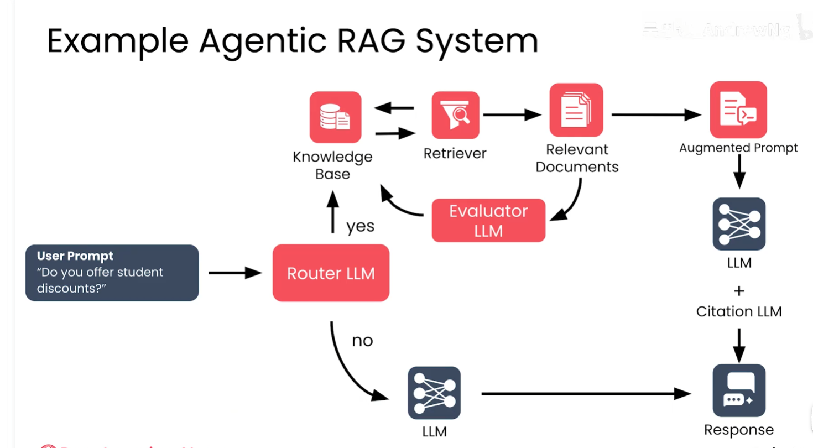
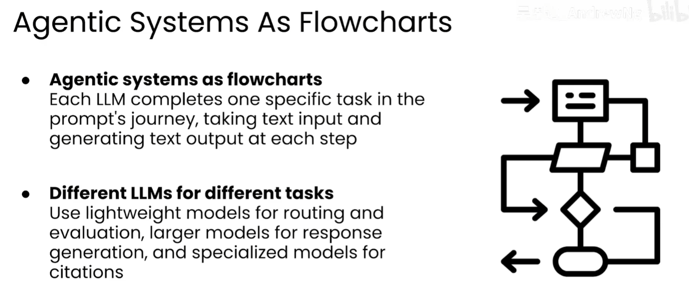

# 代理 RAG（Agentic RAG）

## 1. 定义

代理 RAG（Agentic RAG）是在传统 RAG 的“检索 → 生成”流程上加入智能体决策能力的系统。它可以根据问题决定是否检索、如何改写查询、是否需要重新检索，以及何时让评估器或其他模型参与。

核心思想是：**把一次固定的 RAG 调用变成可判断、可循环、可组合的工作流。**

## 2. 为什么组合多个 LLM

代理 RAG 通常让不同模型承担不同职责，而不是让一个大模型完成所有步骤：

| 角色 | 主要任务 | 模型选择思路 |
| --- | --- | --- |
| 路由模型（Router LLM） | 判断问题类型，决定直接回答还是进入 RAG | 轻量、低延迟、低成本 |
| 查询改写模型 | 将模糊问题改写成适合检索的查询 | 轻量模型通常足够 |
| 生成模型 | 根据问题和证据生成最终答案 | 能力更强，承担主要推理 |
| 评估模型（Evaluator LLM） | 判断检索结果是否相关、充分、可信 | 关注判断稳定性 |
| 引用模型（Citation LLM） | 从答案和证据中生成来源引用 | 可使用专用或轻量模型 |

这种拆分带来两个直接好处：

1. **像画流程图一样组织系统**：每个节点完成一个清晰任务，节点之间传递文本或结构化结果。
2. **降低成本和响应时间**：简单任务交给低成本模型，复杂问题才调用更强模型；不需要检索时可以直接回答。

模型数量不是越多越好。每增加一个 LLM 节点，都会增加延迟、调用成本和失败点，应以质量或控制能力的实际收益为依据。

## 3. 与传统 RAG 的区别

| 维度 | 传统 RAG | 代理 RAG |
| --- | --- | --- |
| 流程 | 通常是固定的检索和生成链路 | 根据问题动态选择路径 |
| 检索次数 | 一般一次 | 可以查询、评估、改写后再次查询 |
| 模型职责 | 一个主模型完成生成 | 多个模型分工协作 |
| 失败处理 | 主要依赖固定兜底逻辑 | 可由路由、评估或反思节点处理 |
| 适合场景 | 问题简单、流程稳定 | 问题复杂、知识源多、需要验证 |

## 4. 示例工作流

```text
用户问题
  → 路由 LLM
      ├─ 不需要知识库 → 生成 LLM → 响应
      └─ 需要知识库
          → 检索器 → 相关文档
          → 评估 LLM
              ├─ 结果不足 → 改写查询或重新检索
              └─ 结果可用 → 增强提示
                  → 生成 LLM + 引用 LLM
                  → 带引用的响应
```

例如用户询问“是否提供学生折扣”：

1. 路由模型判断这是一个可能存在于业务知识库中的问题。
2. 检索器查询折扣政策文档。
3. 评估模型判断文档是否与“学生折扣”直接相关。
4. 如果结果不足，改写查询或扩大检索范围。
5. 生成模型依据有效文档回答，引用模型补充来源。
6. 如果路由模型判断问题属于闲聊或常识问题，则跳过知识库，直接由通用模型回答。

## 5. 流程图



图中包含以下节点：用户提示、路由 LLM、知识库、检索器、相关文档、评估 LLM、增强提示、生成 LLM、引用 LLM 和响应。评估模型发现检索结果不足时，可以推动重新检索；路由模型判断不需要知识库时，则直接进入生成模型。



第二张图强调：代理系统可以看成由多个文本输入、文本输出节点组成的流程图；每个 LLM 负责提示词旅程中的一个具体任务。分支、循环和汇总共同构成完整工作流。

## 6. 最小实现

简单系统可以自己用普通函数组合，不必一开始引入复杂框架：

```python
def answer(question):
    route = router_llm(question)
    if route == "direct":
        return answer_llm(question)

    query = rewrite_llm(question)
    docs = retriever.search(query, top_k=5)
    if not evaluator_llm(question, docs):
        query = rewrite_llm(question + " 请扩大检索范围")
        docs = retriever.search(query, top_k=5)

    prompt = build_prompt(question, docs)
    answer = answer_llm(prompt)
    return add_citations(answer, docs)
```

实际代码还应补充超时、重试上限、权限过滤、日志和敏感信息保护。循环必须有明确上限，避免模型之间无限调用。

## 7. 何时自己搭，何时使用框架

| 情况 | 建议 |
| --- | --- |
| 只有少量节点，顺序固定 | 直接使用函数或普通代码编排 |
| 需要分支、循环和状态 | 使用显式状态机或工作流编排 |
| 多个 Agent 需要通信和协作 | 选择支持多智能体的框架 |
| 需要观测、追踪、评估和生产运维 | 使用成熟框架或平台，并保留清晰的业务边界 |

框架解决的是编排、状态、重试、追踪等通用问题，不能替代路由规则、检索质量和评估集。先用最小流程验证收益，再引入框架，通常更容易控制复杂度。

## 8. 设计原则

1. **一个节点一个职责**：路由、检索、评估、生成和引用不要混成一个不可观察的提示词。
2. **优先使用确定性逻辑**：权限、格式校验、重试次数和超时应由代码控制。
3. **让模型输出结构化结果**：路由结果、评估结论和检索参数使用 JSON 或枚举，便于程序判断。
4. **设置成本和延迟预算**：限制最大 LLM 调用次数，并记录每个节点的耗时和 token 用量。
5. **保留证据链**：保存查询、检索文档、评估结果和最终引用，方便调试与审计。
6. **可失败地降级**：检索失败时明确说明无法确认，避免模型凭空补充事实。

## 9. 评估指标

除了最终答案质量，还应分别评估每个节点：

| 层次 | 关注点 | 示例指标 |
| --- | --- | --- |
| 路由 | 是否选对路径 | 路由准确率、误路由率 |
| 检索 | 是否找到相关证据 | Recall@K、Precision@K、MRR |
| 评估 | 是否正确识别证据不足 | 判断准确率、漏检率 |
| 生成 | 答案是否正确且遵循证据 | Faithfulness、Answer Relevancy |
| 系统 | 是否值得使用 | P50/P95 延迟、单次成本、成功率 |

## 10. 核心理解

> **代理 RAG = RAG + 路由、评估、查询改写和循环等决策能力。**
>
> **组合多个 LLM 的价值在于按任务分工，用合适大小的模型完成合适的步骤；代价是更高的系统复杂度、延迟和调用成本。**
