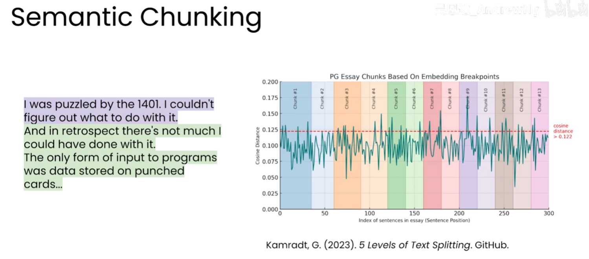

# RAG 分块

## 1. 定义与目的

分块（Chunking）是把知识库中的较长文本文档拆成较小文本块，再分别建立索引和向量表示的过程。检索时，系统返回与问题最相关的块，并把它们放入增强提示交给 LLM。

分块主要解决三个问题：

1. **适应向量模型的输入限制**：嵌入模型可处理的文本长度有限。
2. **提高检索相关性**：较小、主题集中的块更容易形成明确的向量语义。
3. **控制 LLM 上下文**：只把最相关的片段发送给 LLM，减少无关内容。

分块应保留来源元数据，并补充文档 ID、标题、页码、段落号或字符区间等位置字段，便于引用、溯源、更新和重新索引。

## 2. 分块大小的权衡

块太大时，一个块包含多个主题，向量难以表达明确含义，也会迅速占满 LLM 上下文；块太小时，局部文本缺少必要背景，向量语义不完整，检索相关性可能下降。

不存在适用于所有语料的固定大小。应结合文档类型、嵌入模型限制、查询方式和评估结果选择，并通过 Precision@K、Recall@K、MRR 或端到端答案质量验证。

## 3. 基础分块方法

### 3.1 固定大小分块

按固定字符数、字节数或 token 数切分，例如每块约 250 字节。实现简单、速度快，适合作为基线方案。切分点可能落在句子、段落或代码结构中间，因此可设置重叠区，例如块大小 250 字节、前后重叠 25 字节（约 10%）。重叠能保留边界上下文，但会增加存储量、嵌入计算量和结果重复。

### 3.2 递归字符文本分割

按照由强到弱的分隔符递归切分，尽量在自然边界处形成块。常见顺序是标题或空行、段落、换行、句末标点、空格、字符。

| 文档类型 | 优先分隔位置 |
| --- | --- |
| Markdown、普通文本 | 标题、空行、段落、换行 |
| HTML | 标签、区块元素 |
| Python 等代码 | 类、函数定义、代码块 |
| 表格 | 表头与完整行组 |
| 对话记录 | 消息边界、轮次边界 |

递归分割通常比单纯固定宽度更能保持语义完整，是多数知识库的默认方法。

## 4. 高级分块方法

### 4.1 语义分块

语义分块逐句处理文档：计算当前句子与前一句或前一组句子的向量相似度；相似时放入同一块，差异超过阈值时建立新的块边界。



图中横轴是句子位置，纵轴是相邻句子的余弦距离；距离超过红色阈值线时，说明主题发生变化，于是形成新的块边界。不同颜色表示识别出的块。

**优点**：更贴近主题变化，边界自然，合适的阈值可能提高召回率和精确率。

**缺点**：需要反复计算句子向量，成本较高；阈值和窗口大小需要调试，结果也受嵌入模型影响。

### 4.2 基于语言的分块

让 LLM 根据文档内容生成文本块，并规定保持同一概念完整、遇到新主题时换块、不要拆开定义与解释等规则。它通常表现较好，但有调用成本、延迟和输出稳定性问题，应要求结构化输出并校验遗漏、重复和长度。

### 4.3 上下文感知分块

为每个块添加它在整篇文档中的简短上下文摘要，例如“应用发布复盘”“首个应用的发布公告”“开发过程中的关键经验”“支持者和贡献者名单”。附加上下文能帮助检索器理解孤立片段，也能帮助 LLM 恢复块与原文的关系；摘要应简短、可验证，并与原始块一起保存。

## 5. 方法对比

| 方法 | 主要优点 | 主要代价或风险 | 适用场景 |
| --- | --- | --- | --- |
| 固定大小 | 实现简单、速度快 | 可能切断语义；重叠产生冗余 | 快速基线、结构规整文本 |
| 递归字符 | 尽量沿自然边界切分，通用性好 | 仍需配置大小和分隔符 | 多数 Markdown、文本和混合文档 |
| 语义分块 | 主题边界自然，可能提升检索质量 | 向量计算多，阈值需调试 | 主题变化明显、质量优先的语料 |
| LLM 分块 | 能理解概念关系，规则灵活 | 成本、延迟和稳定性问题 | 高价值知识库、复杂文档 |
| 上下文感知 | 为孤立块补充全局语境 | 需要额外生成与存储 | 标题缺失、段落依赖上下文的文档 |

## 6. 选择建议

1. 先用固定大小或递归字符分割建立基线，同时保留来源元数据和位置。
2. 文档结构明显时，优先使用标题、段落、代码函数或 HTML 标签等递归分隔符。
3. 基线指标不足时，再尝试语义分块或 LLM 分块，并比较成本与收益。
4. 对标题缺失、段落很短或跨块依赖明显的语料，优先试验上下文感知分块。
5. 块大小、重叠比例和语义阈值都应通过检索及端到端问答评估确定。

一个可落地的默认流程是：**递归字符分割 + 适度重叠 + 元数据继承**；只有评估证明需要更高质量时，再增加语义、LLM 或上下文处理。

## 7. 分块后的数据结构示例

```json
{
  "chunk_id": "doc-42#chunk-03",
  "document_id": "doc-42",
  "title": "RAG 分块",
  "text": "分块是把较长文档拆成较小文本块……",
  "context": "本文介绍 RAG 知识库的文本分块方法",
  "start_offset": 1250,
  "end_offset": 1388
}
```

`text` 用于嵌入和检索，`context` 用于补充语境，位置字段用于溯源和调试。
