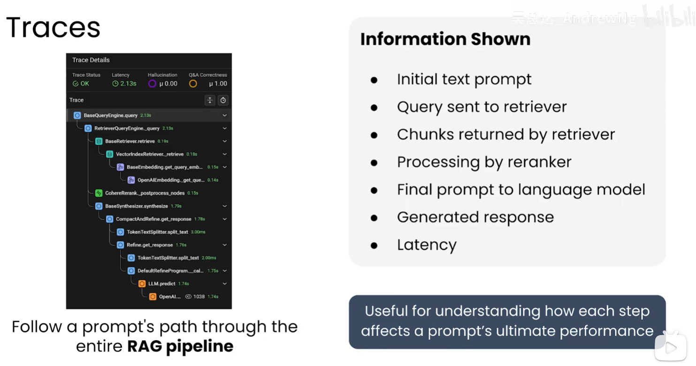

# RAG 可观测系统

RAG（Retrieval-Augmented Generation，检索增强生成）进入生产后，单看“请求是否成功”远远不够。可观测系统要同时回答三个问题：系统是否运行稳定、回答是否有质量、出现问题时能否定位到具体链路和版本。

## 1. 观测目标

| 范围 | 要回答的问题 | 典型指标 |
| --- | --- | --- |
| 系统 | 整体性能是否满足用户体验和容量目标？ | 端到端延迟、吞吐、错误率、成本 |
| 组件 | 哪一个环节导致了延迟或质量下降？ | 检索、重排、Embedding、LLM 各阶段耗时 |
| 质量 | 检索内容和最终答案是否可靠？ | 相关性、引用准确率、答案正确性、满意度 |
| 安全 | 是否发生越权、敏感数据泄露或提示注入？ | 拦截率、权限校验失败、脱敏命中、审计记录 |

## 2. 两类关键指标

### 2.1 软件运行指标

运行指标描述系统“跑得怎么样”，应按整体和组件分别统计。

| 维度 | 建议指标 | 观测重点 |
| --- | --- | --- |
| 延迟 | 端到端 P50/P95/P99、首 token 延迟、各阶段耗时 | 识别长尾请求和瓶颈；不要只看平均值 |
| 吞吐 | QPS、并发数、排队时间、每秒 token 数 | 评估峰值容量和扩容效果 |
| 资源 | CPU、内存、GPU、显存、网络和连接池使用率 | 发现资源耗尽、泄漏和过载 |
| 稳定性 | 超时率、错误率、重试率、降级率 | 区分依赖故障、服务故障和用户输入问题 |
| 成本 | 输入/输出 token、Embedding 次数、模型调用费用 | 发现过长上下文、重复调用和异常流量 |

建议把一次请求拆成以下时间段：查询改写、权限过滤、向量/关键词召回、重排、上下文拼接、LLM 首 token、LLM 完成。这样既能看整体性能，也能知道问题发生在哪里。

### 2.2 质量指标

质量指标描述系统“答得怎么样”。应同时覆盖检索、生成和用户反馈，并按问题类型、模型版本、知识库版本拆分。

| 层级 | 指标示例 | 评估方式 |
| --- | --- | --- |
| 检索质量 | Precision@K、Recall@K、MRR、mAP@K、nDCG@K | 使用带 Ground Truth 的离线评估集 |
| 上下文质量 | 文档相关性、覆盖度、重复率、上下文污染率 | 代码规则、LLM 评审或人工标注 |
| 生成质量 | 答案正确性、忠实性、完整性、引用准确率 | LLM-as-a-Judge、规则检查、人工复核 |
| 用户体验 | 点赞/点踩、改写率、追问率、解决率、满意度 | 线上显式和隐式反馈 |
| 安全质量 | 越权检索、提示注入、敏感信息泄露 | 安全测试集、审计日志和人工抽检 |

## 3. 如何进行跟踪

### 3.1 聚合统计（Aggregate Statistics）

聚合指标用于看趋势、发现回归和触发告警。按小时或天统计整体值，同时按模型、索引、租户、语言和问题类型分组。

- 延迟使用 P50、P95、P99，并设置错误率和超时率阈值；
- 质量指标保留总体值和分场景值，避免长尾问题被平均数掩盖；
- 发布新模型、Embedding、分块策略或重排器后，对比发布前基线；
- 监控知识库新鲜度、解析失败率、索引更新延迟和过期文档占比；
- 告警应关联具体版本和依赖，便于快速回滚或降级。

### 3.2 详细日志与 Trace

日志记录单个提示词在 RAG 流水线中的处理过程，Trace 将这些步骤串成一次可追踪请求。每个请求使用唯一 `trace_id`，每个步骤使用 `span_id`。



一次 Trace 至少应包含：

1. 初始用户问题、会话和租户标识（敏感内容按策略脱敏）；
2. 查询改写结果、检索器类型、过滤条件和 `top_k`；
3. 返回片段的文档 ID、版本、分数和来源，不必默认记录完整敏感正文；
4. 重排结果、最终上下文、提示词模板版本和模型参数；
5. LLM 响应、输入/输出 token、首 token 延迟、总耗时和错误信息；
6. 引用来源、质量评估结果、用户反馈和降级原因。

日志字段应保持结构化，避免只写不可检索的长文本。生产环境实行采样、分级保留和访问审计，防止为了排障把敏感提示词长期存储。

### 3.3 实验（Experimentation）

对模型、提示词、分块、Embedding、检索权重或重排器的更改，应通过安全实验验证，而不是直接依赖线上总体平均值。

- 先在固定离线评估集上比较 Recall@K、MRR、引用准确率和成本；
- 使用 A/B 测试或小流量灰度，保持用户和实验组稳定分配；
- 同时观察质量、P95/P99 延迟、错误率、拒答率和 token 成本；
- 为实验记录配置版本、数据集版本、开始/结束时间和回滚条件；
- 出现显著回归时停止实验并回滚，保留失败样本用于补充评估集。

## 4. 评估器的组合

| 评估器 | 适合检查 | 优点 | 局限 |
| --- | --- | --- | --- |
| 代码规则 | 延迟、吞吐、JSON 合法性、引用格式、提示词长度 | 成本低、稳定、易自动化 | 难以判断开放式答案的语义质量 |
| LLM 作为评审 | 文档相关性、上下文质量、忠实性、答案完整性 | 灵活，覆盖复杂语义 | 需要明确评分标准，可能有偏差和额外成本 |
| 人工反馈 | 满意度、业务正确性、边界和新型失败 | 能发现自动评估遗漏的问题 | 成本高、速度慢、标注一致性需要管理 |

三者应组合使用：代码评估负责持续低成本检测，LLM 评审负责语义抽检，人工反馈负责校准标准和发现未知问题。评审结果要保存评分规则、评审模型版本和样本，避免同一指标因评审器变化而失去可比性。

## 5. 最小可行落地方案

第一阶段先建立一条可回溯的主链路：

```text
请求入口
  → trace_id
  → 查询改写
  → 权限过滤
  → 召回与重排
  → 上下文拼接
  → LLM 调用
  → 引用与反馈
```

至少落地以下内容：

1. 端到端和各组件 P50/P95/P99 延迟、QPS、错误率、token 用量；
2. 结构化 Trace，能定位一次请求经过的每个阶段；
3. 一套带 Ground Truth 的评估集，固定计算 Recall@K、MRR 或 mAP@K；
4. 答案引用、点赞/点踩和人工抽检入口；
5. 模型、提示词、索引和评估集版本关联；
6. 敏感字段脱敏、权限过滤和日志访问审计。

## 6. 监控工具的分工

LLM 可观测平台适合展示提示词、检索片段、模型调用和质量评估，但不能替代全部基础设施监控。传统监控工具仍用于主机、容器、数据库、网络和依赖服务：例如用 Prometheus/Grafana 观察指标和趋势，用日志平台检索错误，用 OpenTelemetry 统一 Trace。

关键原则是让业务 Trace 与基础设施指标通过 `trace_id`、服务名和版本号关联起来。这样可以从“用户反馈答案变差”追到“某版本重排延迟升高”或“某批文档解析失败”，而不是只看到一个孤立的失败率。

## 7. 常见误区

- 只看端到端延迟，无法定位检索、重排还是模型调用变慢；
- 只看平均值，掩盖 P99 长尾和少量严重失败；
- 只看点赞率，没有评估样本、引用和 Ground Truth；
- 记录完整提示词和上下文，导致日志成为敏感数据泄露面；
- 上线改动没有版本标记，无法判断回归由哪个配置引起；
- 只依赖 LLM 评审，忽略代码规则和人工校准；
- 只做离线评估，不观察线上真实问题和用户反馈。

可观测系统的目标不是收集最多日志，而是用少量稳定的指标、结构化 Trace 和可复现的评估集，把“系统变慢”“答案变差”和“为什么变差”连接起来。
