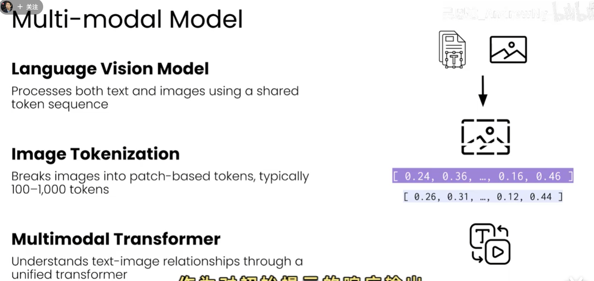

# RAG：多模态 RAG

## 1. 定义

多模态 RAG（Multimodal Retrieval-Augmented Generation）把图片、PDF、幻灯片、视频、音频等非纯文本资料纳入检索增强生成流程。系统不仅检索文字，还需要理解和匹配图像、版面、表格、语音及视频帧等信息。

多模态 RAG 仍属于较前沿的技术方向。难点不只是把文件转换成向量，还包括跨模态对齐、复杂文档切分、检索结果解释和多模态上下文组织。

## 2. 支持的资料类型

| 资料 | 典型内容 | 预处理结果 |
| --- | --- | --- |
| 图片 | 照片、截图、扫描页、图表 | 图像、OCR 文本、区域坐标 |
| PDF | 正文、标题、表格、图片、版面 | 页面图像、文字块、网格块、页码 |
| 幻灯片 | 标题、要点、图表、演讲者备注 | 页面图像、文本和视觉区域 |
| 视频 | 画面、字幕、语音、时间变化 | 视频帧、字幕、音频转写、时间戳 |
| 音频 | 对话、会议、播客 | 转写文本、说话人和时间戳 |

## 3. 核心架构

```text
多模态资料
  → 解析、OCR、ASR、抽帧和版面分析
  → 文本块、图像块、PDF 网格块、音频/视频时间片
  → 多模态向量模型编码
  → 向量数据库及元数据索引
  → 多模态查询编码与检索
  → 过滤、重排序、上下文组织
  → 多模态大语言模型生成回答
```

### 3.1 检索器需要多模态向量模型

检索器需要使用能够处理多种输入并建立共享语义空间的多模态向量模型。这样，文字问题可以检索到相关图片或页面区域，图片查询也可以检索到文字描述或相似视觉内容。

应同时保存原始对象和元数据，例如文档 ID、页码、区域坐标、模态、视频时间戳、音频说话人、版本和访问权限。向量只负责相似度检索，原始内容和元数据负责回溯、过滤及最终展示。

### 3.2 PDF 与幻灯片的网格切片

PDF 和幻灯片往往信息密度高，页面上同时存在文本、标题、表格、图表和图片。一个可行的 PDF RAG 做法是：将页面渲染为图像，切成方块网格（patches），分别向量化后存入向量数据库。查询时，为每个文档寻找与问题最相似的页面块，再汇总这些局部相似度。

这种方法可以绕开复杂的版面检测算法，并保留图表、图片和文字的空间关系；但网格大小、重叠比例和页面分辨率需要通过检索评估确定。网格过小会丢失上下文，过大则会降低定位精度并增加向量数量。

### 3.3 类 ColBERT 的块级打分

一种思路是让查询产生多个提示向量，并在每个文档中为每个查询向量寻找最相似的页面块，最后累加这些最大相似度分数。它比单个页面向量更能定位局部证据，但会增加向量数量、检索开销和结果去重复杂度。

## 4. 多模态模型的基本机制



图中展示了三个关键步骤：

1. **语言视觉模型（Language Vision Model）**：让文字和图像进入共享的 token 序列。
2. **图像 token 化（Image Tokenization）**：把图像切成 patch，通常产生约 100—1,000 个图像 token。
3. **多模态 Transformer**：在统一 Transformer 中理解文字与图像之间的关系，并输出可用于匹配的表示。

这意味着多模态检索可以比较不同模态之间的语义关系，而不必先把所有内容强行转换为纯文字。

## 5. 索引数据结构示例

```json
{
  "chunk_id": "report-42#page-03#grid-07",
  "document_id": "report-42",
  "modality": "pdf_patch",
  "page": 3,
  "bbox": [512, 768, 896, 1152],
  "text": "可选的 OCR 或页面摘要",
  "embedding": "multimodal-vector",
  "source_uri": "s3://bucket/report-42.pdf"
}
```

`bbox` 用于回到原页面定位证据；视频和音频可将 `page` 替换为 `start_time`、`end_time`。向量数据库还应支持模态、权限、文档版本等元数据过滤。

## 6. 一个最小工作流

1. 解析文件并提取文字、图片、表格、字幕或语音转写。
2. 对 PDF/幻灯片渲染页面，按网格切片并保留页码和坐标。
3. 使用同一多模态向量模型编码查询和各类内容。
4. 将向量与原始对象、元数据写入向量数据库。
5. 检索后按相似度、权限、时间和模态过滤，必要时重排序。
6. 将最相关的文字、页面区域、图片或时间片交给多模态模型生成回答，并返回来源定位。

## 7. 主要挑战与评估

- **跨模态对齐**：文字、图像、表格和音频转写的语义粒度可能不同。
- **文档切分**：网格大小、重叠比例和版面边界会直接影响召回结果。
- **索引规模**：一页拆成很多块后，向量数量和存储成本快速增长。
- **证据组合**：答案可能需要同时使用文字块、图像区域和视频时间片。
- **可追溯性**：回答应能定位到页码、坐标或时间戳，而不是只返回一个文档名。

评估时应同时测量各模态的召回率、Precision@K、MRR、跨模态检索准确率、证据定位准确率和端到端答案质量，并记录索引成本与检索延迟。

## 8. 核心理解

> **多模态 RAG 的关键是：用多模态向量模型把不同资料映射到可检索的共享表示中，再用页块、图像区域或时间片作为证据交给多模态模型生成回答。**
