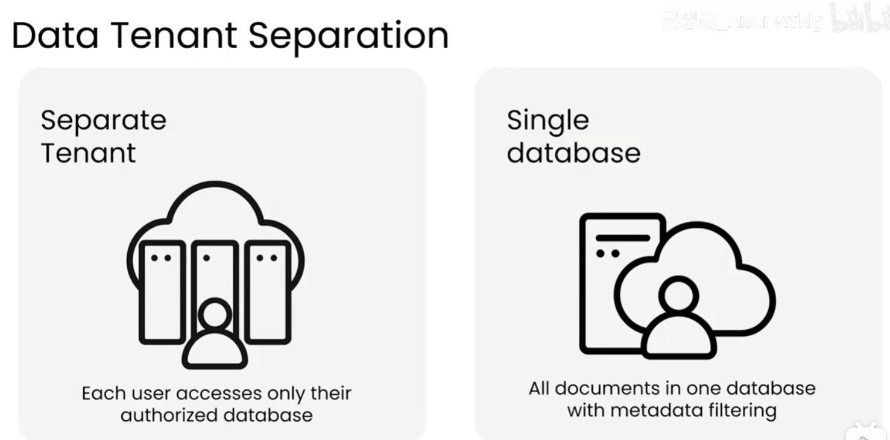
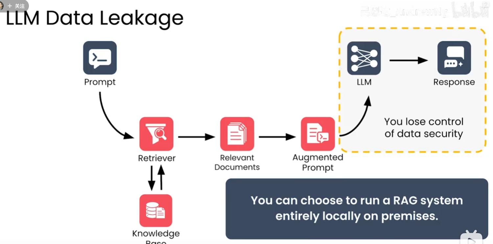

# RAG 安全

RAG（Retrieval-Augmented Generation，检索增强生成）会把检索到的文档拼接进提示词并发送给 LLM，因此安全边界覆盖登录、租户隔离、模型部署、传输与存储等环节。核心原则是：**权限先于检索，数据边界先于生成，模型只接触完成授权后的上下文。**

## 1. 登录限制

登录是 RAG 安全链路的第一道门。系统应先确认用户身份，再建立本次请求可访问的资源范围。

- 使用统一身份认证，并启用多因素认证、会话过期和异常登录检测；
- 登录成功后只授予完成任务所需的最小权限；
- 在检索前校验用户、角色、部门、租户和数据分级；
- 对上传、问答、导出和管理操作分别授权，不能只保护登录入口；
- 记录登录、权限变化、检索和文档访问审计日志，避免记录完整敏感提示词。

仅限制“谁能进入系统”不够，还要限制“进入后能检索什么”和“模型能调用什么”。

## 2. 租户数据隔离

多租户 RAG 常见做法是把所有文档放进同一个数据库，再通过 `tenant_id` 等元数据过滤。它实现简单，但过滤条件遗漏、权限逻辑错误或索引配置不当，都可能造成跨租户数据泄露。

图中左侧是独立租户方案：每个用户只能访问自己获授权的数据库；右侧是单数据库方案：所有文档共存，依赖元数据过滤。前者隔离边界更清晰，后者运维和资源利用更简单，但必须承担更高的权限校验风险。

### 2.1 隔离方式对比

| 方式 | 安全边界 | 优点 | 主要代价 |
| --- | --- | --- | --- |
| 独立数据库或独立知识库 | 数据库、连接和索引级隔离 | 跨租户误检索风险较低，审计清晰 | 数据库数量、备份和运维成本增加 |
| 共享数据库 + 元数据过滤 | 应用查询条件和数据库策略 | 部署简单，资源利用率高 | 过滤遗漏可能导致越权，需严格测试 |

如果租户之间存在较高保密要求，优先使用独立数据库、独立向量索引或至少独立集合。若必须共享数据库，应同时使用数据库行级安全策略、服务端强制注入租户条件、检索结果二次校验和跨租户越权测试。不要把安全责任交给 LLM 自行判断。

## 3. 自行部署 LLM

托管模型通常会接收发送过去的提示词和检索上下文。上下文含有内部制度、客户资料或源代码时，数据可能离开组织控制范围。

图中流程展示了“用户问题 → 检索器 → 相关文档 → 增强提示 → LLM”。如果 LLM 在外部服务中运行，增强提示中的敏感文档也会被发送到该服务，组织会失去部分数据安全控制。将 RAG 和 LLM 部署在本地或受控网络中，可以减少数据外传路径。

自行部署 LLM 的安全收益包括：

- 检索上下文留在受控网络，降低第三方留存和跨境传输风险；
- 可以按组织要求配置访问控制、日志留存、网络隔离和模型版本；
- 便于对模型输入输出做脱敏、审计和安全策略拦截。

但自行部署并不等于自动安全，仍需保护模型服务器、权重文件、推理接口、监控日志和运维账号，并评估 GPU、升级、补丁和容量成本。

## 4. 加密块

对文档、向量、备份、传输链路和日志进行加密，可以降低存储介质泄露或网络窃听造成的影响。更细粒度的做法是对敏感内容进行加密块或字段级加密，让不同租户、角色或服务只持有必要的解密能力。

加密块通常需要处理：

- 密钥生成、轮换、备份和撤销；
- 向量化前后如何保护原文与向量；
- 检索时如何在不扩大明文暴露范围的情况下完成解密；
- 密钥服务、应用服务和数据库之间的权限边界。

这类方案安全性更高，但实现、检索性能、密钥管理和故障恢复都有成本。可按数据分级采用分层策略：普通内部资料使用磁盘和传输加密；高敏感资料再增加字段或加密块、独立密钥和更严格的访问审批。

## 5. 最小安全检查清单

- 用户是否完成身份认证，且会话和权限会过期？
- 检索入口是否强制执行租户、角色和文档权限？
- 检索结果拼接提示词前是否再次校验权限？
- 不同租户是否使用独立数据库、索引或可验证的行级安全策略？
- LLM 服务是否符合数据驻留和保密要求？
- 是否对传输、存储、备份和日志进行加密或脱敏？
- 是否有跨租户越权、提示注入、数据外传和删除回归测试？

安全方案的选择取决于数据敏感度、租户数量、合规要求和运维能力。对高敏感、多租户场景，独立数据库和受控网络内自部署模型通常比“共享数据库 + 元数据过滤 + 外部模型”提供更清晰的安全边界。
