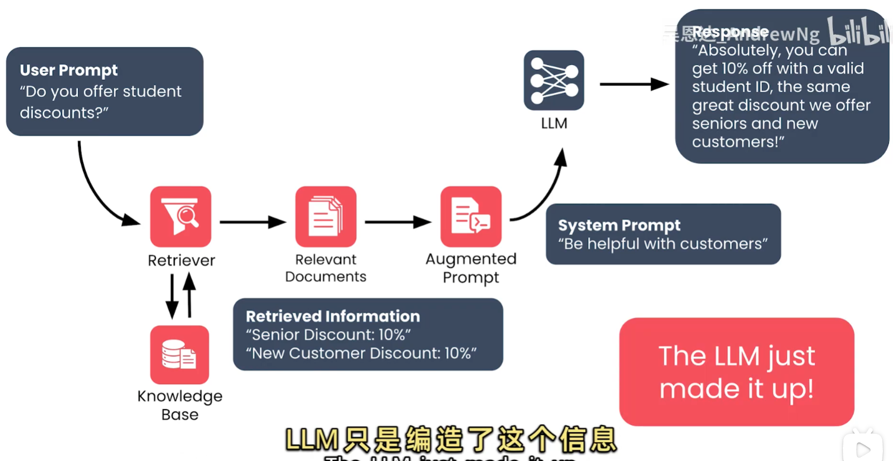
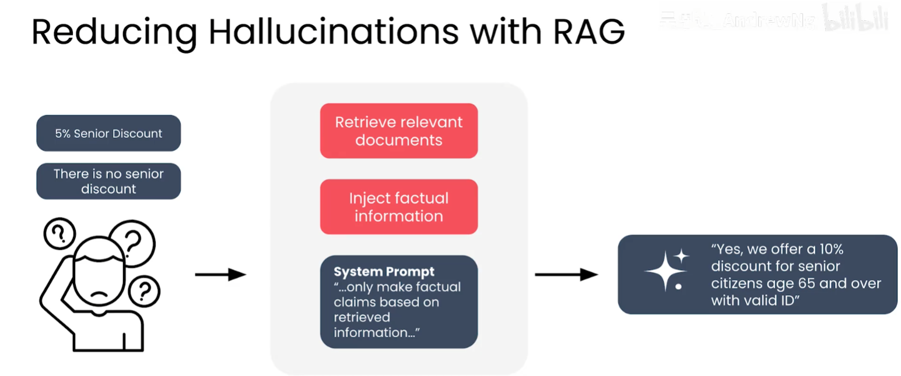

# RAG 与 LLM 幻觉

## 1. 什么是幻觉

幻觉（Hallucination）是模型生成了听起来合理、但没有事实依据或与来源不一致的内容。它可能表现为：

- 把小细节弄错，例如折扣比例、适用年龄或有效期限；
- 完全虚构知识库中不存在的事实；
- 对真实存在的事实作出错误否定；
- 把多个来源中的实体、数字或条件混在一起。

LLM 的训练目标是根据上下文预测最可能出现的词，而不是验证命题真假。它更接近于区分“可能”和“不太可能”，并不天然具备事实核查器的职责。因此，即使回答流畅、自信，也不能仅凭语言质量判断其正确性。

## 2. 购物客服案例



用户询问：“是否提供学生折扣？”检索器只找到两条信息：

| 检索到的事实 | 内容 |
| --- | --- |
| 老人优惠 | 10% 折扣 |
| 新用户优惠 | 10% 折扣 |

增强提示同时包含这些事实和“要帮助客户”的系统提示词。模型随后回答“凭学生证可以享受 10% 折扣”，把老人和新用户优惠错误地推广到学生群体。这个学生优惠并不存在，是模型为了形成一个看似有帮助的回答而编造的内容。

关键问题不是检索器一定找错了，而是模型没有把“来源中明确写出的内容”和“根据模式猜测的内容”区分开。

## 3. 幻觉类型与评估层次

| 类型 | 典型表现 | 主要风险 |
| --- | --- | --- |
| 细节错误 | 把 10% 写成 5%，或改错适用条件 | 业务规则执行错误 |
| 虚构事实 | 编造不存在的学生折扣 | 误导用户、造成损失 |
| 错误否定 | 声称“没有老人优惠”，但来源中有该优惠 | 错误拒答或漏服务 |
| 组合错误 | 将不同人群、时间或产品的条款拼接 | 复杂业务场景失真 |

不能只评价“回答是否通顺”，还应分别检查：检索是否召回正确来源、回答是否被来源支持、引用是否指向正确证据，以及是否在证据不足时拒答。

## 4. 用 RAG 降低幻觉



RAG 能提供外部事实，但不会自动保证答案正确。较稳妥的流程是：

```text
用户问题
  → 检索相关文档
  → 过滤权限、时间和来源质量
  → 将带标识的事实注入增强提示
  → 要求模型只依据这些事实回答
  → 输出答案和对应引用
  → 对关键事实做规则或人工校验
```

提示词可以明确写成：

```text
你是客服助手。只能依据“检索上下文”中的事实回答。
不要把未出现的优惠、数字、条件或政策推断为事实。
如果上下文没有足够证据，请明确说“当前资料无法确认”，并建议用户联系人工客服。
每个可核验的事实后附来源标识，例如 [来源: doc-17, 第 2 段]。
```

这类约束能减少无依据扩写，但不能消除所有幻觉：模型仍可能误读上下文、引用错误段落，或者在检索结果本身错误时忠实地生成错误答案。

## 5. 外部系统上下文与引用

不要只把检索文本拼接成一段无来源的上下文。应用层应为每个片段保留稳定的来源标识，例如文档 ID、版本、段落、URL 和更新时间：

```text
[doc-17 | 促销政策 v3 | 第 2 段 | 更新于 2026-08-01]
老年用户（65 岁及以上）凭有效证件可享受 10% 折扣。
```

引用至少应满足：

1. **可定位**：用户或审核者能找到原文位置；
2. **有支持关系**：引用确实支持前面的断言；
3. **版本明确**：政策变化后不会误用旧条款；
4. **缺证据可拒答**：不能用相似但不相关的来源凑引用。

因此，引用是外部系统提供的可追溯能力，不是模型自行声称“我有来源”就算完成。

## 6. 没有完美的应对方法

降低幻觉需要多个层次共同作用：

| 层次 | 可采取的措施 |
| --- | --- |
| 数据 | 清理重复、过期和互相矛盾的文档，记录版本与负责人 |
| 检索 | 使用关键词、语义和元数据过滤，评估 Recall@K 与 Precision@K |
| 提示 | 限制回答范围，要求逐条引用，证据不足时拒答 |
| 生成 | 降低随机性，限制输出格式和可用字段 |
| 校验 | 对数字、日期、资格条件使用规则校验或第二次核验 |
| 运营 | 对高风险回答保留日志、抽样评审并支持人工接管 |

这些措施只能降低概率，不能把概率模型变成完美的真值判定器。生产系统应把“有证据的回答”“明确拒答”和“转人工”都设计成正常结果。

## 7. ALCE Benchmark

ALCE（生成式回答中的引用评估）用于评估模型回答是否包含有效、正确且支持结论的引用。它把评价从“答案像不像正确答案”扩展到“答案是否由给定证据支持”。常见关注点包括：

- **引用正确性**：引用的内容是否真的支持对应陈述；
- **引用完整性**：重要外部事实是否都给出了引用；
- **答案质量**：回答是否相关、完整、可读；
- **端到端表现**：检索、生成和引用组合后是否有效。

ALCE 类评估适合用来比较不同提示词、检索器、重排器和引用格式。实践中还应加入业务自己的高风险样例，例如折扣、退款、医疗和法律条款，因为通用基准不能覆盖所有领域约束。

## 8. 使用 Ragas 自动评价

Ragas 是用于评价 RAG 流程的 Python 库，可以对测试集中的问题、检索上下文和模型答案计算指标。常见指标包括：

| 指标 | 检查内容 |
| --- | --- |
| Faithfulness | 答案中的陈述是否能被检索上下文支持 |
| Answer Relevancy | 答案是否真正回应用户问题 |
| Context Precision | 排在前面的检索片段是否更相关 |
| Context Recall | 是否找到了回答问题所需的事实 |

最小评估数据通常包含 `user_input`、`retrieved_contexts`、`response`，有参考答案时再加入 `reference`。示例：

```python
from ragas import evaluate
from ragas.dataset_schema import EvaluationDataset, SingleTurnSample
from ragas.metrics import Faithfulness, AnswerRelevancy

dataset = EvaluationDataset(samples=[SingleTurnSample(
    user_input="有学生折扣吗？",
    retrieved_contexts=["老人优惠 10%，新用户优惠 10%"],
    response="当前资料无法确认学生折扣。",
)])
result = evaluate(dataset, metrics=[Faithfulness(), AnswerRelevancy()])
print(result)
```

Ragas 分数是自动化信号，不是真值证明。应固定测试集、模型版本和评估提示词，并结合人工抽样检查，尤其关注数字、引用和拒答是否正确。

## 9. 用点赞和踩做 LLM A/B 测试

可以在答案下方提供“有帮助/没帮助”按钮，把真实用户反馈作为线上评价信号。A/B 测试时，将用户随机分配到两个版本，例如：

| 版本 | 实验变量 |
| --- | --- |
| A | 原有提示词或引用格式 |
| B | 强制基于检索事实回答，证据不足时拒答并附引用 |

记录实验版本、用户问题、检索文档、答案、点赞/踩、时间和必要的业务结果。主要比较：

```text
点赞率 = 点赞数 /（点赞数 + 踩数）
```

实验应使用稳定的随机分流和足够样本量，保持两组的模型、流量入口和用户群体可比；同时分层观察高风险问题、匿名用户和重复会话，避免只看总体平均数。点赞率只能反映用户感受，不能替代事实正确性检查，因此应与 Ragas、人工标注、投诉率和转人工率一起判断。

## 10. 最小检查清单

- 回答中的每个数字、日期、资格条件是否能在来源中定位？
- 是否把不同人群或不同版本的条款混在了一起？
- 没有证据时，系统是否会明确拒答而不是猜测？
- 引用是否支持对应句子，而不是只引用一篇相似文档？
- 检索质量、答案支持度和引用完整性是否分别评估？

> RAG 的作用是把外部资料带到生成过程里；事实边界、引用和拒答机制，才决定系统能否把这些资料可靠地传达给用户。
