# RAG 检索器

## 1. 目标

检索器（Retriever）负责从结构混乱、规模较大的知识库中，找到与用户提示最相关的文档或文档片段，并在毫秒级时间内返回结果。RAG 的基本流程是：用户提示先进入检索器，检索器返回相关文档，RAG 将文档加入增强提示，再交给 LLM 生成响应。

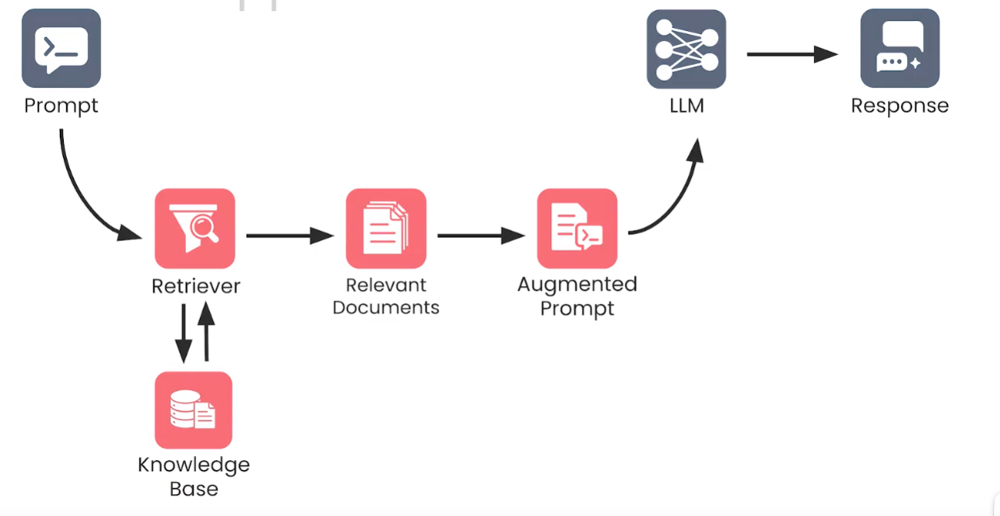

图中，检索器连接用户提示和知识库，输出相关文档；这些文档随后被加入增强提示，供 LLM 生成最终响应。

## 2. 两种搜索技术与元数据筛选

### 2.1 关键词搜索

关键词搜索（Keyword Search）寻找包含提示中确定词语的文档。它擅长处理专有名词、产品名、错误码、版本号和精确短语，结果通常容易解释。

局限是依赖词语匹配：文档使用同义词、缩写或不同表达时，即使含义相关，也可能无法命中。

#### 2.1.1 词袋与稀疏向量

关键词检索的基本直觉是：**文档包含的查询关键词越多，可能与查询越相关。** 这是相关性的近似判断，并不保证真正理解用户意图。

先将提示词分词，转换为词袋（Bag of Words）：忽略词序，记录每个词是否出现或出现多少次。图中的查询为：

> Making pizza without a pizza oven —— 不用披萨烤炉制作披萨。

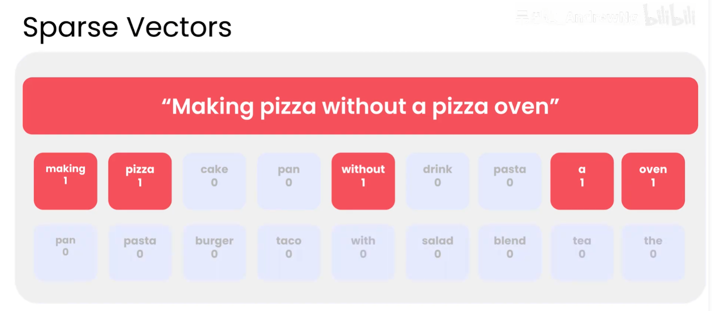

图中“Sparse Vectors”意为“稀疏向量”。向量的每一维对应**整个词表中的一个唯一词**，未出现的词为 0。由于查询只用到词表中的很少几个词，大部分维度为 0，因此称为稀疏向量。多个文档向量组织在一起，才构成稀疏矩阵。

| 词 | 中文含义 | 二值表示（是否出现） | 计数表示（出现次数） |
| --- | --- | --- | --- |
| making | 制作 | 1 | 1 |
| pizza | 披萨 | 1 | 2 |
| without | 不使用、没有 | 1 | 1 |
| a | 不定冠词 | 1 | 1 |
| oven | 烤炉 | 1 | 1 |
| cake、pan 等未出现的词 | 蛋糕、平底锅等 | 0 | 0 |

**原图采用二值表示，所以 `pizza` 标为 1；若按次数表示，则必须为 2。** 原图还重复展示了 `pan`、`pasta`，实际词表中每个词只对应一个维度。词袋忽略顺序，也无法充分表达 `without` 所代表的否定关系。

#### 2.1.2 词项—文档矩阵与倒排索引

预处理文档时，可以把每个文档转换为同一词表下的向量。按本例的画法，**行是词项，列是文档**，单元格记录是否出现、出现次数或加权值。

下面把图片二的命中情况翻译为表格；1 表示命中，0 表示未命中：

| 词项 | 文档 1 | 文档 2 | 文档 3 | 文档 4 | 文档 5 |
| --- | --- | --- | --- | --- | --- |
| making（制作） | 1 | 0 | 0 | 1 | 1 |
| pizza（披萨） | 1 | 0 | 1 | 0 | 0 |
| without（不使用） | 1 | 1 | 0 | 1 | 1 |
| a（不定冠词） | 1 | 1 | 0 | 1 | 1 |
| oven（烤炉） | 1 | 1 | 0 | 1 | 1 |
| 命中的不同查询词数 | **5** | **3** | **1** | **4** | **4** |

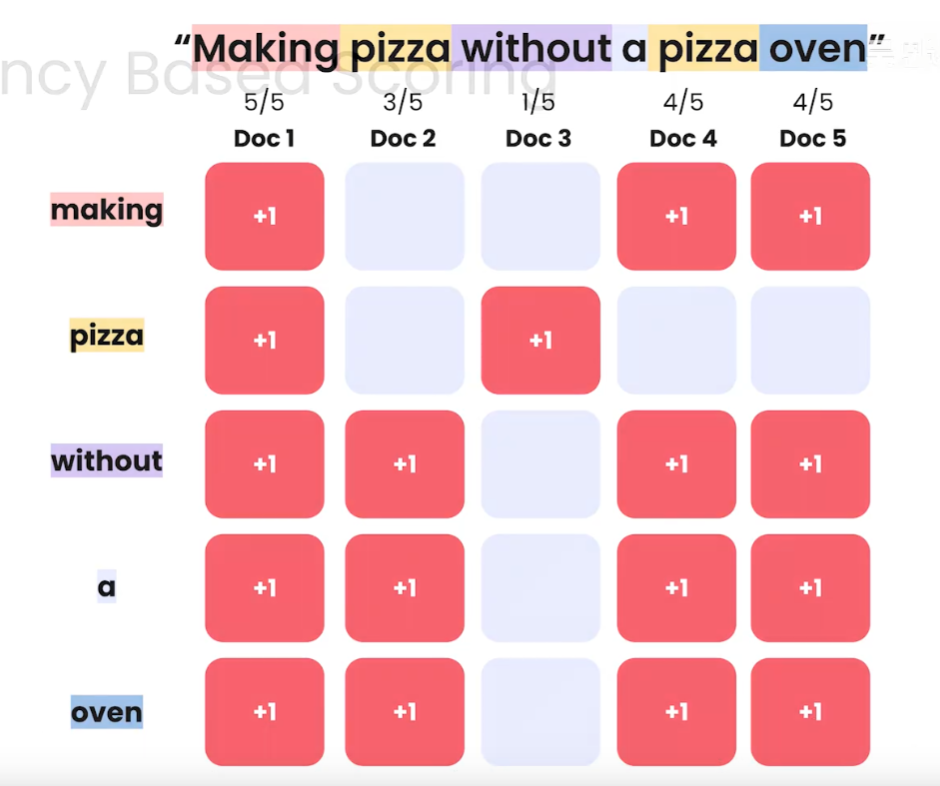

倒排索引（Inverted Index）可以理解为按词项保存矩阵中非零位置的信息，但**矩阵是逻辑表示，倒排索引是便于查找的数据结构，两者不完全等同**。实际通常保存“词项 → 文档列表”，并可附带词频、位置等信息，而不保存大量的 0。

```text
正向索引：文档 → 其中包含的词
倒排索引：词 → 包含该词的文档

pizza → 文档 1、文档 3
oven  → 文档 1、文档 2、文档 4、文档 5
```

查询时通过词项直接找到包含它的文档，通常无需扫描全部文档正文。

#### 2.1.3 从命中计数到词频与长度归一化

评分可以逐步改进：

| 方法 | 如何计分 | 局限或改进目标 |
| --- | --- | --- |
| 不同词命中计数 | 每个查询词在文档中出现就加 1 分，同一个词只计一次 | 忽略同一关键词重复出现的信息 |
| 原始词频计分 | 查询词每出现一次就加 1 分，例如 `oven` 出现 3 次就贡献 3 分 | 长文档容易因为词多而获得高分 |
| 长度归一化词频 | 将某词出现次数除以文档总词数 | 缓解文档长度影响，但未区分常见词与稀有词 |
| TF-IDF 加权 | 词频再乘以逆文档频率 | 降低普遍词的权重，提高有区分力的词的权重 |

设 `count(t,d)` 是词 `t` 在文档 `d` 中出现的次数，`|d|` 是文档分词后的总词数（包含重复词）。本节采用的一种归一化词频定义是：

```text
TF(t,d) = count(t,d) / |d|
```

例如，`oven` 在 100 词的文档中出现 3 次，TF 为 `3/100 = 0.03`；在 1,000 词的文档中出现 10 次，TF 为 `10/1000 = 0.01`。后者虽然出现次数更多，但占比更低。

**分母是文档的总词数，不是不同词的数量，也不是查询词命中次数。** TF 也有直接使用原始次数、对次数取对数等定义；这里使用长度归一化形式解释长文档偏置。

#### 2.1.4 DF 与 IDF：奖励有区分力的词

即使归一化了长度，`a`、`the` 等常见词仍可能占据较多分数。它们在许多文档中都出现，区分相关文档的能力较弱。

**文档频率 DF（Document Frequency）是包含某词的文档数量，不是该词在所有文档中出现的总次数。** 同一词在同一文档中出现 100 次，对 DF 也只贡献 1。

设语料库共有 `N` 篇文档，包含词 `t` 的文档有 `df(t)` 篇。先计算文档占比 `df(t)/N`，取倒数得到 `N/df(t)`，再取对数，得到一种基础 IDF 定义：

```text
IDF(t) = log(N / df(t))
```

图片三“统计文档 → 取倒数奖励稀有词 → 取对数”的步骤可翻译为：

| 步骤（N = 100） | pizza（披萨） | the（常见冠词） |
| --- | --- | --- |
| 包含该词的文档数量 df | 5 | 100 |
| 文档占比 df/N | 5/100 = 0.05 | 100/100 = 1 |
| 占比的倒数 N/df | 20 | 1 |
| 取以 10 为底的对数 | log₁₀(20) ≈ **1.30** | log₁₀(1) = **0** |

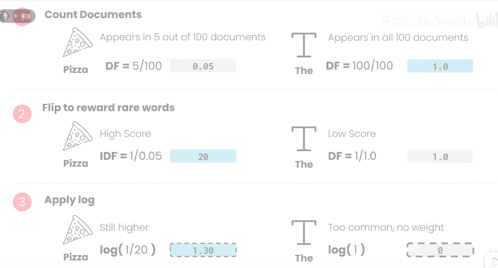

取倒数使稀有词获得更高权重；取对数压缩差距，避免稀有词的权重增长过快。例如，倒数从 20 增大到 100 时，对数值只从约 1.30 增大到 2。

**原图勘误：** 图中把 `df/N` 标为 DF，实际展示的是文档占比；`pizza` 最后一步应为 `log₁₀(20)`，不是图中的 `log(1/20)`，后者会得到负数。`the` 取倒数一行的“DF”标签也应理解为中间的逆频率值。

这里的基础公式要求 `df(t) > 0`；实际工具可能使用平滑公式，对未见词另行处理，因此不同实现的 IDF 数值不一定相同。

#### 2.1.5 TF-IDF 矩阵与查询匹配

TF-IDF（Term Frequency–Inverse Document Frequency，词频—逆文档频率）结合词在当前文档中的频率和词在整个语料库中的稀有程度：

```text
TF-IDF(t,d) = TF(t,d) × IDF(t)
```

对词项—文档矩阵的各单元格进行加权，就得到 TF-IDF 矩阵。查询也可以转换为同一词表下的 TF-IDF 向量，再通过点积或余弦相似度给文档排序。

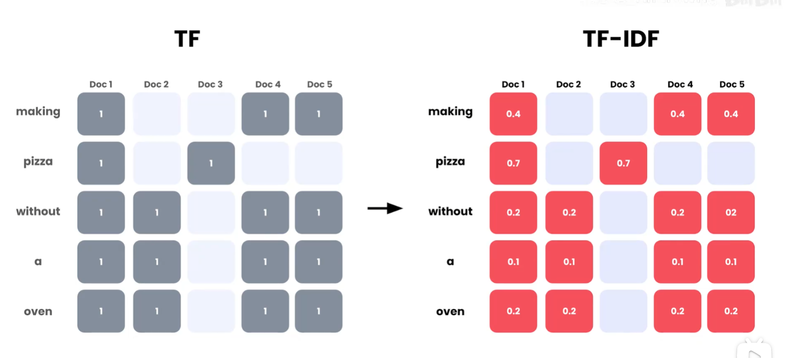

图中左侧是 TF（词频）示意，右侧是 TF-IDF 加权后的示意。`Doc 1～5` 表示文档 1～5；`pizza` 的示意权重 0.7 高于 `a` 的 0.1，表达的是有区分力的词贡献更多分数。

**图中数值仅作概念示意，不能直接由左侧五篇文档按本节公式复算。** 例如，`without`、`a`、`oven` 在图中都出现在四篇文档里，按相同语料与基础公式计算应具有相同 IDF；图中却给出了不同权重。严格计算需要明确完整语料、真实词频和采用的归一化方式。

图片五的高低分示例翻译如下（数值沿用该图，不与上一张图混算）：

| 文档类别 | 命中词及其示意贡献 | 说明 |
| --- | --- | --- |
| 高分文档（High Scoring Document） | pizza：1.3；oven：1.1 | 命中更有区分力的主题词 |
| 低分文档（Low Scoring Document） | a：0；without：0.1 | 主要命中较常见的词 |

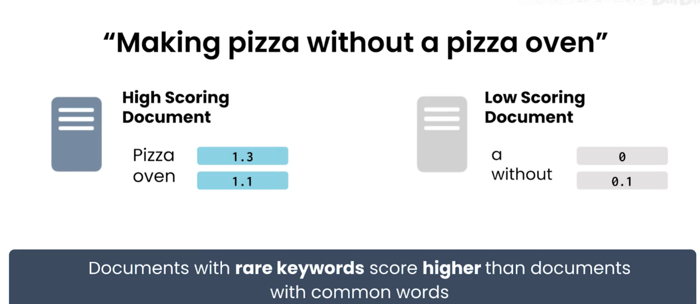

图中结论可译为：**在其他条件相近时，命中查询中稀有关键词的文档，比只命中常见词的文档获得更高分。** 这里的“稀有”由语料库中的文档频率决定；与查询无关的稀有词不会仅因稀有就提高匹配分数。

TF-IDF 仍然是词面匹配方法，不能保证区分“需要披萨烤炉”和“不需要披萨烤炉”。它解释了关键词加权的基本思想；实际检索系统也常使用 BM25，对词频饱和与文档长度作进一步处理。

#### 2.1.6 BM25：Best Matching 25

BM25（Best Matching 25，最佳匹配 25）是经典的概率相关性排序函数。“25”表示它是提出者设计的一系列评分函数中的第 25 个变体，不代表只能返回 25 篇文档。它通常作为生产环境中的标准关键词检索算法，与 TF-IDF 相比计算成本相近，但对词频和文档长度的处理更灵活。

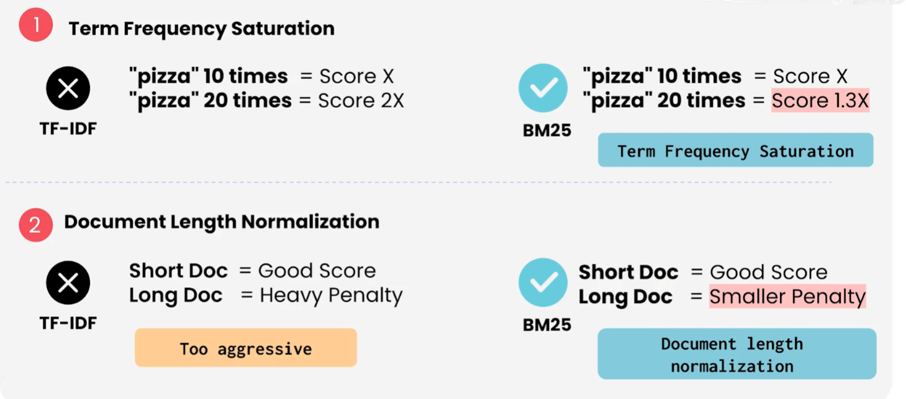

BM25 主要解决两个问题：

1. **词频饱和（Term Frequency Saturation）**：关键词出现次数增加会提升分数，但收益逐渐变小。TF-IDF 中出现 20 次可能近似得到出现 10 次的两倍贡献；BM25 会把这部分收益限制在一个上限附近。图中用“10 次为 `Score X`、20 次约为 `Score 1.3X`”说明这一趋势，具体比例取决于参数和其他项。
2. **文档长度归一化（Document Length Normalization）**：长文档不会因包含更多词而受到过度惩罚。BM25 根据文档长度与平均文档长度的比值调整词频项，并通过参数控制惩罚强度。

##### BM25 单个词项的评分

对查询中的一个词 `t` 和文档 `d`，常见 BM25 词项得分为：

```text
score(t, d) = IDF(t) × ( TF(t,d) × (k1 + 1) )
                         / ( TF(t,d) + k1 × (1 - b + b × |d| / avgdl) )
```

其中：

| 符号 | 含义 |
| --- | --- |
| `TF(t,d)` | 词 `t` 在文档 `d` 中的出现次数 |
| `|d|` | 文档 `d` 的长度，通常是分词后的词数 |
| `avgdl` | 语料库中文档的平均长度 |
| `IDF(t)` | 词 `t` 的逆文档频率，具体平滑公式由实现决定 |
| `k1` | 词频饱和参数，常见范围约为 1.2～2.0 |
| `b` | 文档长度归一化参数，范围通常为 0～1 |

查询包含多个词时，将每个查询词的得分相加：

```text
BM25(query, d) = Σ score(t, d)    # t 遍历查询中的词
```

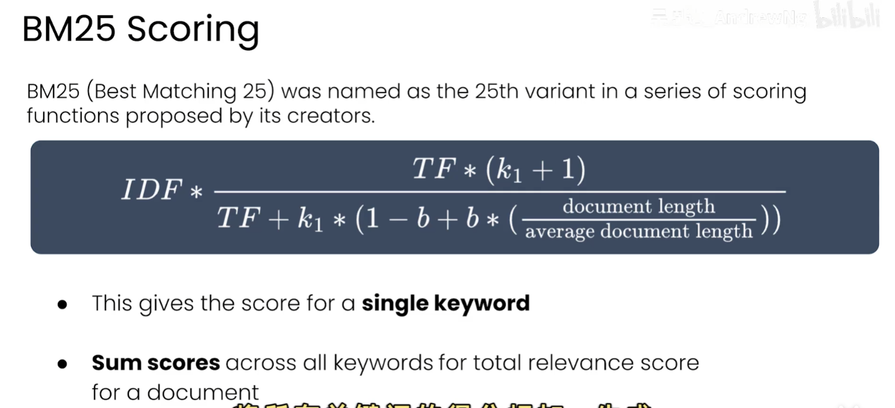

##### `k1` 与 `b` 的调节

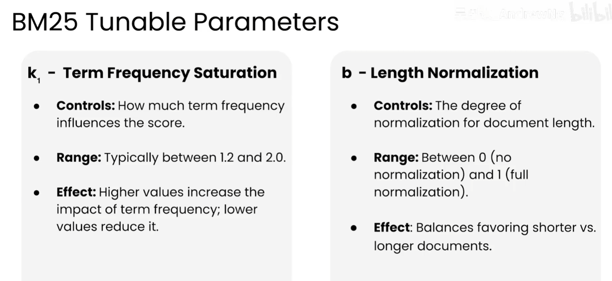

| 参数 | 控制内容 | 调大后的倾向 | 常见范围 |
| --- | --- | --- | --- |
| `k1` | 词频饱和速度与词频影响 | 允许词频在更大范围内影响分数，饱和更慢 | 约 1.2～2.0 |
| `b` | 文档长度归一化程度 | 更强地平衡短文档与长文档 | 0～1 |

`b = 0` 表示不做长度归一化；`b = 1` 表示完全按文档长度归一化。实际值应使用领域数据和检索评估集调参，而不是机械采用默认值。

##### TF-IDF 与 BM25 的选择

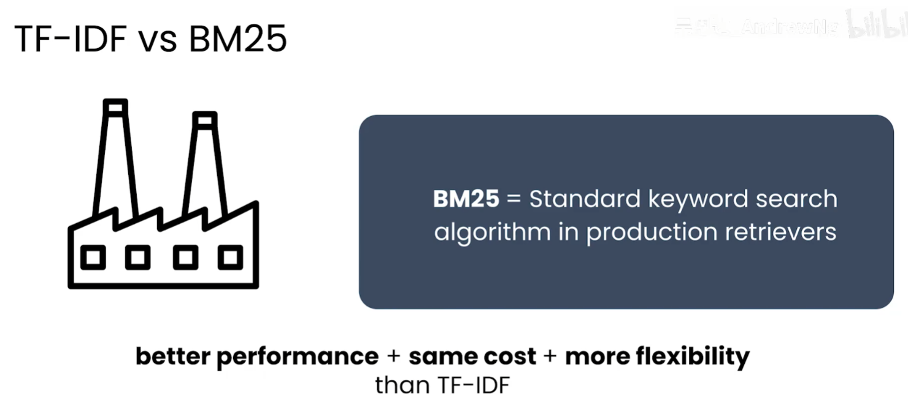

| 特性 | TF-IDF | BM25 |
| --- | --- | --- |
| 词频处理 | 通常随词频增加，容易持续增大 | 词频饱和，重复出现的边际收益递减 |
| 长度处理 | 常需额外归一化 | 内置可调的长度归一化 |
| 参数灵活性 | 相对较少 | 可通过 `k1`、`b` 调整 |
| 常见用途 | 教学、基线和简单检索 | 生产环境的关键词检索和混合检索候选召回 |

BM25 仍是词面匹配方法，不能识别同义表达或真正理解语义；通常与语义搜索结合，作为混合检索的一路候选来源。BM25 排序后再取前 25 篇，只是一个 `top_k=25` 的业务设置，与算法名称中的“25”无关。

### 2.2 语义搜索

语义搜索（Semantic Search）将提示和文档表示成向量，再按向量相似度寻找含义相近的文档。它可以找到没有出现相同关键词、但表达相同意图的内容，适合自然语言问题和概念检索。

局限是对精确标识符不够敏感，且可能返回主题相似但事实并不匹配的内容。

#### 2.2.1 Embedding：把文本映射到向量空间

Embedding 模型把词、短语、句子或文档映射为固定长度的向量。语义相近的文本通常会被映射到向量空间中较近的位置，语义差异较大的文本距离更远。向量的每一维通常没有单独可解释的词义，整体位置表达模型学到的语义特征。

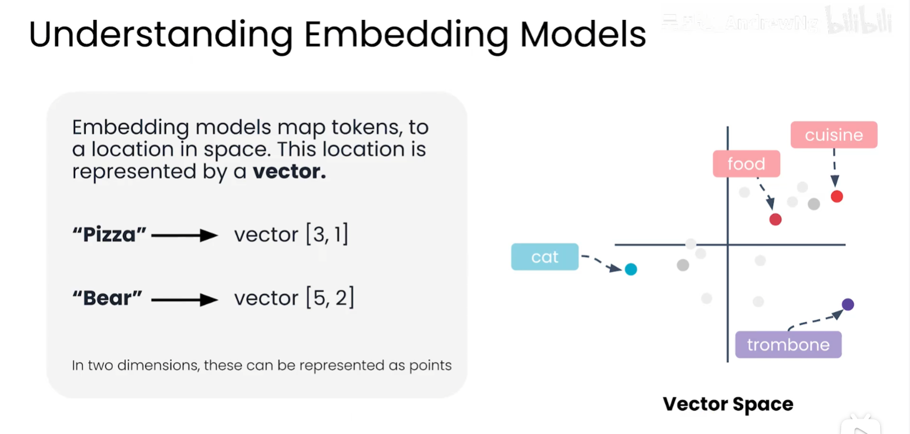

图中用“pizza → [3, 1]”“bear → [5, 2]”说明文本可表示为向量；右侧的 `food` 与 `cuisine` 位置接近，表示含义相近，`cat` 与 `trombone` 则位于其他区域。二维坐标只是便于展示，真实 Embedding 通常有数百到上千个维度。

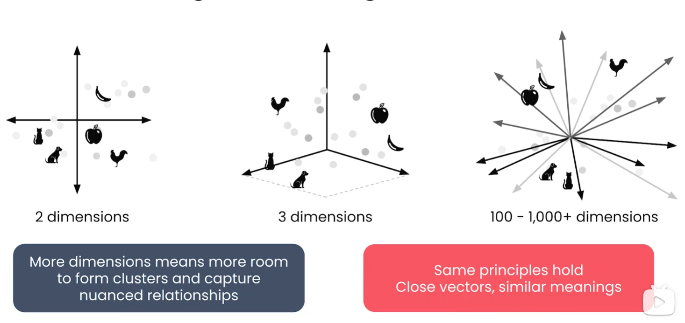

维度增加后，向量空间有更多位置来表达细粒度关系并形成语义簇，但基本原则不变：向量越接近，通常表示语义越相似。实际检索不能直接观察高维空间，必须使用相似度函数排序。

#### 2.2.2 相似度测量

常用的相似度或距离包括：

| 方法 | 核心计算 | 说明 |
| --- | --- | --- |
| 余弦相似度 | `cos(θ) = (A·B) / (||A|| ||B||)` | 比较向量方向，常用于文本 Embedding；对整体长度不敏感 |
| 欧氏距离 | `||A-B||₂` | 计算空间中的直线距离；向量尺度会影响结果 |
| 点积 | `A·B` | 计算简单；同时受方向和向量长度影响 |

余弦相似度越大，通常表示语义越接近；欧氏距离越小，通常表示越接近。若模型或向量数据库要求归一化向量，余弦相似度与点积排序可能等价，但不能混用不同模型的向量或未经说明的分数。

语义检索的基本流程是：

```text
文档分块 → Embedding 编码 → 写入向量索引
用户查询 → 使用同一向量模型编码 → 计算相似度 → 返回 Top-K
```

关键词搜索依赖词面重合，语义搜索依赖向量空间中的近邻关系。实际系统常把二者结合，以同时覆盖同义表达和错误码、版本号等精确词面。

### 2.3 元数据筛选

**元数据（Metadata）是描述文档的附加信息**，可能包括标题、作者、创建日期、访问权限等。元数据筛选（Metadata Filtering）利用这些字段限制候选文档的范围。

| 元数据 | 示例 | 作用 |
| --- | --- | --- |
| 标题 | 产品使用指南 | 标识文档，可用于精确条件匹配 |
| 作者 | 某位作者、某个团队 | 限定资料来源 |
| 创建日期 | 2026-08-16 | 限定创建时间范围 |
| 部门 | 开发部、财务部 | 限制用户可见的业务范围 |
| 访问权限 | 项目成员、管理员 | 避免返回无权访问的文档 |
| 订阅要求 | 免费、付费 | 限制不同订阅等级可见的文章 |
| 地区 | 北美、欧洲 | 限定适用地区 |
| 文档类型 | 规范、故障记录、API 文档 | 匹配任务所需的资料类型 |

#### 2.3.1 三种搜索技术对比

| 技术 | 工作方式 | 优点 | 局限 |
| --- | --- | --- | --- |
| 元数据筛选（Metadata Filtering） | 根据文档元数据中的固定条件缩小结果范围，例如日期、作者、地区或权限 | 快速、简单，适合明确的“是/否”条件 | 不能单独判断正文相关性，通常不能独立完成搜索 |
| 关键词搜索（Keyword Search） | 根据提示词与文档中是否出现相同关键词进行计分和排序 | 速度快；关键词、错误码、版本号等精确词面很重要时效果好 | 依赖精确匹配，同义词或不同表达可能无法命中 |
| 语义搜索（Semantic Search） | 将提示和文档编码为向量，根据语义相似度计分和排序 | 能识别相近含义，表达更灵活 | 计算成本更高、速度通常较慢，也可能返回主题相近但事实不匹配的内容 |

三者职责不同：**元数据筛选决定哪些文档可以进入候选集，关键词搜索判断词面是否匹配，语义搜索判断含义是否接近。** RAG 通常组合使用它们，以兼顾权限范围、精确术语和自然语言表达。

#### 2.3.2 RAG 中的元数据过滤

**元数据过滤本身不执行相关性检索，而是根据用户属性，缩小其他搜索技术返回的结果范围。** 图中场景的过滤条件来自发起查询的用户属性，而不是查询内容。

| 场景 | 用户属性 | 过滤规则（图片译文） |
| --- | --- | --- |
| 订阅过滤（Subscription Filtering） | 免费用户 | 排除所有元数据为 `subscription = paid`（需要付费订阅）的文章 |
| 地理位置过滤（Geographic Filtering） | 位于北美的用户 | 只保留元数据为 `region = North America`（地区为北美）的文章 |

这里需要区分：**文档元数据描述文档，用户属性决定当前用户适用的过滤条件。** 例如，系统从已认证用户的信息中取得订阅等级，再与文章的订阅要求匹配；不能因为提示词写着“我是付费用户”就放行付费文章。

“不执行检索”不表示不能直接过滤文档，而是说明它不负责判断内容与问题是否相关。实现时可以在搜索前、搜索过程中或搜索后应用过滤条件。图中强调的是用户属性驱动的过滤；一般系统也可以从查询中提取日期、作者等非权限条件，但权限条件必须由可信身份和授权策略决定。

#### 2.3.3 优势与局限

| 类别 | 图片内容的中文翻译 |
| --- | --- |
| 优势 | 简单，容易理解和调试。 |
| 优势 | 速度快，经过优化，技术成熟且可靠。 |
| 优势 | 严格执行检索规则，精确匹配过滤条件。 |
| 局限 | 本身不是真正的相关性搜索。 |
| 局限 | 规则固定，不理解正文内容，也不提供相关性排名方式。 |
| 局限 | 单独使用无法完成相关内容检索，需要配合其他搜索技术。 |

元数据过滤解决的是**哪些文档允许进入结果集**；关键词搜索和语义搜索解决的是**哪些文档与问题相关，以及相关程度如何**。

## 3. 混合检索

混合检索（Hybrid Search）将关键词搜索和语义搜索结合起来，再对每个结果列表进行元数据筛选，最后合并并重新排序。

典型流程如下：

```text
知识库
  ├─ 关键词搜索 → 候选列表（20～50 个文档）→ 元数据筛选 ─┐
  └─ 语义搜索   → 候选列表（20～50 个文档）→ 元数据筛选 ─┤
                                                        ↓
                                             合并、去重、融合排名
                                                        ↓
                                             返回最高排名的文档
```

两个列表通常包含许多相同文档，但由于搜索方式不同，文档排名可能不同。合并时应去重，并保留两种搜索的分数或排名信息，再计算最终排名。

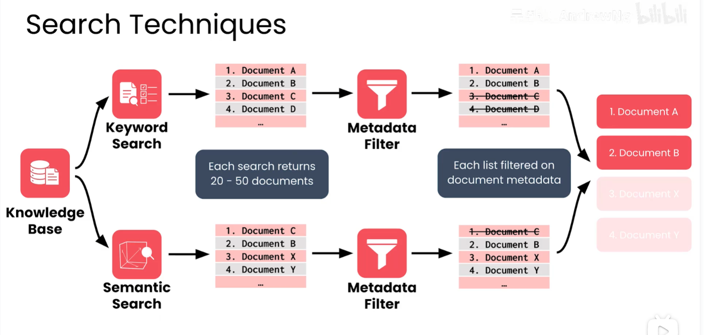

### 3.1 排名融合示例

设关键词搜索和语义搜索的归一化分数分别为 `s_keyword` 和 `s_semantic`，可以使用加权组合：

```text
final_score = α × s_keyword + (1 - α) × s_semantic
```

其中 `α` 控制两种技术的相对权重。关键词、错误码和版本号较多的系统可以提高 `α`；用户问题更偏自然语言和概念描述时，可以提高语义搜索权重。实践中还应加入权限过滤、时间新鲜度和文档质量等因素。

### 3.2 互惠排名融合（RRF）

元数据过滤后，关键词检索和语义检索分别得到两个有序文档列表。合并时先按文档 ID 去重，再使用互惠排名融合（Reciprocal Rank Fusion，RRF）计算统一分数。RRF 奖励在任一列表中排名靠前的文档，不要求两个检索器的原始分数具有相同量纲。

对文档 `d`，基础 RRF 分数为：

```text
RRF(d) = Σ 1 / (k + rank_i(d))
```

其中 `rank_i(d)` 是文档在第 `i` 个列表中的名次，从 1 开始；文档未出现在某个列表时，该列表不贡献分数；`k` 是平滑常数，用于降低第一名对结果的绝对支配。`k = 0` 时，第 1 名得 1 分、第 2 名得 0.5 分；增大 `k` 会减小不同名次之间的差距。RRF 只使用排名，不使用关键词或语义检索的原始相似度分数。

需要偏向某一路检索时，可以使用加权 RRF：

```text
RRF_weighted(d) = β × Σ 1 / (k + rank_semantic(d))
                  + (1 - β) × Σ 1 / (k + rank_keyword(d))
```

`β` 越大，语义检索权重越高；例如 `β = 0.8` 表示语义权重 80%、关键词权重 20%，`β = 0.7` 表示语义权重 70%、关键词权重 30%。如果精确关键词、错误码或版本号更重要，应降低 `β`；如果自然语言表达和同义语义更重要，可提高 `β`。

最终按融合分数降序排列，取前 `top_k` 个文档。`top_k` 表示混合检索结果中要返回的最相似（排名最高）文档数量，而不是 RRF 公式中的参数。

## 4. 高性能设计要点

### 4.1 先过滤，再扩大候选

在权限和租户边界明确的场景中，尽早应用可下推的元数据过滤，减少需要计算相似度和排序的文档数量。但必须保证过滤条件不会绕过访问控制。

### 4.2 控制候选集大小

关键词搜索和语义搜索各返回约 20～50 个候选文档，通常足以覆盖相关结果，也能限制合并与重排成本。`top_k` 应通过离线评估和线上延迟数据调整，而不是固定照搬。

### 4.3 为毫秒级响应准备索引

- 关键词搜索使用倒排索引；
- 语义搜索使用向量索引，并选择适合数据规模的近似最近邻算法；
- 文档向量和常用元数据保持在可快速访问的存储中；
- 对重复查询、热门查询和稳定的过滤条件使用缓存；
- 并行执行关键词搜索和语义搜索，再进行结果融合。

### 4.4 质量与延迟一起评估

只追求延迟可能漏掉关键文档，只追求召回率又会增加重排和上下文长度。至少同时观察：

| 指标 | 关注点 |
| --- | --- |
| 召回率 | 相关文档是否进入候选列表 |
| 排名质量 | 相关文档是否位于前列 |
| 端到端延迟 | 检索是否满足毫秒级目标 |
| 权限正确性 | 是否只返回用户有权访问的内容 |
| 新鲜度 | 是否优先返回有效版本 |

## 5. 技术选择的平衡

高性能检索器没有适用于所有项目的固定配比。设计时应先了解每种技术的优势：关键词搜索提供精确匹配和可解释性，语义搜索提供表达灵活性，元数据筛选提供权限和范围控制；再根据领域词汇、文档规模、访问控制、更新频率和延迟目标调整三者的平衡。

## 6. 最小实现伪代码

```python
def hybrid_search(query, filters, top_k=10):
    keyword_hits, semantic_hits = parallel_search(query)
    keyword_hits = apply_metadata_filter(keyword_hits, filters)
    semantic_hits = apply_metadata_filter(semantic_hits, filters)
    return rrf_merge_and_deduplicate(keyword_hits, semantic_hits, top_k)
```
