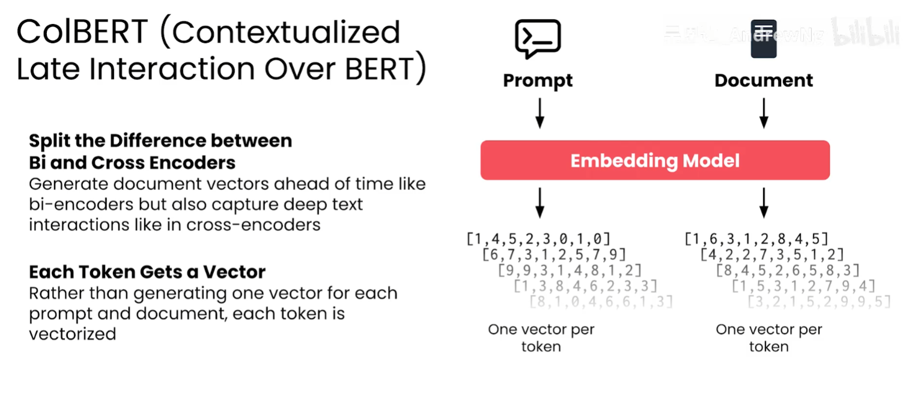

# RAG 重新排名

## 1. 重新排名解决什么问题

RAG 通常先用关键词检索、向量检索或混合检索，从知识库中快速召回一批候选文档，再对候选文档重新排名（Reranking）。

```text
用户查询
  → 粗召回：快速找到候选集（例如 20～100 条）
  → 重新排名：逐条判断查询与候选文档的相关性
  → 取 Top-K
  → 将高质量片段交给 LLM
```

粗召回的目标是**不要漏掉相关文档**；重新排名的目标是**把最相关的文档排到前面**。重排器只能重新排列已经召回的候选，候选集中不存在的文档无法被它找回。

## 2. 三种编码方式

### 2.1 Bi-Encoder：双编码器

Bi-Encoder（双编码器，也称双塔模型）分别编码查询和文档：

```text
查询 → 编码器 → 查询向量
文档 → 编码器 → 文档向量
查询向量与文档向量 → 余弦相似度或点积
```

文档向量可以在查询到达前预先计算并写入向量索引；查询到达后只需编码一次查询，再执行近似最近邻（ANN）搜索。因此它适合百万级甚至更大规模的知识库，也是 RAG 第一阶段常用的召回方式。

**优点**：速度快、易于预计算、适合大规模 ANN 检索。

**局限**：查询和文档在编码时没有直接交互，细粒度词语关系、否定关系和局部匹配可能表达不足。

### 2.2 Cross-Encoder：交叉编码器

Cross-Encoder 将查询和一篇候选文档拼接后一起输入模型：

```text
（查询，文档） → 交叉编码器 → 相关性分数
```

模型在联合上下文中判断二者的匹配程度，通常输出一个相关性分数。由于每个查询—文档对都要单独推理，无法提前为文档计算一个与查询无关的固定向量，速度明显慢于 Bi-Encoder。

因此 Cross-Encoder 更适合重排几十条候选结果，而不是扫描整个知识库。它通常能获得比单纯向量相似度更准确的排序，但会增加推理延迟和算力成本。

| 对比项 | Bi-Encoder | Cross-Encoder |
| --- | --- | --- |
| 编码方式 | 查询、文档分别编码 | 查询与文档联合编码 |
| 文档是否可预计算 | 可以 | 不能针对所有查询预计算 |
| 检索规模 | 全库或百万级候选 | 通常几十条候选 |
| 速度 | 快 | 慢 |
| 交互建模 | 较弱 | 较强 |
| 常见职责 | 粗召回 | 精排、重新排名 |

### 2.3 Late Interaction：延迟交互

Late Interaction 位于 Bi-Encoder 和 Cross-Encoder 之间。以 ColBERT（Contextualized Late Interaction over BERT）为例，查询和文档可以分别编码，但不是把整段文本压成一个向量，而是保留每个 token 的向量表示。检索时再计算查询 token 与文档 token 之间的局部匹配，并聚合为文档分数。



图中查询和文档分别经过 Embedding 模型，每个 token 都得到一个向量；这些 token 级表示可以预先保存文档部分，查询到达后通过局部最大匹配等方式计算相关性。这样既保留了独立编码带来的部分效率，又比单一向量保留更多细粒度交互信息。

**取舍**：ColBERT 通常比单向量 Bi-Encoder 占用更多存储和计算，但在长文档、实体匹配和高质量企业 RAG 中可能获得更好的排序效果；它仍然不是把完整查询和文档一次性联合输入的 Cross-Encoder。

#### 存储空间大约增加多少

可以用下面的公式做一阶估算（暂不计索引结构、ID、元数据和压缩开销）：

```text
单向量 Embedding：D × bytes_per_value
ColBERT 文档表示：L × D_c × bytes_per_value
空间倍数 ≈ (L × D_c) / D
```

其中 `D` 是普通 Embedding 的维度，`D_c` 是 ColBERT 每个 token 的维度，`L` 是每个文档块实际保留的 token 数。查询向量通常是在线生成的，不会像文档表示一样长期存储。

例如，普通模型使用 `D=768`、FP32，每个文档块约 512 个 token；ColBERT 使用 `D_c=128`、FP32：

```text
普通 Embedding：768 × 4 = 3,072 bytes ≈ 3 KB
ColBERT：512 × 128 × 4 = 262,144 bytes ≈ 256 KB
空间倍数：约 85 倍
```

如果文档块只有 180 个 token（ColBERT 官方示例中的 `doc_maxlen=180`），倍数约为 `180×128/768 = 30` 倍。也就是说，**未压缩时常见量级约为普通单向量索引的 30～100 倍**；实际值主要由文档块长度和两种模型的维度比决定。

压缩会显著改变这个结论。ColBERT 实现支持 `nbits=2` 等量化配置，ColBERTv2 还使用残差压缩；理想情况下，128 维向量从 FP32 的 32 bit/维降到 2 bit/维，向量主体约缩小 16 倍。因此上例的 30～85 倍理论开销可能降到约 2～5 倍，再加上码本、残差、查找表和索引结构，线上实际倍数需要以真实索引目录大小测量。

**结论**：ColBERT 的额外成本不是“多存一个向量”，而是“每个 token 存一个向量”。规划容量时先按未压缩公式留出上限，再用目标压缩配置在代表性数据集上实测；不要直接把论文或示例中的倍数当成所有语料的固定值。

## 3. 两阶段检索架构

典型生产方案是“Bi-Encoder 粗召回 + Cross-Encoder 重排”：

1. 对知识库文档分块，并提前计算 Bi-Encoder 文档向量。
2. 用户查询经过同一向量模型编码。
3. 向量数据库通过 ANN 返回候选集，例如前 50 条。
4. 将查询分别与这 50 条候选文档组成文本对，交给 Cross-Encoder 打分。
5. 按重排分数降序排列，取前 `K` 条交给生成模型。

```python
def retrieve_and_rerank(query, top_k=5, candidates=50):
    hits = vector_search(query, top_k=candidates)
    scored = [(doc, reranker.score(query, doc.text)) for doc in hits]
    return sorted(scored, key=lambda item: item[1], reverse=True)[:top_k]
```

这里的 `candidates` 应大于最终的 `top_k`，否则重排器没有足够的候选进行筛选。候选数越大，召回覆盖率通常越高，但 Cross-Encoder 的推理延迟和成本也越高。

## 4. 为什么要重排

向量召回擅长快速找到语义相近的内容，但前排结果可能存在以下问题：

- 主题相似，却没有回答查询中的关键约束；
- 只匹配了大致主题，没有匹配实体、时间、版本或数值；
- 多个候选内容相似，真正包含答案的片段没有排在最前；
- 查询包含否定、条件或多个子意图，单一向量难以充分表达。

重排器可以对查询和候选正文进行更细致的联合判断，降低无关上下文进入 LLM 的概率。它提升的是候选集内的排序质量，不会替代召回器，也不能修复分块、权限过滤或知识库缺失问题。

## 5. 方法对比

| 方法 | 查询与文档交互时机 | 速度 | 排序精度倾向 | 适合位置 |
| --- | --- | --- | --- | --- |
| Bi-Encoder | 编码阶段不交互，检索时比较整体向量 | 快 | 中等 | 第一阶段粗召回 |
| Cross-Encoder | 对每个查询—文档对联合编码 | 慢 | 高 | 第二阶段重排 |
| ColBERT / Late Interaction | 分别编码，检索时做 token 级局部交互 | 介于两者之间 | 通常高于单向量召回 | 高质量召回或重排 |

没有一种方法在所有场景都最好。知识库规模、延迟目标、文档长度、GPU 预算和评估集结果共同决定组合方式。常见默认方案是先使用 Bi-Encoder 或混合检索控制候选规模，再使用 Cross-Encoder 提升前排质量。

## 6. 工程注意事项

### 6.1 先做权限过滤

权限、租户和数据隔离条件应在召回阶段尽早执行，或至少在结果交给重排器和 LLM 前强制执行。不能依赖重排分数隐藏无权访问的文档。

### 6.2 控制候选数量

候选数应通过 `Recall@K`、`nDCG@K`、MRR 和 P95 延迟共同选择。候选太少会漏掉答案，候选太多则增加重排成本和长尾延迟。

### 6.3 保留可解释信息

线上日志至少记录召回器、重排器、候选数量、最终排名、模型版本和耗时，便于判断问题来自“没有召回”还是“重排错误”。

### 6.4 不要直接比较不同分数

Bi-Encoder 相似度、Cross-Encoder logits 和 ColBERT 聚合分数通常不在同一量纲上。若要融合多路结果，应先做排名融合（如 RRF）或在验证集上校准权重，不要直接把原始分数相加。

## 7. 一句话记忆

> **Bi-Encoder 负责快速找得到，Cross-Encoder 负责逐条排得准，ColBERT 用 token 级延迟交互在速度和精度之间取平衡。**
