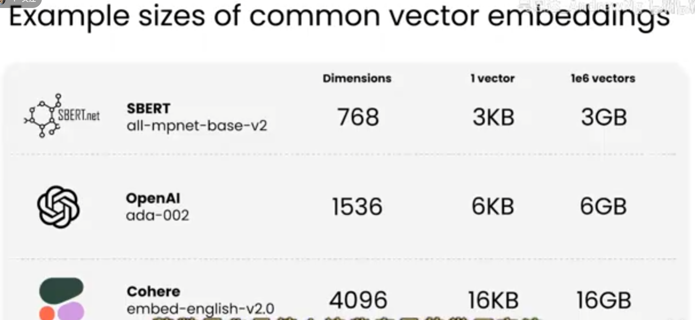
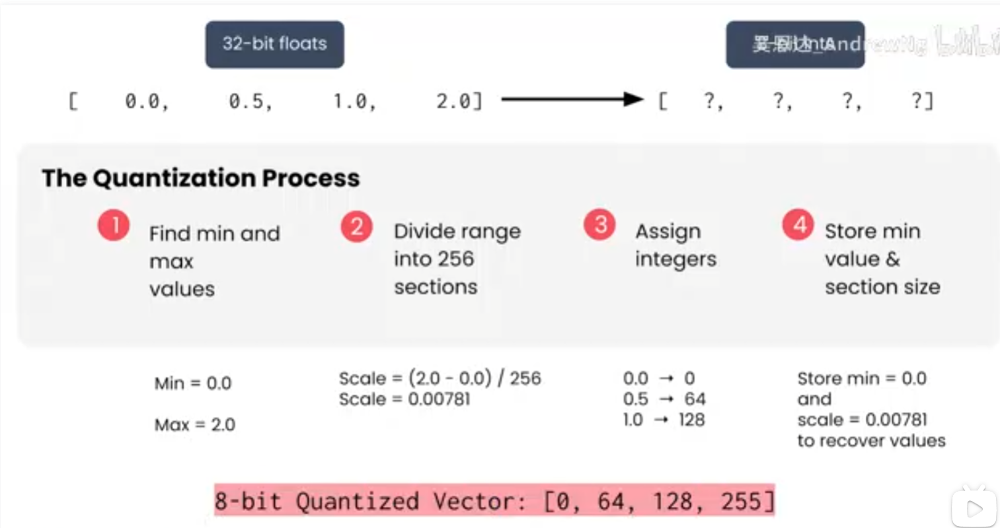

# RAG 中的向量量化

## 1. 什么是量化

量化（Quantization）把生产环境中的高精度向量或模型权重转换为低精度数据类型，例如把 `float32` 转成 `int8`。目标是减少存储和内存带宽，降低检索与推理成本，并提高运行速度。

量化通常不会让相关性或响应质量发生明显下降，但会引入近似误差，实际损失取决于数据分布、量化方法、距离函数和业务指标。

## 2. 为什么 RAG 需要量化

Embedding 维度和向量数量共同决定存储规模。单个向量的原始大小为：

```text
向量大小 = 维度 × 每个元素的字节数
```

| Embedding 模型 | 维度 | 单个向量（float32） | 100 万个向量（约） |
| --- | ---: | ---: | ---: |
| SBERT `all-mpnet-base-v2` | 768 | 3 KB | 3 GB |
| OpenAI `ada-002` | 1536 | 6 KB | 6 GB |
| Cohere `embed-english-v2.0` | 4096 | 16 KB | 16 GB |



图中按 `float32` 估算了不同维度向量的空间占用。向量数量达到百万级后，存储、缓存和内存带宽都会成为成本与延迟的重要来源。

## 3. 8 位整数量化流程

对一个向量逐元素量化时，先找到最小值和最大值，再把数值范围映射到 `int8` 或 `uint8` 的整数范围。



以 `uint8` 为例，范围是 `[0, 255]`：

```text
scale = (max - min) / 255
q = round((x - min) / scale)
x̂ = min + q × scale
```

例如原始向量为 `[0.0, 0.5, 1.0, 2.0]`：

```text
min = 0.0
max = 2.0
scale = 2.0 / 255 ≈ 0.00784
量化结果 ≈ [0, 64, 128, 255]
```

部署时必须同时保存量化数据和恢复所需的 `min`、`scale`（或等价的零点 `zero_point`），否则无法近似还原原始值。

## 4. 常见量化粒度

| 粒度 | 说明 | 特点 |
| --- | --- | --- |
| 全局量化 | 整个向量库共享一组参数 | 元数据少，但容易被异常值影响 |
| 向量级量化 | 每个向量保存自己的 `min/max` 或 `scale` | 误差通常更小，元数据开销增加 |
| 分块量化 | 每个向量分成多个块，每块独立量化 | 在误差和元数据之间折中 |
| 每通道/每维量化 | 每个维度使用独立参数 | 精度较好，实现和存储更复杂 |

量化参数应在与线上数据分布一致的代表性样本上确定。异常值范围过大时，绝大多数值会被压缩到很少的整数桶中，误差会明显增大。

## 5. 精度与空间的取舍

| 数据类型 | 每元素字节数 | 相对 `float32` 的存储 | 常见用途 |
| --- | ---: | ---: | --- |
| `float32` | 4 | 100% | 基准、训练、对精度最敏感的场景 |
| `float16` / `bfloat16` | 2 | 50% | 推理和模型权重压缩 |
| `int8` | 1 | 25% | 向量检索、模型推理，常见的精度/成本折中 |
| `uint8` | 1 | 25% | 非对称范围映射、部分向量索引 |
| `int4` | 0.5 | 12.5% | 更激进的权重压缩，误差和实现约束更大 |

`int8` 相比 `float32` 通常能节省约 75% 的向量存储；但索引结构、量化参数和副本仍占用额外空间，实际节省量应以部署测量为准。

## 6. 对检索质量的影响

量化后，距离计算使用近似向量，因此可能出现排序变化：原本相邻的两个候选交换名次，或者边界处的文档不再进入 Top-K。通常需要比较：

- **Recall@K / Precision@K**：量化前后是否漏掉相关文档；
- **MRR、nDCG@K**：相关文档是否仍位于前排；
- **P50/P95 延迟和 QPS**：压缩是否真正改善线上性能；
- **索引大小和内存占用**：是否达到成本目标；
- **端到端答案质量**：检索变化是否影响最终回答。

一个常见流程是用高精度向量建立基准，再比较不同量化方案：

```text
float32 精确检索基准
  → 量化向量召回
  → 比较 Recall@K、MRR、延迟和内存
  → 在真实查询集上验证最终回答
```

如果量化导致边界候选排序不稳定，可以先用量化索引召回较大的候选集，再用原始 `float32` 向量重算距离或使用重排器。

## 7. 生产选型建议

| 场景 | 建议 |
| --- | --- |
| 需要严格精确的离线基准 | 保留 `float32` |
| 大规模在线向量检索 | 优先评估 `int8` 或向量库内置量化 |
| 内存极其有限，能接受更多误差 | 评估 `int4` 或乘积量化（PQ） |
| 量化后 Top-K 变化明显 | 增大召回候选集，再用高精度重排 |
| 向量持续新增或分布变化 | 定期重新校准量化参数并监控指标 |

量化不是只替换一个数据类型：需要确认向量库是否支持该类型、距离函数是否匹配、索引是否需要重建，以及查询向量是否使用相同的预处理和量化规则。

## 8. 最小量化示例

```python
def quantize_uint8(values):
    lo, hi = min(values), max(values)
    scale = (hi - lo) / 255 or 1.0
    encoded = [round((value - lo) / scale) for value in values]
    return encoded, lo, scale


def dequantize(encoded, lo, scale):
    return [lo + value * scale for value in encoded]


if __name__ == "__main__":
    encoded, lo, scale = quantize_uint8([0.0, 0.5, 1.0, 2.0])
    restored = dequantize(encoded, lo, scale)
    assert encoded == [0, 64, 128, 255]
    assert max(abs(a - b) for a, b in zip(restored, [0.0, 0.5, 1.0, 2.0])) < 0.01
```

这个示例采用全局 `uint8` 线性量化，适合说明原理；生产系统应优先使用向量数据库或推理框架经过验证的量化实现，并用真实评估集确认质量损失。

## 9. 常见误区

- **只看存储下降，不测 Recall@K**：压缩成功不代表检索质量满足业务要求。
- **丢弃量化参数**：没有 `scale`、`min` 或 `zero_point` 就无法正确恢复和计算距离。
- **把所有模型都直接量化到 int4**：不同模型和数据分布的误差差异很大，应从 `int8` 基线开始评估。
- **只量化文档向量，不处理查询向量**：两侧距离计算的尺度不一致，可能造成排序偏差。
- **只看平均延迟**：应同时观察 P95/P99 长尾延迟、吞吐和索引构建时间。

量化的核心是用可控的小误差换取更低的存储、内存和计算成本。8 位整数量化通常是生产环境的第一候选，但最终方案必须由真实查询集上的质量、性能和成本共同决定。
