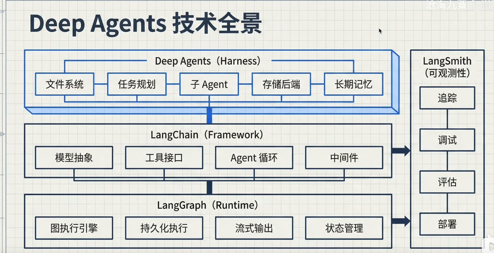

# Deep Agents 介绍

> 本笔记根据 LangChain 官方 Deep Agents 文档（检索日期：2026-07-29）整理并翻译，示例以 Python 为主。课程仓库用于补充学习路径和实验建议，API 与默认行为以官方当前文档和对应版本的 API reference 为准。

## 1. 一句话理解

官方 Overview 摘录译文：

> 构建能够规划、使用子 Agent，并借助文件系统完成复杂任务的 Agent。

来源：[Deep Agents Overview](https://docs.langchain.com/oss/python/deepagents/overview)。下文围绕官方文档各主题做中文节选与解释。

Deep Agents 是构建复杂、长流程 Agent 的一套“应用运行骨架（harness）”。它建立在 LangChain 的模型、工具与 Middleware 抽象，以及 LangGraph 的状态化运行时之上，预置了文件系统上下文管理、子 Agent 委派、上下文摘要等能力，并按需加入任务规划、Skills、长期记忆、人机审批、沙箱执行和流式输出。

它适合需要多个步骤、较大上下文、工具调用、文件中间产物或多个专业角色协作的任务。只有一次模型调用或一个简单工具的场景，直接使用 LangChain 的 `create_agent` 往往更轻量。

## 2. 资料范围与版本说明

- **官方主来源**：LangChain Deep Agents 的 Overview、Quickstart、Customization、Backends、Subagents、Memory、Human-in-the-loop、Skills、Streaming 和 Sandboxes 页面。
- **课程补充**：[`webup/deepagents-course`](https://github.com/webup/deepagents-course)，当前仓库提交为 `f93fe0a`（2026-07-28），课程以 Deep Agents 0.7.x 为实践基线。
- **版本提醒**：官方当前文档显示，v0.7 起 Todo 规划是可选能力；旧教程或旧版本示例可能把 Todo 当成默认能力。升级时应锁定依赖、查看实际 Middleware 栈，并用 Trace 和业务评测验证行为。
- 本文是中文翻译整理和工程化解释，不逐字复制官方页面；代码片段用于说明 API 关系，运行前请按所安装版本核对参数。

## 3. 技术全景



图中可以这样阅读：

| 层次 | 主要职责 | 与 Deep Agents 的关系 |
| --- | --- | --- |
| Deep Agents（Harness） | 文件系统、任务分解、子 Agent、后端存储、长期记忆 | 面向应用的能力组合和默认运行骨架 |
| LangChain（Framework） | 模型抽象、工具接口、Agent 循环、Middleware | 提供模型和工具的统一编程接口 |
| LangGraph（Runtime） | 图执行、状态管理、持久化、流式事件、中断恢复 | 负责可恢复的状态化执行 |
| LangSmith（可观测性） | 追踪、调试、评估、部署 | 观察轨迹并验证质量、成本和延迟 |

这是一张概念图，不表示每个能力都会自动启用。例如 v0.7 的任务规划通常需要显式加入 `TodoListMiddleware`；长期记忆由持久化后端提供，`memory` 参数则指定启动时加载哪些记忆文件；沙箱执行需要配置支持 `execute` 的 Sandbox Backend。模型专属 Harness Profile 也可能自动加入部分能力，应检查实际工具集合。

### 3.1 核心能力对比

图片把三类 Agent 开发工具分为“各自独有能力”和“共同能力”。以下将文字对比转写为表格，保留课程的对比项；“独有”是图片中的表述，不代表另外两种方案没有类似能力。

| 方案 | 图片列出的独有优势 | 适合关注的方向 |
| --- | --- | --- |
| Deep Agents | 模型灵活性、长期记忆、虚拟文件系统与可插拔后端、将沙箱作为工具（Sandbox-as-Tool）、LangSmith 可观测性 | 多模型接入、存储后端组合、文件上下文与跨会话记忆 |
| Claude Agent SDK | Claude 深度集成、生命周期钩子（Hooks）拦截系统、自定义 HTTP/WebSocket 层 | 将 Claude Code 的 Agent 循环、工具和上下文管理嵌入 Python / TypeScript 应用 |
| Codex SDK | 操作系统级沙箱模式、内置 MCP 服务器、云端执行环境 | 编程控制 Codex 的线程、任务执行和沙箱权限；图片中的 MCP 服务器和云端条目需结合下方说明理解 |

图片下方列出的共同能力包括：文件读写、Shell 执行、搜索、规划、子 Agent、MCP 和人机协作。这里的“共同”表示三者都可以覆盖相应的应用需求，具体 API、默认开启状态、模型支持和安全边界仍需分别查阅官方文档；例如本笔记前文说明，Deep Agents 的规划在 v0.7 起通常按需通过 `TodoListMiddleware` 启用，Shell 执行则取决于所配置的 Backend。

#### 官方文档补充与修正

| 对比项 | 当前官方说明与阅读方式 |
| --- | --- |
| Deep Agents 的模型灵活性 | 基于 LangChain 模型接口接入不同提供商，仍要求模型支持所需的工具调用能力。 |
| 长期记忆是否独有 | Deep Agents 提供可插拔 Backend 和 Store 组合；Claude Agent SDK 官方也列出 Skills、命令和记忆能力，不能把“长期记忆”泛称为只有 Deep Agents 支持。 |
| Claude 的 Hooks | 官方支持在 Agent 生命周期关键点运行自定义代码，也提供工具、子 Agent、MCP、权限和会话能力。 |
| Claude 的 HTTP/WebSocket 层 | 此次查阅的官方 Overview 没有将它列为独有能力；应用的网络接口设计应与 SDK 的 Agent 能力分别理解。 |
| Codex 的 SDK 与运行时 | 官方将 Codex SDK 定义为编程控制本地 Codex Agent 的接口。TypeScript 库管理本地线程；Python SDK 通过 JSON-RPC 控制本地 Codex app-server。 |
| Codex 的内置 MCP 服务器 | 当前官方 SDK 文档明确说明：`codex mcp-server` 命令和独立 `codex-mcp-server` 二进制已移除，既有集成应使用 Codex app-server。这与通过 MCP 接入外部工具是不同方向的功能。 |
| Codex 的云端执行环境 | Codex 产品有云端使用方式，但当前 SDK 页面主要介绍本地运行接口，不能据此认为创建 SDK 实例就获得云端执行环境。 |
| Codex 的沙箱 | 官方 SDK 提供只读、工作区可写和完全访问等预设；具体隔离效果取决于运行时和配置。完全访问预设不施加文件系统访问限制。 |

从选型角度，Deep Agents 适合重点考察跨模型接入和 Backend 组合；Claude Agent SDK 适合将 Claude Code 的 Agent 循环和 Hooks 嵌入应用；Codex SDK 适合在应用、内部工具和 CI 中编程控制 Codex 编码任务。比较时应区分 SDK 接口、底层运行时和云端产品，不能只根据图片中的勾选判断实现方式。

来源（检索日期：2026-07-29）：[Deep Agents 官方文档](https://docs.langchain.com/oss/python/deepagents/overview)、[Claude Agent SDK 官方 Overview](https://code.claude.com/docs/en/agent-sdk/overview)、[OpenAI Codex SDK 官方文档](https://developers.openai.com/codex/sdk)。图片中的对比项是课程资料；上表中的补充与修正依据实际读取的官方页面。

## 4. 最小运行方式

Deep Agents 要求模型支持工具调用。官方快速开始的通用流程是安装包、配置模型提供商密钥、准备工具、调用 `create_deep_agent`，再通过 `invoke` 或 `stream` 运行。

```bash
pip install deepagents
```

```python
from deepagents import create_deep_agent

agent = create_deep_agent(
    model="provider:model-name",  # 例如某个支持工具调用的 LangChain 模型
    tools=[],
    system_prompt="你是一个会先理解目标、再分步完成任务的助手。",
)

result = agent.invoke({
    "messages": [
        {"role": "user", "content": "介绍 LangGraph 的用途，并给出学习顺序。"}
    ]
})
print(result)
```

实际研究型 Agent 通常还会加入搜索工具。Google、OpenAI 和 Anthropic 的官方模型提供商可直接传入各自的服务端搜索工具；其他提供商可以使用 Tavily 等工具。不要把 API key 写入代码或提交到仓库。

多轮会话需要配置 Checkpointer，并使用稳定的 `thread_id`；只传入线程 ID 并不会自动建立持久化：

```python
from langgraph.checkpoint.memory import MemorySaver

agent = create_deep_agent(
    model="provider:model-name",
    checkpointer=MemorySaver(),
)
config = {"configurable": {"thread_id": "user-001"}}
agent.invoke({"messages": [{"role": "user", "content": "我偏好简洁回答。"}]}, config=config)
agent.invoke({"messages": [{"role": "user", "content": "继续解释刚才的概念。"}]}, config=config)
```

这里的模型字符串是占位符，需要替换；`MemorySaver` 只在当前进程内保存状态。来源：[Quickstart](https://docs.langchain.com/oss/python/deepagents/quickstart)、[LangGraph Persistence](https://docs.langchain.com/oss/python/langgraph/persistence)。

## 5. 默认 Harness 与内置工具

`create_deep_agent` 会组装一个 Middleware 栈。当前 v0.7 的基础栈通常包括：

1. `FilesystemMiddleware`：提供虚拟文件系统和文件工具。
2. `SubAgentMiddleware`：在有同步子 Agent（默认的 `general-purpose` 子 Agent 或自定义子 Agent）时提供委派能力。
3. `SummarizationMiddleware`：在上下文过长时摘要消息历史。
4. `PatchToolCallsMiddleware`：中断恢复或工具参数异常时修复悬空工具调用。
5. 提示词缓存 Middleware：按模型提供商生效，不支持的模型跳过缓存处理。

异步子 Agent、自定义 Middleware、模型 Profile、Skills、记忆和人机审批会按配置加入相应位置。完整排序见 [Customization：Deep Agents stack](https://docs.langchain.com/oss/python/deepagents/customization#deep-agents-stack)。

常见内置工具如下：

| 工具 | 用途 | 备注 |
| --- | --- | --- |
| `ls` | 列出目录 | 后端决定可见范围 |
| `read_file` | 读取文件 | 支持分页时会返回总行数、剩余行数和下一次偏移量 |
| `write_file` | 写入文件 | v0.7 对已有文件执行完整覆盖 |
| `edit_file` | 对文件做精确替换 | 适合局部修改 |
| `glob`、`grep` | 按模式或内容查找 | 大范围搜索可能返回部分结果并标记 `truncated` |
| `delete` | 删除文件或递归删除目录 | v0.7 起按后端能力暴露，属于高风险写操作 |
| `task` | 委派给子 Agent | 由 `SubAgentMiddleware` 提供 |
| `write_todos` | 维护任务清单 | v0.7 起需显式加入 Todo Middleware |
| `execute` | 执行命令或代码 | 后端需支持执行协议；`LocalShellBackend` 也能暴露它，但直接在宿主机执行，没有隔离 |

删除、覆盖写入和命令执行都应结合路径权限、工具 allowlist、沙箱或人工审批使用。若应用只需要只读能力，可以在 `FilesystemMiddleware` 中提供 `read_file`、`ls`、`glob`、`grep` 等有限工具；`read_file` 是必须保留的核心读取能力。

## 6. 虚拟文件系统与后端

文件系统是 Deep Agents 的上下文工程层：Agent 可以把研究结果、草稿、长文本和中间产物写入文件，再按需读取，避免把所有内容一直塞在消息历史中。

| 后端 | 生命周期 | 适用场景 |
| --- | --- | --- |
| `StateBackend` | 当前线程或运行状态内 | 临时草稿、短期上下文，默认最轻量 |
| `FilesystemBackend` | 本地磁盘 | 本地开发、需要真实目录访问的任务；建议启用 `virtual_mode=True` |
| `LocalShellBackend` | 宿主机文件与进程 | 受控本地开发；提供 Shell 执行，没有沙箱隔离 |
| `StoreBackend` | 跨线程、跨会话 | 长期记忆、用户偏好、持久化知识 |
| `CompositeBackend` | 按路径路由 | 例如普通文件放 State，`/memories/` 放 Store |
| Sandbox Backend | 隔离环境 | 需要安装依赖、执行测试或运行命令的任务 |

关键区别是：Checkpoint 保存线程状态，Store 保存可跨线程复用的数据。`StateBackend` 配合 Checkpointer 可在同一线程的多次调用间保存文件，但一个线程的文件不会自动出现在另一个线程。使用 Store 做跨会话记忆时，需要 `StoreBackend`（或把它作为 `CompositeBackend` 的路径路由）并提供真正持久化的 Store；本地持久磁盘或其他持久化 Backend 也可保存记忆。生产环境不要把 `InMemoryStore` 当作重启后仍保留的数据源。

文件路径、租户或用户 namespace 必须明确设计。`virtual_mode` 提供路径映射和约束，但不提供进程级沙箱隔离。

来源：[Backends](https://docs.langchain.com/oss/python/deepagents/backends)。

## 7. 任务规划

任务规划是一个可选的结构化任务清单。启用后，Agent 可以通过 `write_todos` 创建和更新任务，状态一般为 `pending`、`in_progress`、`completed`，清单随 Agent 状态保存。

```python
from deepagents import create_deep_agent
from langchain.agents.middleware import TodoListMiddleware

agent = create_deep_agent(
    model="provider:model-name",
    middleware=[TodoListMiddleware()],
)
```

适合启用 Todo 的情况：多阶段研究、长时间运行、需要前端显示进度、需要明确验收步骤的任务。简单问答或一步工具调用通常不需要它。v0.7 将规划从默认固定成本变成按需选择，迁移旧项目时要确认界面是否依赖 `todos` 状态。

来源：[Overview：Task planning](https://docs.langchain.com/oss/python/deepagents/overview#task-planning)。

## 8. 子 Agent 与任务委派

主 Agent 通过 `task` 工具创建短生命周期的子 Agent。子 Agent 在隔离上下文中独立完成任务，再把精炼结果返回主 Agent；这样可以把大量检索、代码分析或专门领域工作隔离出去。

```python
from deepagents import create_deep_agent

researcher = {
    "name": "researcher",
    "description": "检索资料、核对来源并返回带引用的摘要",
    "system_prompt": "只处理研究任务，给出证据、结论和未解决问题。",
    "tools": [],  # 此处加入专用搜索或数据库工具
}

agent = create_deep_agent(
    model="provider:model-name",
    subagents=[researcher],
)
```

实践原则：

- 描述要具体，让主 Agent 能判断何时委派；工具集合要小而专一。
- 子 Agent 通常是无状态的，一次 `task` 调用就应包含完整指令和交付格式。
- 自定义声明式子 Agent 有自己的 Middleware 栈；不要假设它会自动继承主 Agent 的 Todo 或 Skills。官方文档明确说明，默认 `general-purpose` 子 Agent 会继承主 Agent 的 Skills，自定义子 Agent 则需要在定义中显式传入。
- 需要并行或动态编排时，可进一步使用异步子 Agent、Forked Subagent 或 Dynamic Subagents，并通过流式事件观察每个分支。

来源：[Subagents](https://docs.langchain.com/oss/python/deepagents/subagents)。Forked Subagent 会复制经过裁剪的父 Agent 上下文，普通子 Agent 则从委派任务出发；无论哪种方式，都不要把多次独立 `task` 调用当作连续聊天。

## 9. Skills 与 Memory 的区别

### Skills：按需加载的程序性能力

Skill 是一个目录中的 `SKILL.md`，包含 YAML front matter（至少有 `name` 和 `description`）以及执行说明；还可以附带脚本、模板和参考资料。Deep Agents 采用渐进式披露：启动时只扫描名称和描述，任务匹配后才读取完整 `SKILL.md`，从而节约上下文。

```text
skills/
└── report-writing/
    ├── SKILL.md
    ├── templates/
    └── references/
```

描述应明确“做什么”和“什么时候使用”，正文保持聚焦，详细资料放在支持文件中。自定义子 Agent 是否能使用某个 Skill，要在子 Agent 配置中显式提供相应路径。

### Memory：始终可用的持久上下文

Memory 通常是通过 `memory=["/path/AGENTS.md"]` 指定的记忆文件。与按需读取的 Skills 不同，Memory 的核心内容会在 Agent 启动时加载；文件由配置的 Backend 决定是否能跨线程、跨用户持久保存。

可以把两者这样区分：

| 机制 | 主要内容 | 加载时机 |
| --- | --- | --- |
| Memory / `AGENTS.md` | 稳定偏好、项目约定、身份和长期事实 | 启动时加载 |
| Skills / `SKILL.md` | 某类任务的流程、工具使用规则、模板 | 命中任务后按需加载 |

需要跨会话记忆时，给 `/memories/` 路径配置 `StoreBackend`，并按 assistant、user 或其他业务边界设计 namespace。记忆文件可由 Agent 的 `edit_file` 更新，但组织政策和只读 Skills 通常应设为只读。

来源：[Skills](https://docs.langchain.com/oss/python/deepagents/skills)、[Memory](https://docs.langchain.com/oss/python/deepagents/long-term-memory)。

## 10. 人机协作与中断恢复

对于写文件、删除、发邮件、数据库写入或部署等敏感工具，可以用 `interrupt_on` 在执行前暂停，让人类批准、编辑、拒绝或直接回答。

```python
from deepagents import create_deep_agent
from langgraph.checkpoint.memory import MemorySaver

agent = create_deep_agent(
    model="provider:model-name",
    interrupt_on={
        "write_file": {"allowed_decisions": ["approve", "reject"]},
        "delete": {"allowed_decisions": ["approve", "edit", "reject"]},
    },
    checkpointer=MemorySaver(),  # HITL 必需
)
```

中断处理流程：

1. 用固定的 `thread_id` 调用 Agent。
2. 检查结果或流中的中断和 action requests。
3. 人类返回 `approve`、`edit`、`reject` 或适合询问型工具的 `respond`。
4. 使用同一个 `config` 和 `Command(resume={"decisions": [...]})` 恢复。

Checkpointer 和一致的 `thread_id` 都是恢复的前提。恢复会从保存的节点重新执行，因此中断前的副作用必须幂等，不能用宽泛的 `try/except` 吞掉中断异常。并行中断应使用每个中断的 ID 映射恢复值，避免按顺序错配。

文件权限还可以用 `FilesystemPermission` 对路径设置 `allow`、`deny` 或 `interrupt`，保护 `.env`、凭证和生产目录。权限规则不等于沙箱命令控制；如果暴露了 `execute`，应依赖隔离沙箱和额外的策略钩子。

来源：[Human-in-the-loop](https://docs.langchain.com/oss/python/deepagents/human-in-the-loop)、[Filesystem permissions](https://docs.langchain.com/oss/python/deepagents/permissions)。

## 11. 沙箱与代码执行

当 Agent 需要安装依赖、执行测试、运行 CLI 或处理操作系统文件时，应使用 Sandbox Backend。沙箱把 `execute` 放在隔离环境中，并可与文件工具共享受控工作目录。

选择沙箱时要明确：

- 运行时镜像、依赖安装方式和网络访问范围。
- 结果文件如何回传给主 Agent，哪些文件需要持久保存。
- 命令超时、资源上限、凭证注入和清理策略。
- 主 Agent、子 Agent 与沙箱之间的权限边界。

本地磁盘 Backend 适合开发调试；面向不受信任输入的生产服务，应使用隔离沙箱或受限 Backend，并结合文件权限和 HITL。

来源：[Sandboxes](https://docs.langchain.com/oss/python/deepagents/sandboxes)。

## 12. 流式输出与可观测性

Deep Agents 建立在 LangGraph 流式基础设施上。新项目优先使用官方推荐的 Event Streaming（v0.6 引入的类型化投影），分别消费消息、工具调用、状态值、自定义事件和子 Agent 事件；旧式 `stream_mode` 仍适用于已有代码。

启用子图流后，每个事件包含 namespace，可以区分主 Agent、某次 `task` 创建的子 Agent 以及子 Agent 内部的模型或工具节点。前端可以用它显示“正在研究”“正在写文件”“子任务完成”等进度，而无需解析最终文本。

将运行接入 LangSmith 后，可以追踪：模型轮次、工具调用、子 Agent 分支、输入输出 Token、延迟、错误、人工审批和最终结果。评估时同时看最终答案和中间轨迹，避免只看“回答成功”而漏掉重复调用、越权文件访问或成本异常。

来源：[Streaming](https://docs.langchain.com/oss/python/deepagents/streaming)、[Event Streaming](https://docs.langchain.com/oss/python/deepagents/event-streaming)。

## 13. v0.7 升级时最容易踩的坑

| 变化 | 迁移动作 |
| --- | --- |
| Todo 从默认变为按需 | 需要进度状态时显式加入 `TodoListMiddleware`，检查主 Agent 和声明式子 Agent 是否一致 |
| `write_file` 可以覆盖已有文件 | 对配置、凭证和生产脚本增加路径权限、allowlist 或 HITL |
| 新增 `delete` | 审查工具面；不需要删除时不要暴露它 |
| `read_file` 返回分页信息 | 调用方应使用结构化结果，不要假设固定行号或 Tab 格式 |
| `grep` / `glob` 可返回部分结果 | 检查 `truncated`，必要时收窄路径或继续分片搜索 |
| Middleware 可按 `.name` 原位替换 | 替换是整个实例替换，不是字段级合并；重新检查 Backend、权限和工具配置 |
| Backend 兼容层变化 | 按当前版本 API reference 迁移，明确 Store namespace 和租户隔离 |

建议在升级前保存一组 v0.6 或旧版本基线 Trace，覆盖短任务、长任务、子 Agent、大文件、搜索截断、权限拒绝和人工审批，再比较成功率、Token、延迟、工具次数和成本。官方文档中的“基础输入 Token 降低”不等于每个业务总成本都会同比下降。

## 14. 课程仓库的学习顺序

课程仓库适合把官方能力变成实验：

1. 第 1–2 章：理解 Harness、LangChain、LangGraph 的分工，并跑通最小 Agent。
2. 第 3–6 章：虚拟文件系统、规划、同步/异步子 Agent 和上下文隔离。
3. 第 7–9 章：Skills、长期记忆、Human-in-the-Loop。
4. 第 10–12 章：沙箱、文件系统权限、MCP 工具。
5. 第 13–16 章：评分量规、流式输出、Interpreters、动态子 Agent。

建议先读官方 Overview 和 Quickstart，再按课程章节做实验；课程中保留的旧章节代码或截图可能反映历史版本，运行前先查看章节中的 v0.7 提醒和迁移说明。

## 15. 设计检查清单

- 模型是否支持工具调用，模型字符串和依赖版本是否锁定？
- 任务是否真的需要文件上下文、规划或子 Agent？不需要的能力不要加入默认栈。
- 文件 Backend 是临时、线程级、用户级还是租户级？namespace 是否隔离？
- 是否需要 `delete`、`execute` 或完整写入？工具 allowlist 是否最小化？
- 长期记忆是否使用持久化 Store，还是误用了重启即丢失的内存 Store？
- Skills 的 `description` 能否帮助 Agent 正确发现，正文是否保持渐进式加载？
- 高风险工具是否配置了 Checkpointer、固定 `thread_id` 和清晰的拒绝反馈？
- 是否接入 LangSmith，能够定位模型、工具、子 Agent 和中断的实际轨迹？
- 是否用代表性任务做成功率、成本、延迟、权限和恢复测试？

## 16. 官方资料

- [Deep Agents Overview](https://docs.langchain.com/oss/python/deepagents/overview)
- [Quickstart](https://docs.langchain.com/oss/python/deepagents/quickstart)
- [Customize Deep Agents](https://docs.langchain.com/oss/python/deepagents/customization)
- [Backends](https://docs.langchain.com/oss/python/deepagents/backends)
- [Subagents](https://docs.langchain.com/oss/python/deepagents/subagents)
- [Long-term memory](https://docs.langchain.com/oss/python/deepagents/long-term-memory)
- [Human-in-the-loop](https://docs.langchain.com/oss/python/deepagents/human-in-the-loop)
- [Skills](https://docs.langchain.com/oss/python/deepagents/skills)
- [Streaming](https://docs.langchain.com/oss/python/deepagents/streaming)
- [Sandboxes](https://docs.langchain.com/oss/python/deepagents/sandboxes)
- [Deep Agents 课程仓库](https://github.com/webup/deepagents-course)
