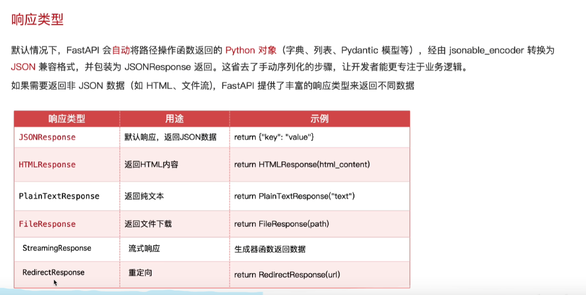
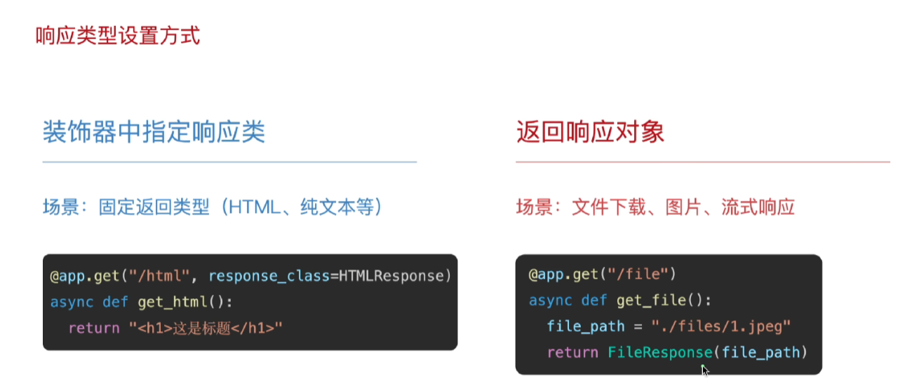

# FastAPI 响应类型

## 1. 默认 JSON 响应

FastAPI 默认会把路由函数返回的字典、列表或 Pydantic 模型编码为 JSON，并返回 JSON 响应。开发者通常只需要返回 Python 对象，不必手动序列化。

```python
@app.get("/json")
async def json_response():
    return {"message": "hello", "ok": True}
```

## 2. 自定义 JSON 响应与 `response_model`

### 2.1 使用 `response_model` 约束响应结构

在路由装饰器中声明 `response_model`，FastAPI 会根据 Pydantic 模型校验和序列化返回值，并过滤模型中没有声明的字段。它还会把模型结构展示在自动生成的 OpenAPI 文档中。

```python
from pydantic import BaseModel


class Message(BaseModel):
    message: str
    ok: bool


@app.get("/json/model", response_model=Message)
async def json_response_model():
    return {"message": "hello", "ok": True, "internal": "hidden"}
```

上例的响应只包含 `message` 和 `ok`，`internal` 会被 `response_model` 过滤掉。响应数据不符合模型时，服务端会报告响应校验错误。

### 2.2 直接返回 `JSONResponse`

需要自定义状态码、响应头或响应内容时，可以直接创建 `JSONResponse`：

```python
from fastapi.responses import JSONResponse


@app.get("/json/custom")
async def custom_json_response():
    return JSONResponse(
        content={"code": 0, "message": "success", "data": {"name": "FastAPI"}},
        status_code=200,
        headers={"X-Response-Type": "custom-json"},
    )
```

`response_model` 主要描述和约束响应数据结构；`JSONResponse` 主要控制实际的 HTTP 响应。两者可以根据接口需求分别使用。

## 3. 异常响应：查询用户

业务查询失败时，可以使用 `HTTPException` 提前结束请求并返回错误状态码。下面的示例规定用户 ID 在 1 到 100（包含边界）之间时视为存在，其他 ID 返回 `404 Not Found`：

```python
from fastapi import HTTPException


@app.get("/users/{user_id}")
async def get_user(user_id: int):
    if 1 <= user_id <= 100:
        return {"user_id": user_id, "username": f"user_{user_id}"}

    raise HTTPException(status_code=404, detail="用户不存在")
```

请求 `/users/10` 会返回用户信息；请求 `/users/101` 或 `/users/0` 会返回：

```json
{
  "detail": "用户不存在"
}
```

## 4. 常用响应类型

## 3. 常用响应类型



| 响应类型 | 用途 | 示例 |
| --- | --- | --- |
| `JSONResponse` | 返回 JSON 数据；也是常见的默认结果 | `return {"key": "value"}` |
| `HTMLResponse` | 返回 HTML 内容 | `HTMLResponse("<h1>Hello</h1>")` |
| `PlainTextResponse` | 返回纯文本 | `PlainTextResponse("text")` |
| `FileResponse` | 返回文件或触发文件下载 | `FileResponse(path)` |
| `StreamingResponse` | 分块返回持续生成的数据 | `StreamingResponse(generator())` |
| `RedirectResponse` | 将客户端重定向到另一个 URL | `RedirectResponse(url)` |

## 5. 响应类型的两种设置方式



### 5.1 在装饰器中指定响应类

适合一个路由始终返回固定类型的响应，例如 HTML 或纯文本。通过 `response_class` 指定类型后，函数可以直接返回内容字符串：

```python
from fastapi.responses import HTMLResponse


@app.get("/html", response_class=HTMLResponse)
async def get_html():
    return "<h1>这是标题</h1>"
```

### 5.2 在函数中直接返回响应对象

适合文件下载、图片、流式数据等需要动态设置路径、媒体类型或响应头的场景：

```python
from fastapi.responses import FileResponse


@app.get("/file")
async def get_file():
    file_path = "./files/1.jpeg"
    return FileResponse(file_path)
```

两种方式都可以设置响应类型。装饰器方式更简洁，直接返回响应对象时控制更灵活。

## 6. 示例代码

完整示例位于 `fastapitest/response.py`，可以使用下面的命令启动：

```powershell
cd fastapitest
uv run response.py
```

也可以使用 Uvicorn 命令：

```powershell
uv run uvicorn response:app --reload
```

### 6.1 HTML 和纯文本

```python
from fastapi.responses import HTMLResponse, PlainTextResponse


@app.get("/html", response_class=HTMLResponse)
async def html_response():
    return HTMLResponse("<h1>Hello FastAPI</h1>")


@app.get("/text")
async def text_response():
    return PlainTextResponse("这是纯文本响应。")
```

### 6.2 文件响应

```python
from fastapi.responses import FileResponse


@app.get("/file")
async def file_response():
    return FileResponse("example.txt", filename="example.txt")
```

`FileResponse` 适合下载或展示服务器上的文件。文件路径应经过服务端控制，不能直接使用未经验证的用户输入拼接路径。

### 6.3 流式响应

```python
from fastapi.responses import StreamingResponse


async def content_stream():
    for line in ("第一行\n", "第二行\n"):
        yield line.encode("utf-8")


@app.get("/stream")
async def stream_response():
    return StreamingResponse(content_stream(), media_type="text/plain")
```

生成器每次产生一部分数据，客户端可以逐步接收，而不必等待全部内容生成。

### 6.4 重定向响应

```python
from fastapi.responses import RedirectResponse


@app.get("/redirect")
async def redirect_response():
    return RedirectResponse(url="/json", status_code=307)
```

`307` 会保留原始请求方法；如果是简单的页面跳转，也可以根据需求使用其他 3xx 状态码。

## 7. 官方文档

- [FastAPI 返回响应](https://fastapi.tiangolo.com/advanced/response-directly/)
- [FastAPI 自定义响应类](https://fastapi.tiangolo.com/advanced/custom-response/)
- [FastAPI 响应模型](https://fastapi.tiangolo.com/tutorial/response-model/)
- [FastAPI HTTP 异常](https://fastapi.tiangolo.com/tutorial/handling-errors/)
