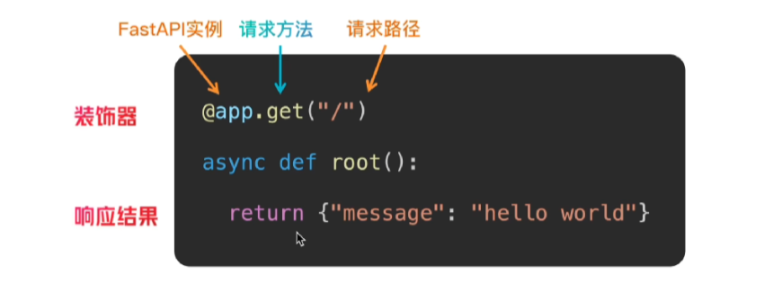

# FastAPI 路由与参数

## 1. 路由的基本写法

FastAPI 使用装饰器把 HTTP 请求方法和请求路径绑定到 Python 函数。下面的代码表示：客户端使用 `GET` 方法访问 `/` 时，执行 `root` 函数。

```python
from fastapi import FastAPI

app = FastAPI()


@app.get("/")
async def root():
    return {"message": "hello world"}
```

装饰器中的 `app.get` 是请求方法和 FastAPI 实例，`"/"` 是请求路径，函数返回值会被转换为 JSON 响应。



图中标注了 FastAPI 实例、请求方法、请求路径、装饰器和响应结果之间的对应关系。

## 2. 路由参数的三种类型

### 2.1 路径参数

路径参数写在路径的大括号中，例如 `/books/{book_id}`。请求 `/books/12` 时，`book_id` 的值就是 `12`。路径参数通常是必选的。

```python
from fastapi import Path


@app.get("/books/{book_id}")
async def read_book(
    book_id: int = Path(..., ge=1, le=1000, description="书籍的 ID")
):
    return {"book_id": book_id}
```

这里的 `int` 会把参数声明为整数，`Path(...)` 中的 `...` 表示必填，`ge=1` 和 `le=1000` 表示取值范围是 1 到 1000（包含边界）。

### 2.2 查询参数

查询参数位于 URL 的 `?` 后面，例如 `/news/news_list?page=2`。函数参数没有出现在路径模板中时，FastAPI 会将其识别为查询参数。

```python
from fastapi import Query


@app.get("/news/news_list")
async def read_news_list(
    page: int = Query(
        1,
        ge=1,
        le=100,
        description="新闻页码，默认值为 1，范围为 1-100",
    )
):
    return {"page": page}
```

这里 `page` 的默认值是 `1`，因此可以不传；如果传入，则必须是 1 到 100 之间的整数。

### 2.3 请求体参数

请求体参数放在 HTTP 请求的 body 中，常用于 `POST`、`PUT` 或 `PATCH` 请求。使用 Pydantic 的 `BaseModel` 定义数据结构，FastAPI 会读取 JSON 请求体并自动校验。

```python
from pydantic import BaseModel, Field


class User(BaseModel):
    username: str = Field(..., min_length=3, max_length=30, description="用户名")
    password: str = Field(..., min_length=8, max_length=30, description="密码")


@app.post("/users/register")
async def register_user(user: User):
    return {"username": user.username, "password": user.password}
```

请求体示例：

```json
{
  "username": "alice",
  "password": "password123"
}
```

`User` 中的字段默认必填。`Field(...)` 的省略号表示必填，`min_length` 和 `max_length` 限制字符串长度。实际项目中不应把密码原文直接返回给客户端，应在服务端安全地处理和存储密码。

## 3. 参数校验方式

| 参数位置 | 校验工具 | 常用校验示例 |
| --- | --- | --- |
| 路径参数 | `Path` | `ge`、`le`、`gt`、`lt`、`description` |
| 查询参数 | `Query` | 默认值、`ge`、`le`、长度限制、`description` |
| 请求体字段 | Pydantic `Field` | `min_length`、`max_length`、数值范围、`description` |

校验失败时，FastAPI 通常返回 HTTP `422 Unprocessable Entity`，响应体会指出出错字段的位置、错误类型和原因。类型注解也会参与校验，例如 `book_id: int` 收到无法转换为整数的内容时会校验失败。

## 4. 官方文档

- [FastAPI 路径参数](https://fastapi.tiangolo.com/tutorial/path-params/)
- [FastAPI 查询参数](https://fastapi.tiangolo.com/tutorial/query-params/)
- [FastAPI 请求体](https://fastapi.tiangolo.com/tutorial/body/)
- [FastAPI 数字校验：`Path` 与 `Query`](https://fastapi.tiangolo.com/tutorial/path-params-numeric-validations/)
- [FastAPI 字符串校验：`Query` 与 `Path`](https://fastapi.tiangolo.com/tutorial/query-params-str-validations/)
- [Pydantic 字段（`Field`）](https://docs.pydantic.dev/latest/concepts/fields/)
