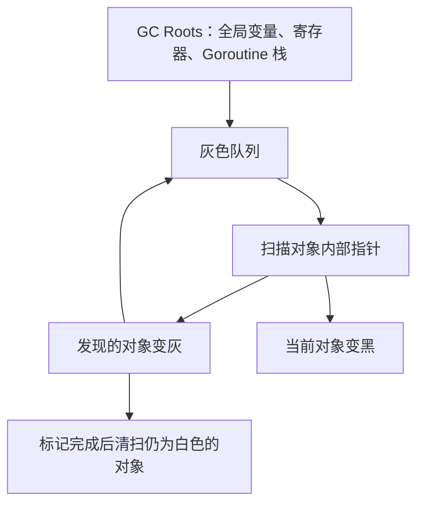
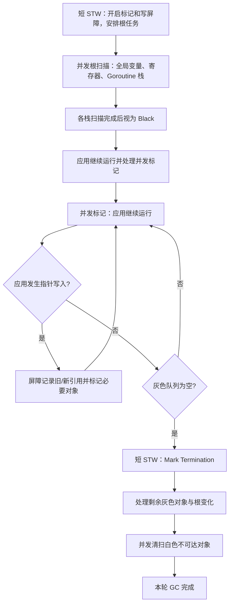
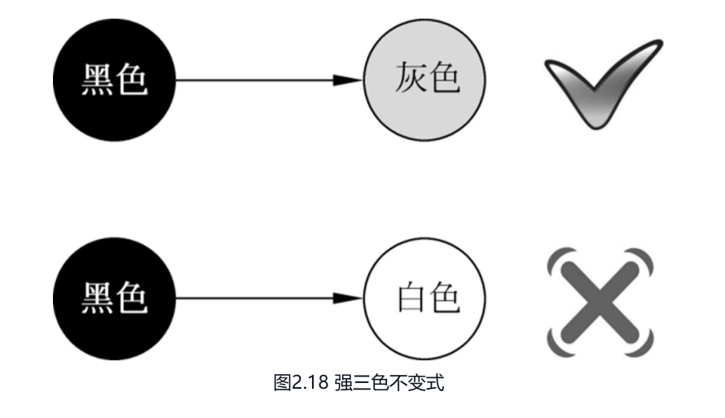
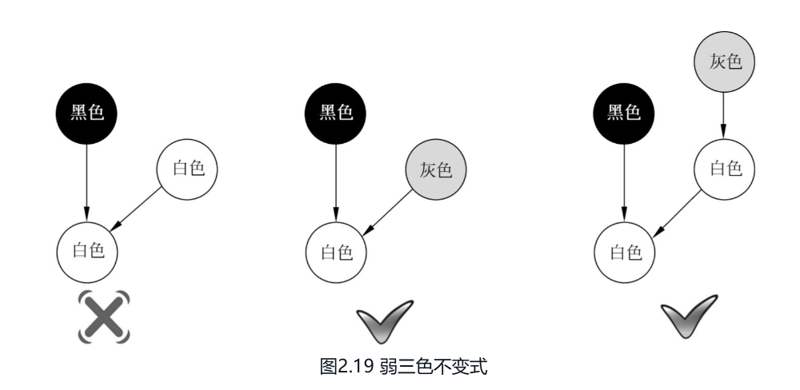
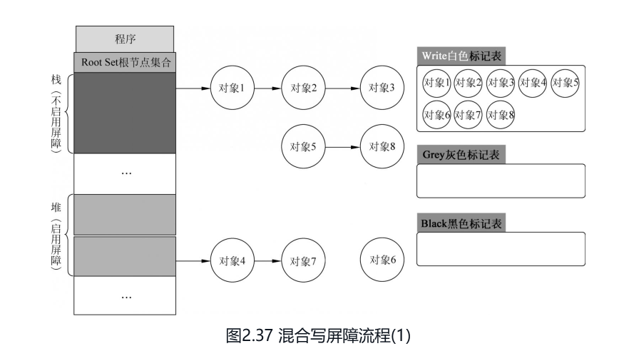
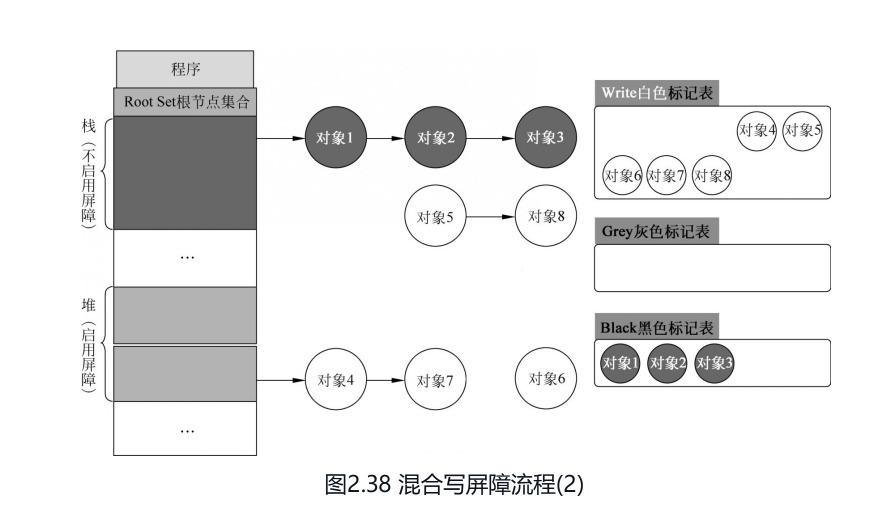
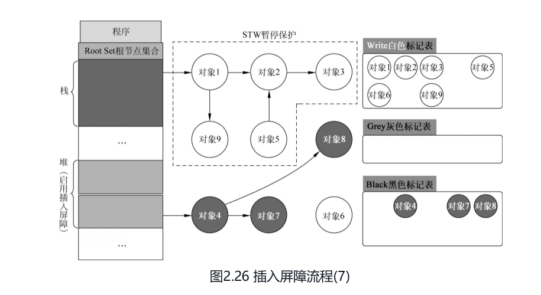
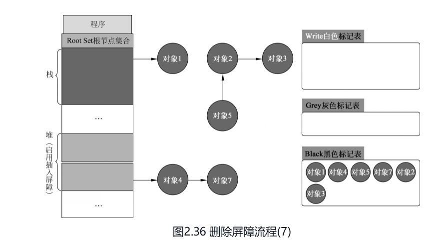
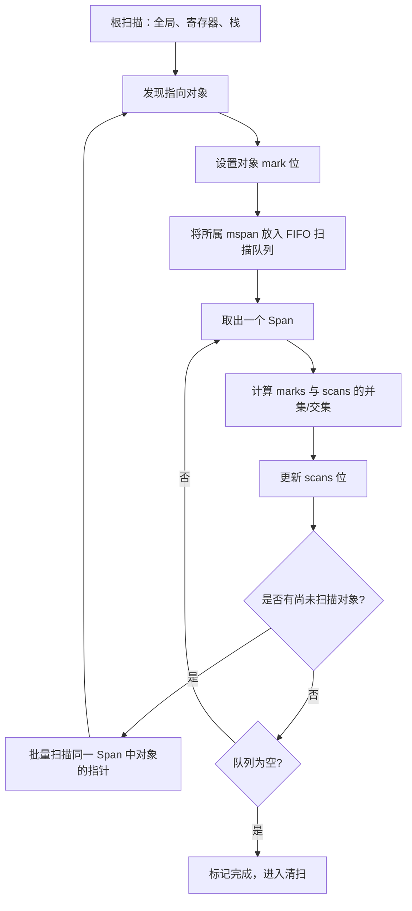

# Go GC：三色标记、混合写屏障与 Green Tea GC

## 先记：Go GC 面试复述

Go 的 GC 核心是并发三色标记清扫。白灰黑是逻辑状态。灰表示已经发现但还没扫描，黑表示自己和直接引用都处理完了，白表示还没发现。GC 开始时，堆对象逻辑上都是白色，然后从根出发把根标灰。根包括 Goroutine 栈、全局变量、寄存器中指向堆的指针。之后不断从灰色集合取对象，扫描它指向的对象并标灰，自己标黑，直到灰色集合为空。剩下白色对象就不可达，后续清扫阶段回收。

并发标记时用户程序还在改指针，所以单纯这个流程可能漏标。Go 1.8 起用混合写屏障，它维护的是弱三色不变式：黑色对象可以指向白色对象，但这个白色对象必须还能从某个灰色对象到达。写指针时，写屏障先把被覆盖的旧引用对象标灰；如果当前 Goroutine 的栈还没扫完、仍处于灰色，再把新引用对象也标灰。这样既能处理堆对象之间的引用变化，也能防止栈上还没扫描到的白色对象被挂到已经扫描完的黑色对象上，避免可达对象在并发标记中被错误回收。

STW 这块，GC 开始时会短暂 STW，做标记准备、开启写屏障、安排根扫描。之后 Goroutine 栈在并发标记阶段逐步扫描，扫描完成后变黑。混合写屏障让标记终止阶段不必 STW 重扫所有 Goroutine 栈，但标记终止本身仍然是一个 STW 阶段。所以一次 GC 主要有两个很短的 STW 阶段，标记和清扫与用户程序并发执行。

Go 1.25 起引入了 Green Tea GC，它不改变三色标记的正确性，也不是新的分配器，而是按 mspan 组织待扫描对象，尽量批量处理同一 span 中的对象，减少重复的元数据访问，并改善 CPU 缓存局部性。

## 0. 问答总结

### 0.1 Go GC 主要解决什么问题？

1. **GC 自动回收不可达堆对象。** 程序不需要手动释放堆内存。
2. **并发 GC 让应用与标记、清扫同时运行。** 因此暂停主要集中在开始和结束等短阶段。
3. **本文只讲两个关键实现点。** Go 1.8 的三色标记与混合写屏障，以及 Go 1.27 的 Green Tea GC。

### 0.2 三色标记是什么？

1. **白色表示尚未确认存活。** 可能最终被回收。
2. **灰色表示已发现但内部引用尚未全部处理。** 它是待扫描队列中的对象。
3. **黑色表示对象自身已经完成扫描。** 在 Go 的弱三色不变式下，黑色对象并非绝对不能指向白色对象；标记结束后，仍为白色且未受保护的对象才会被清扫。
4. **GC 从根开始遍历。** 根包括全局变量、寄存器和 Goroutine 栈中的指针。

### 0.3 Go 1.8 的混合写屏障解决什么问题？

1. **并发标记期间，应用仍会修改指针。** 没有保护时，GC 可能漏标对象。
2. **混合写屏障维护弱三色不变式并配合栈黑化。** 已扫描栈被视为黑色，栈仍为灰色时写入的新引用也会受到保护。
3. **主要收益是缩短结束阶段的 STW。** 标记终止仍然 STW，但不需要再次重扫全部 Goroutine 栈。
4. **写屏障有运行时成本。** 每次相关指针写入可能增加少量指令和 CPU 开销。

### 0.4 Green Tea GC 做了什么？

1. **Green Tea 是标记扫描算法。** 它不是逃逸分析，也不是新的堆分配器。
2. **通俗地说，它优化“灰色对象”的扫描顺序和组织方式。** 将同一 mspan 中已发现、尚未扫描的对象集中起来批量扫描，提高局部性并分摊元数据访问成本；不会搬动对象，也不会把整个 Span 的所有对象都当成存活对象。[3]
3. **它使用 marks 与 scans 两组状态。** 前者记录首次发现对象，后者记录对象是否已经扫描，通过合并差异保持精确性。
4. **512 B 不是 Green Tea 的通用对象上限。** Go 1.27.1 中，是否使用 Span 内联标记位由 `gcUsesSpanInlineMarkBits` 等实现条件决定。

### 0.5 STW 和 GC 总耗时有什么区别？

1. **STW 是应用暂停时间。** 应用线程暂时停止，GC 完成必须在暂停中执行的工作。
2. **GC 总耗时还包括并发标记、清扫和页回收。** 应用可能在这些阶段继续运行。
3. **Go 1.8 的核心改进偏向降低暂停。** 不能据此保证总 CPU 时间固定下降。
4. **Green Tea 的核心改进偏向标记扫描效率。** 实际收益取决于堆大小、对象布局、指针密度和 CPU。

### 0.6 GC 在什么情况下会触发？

1. **堆增长达到 GC pacing 目标时会触发。** 默认由 `GOGC` 控制下一轮目标堆大小；它不是“每分配固定字节数触发”。
2. **接近 `GOMEMLIMIT` 时会更积极触发。** 软内存限制会参与堆目标计算，帮助运行时控制总体 Go 内存使用。
3. **显式调用也能触发。** `runtime.GC()` 会请求完成一次 GC，适合测试或特殊控制场景，不应在普通请求路径中频繁调用。
4. **后台系统任务可能强制触发。** 例如长时间没有 GC、需要推进清扫或运行时认为有必要时，触发条件由当前版本实现决定。
5. **触发不等于立刻完成。** 触发后仍可能经历辅助标记、并发标记、标记终止和清扫；`GOGC`、`GOMEMLIMIT`、分配速率和运行时状态都会影响实际时间。

### 0.7 Go 1.8 的 GC 标记流程是什么？

Go GC 先短暂 STW 进入标记准备阶段，启用混合写屏障并准备、扫描根集合，将根引用关联的对象加入标记队列。随后进入并发标记阶段，GC 工作线程和用户 Goroutine 并发执行三色标记，扫描全局变量、各 Goroutine 栈以及堆对象。栈扫描会标记其引用的堆对象，堆上指针修改则由混合写屏障保护，防止可达对象漏标。最后再次短暂 STW 进入标记终止阶段，完成剩余标记工作和收尾，直到标记队列清空、不存在灰色对象，然后进入并发清扫阶段。

### 0.8 GC 如何触发和计算下一轮目标？

Go 的 GC 触发由 `gcController` 负责 pacing，也就是根据分配速度安排标记工作，并决定何时开始下一轮 GC。`GOGC` 控制堆增长比例：可以粗略理解为，上一轮 GC 结束后存活堆越大，允许的下一轮目标堆就按 `GOGC` 比例增长；默认 `GOGC=100` 时，目标通常接近上一轮存活堆的两倍，但实际计算还会把全局根、非堆 GC 元数据、标记成本和运行时修正纳入考虑，因此不能把它当成简单的固定公式。

`GOMEMLIMIT` 是 Go 运行时的软内存目标。启用它后，`gcController` 会把当前 Go 内存使用和预计的非堆开销一起纳入预算；如果按 `GOGC` 计算的目标会使总使用量逼近限制，运行时会压低下一轮堆目标，更积极地触发 GC。可以把最终目标理解为：由 `GOGC` 给出比例目标，再受到 `GOMEMLIMIT` 和运行时实际开销的约束。达到目标会启动或推进 GC，但触发不等于立刻完成，完整周期仍包括并发标记、标记终止和清扫。

### 0.9 什么是 mutator assist？分配太快时用户 Goroutine 如何帮忙标记？

并发标记时，用户 Goroutine 也叫 mutator，仍然可以持续分配对象。如果程序分配速度超过 GC 后台标记速度，`gcController` 会通过 pacing 给分配路径增加标记债务，也就是 mutator assist。分配较快的 Goroutine 在申请堆内存时，可能被要求先执行一部分标记工作：从灰色队列取出对象，扫描其指针并继续推进标记，直到偿还相应的标记债务，然后再完成分配。

因此，mutator assist 不是把用户 Goroutine 永久变成 GC 线程，也不是所有分配都会触发；它是 GC 进度落后于分配进度时的反馈机制。分配越快、标记进度越落后，需要承担的 assist 工作通常越多。它保证标记工作量能随着分配量推进，避免 GC 一直追不上堆增长；代价是分配路径会增加 CPU 开销和延迟。

### 0.10 标记开始阶段的 STW 做了什么？

标记开始阶段的 STW 主要做四件事：切换 GC 阶段状态、在所有 P 上启用写屏障、启用 Mutator Assist、准备并启动根扫描任务。它本质上是为并发标记创造一个“安全的起点”，确保所有指针修改都能被写屏障捕获，避免后续漏标。

### 0.11 标记结束阶段的 STW 做了什么？

标记终止的 STW 主要做四件事：暂停用户程序、完成剩余标记、关闭写屏障、准备清扫。它本质上是一个同步点，确保在关闭写屏障之前，所有可达对象都已被正确标记，避免并发修改导致漏标。
***

## 1. 版本基准与范围

本文以 **Go 1.8 的混合写屏障设计** 和 **Go 1.27.1 的 Green Tea GC 实现** 为基准，只介绍这两个版本的重大改动，不列出中间版本升级路径。

需要区分三个层次：

| 概念 | 负责什么 |
| --- | --- |
| 逃逸分析 | 编译期判断值更适合放栈还是堆 |
| GC 标记与清扫 | 判断堆对象是否存活并回收不可达空间 |
| 写屏障 | 并发 GC 时记录指针写入，避免漏标 |

## 1.1 GC 触发条件

### 1.1.1 比例触发：`GOGC` 与堆目标

Go 会根据上一轮 GC 后的堆使用量和预计的 GC 工作空间计算下一轮堆目标。默认 `GOGC=100`，可粗略理解为：当堆增长到接近上一轮存活堆的两倍时，运行时倾向于开始下一轮 GC。实际目标还会受到全局根、元数据、分配速率、标记辅助和 pacing 修正影响，因此不能把“翻倍”当作精确阈值。

```text
GOGC 较小 → 更早触发 → 堆通常较小、GC CPU 可能更高
GOGC 较大 → 更晚触发 → 堆通常较大、GC 频率可能更低
```

`GOGC=off` 可以关闭基于堆增长的自动 GC，但在存在内存限制或其他运行时必要条件时，不能把它理解为“运行时永远不会 GC”。

### 1.1.2 内存限制触发：`GOMEMLIMIT`

`GOMEMLIMIT` 设置 Go 运行时软内存目标。运行时会把当前 Go 内存使用、预计堆增长和 GC 成本纳入 pacing；当使用量接近限制时，可能更频繁地触发 GC，并更积极地清扫或归还空闲页。

它是软限制，不是操作系统强制上限，也不等于进程 RSS 的精确值。第三方分配、共享库、线程栈和运行时未计入的内存可能仍使进程超过该值。限制过低时，GC 可能变得非常频繁，造成明显 CPU 消耗。

### 1.1.3 显式触发与其他触发

```go
runtime.GC()
```

`runtime.GC` 请求运行时执行 GC，调用方通常应只在测试、基准或明确的生命周期边界使用。它不能替代合理的 `GOGC`/`GOMEMLIMIT` 配置，也不能保证调用返回后所有物理页都已归还操作系统。

运行时还可能因为清扫推进、分配路径需要空间、内存压力或周期性维护而触发相关 GC 工作。具体条件属于 runtime 实现细节，不能用单一“超过 X MB”规则概括。

### 1.1.4 如何观察实际触发

```bash
GODEBUG=gctrace=1 ./program
```

结合 `/runtime/metrics` 观察：

| 指标方向 | 观察内容 |
| --- | --- |
| GC 次数与暂停 | `/gc/cycles/*`、`/gc/pauses:seconds` |
| 堆对象规模 | `/memory/classes/heap/objects:bytes` |
| GC CPU | `/cpu/classes/gc:cpu-seconds` |
| 已释放堆页 | `/memory/classes/heap/released:bytes` |

不要只根据一次日志中的堆大小判断触发阈值；应结合 `GOGC`、`GOMEMLIMIT`、分配速率和完整 GC 周期观察。

## 2. Go 1.8 的三色标记流程

### 2.1 从根开始标记



根不是普通堆对象，但栈中保存的堆指针必须被扫描。函数返回时栈帧可复用，和 GC 扫描当前活跃栈是两个问题。

用 Go 1.8 的并发标记语境完整描述如下：

```text
1. GC 开始，进入标记阶段并安排全局变量、寄存器和 Goroutine 栈的根任务。
2. 根直接指向的堆对象被放入灰色标记工作；未发现的对象保持白色。
3. 并发根扫描与堆标记进行，应用继续运行；某个 Goroutine 的栈扫描完成后，该栈视为黑色。
4. 扫描对象内部指针：白色引用对象被标灰，当前对象的扫描完成后变黑。
5. 应用修改指针时，Go 1.8 的混合写屏障记录必要的旧引用和新引用。
6. 标记工作与屏障产生的新增工作都处理完后，进入短暂的标记终止阶段。
7. 标记完成后，仍为白色的不可达对象交给清扫阶段回收。
```

因此，“重复直到灰色队列为空”是三色遍历的核心，但在 Go 1.8 中还必须加上**并发修改期间的写屏障**和**标记终止**。灰色队列在某个时刻为空，不代表应用不会马上产生新的引用，也不代表可以跳过终止阶段。

### 2.2 并发标记为什么需要屏障？

假设对象关系开始时是：

```text
黑对象 A  ──> 灰对象 B  ──> 白对象 C
```

如果应用在 GC 扫描 A 之后执行：

```go
A.Child = C
```

而 C 仍保持白色，GC 可能在没有额外记录的情况下漏掉 C。写屏障就是在这种并发修改发生时补充标记信息的机制。

## 3. Go 1.8：混合写屏障与栈黑化

### 3.0 完整流程图（概念模型）



这张图是根据 Go 1.8 官方发布说明及当时 runtime 标记代码整理的概念流程。不同补丁版本可能调整函数名和调度细节；“混合”指屏障同时利用删除前后的引用信息来维护三色不变式，而不是指存在一个名为“混合表”的容器。[1][4][5]

### 3.1 解决的核心问题

早期并发标记需要处理根，并在结束阶段重新检查并发期间变化的栈和根。Go 1.8 的重大改进是采用混合写屏障；**每个栈完成扫描后才视为黑色**，从而减少标记终止时对全部栈的统一重扫。

### 3.1.1 强、弱三色不变式



*图 2.18：强三色不变式示意。*

**强三色不变式**要求不存在“黑色对象直接引用白色对象”的边。这样，已经完成扫描的黑色对象不会绕过灰色工作队列直接连接到未处理对象。更准确地说，强不变式要求黑对象指向的白对象不能出现；“所有被黑色对象引用的白色对象都必须变灰”是实现这一要求的一种表达。[1][2]



*图 2.19：弱三色不变式示意。*

**弱三色不变式**允许黑色对象引用白色对象，但要求这条引用路径上存在灰色保护对象。例如黑对象 → 灰对象 → 白对象。只要灰对象仍在待扫描集合中，白对象仍能被后续遍历发现。删除写屏障通常用来维护这类保护关系；代价是某些本轮已经暂时不可达的对象可能存活到下一轮。[2]



*图 2.37：混合写屏障执行前后的对象着色示意。根集合可指向堆对象；白色对象尚未确认存活，灰色对象等待扫描，黑色对象已经处理。*



*图 2.38：栈完成扫描并黑化后的示意。图中对象 1～3 变黑，仍在白色表中的对象不会因为栈引用变化而被无条件漏标；实际写屏障细节以对应版本实现为准。*

**配图说明：** 两图是教学示意，右侧的 White/Grey/Black 表表示 GC 的待处理状态集合，不是 Go 暴露的三个运行时容器。栈标记为黑色表示当前栈已扫描完成，不表示栈帧永远不回收。

```text
开始阶段短 STW：开启标记和写屏障，安排根任务
                 ↓
并发根扫描：逐个扫描栈，扫描完成的栈变黑
                 ↓
并发标记：应用运行，写屏障记录指针变化
                 ↓
结束阶段短 STW：完成剩余标记工作
```

**栈黑化不是“栈永远不会回收”。** 它只表示该栈当前内容已扫描完成，后续栈中的引用变化由屏障和终止阶段协作处理。

### 3.2 为什么能减少暂停

```text
早期思路：开始处理根 → 并发标记 → 终止阶段重新检查栈
Go 1.8：  开始安排根任务 → 并发扫描各栈并逐个黑化 → 写屏障协作 → 短暂终止
```

这把一部分“结束时重新扫描所有栈”的工作转化为运行期间的写屏障成本。暂停时间不再简单地随所有 Goroutine 栈大小线性增长，但并不意味着 GC 完全没有 STW。

### 3.3 插入写屏障流程



*图 2.26：插入写屏障教学示意。*

插入写屏障关注新写入的引用：当对象 A 将对象 B 设为新的子对象时，先将 B 标记为灰色，再完成指针写入。这样即使 A 已是黑色，B 也不会以白色状态被黑色对象直接接入而漏标。[2]

需要纠正图中“对栈中的白色对象启动 STW 并拦截所有读写”的直观说法：实际运行时不会把每次栈读写都阻塞。栈扫描、栈黑化和写屏障共同维护正确性，具体屏障覆盖范围由编译器和运行时实现决定。

### 3.4 删除写屏障流程



*图 2.36：删除写屏障教学示意。*

删除写屏障关注被覆盖或删除的旧引用：在 `slot = new` 或 `slot = nil` 前，先把旧引用指向的对象变灰（若尚未被标记），保护它不因引用路径被并发切断而漏标。这里的“删除”是删除一条引用，不是立即释放对象。[2]

删除屏障可能比严格追踪当前可达性更保守：对象即使随后没有任何业务引用，也可能已经被屏障保活，直到本轮或后续清扫阶段结束；这不影响正确性，但可能增加暂时保留的内存。

### 3.5 写屏障的边界

- 写屏障保护的是并发期间的引用变化，不负责判断变量是否逃逸。
- 栈黑化减少了栈重扫需求，但寄存器、栈、全局变量等根仍需在 GC 周期中正确处理。
- 写屏障增加的是指针写入路径成本；指针写入很多的程序可能承担更多 CPU 开销。

### 3.6 混合写屏障规则（Go 1.8）

用户资料中的四条规则可以作为记忆框架，但需要按运行时语义修正：

| 资料中的表述 | 更准确的理解 |
| --- | --- |
| GC 开始把栈上的对象全部扫描并标黑，之后无须 STW | GC 开始阶段安排根任务；各栈在并发根扫描中逐个处理，扫描完成的栈可视为黑色，从而减少标记终止时的全量栈重扫，但 GC 仍有开始、结束等短 STW 阶段 |
| 栈上创建的新对象均为黑色 | 栈帧中的新值由编译器生成的栈图和运行时根扫描处理；不能把所有新建值都当成独立的黑色堆对象，也不能据此跳过根处理 |
| 被删除的对象标记为灰色 | 覆盖或删除指针槽位前，屏障保护旧引用指向的对象，必要时将其纳入标记工作 |
| 被添加的对象标记为灰色 | 向已扫描区域写入新引用时，屏障保护新引用指向的对象，避免黑对象直接连接白对象 |

因此，混合写屏障可以概括为：**已扫描的栈保持黑色；删除旧引用和添加新引用都由屏障保护；剩余灰色工作通过并发标记完成。** 它维护的是针对 Go 并发标记场景调整后的弱三色不变式，不是一个要求“任何黑对象都绝不能指向白对象”的强不变式。[1][2]

```text
GC 开始：安排根任务 → 并发扫描各栈 → 已扫描栈视为黑色
并发运行：
  覆盖旧引用 → 保护旧对象
  写入新引用 → 保护新对象
标记终止：完成剩余灰色工作 → 并发清扫
```

**版本边界：** 上述是 Go 1.8 混合写屏障的概念说明。实际编译器和运行时会根据写入位置、对象状态和构建版本采用更精确的快速路径；不要把教学伪代码当成可直接实现的屏障函数。

## 4. Go 1.27：Green Tea GC

### 4.0 完整流程图（Span 批处理模型）



Green Tea 的关键不是改变“白、灰、黑”语义，而是改变待扫描工作的组织方式：把对象发现事件聚合到 Span，再批量扫描同一 Span 中的对象。这样可以改善缓存局部性、减少重复访问对象元数据，并保留精确扫描所需的差异判断。[3][6]

### 4.1 为什么按 Span 批量扫描

**直观记忆：Green Tea GC 优化的是“灰色对象的扫描顺序和组织方式”。** 三色模型中的灰色表示已发现但尚未完成扫描；Green Tea 将这些待扫描工作按 mspan 聚合，而不是改变对象存活判定的原则。[3]

```text
发现 A、B、C，且它们属于同一个 mspan
                 ↓
记录对象的待扫描状态，并将所属 Span 纳入扫描队列
                 ↓
处理该 Span 时，批量扫描其中已发现、尚未扫描的对象
```

这里的“放在一起”指 **扫描工作集中处理**，不是移动或复制对象。也不要求等待整个 mspan 的对象都变灰：只处理本次已积累且需要扫描的对象，后续有新发现时还可以继续安排扫描。同一 Span 中尚未发现的对象不会仅因邻居存活就被一并认定为存活。[3]

传统标记扫描经常以对象为单位推进。相邻对象通常位于同一 mspan 内，逐个处理会重复访问对象元数据和队列结构。Green Tea 延迟扫描，把同一 Span 中待扫描对象积累起来，再批量处理：

```text
发现对象指针
    ↓
设置对象 mark 位并把 Span 放入队列
    ↓
积累同一 Span 的多个对象
    ↓
批量扫描对象和类型信息
```

这样可以提高缓存局部性，减少元数据访问，并为预取和按尺寸优化留下空间。Green Tea 仍然必须保持精确 GC 语义，不能把“同 Span”当成“所有对象都应扫描”。

### 4.2 marks 与 scans

Go 1.27.1 的 Green Tea 实现为 Span 内联标记信息保留两类状态：

| 状态 | 含义 |
| --- | --- |
| `marks` | 第一次发现对象指针时设置的标记 |
| `scans` | 对象已经被扫描的状态 |

扫描 Span 时，算法计算 marks 与 scans 的并集和交集：更新 scans，并根据差异决定哪些对象仍需要扫描。这让多个对象可以批量处理，同时保持“每个需要扫描的对象只按正确状态处理”的精度。[3]

### 4.3 `512 B` 的正确理解

“512 B 以下对象才使用 Green Tea”是过度简化。Go 1.27.1 的 `gcUsesSpanInlineMarkBits(size)` 以对象布局是否适合 Span 内位图、以及 `size >= 16` 等条件判断是否使用内联标记位。其他大小的对象仍然参与 Green Tea 的整体标记算法，只是元数据布局和扫描路径可能不同。[3]

Green Tea 与下列概念无关：

- `new` 是否逃逸到堆；
- Size Class 是否选择 512 B 槽位；
- 对象是否一定独占一个 Span；
- 栈对象是否需要 GC 扫描。

### 4.4 可能带来的收益与代价

**收益：** 同一 Span 的对象访问更集中，降低标记元数据访问成本，并减少队列操作和缓存失误的机会。

**代价：** 算法需要维护 marks、scans、Span 队列和并发所有权状态，标记逻辑更复杂；最终收益取决于程序的对象分布和指针图。

## 5. 直观对比

| 维度 | Go 1.8 混合写屏障 | Go 1.27 Green Tea |
| --- | --- | --- |
| 主要改动位置 | 并发标记期间的指针写入与栈处理 | 标记对象的组织和扫描方式 |
| 主要目标 | 减少栈重扫和 STW 暂停 | 提高标记扫描局部性与效率 |
| 关键机制 | 栈黑化、混合写屏障 | Span 批处理、marks/scans |
| 是否改变逃逸分析 | 否 | 否 |
| 是否消除 STW | 否 | 否 |
| 是否保证固定百分比收益 | 否 | 否 |

## 6. 观测 GC 的方法

```bash
GODEBUG=gctrace=1 ./program
```

重点区分：暂停时间、并发标记 CPU、清扫时间和进程 RSS。对象回收后，Span 可能先被复用，空闲页再由 scavenger 按策略归还操作系统；GC 结束不等于 RSS 立即下降。

## 7. 官方参考

1. [Go 1.8 Release Notes](https://go.dev/doc/go1.8)：Go 1.8 GC 低延迟设计背景与混合写屏障相关说明。
2. [Go 语言规范：Garbage collection](https://go.dev/ref/spec#Garbage_collection)：语言层面的 GC 语义边界。
3. [Go 1.27.1 Green Tea GC 源码](https://github.com/golang/go/blob/go1.27.1/src/runtime/mgcmark_greenteagc.go)：Span 批量扫描、marks/scans、`gcUsesSpanInlineMarkBits`。
4. [Go 1.27.1 mheap 源码](https://github.com/golang/go/blob/go1.27.1/src/runtime/mheap.go)：Span、堆页、内联标记位与 mheap 关系。
5. [Go 1.8 runtime/mgc.go](https://github.com/golang/go/blob/go1.8/src/runtime/mgc.go)：Go 1.8 GC 周期、根扫描、并发标记与 mark termination 的实现入口。
6. [Go 1.27.1 runtime/mgcmark.go](https://github.com/golang/go/blob/go1.27.1/src/runtime/mgcmark.go)：当前标记队列、根扫描和并发标记调度入口；与 Green Tea 专用文件配合理解完整流程。
