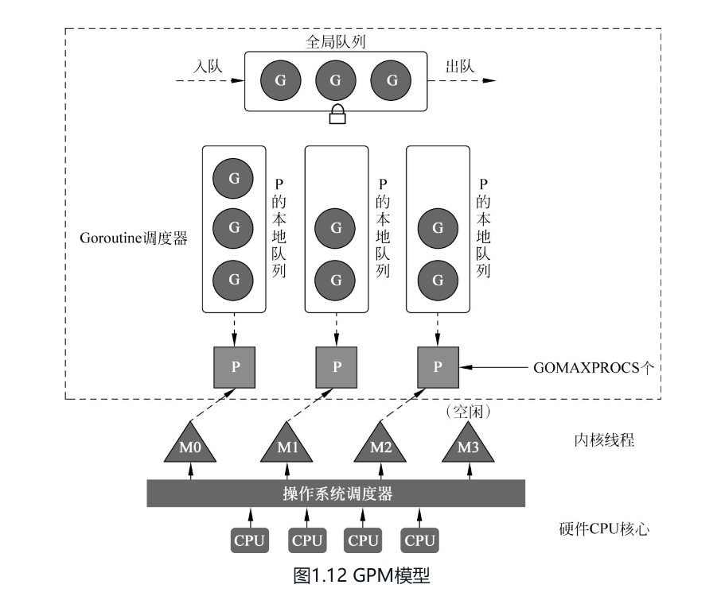
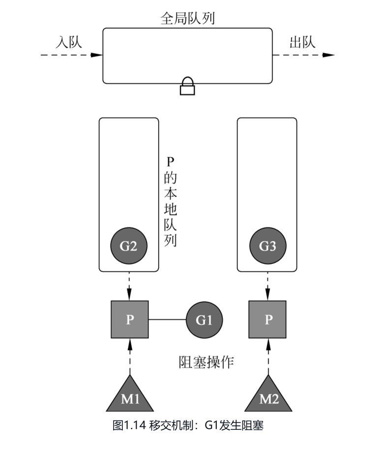
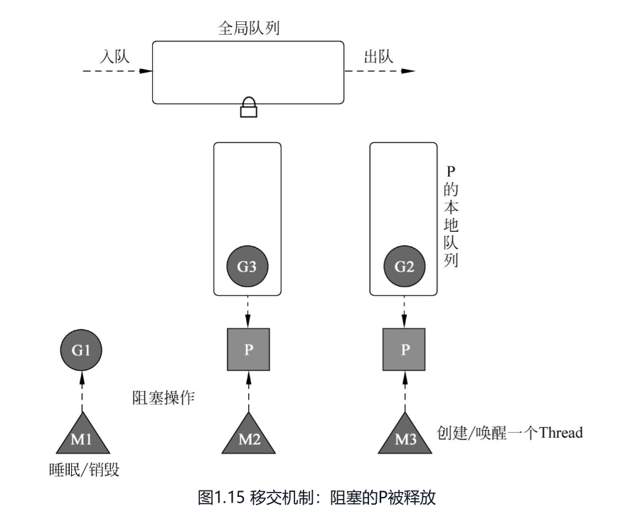
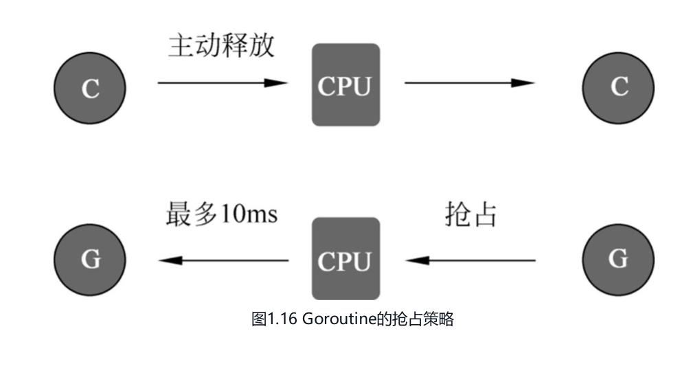
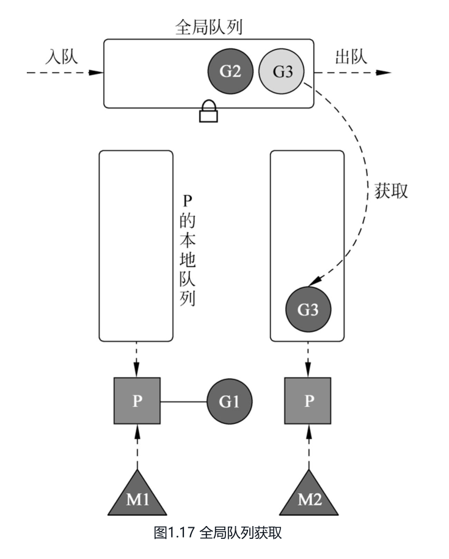
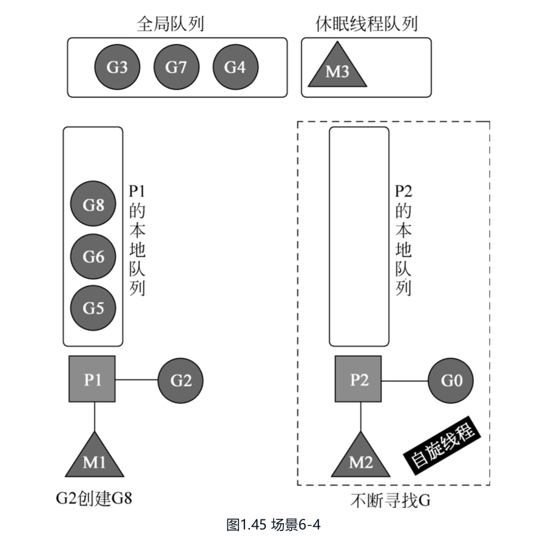
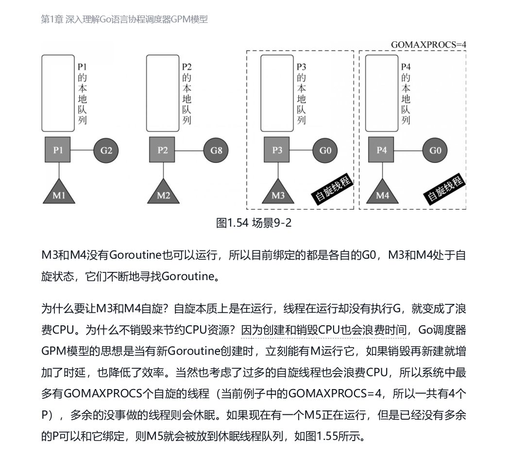

# Golang GPM 调度模型

## 先记：Golang GMP 调度模型面试复述

GMP 是 Go 运行时的调度模型。G 是 Goroutine，表示要执行的任务；M 是操作系统线程，真正执行 Go 代码；P 是逻辑处理器，也可以理解为调度上下文，里面包含本地可运行队列等资源。P 的数量由 `GOMAXPROCS` 决定，限制同时执行 Go 代码的最大并行度；M 的数量是弹性的，可以多于 P，因为有些 M 可能阻塞在系统调用或 cgo 调用中。

创建新的 G 时，运行时通常会优先尝试把它放到当前 P 的 `runnext`。如果 `runnext` 已经有 G，运行时会尝试把原来的 G 放入本地环形队列 `runq`，再让新 G 占据 `runnext`；如果 `runq` 已满，把其中大约一半的 G **连同待入队的 G** 批量转移到全局队列。`runq` 的容量是 256，`runnext` 是额外的优先执行槽位。调度时，P 通常先检查本地调度结构，再从全局队列批量获取任务，然后检查网络轮询器中已经就绪的 G，最后才尝试从其他 P 偷取任务。虽然本地优先，但每 61 次调度给全局队列一次“插队”机会，防止全局任务饿死。

当某个 P 的本地队列没有足够任务时，持有它的 M 会随机选择其他 P，从对方本地队列的尾部偷取大约一半的 G。偷取尾部可以减少与原 P 从队列头部取任务时的竞争；如果仍然找不到任务，M 可能短暂自旋，之后进入休眠。

G 阻塞时要区分 G 等待和 M 被阻塞。channel 等待、`time.Sleep` 或网络 I/O 等待通常只停放当前 G，M 还能继续执行其他 G；阻塞系统调用或某些 cgo 调用可能让 M 一起阻塞，这时运行时会把 P 与该 M 解绑定，也就是 handoff，把 P 交给其他可用的 M。系统调用返回后，原来的 G 会优先尝试重新取得 P，取不到时再进入全局队列等待其他 M 调度。

为了避免某个 G 长时间占用 CPU，Go 1.14 起支持基于信号的异步抢占。`sysmon` 发现 G 持续运行达到约 10ms 的阈值后，会发起抢占请求，避免纯计算循环长期饿死其他 G。10ms 只是触发请求的近似阈值，不是严格的运行时限，实际切换还取决于检查时机和代码是否处于可抢占位置。

P 的核心作用有三个：第一，解耦 M 和 G 队列，M 因系统调用阻塞时，P 可以交给其他 M；第二，通过本地队列减少全局锁竞争；第三，通过 `GOMAXPROCS` 控制 Go 代码的并行度，并通过 Work Stealing 在多个 P 之间均衡负载。

## 0. 问答总结

以下按面试中的常见提问组织，答案可以直接口述。先记住每条加粗的重点，再展开解释；256、10ms 等数值属于运行时实现细节。

### 0.1 Golang 的 GPM 调度模型了解吗？

1. **定位：Go 运行时的 Goroutine 调度模型，是高并发的重要基础之一。** G 表示 Goroutine，M 表示操作系统线程，P 表示执行 Go 代码所需的调度资源，包含本地可运行队列等。
2. **执行关系：M 绑定 P 执行 G，操作系统再把 M 调度到 CPU 上。** 大量 Goroutine 可以复用一组线程，不需要每个 Goroutine 都对应一个线程。
3. **核心机制：本地队列、工作偷取、P 移交和抢占。** 本地队列减少全局锁竞争，工作偷取均衡负载，系统调用阻塞时移交 P 保持任务推进，抢占与周期性检查全局队列改善公平性。
4. **并行度：由 GOMAXPROCS 控制。** 它决定 P 的数量，限制同时执行 Go 代码的最大并行度。

### 0.2 为什么需要 P？只有 G 和 M 不行吗？

1. **减少全局锁竞争。** P 提供本地队列，相比主要围绕全局队列分配任务，可以减少多个线程争抢同一把锁，提高调度效率。
2. **让调度资源与线程解耦。** P 把执行 Go 代码需要的资源从线程中抽离出来。M 因系统调用阻塞时，P 可以交给其他 M，继续处理任务。
3. **控制 Go 代码的并行度。** 通过限制 P 的数量，控制能同时执行 Go 代码的线程数量。

### 0.3 Goroutine 和线程有什么区别？为什么 Goroutine 更轻量？

1. **调度者不同：线程由操作系统调度，Goroutine 由 Go 运行时调度。** 多个 Goroutine 可以复用一组线程。
2. **栈开销较小：Goroutine 的栈可以按需伸缩。** 初始栈较小，需要时增长，也可以收缩，因此通常能以较低的内存开销创建大量并发任务。
3. **切换通常在用户态完成。** Goroutine 的调度切换不必每次都触发操作系统线程切换。
4. **最终仍依赖线程执行。** 涉及系统调用时也可能阻塞线程，Goroutine 并不是完全脱离操作系统的执行单元。

### 0.4 GOMAXPROCS 控制什么？设为 1 还能并发吗？

1. **控制 P 的数量，也就是 Go 代码的最大并行度。** 它不限制 Goroutine 总数，也不限制线程总数。
2. **设为 1 仍然可以并发。** 多个 G 可以交替执行，某个 G 等待时也可以调度其他 G。
3. **设为 1 时，普通 Go 代码不能通过多个 P 在多核上并行执行。** 并发强调多个任务交替推进，并行强调同一时刻执行。

### 0.5 P 和 M 的数量有什么关系？M 会无限创建吗？

1. **P 的数量由 GOMAXPROCS 决定，运行期间可以调整。** M 根据执行需要创建和复用，两者没有固定比例。
2. **M 的数量可能大于 P。** 例如有些 M 阻塞在系统调用中，其他 M 仍需要持有 P 执行任务。
3. **M 有数量限制，初始线程数上限是 10,000。** 可以通过 `runtime/debug.SetMaxThreads` 修改，操作系统也有自己的资源限制。
4. **优先复用线程，不是每次 G 阻塞都创建 M。** 只有现有可用线程无法满足执行需要时，才可能创建新线程。

### 0.6 新创建的 G 放在哪里？本地队列满了怎么办？

1. **新 G 通常优先进入当前 P 的本地调度结构。** 它可能先放到优先执行槽位 `runnext`。
2. **本地环形队列有 256 个槽位，另有一个 runnext 槽位。** 所以不能把 256 理解为 P 所关联的全部待运行 G 的绝对上限。
3. **队列满时，将一半 G 加上此次待入队的 G 转移到全局队列。** 这样既能腾出本地空间，也能让其他 P 获取这些任务。

### 0.7 什么是工作偷取？本地队列空了怎么办？

1. **工作偷取：从其他 P 的本地队列取走约一半任务，均衡负载。** 当前 P 缺少任务时，持有它的 M 执行偷取代码，一个任务可用于当前执行，其余放入自己的本地队列。
2. **任务来源不只有其他 P。** 调度器还可以从全局队列、网络就绪事件等来源寻找工作，实际流程不是固定的“本地、偷取、全局”三步。
3. **最终没有工作时，M 可能停放。** 后续有任务时再唤醒，避免持续空转浪费 CPU。

### 0.8 Goroutine 阻塞时，M 和 P 会怎样？

1. **先区分：只有 G 等待，还是连 M 也被阻塞。** 两类情况对线程和 P 的影响不同。
2. **只有 G 等待时，M 通常可以继续持有 P 执行其他 G。** 例如 channel 等待、`time.Sleep`，或者由 netpoll 处理的网络 I/O 等待，通常只需要停放当前 G。
3. **M 被阻塞时，P 可以交给其他 M。** 例如阻塞系统调用或某些 cgo 调用，运行时通过移交 P，让其他 G 继续执行。
4. **移交不一定立即发生，也不一定创建新线程。** 不同系统调用路径可能主动移交 P，也可能稍后由监控逻辑回收；可用的 M 会优先复用。

### 0.9 系统调用结束后，原来的 G 怎么继续执行？

1. **M 尝试使用或重新取得原来的 P，也可以获取其他空闲 P。** 获取 P 的动作由 M 执行。
2. **取得 P 后，通常直接恢复执行原来的 G。** 不需要先把 G 放进 P 的本地队列。
3. **最终取不到 P，则 G 进入全局队列，M 停放等待复用。** 之后这个 G 可以被其他持有 P 的 M 执行。
4. **显式绑定线程时，要保留绑定关系。** 使用了 `runtime.LockOSThread` 的 G 不能直接换到任意 M 上执行。

### 0.10 Go 如何避免一个 G 长时间占用 CPU？是不是最多运行 10ms？

1. **通过抢占机制，让其他 G 获得执行机会。** 除了主动让出和阻塞时切换，Go 1.14 起还引入了异步抢占能力，使长时间运行的 G 也有机会被打断。
2. **约 10ms 是发起抢占请求的阈值，不是严格的运行上限。** 不能说每个 G 最多只能连续执行 10ms。
3. **发出请求不等于立即完成切换。** 实际切换还受监控检查时机、可抢占位置和操作系统调度等因素影响。

### 0.11 已经有本地队列，为什么还需要全局队列？会不会饥饿？

1. **提供跨 P 的任务分配入口。** 全局队列会接收本地队列溢出的 G，以及系统调用返回后暂时无法取得 P 的 G 等任务。
2. **支持批量获取，补充本地任务。** 本地任务不足时，调度器可以从全局队列批量获取 G。
3. **周期性检查，改善公平性。** 避免本地任务持续产生，导致全局任务长期得不到执行，所以全局队列并非只有偷取失败后才访问。
4. **61 是调度计数相关的检查条件，不是 61ms。** 当前实现有 `schedtick % 61 == 0` 的检查逻辑。

### 0.12 Goroutine 越多，程序就越快吗？

1. **不一定，要区分任务类型和资源瓶颈。** 不能靠无限创建 Goroutine 提升吞吐量。
2. **CPU 密集型任务受 CPU 资源和 GOMAXPROCS 限制。** 过多 G 反而会增加调度、内存和同步开销。
3. **I/O 密集型任务可以通过适当增加并发利用等待时间。** 但仍受连接数、下游容量和内存等限制。
4. **控制并发，并通过压测确定规模。** 根据任务类型和系统容量选择并发数量，才能获得稳定的性能收益。

### 0.13 什么是自旋线程？为什么有新 G 时不一定唤醒休眠线程？

1. **自旋线程是正在寻找任务、尚未休眠的 M。** 它暂时没有可执行的用户 G，但仍在执行调度代码；它和已经停放的空闲 M 不同。
2. **目的是减少线程频繁休眠和唤醒的开销。** 已经有 M 在找任务时，新任务可以由它发现，不必每次创建 G 都额外唤醒一个 M。
3. **普通唤醒路径会检查空闲 P 和自旋线程数量。** Go 1.27.0 的 `wakep` 在没有自旋线程并且取得空闲 P 时，才启动一个寻找任务的 M；P 的本地队列为空不等于 P 空闲。
4. **找到任务就执行，找不到也不会无限空转。** M 找到工作后退出自旋状态；最终没有工作则退出自旋并停放，过程中需要重新检查任务，避免遗漏并发到来的工作。
5. **图中的 g0 是 M 的系统栈上下文，不是普通业务 G。** 每个 M 都有自己的 g0，调度代码可在其系统栈上执行。详见第 5.6 节的 Go 1.27.0 官方依据。

### 0.14 为什么不直接销毁没任务的线程？自旋线程越多越好吗？

1. **复用线程可以减少创建、销毁和反复唤醒的开销。** 暂时没有业务 G 的 M 可以先寻找工作；最终没有工作时通常停放，保留线程供后续复用。
2. **自旋也消耗 CPU，因此数量需要控制。** 它的目的是兼顾任务响应速度和资源开销，不是让所有没有任务的 M 一直运行。
3. **Go 1.27.0 在工作偷取路径按非空闲 P 数量限制新进入自旋的 M。** 核心判断是 `2 * 自旋 M 数 < GOMAXPROCS - 空闲 P 数`；已经处于自旋状态的 M 也可以继续这一轮寻找。不能简单背成“固定有 GOMAXPROCS 个自旋线程”。
4. **没有 P 的普通工作 M，不能执行用户 Go 代码。** 如果也没有其他运行时工作要处理，可以停放等待复用；不能推广为所有不持有 P 的线程都必须休眠，系统调用和部分运行时工作可以不持有 P。

## 1. G、P、M 分别是什么

| 角色 | 含义 | 主要职责 |
| --- | --- | --- |
| G（Goroutine） | Go 协程的运行时表示 | 保存执行栈、调度状态等信息，执行具体任务 |
| P（Processor） | 逻辑处理器，即调度资源和执行上下文 | 持有本地可运行队列、内存分配缓存等资源，供 M 执行 Go 代码 |
| M（Machine） | 操作系统线程 | 执行 G 或运行时调度代码，由操作系统调度到 CPU 上 |

P 不是物理 CPU 核心，也不会自己执行代码。**Go 调度器把 G 调度到 M 上，操作系统调度器把 M 调度到 CPU 上，两层调度通过 M 衔接。**



图中有三个 P、四个 M，其中 M3 空闲，说明 M 的数量可以多于 P。图里的连接表示绑定关系，不表示某个 P 永久绑定某个 M 或 CPU 核心。

## 2. 可运行的 G 放在哪里

### 2.1 全局队列（Global Queue）

全局队列保存等待运行的 G，供不同 P 对应的调度执行流程获取。它是共享资源，相关入队、出队操作需要通过调度器锁保护。

全局队列既可以接收本地队列溢出的任务，也承担任务分配和公平性保障的职责。

### 2.2 P 的本地队列

每个 P 都有自己的本地可运行队列，减少对全局锁的竞争。

- Go 1.26.6 中，本地环形队列 `runq` 的容量为 **256**。
- P 另有一个 `runnext` 槽位，用于保存优先考虑执行的 G，因此“256”不是 P 所关联的所有待运行 G 的绝对总上限。
- 新建 G 通常优先进入当前 P 的本地调度结构，可能先放入 `runnext`。
- 本地队列满时，慢路径会将队列中一半的 G，加上此次待入队的 G，一起转移到全局队列。在 256 个槽位已满的情况下，这一批通常是 128 + 1 个 G。

本地队列也可能被其他 P 对应的 M 偷取任务，因此其实现仍需要原子操作等同步机制，不能简单理解为“本地队列完全不需要并发控制”。

### 2.3 P 列表

运行时通过 `allp` 等结构管理 P。当前用于调度的 P 数量由 `GOMAXPROCS` 决定。

启动阶段会按确定的数量初始化 P；运行期间 `GOMAXPROCS` 变化时，运行时也会调整 P，不能理解为“所有 P 只在启动时创建，此后数量永远固定”。

## 3. M 如何执行 G

可以用下面的流程理解调度循环：

1. M 获得 P，具备执行普通 Go 代码的条件。
2. 调度器寻找可运行的 G，来源包括本地队列、全局队列、网络轮询器或其他 P 的队列。
3. M 执行选中的 G。
4. G 结束、等待、主动让出执行权或被抢占后，进入下一轮调度。
5. 如果没有可运行任务，M 可能经过短暂自旋后停放，等待唤醒。

这是理解用的简化流程。实际调度还会处理定时器、GC 工作等，并不始终按“本地 → 偷取 → 全局”的固定顺序寻找任务。

## 4. P 和 M 的数量及创建时机

### 4.1 P 的数量：由 GOMAXPROCS 决定

可以通过环境变量 `GOMAXPROCS` 或 `runtime.GOMAXPROCS(n)` 显式设置；`runtime.GOMAXPROCS(0)` 可以查询当前值而不修改它。

**GOMAXPROCS 限制的是同时执行 Go 代码的并行度，不是 Goroutine 总数，也不是进程的线程总数。** 等待中的 G 可以有很多；阻塞在系统调用中的 M 不占用执行普通 Go 代码所需的 P。

例如，`GOMAXPROCS=4` 时，最多有四个 M 持有 P 并行执行 Go 代码，但进程可能存在更多 M 和成千上万个 G。实际并行程度还取决于 CPU 资源和可运行任务数量。

现代 Go 的默认值不应记成 1。Go 1.26.6 的默认策略会考虑逻辑 CPU 数量、CPU 亲和性，以及 Linux 下的 cgroup CPU 配额，并支持按运行环境变化更新；具体行为也受语言版本和 `GODEBUG` 设置影响。显式设置环境变量或调用该函数设置正值，会关闭默认值的自动更新。

把值设为逻辑 CPU 数的一半，表示限制同时执行 Go 代码的线程数量，**不表示固定只用其中一半核心，也不保证进程 CPU 使用率恰好是 50%**。

### 4.2 M 的数量：按执行需要增长

当有可运行的 G 和可用 P 时，运行时会尽量复用可用的 M。如果现有 M 都因系统调用、cgo 调用或线程绑定等原因无法承担任务，才可能创建新的 M。

- M 的数量与 P 没有固定比例，M 可以多于 P。
- 即使 `GOMAXPROCS=1`，也可能因阻塞调用等原因存在多个 M。
- Go 运行时的线程数初始上限是 **10,000**，可以通过 `runtime/debug.SetMaxThreads(n)` 修改。
- 超过这个限制会导致程序崩溃；操作系统也可能因自身限制或资源不足而提前拒绝创建线程。因此线程数限制不能忽略。

“一个 G 阻塞就新建一个 M”不成立：要先区分是否阻塞了线程，以及有没有其他可复用的 M。

## 5. 调度器的设计策略

### 5.1 复用线程：工作偷取（Work Stealing）

当当前 P 没有足够的可运行任务时，执行调度代码的 M 可以从其他 P 的本地队列中偷取任务，通常取走约一半，以改善负载均衡。

例如，P1 没有待运行 G，而 P2 的本地队列还有八个 G，P1 对应的 M 可以偷取约四个任务，其中一个直接执行，其余放入 P1 的本地队列。

这样既利用了空闲执行资源，也避免所有任务都经过全局队列。

严格来说，**偷取动作由持有 P 的 M 执行调度代码完成，P 提供队列和调度上下文**。“P 发起偷取”只是把执行动作归属到逻辑处理器的简化说法。没有 P 的 M 不能直接按普通调度路径取 G 执行 Go 代码。

### 5.2 复用线程：移交（Hand Off）

当 G 在某些系统调用中阻塞时，执行它的 M 也可能被阻塞。为了让其他 G 继续执行，运行时可以把 P 交给其他 M。



图中 G1 在 M1 上执行系统调用并阻塞。要区分“G 等待”和“M 被操作系统阻塞”，这张图描述的是后者。

移交过程可以理解为：

1. G1 进入系统调用，M1 暂时无法继续执行其他 G。
2. P 与 M1 的执行关系被解除，P 被交给其他可用 M。
3. 运行时优先使用空闲 M，必要时创建新的 M。
4. 新的 M 绑定 P，继续运行就绪的 G。
5. 系统调用返回后，M1 尝试获得 P；成功则直接继续执行 G1，最终无法获得则将 G1 放入全局队列，M1 停放等待复用。

#### 系统调用返回后，G 和 M 去哪里

获取 P 的动作由 M 执行。对于普通、未通过 `runtime.LockOSThread` 绑定线程的 G，可以分为三种情况：

| 返回时的情况 | 后续处理 |
| --- | --- |
| 原来的 P 仍可使用或能够重新取得 | M 使用原来的 P，直接继续执行 G |
| 无法使用原来的 P，但取得了其他空闲 P | M 绑定该 P，直接继续执行 G |
| 最终仍无法取得 P | G 变为可运行状态，放入全局队列；M 进入空闲线程管理并停放，等待后续唤醒 |

**取得 P 后，G 通常直接恢复执行，不需要先进入 P 的本地队列。** 获取失败进入慢路径后，运行时还会在调度器锁保护下再次检查空闲 P；如果此时取得 P，也会直接执行 G，而不是先加入全局队列。

进入全局队列的 G 之后可由其他持有 P 的 M 获取并执行，不必等待原来的 M。若 G 显式绑定了操作系统线程，则运行时需要保留该绑定关系，不能直接套用“换任意 M 执行”的描述。



**图示说明：** 普通系统调用进入后，P 可能先处于系统调用状态，由监控线程在需要时回收；已知会阻塞的路径可主动移交。因此并非所有系统调用都“立即释放 P 并创建线程”。图中 M1 下方的“睡眠/销毁”也不表示阻塞时会立即销毁 M1，线程仍需等待调用返回。G 的执行栈属于 G，不能理解成所有程序栈都保存在 M 中。

不同等待方式对调度资源的影响如下：

| 等待场景 | G 的变化 | M 与 P 的典型处理 |
| --- | --- | --- |
| channel 等待、`time.Sleep`、锁竞争导致停放 | G 进入等待状态 | M 通常继续持有 P，执行其他 G |
| 由 netpoll 支持的网络 I/O 等待 | G 等待网络就绪事件 | M 通常不随该 G 阻塞，可继续执行其他 G |
| 阻塞系统调用、某些 cgo 调用 | G 随调用等待 | M 可能被占用，P 可交给其他 M |

### 5.3 利用并行

设置多个 P，使多个 M 能同时执行 Go 代码，从而利用多核资源。

需要区分两个概念：

- **并发**：多个任务在一段时间内交替推进，单个 P 也可以实现。
- **并行**：多个任务在同一时刻执行，需要多个 P 以及足够的 CPU 资源。

所以 `GOMAXPROCS` 主要控制 Go 代码的并行执行能力，而不是限制程序只能创建多少并发任务。

### 5.4 抢占：防止单个 G 长时间占用执行资源

传统协作式协程通常依赖任务主动让出执行权。Go 除了主动让出和阻塞切换，还具有抢占机制，Go 1.14 起引入了异步抢占能力。



**图中“最多 10ms”应理解为简化示意，不能作为严格时限。** Go 1.26.6 中，监控逻辑使用约 10ms 的 `forcePreemptNS` 阈值，在观察到持续运行达到条件时发起抢占请求。实际何时切换还受监控检查时机、操作系统调度以及代码是否处于可抢占位置等因素影响。

因此应记成：**长时间运行的 G 会被请求抢占，以改善公平性；Go 不保证每个 G 连续运行绝不超过 10ms。**

### 5.5 全局队列：任务分配与公平性

当本地任务不足时，调度器可以从全局队列批量获取 G，其中一个用于执行，其余放到本地队列，减少全局锁的访问频率。



全局队列并非只有“从其他 P 偷不到 G”时才会使用。调度器还会周期性检查全局队列，避免本地任务源源不断时，全局队列中的 G 长期得不到运行。Go 1.26.6 中可见按 `schedtick % 61 == 0` 检查的公平性逻辑，这不是每 61ms 检查一次。

### 5.6 自旋线程：先寻找任务，再决定是否休眠

本节对照 **Go 1.27.0** 官方源码核实。前文明确标注 Go 1.26.6 的实现说明保留其原核对版本，不表示全文已完成 Go 1.27 的逐项复核。



#### 图中的各个角色

| 图中对象 | 含义 |
| --- | --- |
| M1、P1、G2 | M1 持有 P1，正在执行 G2；G2 创建了 G8 |
| P1 本地队列里的 G8、G6、G5 | 示意等待执行的任务；新建 G8 的实际位置还可能涉及 `runnext`，不能从图推导固定执行顺序 |
| M2、P2 | M2 持有 P2，暂时没有本地任务，正在寻找工作 |
| M3 | 已经停放的线程，可在需要时被唤醒复用 |
| 全局队列里的 G3、G7、G4 | 可被调度器获取的就绪任务 |
| 标为 G0 的圆圈 | 若表示运行时 `g0`，应理解为 M2 自己的系统栈上下文，不是 P2 的普通业务任务 |

**本地队列为空，不等于 P 空闲。** 图中 P2 仍由 M2 持有，因此不能仅凭队列为空就认为能把 P2 分给 M3。

#### 为什么 M3 不一定被唤醒

1. **G2 创建 G8，先提交可运行任务。** 任务通常进入当前 P 的本地调度结构。
2. **M2 已经在寻找工作。** 普通 `wakep` 路径发现已有自旋 M 时，会避免额外启动一个找任务的 M，减少不必要的线程唤醒。
3. **M2 可以获取任务并退出自旋。** 任务来源包括全局队列、其他 P 的队列等，不能断言它一定偷取 G8。
4. **如果 M2 是最后一个自旋 M，找到工作后会检查是否需要补充寻找任务的线程。** Go 1.27.0 的 `resetspinning` 会调用 `wakep`，但仍需要有空闲 P 才能启动相应的工作线程。
5. **如果始终没有工作，M2 会走退出自旋和停放流程。** 运行时在状态切换期间重新检查工作，协调任务提交与线程唤醒，避免任务已到达却无人处理。

在图示只有 P1、P2 的前提下，两者都已有 M 使用，也不能因为 M3 休眠就让三个 M 同时持有 P 执行 Go 代码。自旋是在任务响应速度与 CPU 空转开销之间做权衡，不是永远忙等。

#### 原图的简化与 Go 1.27 的实际含义

- **“不断寻找 G”是概念示意，不是无限循环保证。** 官方实现会在找到工作或准备停放时退出自旋状态。
- **“全局队列有任务，M2 仍一直自旋”不能理解成稳定状态。** 正常寻找任务时会检查全局队列；图可以表示任务刚到达、M2 尚未观察到的瞬间，不能推导出它会忽略全局任务而一直偷取。
- **g0 不进入普通 G 的可运行队列。** 每个 M 都有自己的系统栈，运行时在需要执行调度等工作时切换到该栈；不能把图中 G0 理解成所有 M 共享的“第零个业务协程”。
- 上述是对图示的简化说明作澄清，**不是声称自旋或 g0 是 Go 1.27 新增的机制**。

官方依据：[Go 1.27.0 runtime/proc.go](https://github.com/golang/go/blob/go1.27.0/src/runtime/proc.go) 的 `Worker thread parking/unparking` 注释、`wakep`、`resetspinning` 与 `findRunnable`；[Go 1.27.0 runtime/HACKING.md](https://github.com/golang/go/blob/go1.27.0/src/runtime/HACKING.md#stacks) 的 `Stacks` 章节解释每个 M 的 g0 系统栈。

#### 四个 P 的例子：为什么 M3、M4 先寻找任务



图中 `GOMAXPROCS=4`，M1、M2 分别通过 P1、P2 执行 G2、G8；M3、M4 持有 P3、P4，在各自的 g0 系统栈上执行寻找工作的调度逻辑。**没有业务 G 可执行，不代表 M 没有执行任何代码。** 这两个 G0 表示各自 M 的系统栈上下文，并非同一个对象。

如果新任务很快到来，正在寻找工作的 M 有机会直接发现它，减少线程唤醒延迟。如果最终找不到任务，运行时会让 M 退出自旋、释放 P，并在相关检查后停放，避免持续消耗 CPU。`stopm` 会把普通空闲 M 纳入复用管理，再通过 `mPark` 停放；通常不需要立即销毁线程。

**截图勘误：** “创建和销毁 CPU”应为“创建和销毁线程”。CPU 是硬件，不会由调度器创建或销毁。实际需要权衡的还包括线程停放与唤醒的开销。

#### Go 1.27.0 如何限制自旋数量

`findRunnable` 的工作偷取分支使用以下条件（保留官方判断逻辑）：

```go
if mp.spinning || 2*sched.nmspinning.Load() < gomaxprocs-sched.npidle.Load() {
    // 尚未自旋的 M 进入自旋状态，并尝试偷取工作。
    // 已经自旋的 M 可以继续本轮寻找。
}
```

1. **`sched.nmspinning` 是当前自旋 M 的计数。** `sched.npidle` 是空闲 P 的计数。
2. **右侧是非空闲 P 的数量，不是正在执行业务 G 的数量。** 图中 P3、P4 虽然没有本地任务，但仍由寻找工作的 M 持有，不属于空闲 P。
3. **该路径让新进入自旋的 M 数量大致受非空闲 P 数量的一半约束。** 在四个 P 均非空闲、没有并发变化的示例中，自旋数为 0 或 1 时可以再增加一个；达到 2 时，另一个尚未自旋的 M 不满足这一条件。
4. **这不是所有时刻都严格成立的全局上限公式。** 已自旋的 M 走左侧分支，`wakep` 还有启动自旋 M 的路径，计数和 P 状态也会并发变化；不能把它改写成“所有时候最多 GOMAXPROCS / 2 个”。

因此，图中的两个自旋 M 可以用于理解寻找任务的场景，但“系统最多 GOMAXPROCS 个自旋线程”只是粗略的资源约束描述，**不足以解释当前实现如何主动抑制过度自旋**。也不能据此认为设置四个 P 就应该保持四个自旋 M。这里是补充图示省略的实现策略，不是断言这项限制始于 Go 1.27。

如果另有普通工作线程 M5，在无法取得 P 且没有其他工作可处理时，它可以进入停放流程；M 总数可以超过四个，但不会因此出现第五个同时持有 P 执行 Go 代码的 M。

官方依据：[Go 1.27.0 runtime/proc.go](https://github.com/golang/go/blob/go1.27.0/src/runtime/proc.go) 中 `findRunnable` 的 `Spinning Ms: steal work from other Ps` 分支、`wakep`、`stopm` 及文件开头的 `Worker thread parking/unparking` 设计说明。

## 6. 关键结论速记

| 问题 | 准确记法 |
| --- | --- |
| G、P、M 如何配合？ | M 持有 P，获取并执行可运行的 G |
| P 是 CPU 核心吗？ | 不是，是运行时调度资源；线程最终由 OS 调度到 CPU |
| 本地队列多大？ | `runq` 有 256 个槽位，另有 `runnext` |
| GOMAXPROCS 限制什么？ | 同时执行 Go 代码的并行度，不是 G 或 M 的总数 |
| P 的数量一直不变吗？ | 不一定，GOMAXPROCS 改变时可以调整 |
| G 阻塞一定创建 M 吗？ | 不一定；很多等待只停放 G，并不阻塞 M |
| 谁执行工作偷取？ | 持有 P 的 M 执行调度代码，从其他 P 获取任务 |
| 抢占是不是严格 10ms？ | 不是，约 10ms 是触发请求的阈值，实际切换可能更晚 |
| 全局队列只是最后兜底吗？ | 不是，还承担批量分配和公平性保障 |

## 7. 参考资料

- [Go 1.26.6 runtime/proc.go：调度、移交、抢占与队列操作](https://github.com/golang/go/blob/go1.26.6/src/runtime/proc.go)：可搜索 `findRunnable`、`runqputslow`、`runqsteal`、`entersyscall`、`retake`、`forcePreemptNS`。
- [Go 1.26.6 runtime/runtime2.go：G、M、P 的数据结构](https://github.com/golang/go/blob/go1.26.6/src/runtime/runtime2.go)。
- [Go 1.26.6 runtime/debug.go：GOMAXPROCS 的默认值与更新规则](https://github.com/golang/go/blob/go1.26.6/src/runtime/debug.go)。
- [runtime/debug.SetMaxThreads 文档](https://pkg.go.dev/runtime/debug#SetMaxThreads)。
- [Go 1.14 发布说明：异步抢占](https://go.dev/doc/go1.14#runtime)。

配图来源：用户提供的七张截图（包含后续补充的两张自旋线程图），保留原图及图号；未提供的图 1.13 用工作偷取文字示例说明。
