# TCMalloc 内存管理模型

## 0. 问答总结

### 0.1 了解 TCMalloc 吗？它解决什么问题？

1. **TCMalloc 是内存分配器，名称来自 Thread-Caching Malloc。** 它通过尺寸分类、局部缓存和批量补充，让频繁的小对象分配尽量避免共享锁和系统调用。
2. **经典模型分为 ThreadCache、CentralCache、PageHeap。** 小对象先从线程缓存取，缺货时向中央缓存批量补充，底层由页堆提供连续页。
3. **核心目标是降低分配开销和锁竞争。** 局部快路径与共享慢路径配合，在速度、内存利用率和碎片之间权衡。
4. **现代 Google TCMalloc 还支持 per-CPU 缓存。** 回答时区分经典线程缓存模型和现代设计，不把某一版本的阈值和数据结构当作通用规则。[1][4]

### 0.2 Page、Span、Size Class 分别是什么？

1. **Page 是分配器内部的逻辑页。** 本文经典配置为 8 KiB，与操作系统物理页不是同一概念。
2. **Span 是一段连续虚拟页及其管理信息。** 用起始页编号和页数描述，虚拟地址连续不要求物理页连续。
3. **Size Class 是对象尺寸类别。** 请求按大小和对齐要求映射到一个能容纳它的类别，再从相应 Span 中取一个对象槽位。
4. **小对象拿到的是槽位，不是整个 Span。** 一个用于小对象的 Span 通常被划成多个同尺寸对象。[1][2][4]

### 0.3 小对象是怎么分配的？

1. **确定 Size Class。** 选择能满足请求和对齐要求的尺寸类别。
2. **命中 ThreadCache 就直接取一个空闲对象。** 普通局部缓存快路径不需要共享锁。
3. **本地缺货则批量从 CentralCache 获取对象。** 取一个满足本次请求，剩余对象留在本地，分摊共享访问成本。
4. **中央也缺货则向 PageHeap 获取 Span。** 中央层把 Span 划分成对象槽位；页堆不足再向操作系统请求内存。[1][4]

### 0.4 为什么需要 CentralCache？

1. **让不同线程之间复用内存。** 本地缓存缺货可以补充，多余对象可以归还共享层，避免内存长期困在单个线程中。
2. **通过批量搬运减少锁竞争。** 跨线程共享需要同步，但不必每次小对象分配都访问共享层。
3. **管理尺寸类别对应的 Span 和空闲对象。** 它与 ThreadCache 使用相同的尺寸分类，但布局与职责并不完全一样。[1][4]

### 0.5 中对象和大对象如何分配？

1. **经典配置下，超过 256 KiB 的对象走页级分配。** 不经过小对象的 ThreadCache 和 CentralCache 槽位分配路径。
2. **先向上取整为页数，再查找合适的空闲 Span。** 本文基准中，不超过 128 页的请求先使用按页数分组的链表。
3. **较大的请求或链表找不到时，查找大 Span 集合。** 找到足够大的 Span 后切出需要的页，剩余页继续缓存。
4. **没有可用 Span 才需要扩展底层内存。** “大对象”不等于“每次都直接向 OS 申请”。这些分类依赖本文指定的版本与配置。[1][2][3]

### 0.6 free 之后，内存是否立即归还操作系统？

1. **通常不会立即归还 OS。** 经典线程缓存模式下，小对象通常进入执行释放操作的线程的相应 FreeList。
2. **缓存对象会按策略向共享层归还。** 缓存过多或线程退出等情况可以触发归还，不保证每次 free 都向下传递。
3. **整个 Span 可回收后才能按页复用。** 只释放其中一个对象，不代表整块 Span 可以退回页堆。
4. **页堆空闲与归还物理内存是不同阶段。** 是否释放给 OS 受回收策略和平台接口影响，因此 free 后 RSS 不一定立即下降。[1][4]

### 0.7 ThreadCache 为什么快？是不是整个分配器都无锁？

1. **线程私有快路径减少共享竞争。** 本地空闲对象可直接取出、归还。
2. **批量补充降低平均同步成本。** 一次访问共享缓存可补充多个对象。
3. **共享慢路径仍需要同步。** CentralCache、页堆及全局管理不能因为有 ThreadCache 就被称为整体无锁。
4. **缓存速度以一定内存占用为代价。** 线程数量、缓存容量和工作负载会影响滞留内存；现代 per-CPU 模式改变了缓存的归属方式。[1][4]

### 0.8 TCMalloc 如何处理内存碎片？

1. **Size Class 控制尺寸种类，但会产生内部碎片。** 请求向上取整，槽位中未使用的部分仍占空间。
2. **Span 切分和相邻空闲 Span 合并改善页级复用。** 大块可以拆开，满足条件的相邻空闲块可以合并。
3. **部分占用的 Span 仍可能滞留内存。** 只要还存在占用或缓存未归还的对象，就可能不能整块回收。
4. **不能保证完全消除碎片。** 需要在分配速度、局部性、缓存占用和归还 OS 的积极程度之间权衡。[1][3][4]

## 1. 定位、版本与整体结构

**TCMalloc 是用于管理动态内存分配与释放的分配器，核心思想是让常见的小对象请求在局部缓存中快速完成，把共享同步和操作系统交互放到较少发生的慢路径。** 本文只介绍 TCMalloc 的内存管理模型。[1][4]

本文区分经典线程缓存模型与现代 Google TCMalloc，避免把历史图示当成所有实现的统一结构：

| 范围 | 本文依据 | 使用方式 |
| --- | --- | --- |
| 经典线程缓存模型 | gperftools 官方设计文档；具体页大小、阈值和页堆结构核对 gperftools 2.16 | 用于理解所提供截图 |
| 现代 Google TCMalloc | Google 官方在线设计文档，访问日期 2026-01-04 | 说明 per-CPU、TransferCache 与 hugepage-aware 后端；在线文档并非固定发行标签 |

本文 KiB、MiB 分别为 1024、1024² 字节；截图中的 KB 按其二进制配置理解。

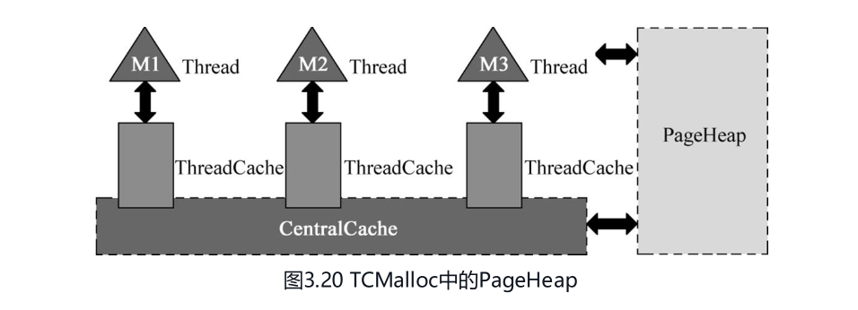

小对象主要沿 `ThreadCache → CentralCache → PageHeap → OS` 补充资源；超过小对象阈值的请求可以直接进入页级分配。图中 M1、M2、M3 表示一般操作系统线程。[1][4]

## 2. Page、Span 与 Size Class

### 2.1 Page：分配器的逻辑页

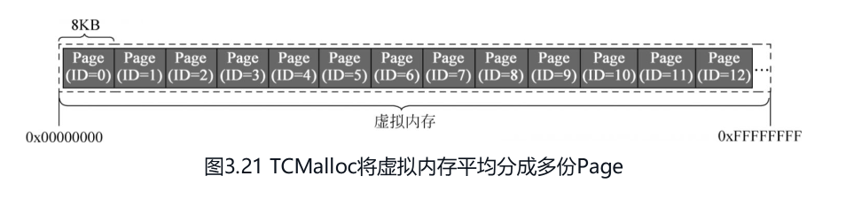

gperftools 2.16 在未覆盖 `TCMALLOC_PAGE_SIZE_SHIFT` 时，`kPageShift=13`，所以一页是 `1 << 13 = 8192` 字节。地址对应的页号可概念化为：

```text
页号 = 地址 / 页大小 = 地址 >> 13
页内偏移 = 地址 % 页大小
```

页号可以作为查找所属 Span 元数据的索引基础，但“算出页号”不等于完成虚拟地址到物理地址的翻译。[1][2]

**图示澄清：** 把地址空间划成页是编号和管理模型，不代表分配器已经申请了全部虚拟地址空间，更不代表所有页都有实际物理内存。OS 页大小由系统决定；分配器 Page 不等于 MMU 物理页。图中 32 位地址范围只是示意，不是现代进程地址空间上限。[1][4]

### 2.2 Span：连续虚拟页及其元数据

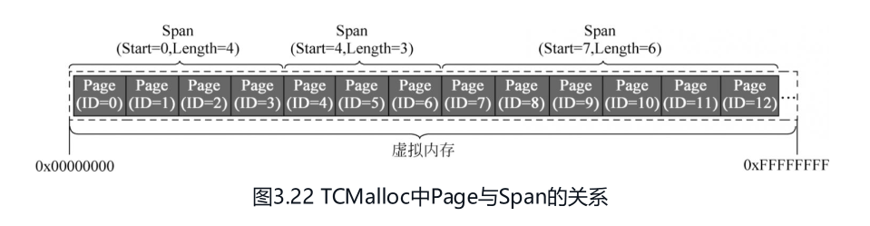

例如 `Start=4, Length=3`，表示页编号 4、5、6 组成的连续虚拟页范围。Span 元数据还要表达它的使用状态、尺寸类或空闲对象等信息。**Span 是分配器管理的内存范围，不是操作系统页表。** 页表负责地址映射，两者作用不同。[1][3]

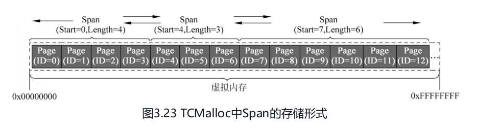

双向链表方便将 Span 加入或移出某个集合。链表中的相邻节点不必在地址上相邻；能否合并要检查真实地址边界。也不是所有 Span 永远放在同一条双向链表里，大 Span 可以通过有序集合管理。[3]

### 2.3 Size Class：对象尺寸类别

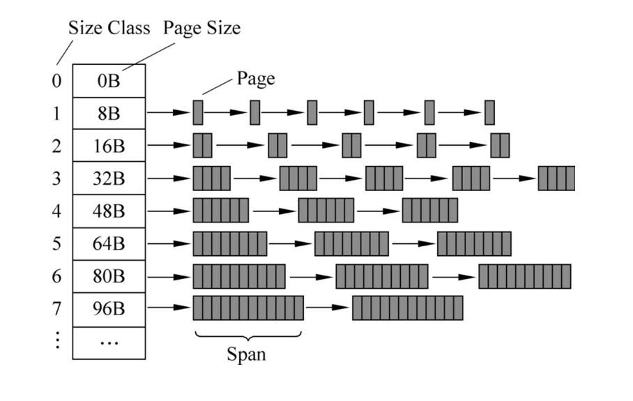

申请的小对象先匹配一个足够大的尺寸类别。用于该类别的 Span 再切成等大的对象槽位。例如教学假设某个 Span 是 8 KiB、类别是 32B，忽略其他条件时可容纳 `8192 / 32 = 256` 个槽位；申请 25B 的对象占用一个 32B 槽位，产生 7B 的取整余量。[1][4]

**图示勘误：** 图中 `Page Size` 列的 8B、16B、32B 实际应理解为对象尺寸，不是 Page 的大小。不能推导“一个 32B 对象由四个 Page 组成”，也不能认为 Span 页数必然随类别编号线性增长。类别大小、对应 Span 页数和批量搬运数量由实现的尺寸表及策略决定。

## 3. ThreadCache：线程私有的小对象缓存

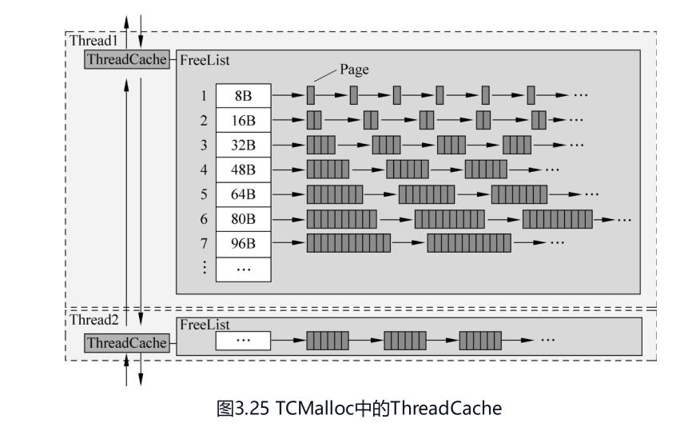

经典模型中，每个线程缓存按 Size Class 维护空闲对象 FreeList：

1. 请求到达时，按尺寸类找到 FreeList。
2. 非空则取一个对象返回，普通局部快路径不需要共享锁。
3. 为空则向中央层批量申请对象，一个用于当前请求，其余留在本地。
4. 释放的小对象通常加入执行 free 的线程缓存；超过缓存策略允许的范围时，批量归还中央层。

**FreeList 中是可复用的小对象，不是“空闲 Span 队列”。** 截图把对象、Page、Span 画成类似小方块，应按上述语义区分。线程缓存之间的全局登记结构用于统计和管理，不代表每次分配都要遍历所有线程缓存。跨线程释放也不能笼统说成一定回到“最初分配它的线程”。[1][4]

## 4. CentralCache：共享补充与批量回收

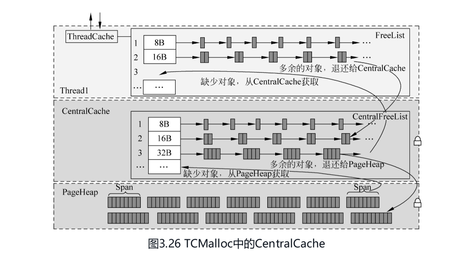

中央层按相同的 Size Class 组织资源，与多个线程交互时需要同步。它从 Span 中组织可分配对象，并批量向 ThreadCache 补货，也接收线程缓存退回的对象。[1][4]

两类数据传递要分清：

| 层之间 | 主要传递的单位 |
| --- | --- |
| ThreadCache ↔ CentralCache | 一批小对象 |
| CentralCache ↔ PageHeap | 由连续页组成的 Span |
| 页级后端 ↔ OS | 虚拟地址范围及页资源，具体由平台接口和策略决定 |

**中央缓存不是 ThreadCache 的完全相同副本。** 两者尺寸分类可以一致，但中央层还需要管理 Span 及对象占用情况。一个 Span 的对象全部回到可回收状态后，才可能整块交还 PageHeap；“中央层多一个空闲对象”不会立即触发整块 Span 归还。[1][4]

## 5. PageHeap：页级分配、切分与合并

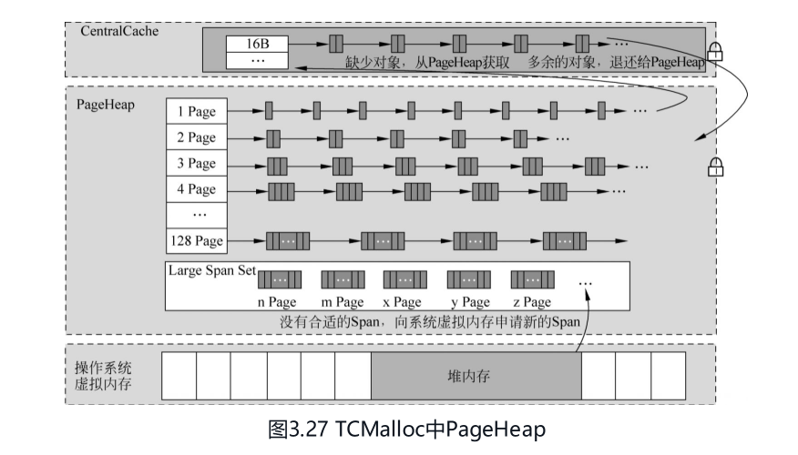

PageHeap 缓存和管理空闲 Span，既向中央层提供页，也满足超过小对象阈值的请求。在已有空闲 Span 可以满足请求时，不必每次都调用 OS。空间不足时才向系统申请或扩展管理范围，申请量还可能大于当前所需 Span。[1][3]

在本文核对的 gperftools 2.16 默认 8 KiB 配置中：

- `kMaxPages = 1 << (20 - kPageShift) = 128`。
- `free_[kMaxPages]` 按页数保存空闲 Span，索引 `i` 对应 `i+1` 页。
- 大于 128 页的空闲 Span 使用 `SpanSet`，支持按大小寻找合适空间；源码还区分普通空闲与已向系统释放的集合。
- 分配可拆分大 Span，剩余部分按其大小重新分类；释放时可以合并地址上相邻且可合并的空闲 Span。

**版本限定：** “128 个链表 + 大 Span 集合”是这条实现线的具体结构，不是所有 TCMalloc 都必须使用的形式。128 与页大小配置相关；不能脱离构建配置只记一个数字。[2][3]

## 6. 小对象分配：尺寸类与批量补充

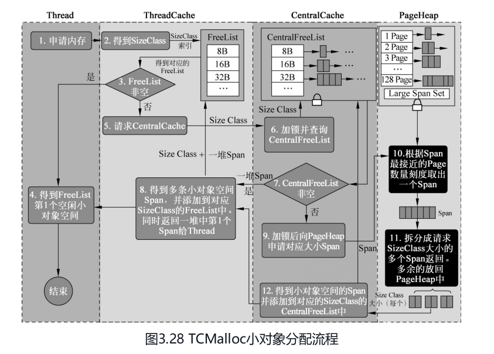

按本文经典配置，非零且不超过 256 KiB 的普通请求走小对象尺寸类路径。以下是修正原图术语后的流程：[1][2]

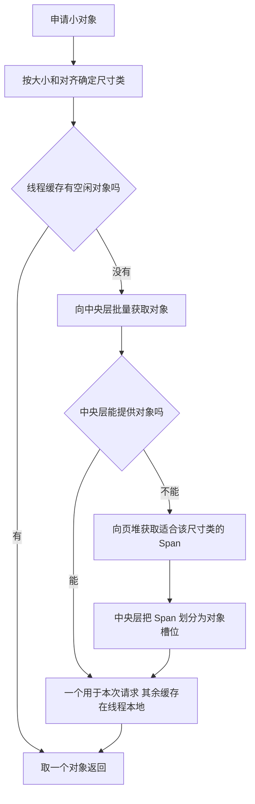

**原图勘误：** “获取一堆 Span 放进 ThreadCache”应为“获取一批对象”；“拆成 Size Class 大小的多个 Span”应为“将供给 Span 划分成该尺寸的对象槽位”。页堆层切分的是连续页范围，中央层再组织小对象，两种切分不是同一件事。

## 7. 中对象分配：按页数寻找 Span

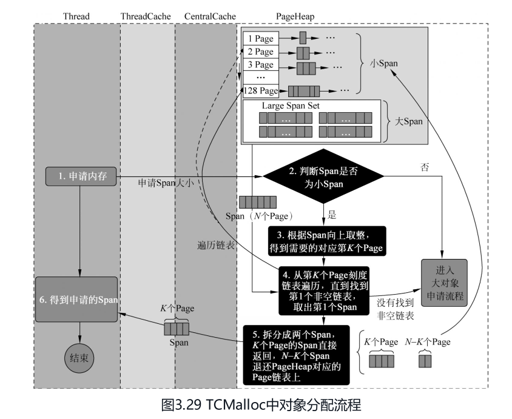

为避免经典文档在 256 KiB 和 1 MiB 处的文字区间重叠，本文按代码阈值统一为：**中对象指大于 256 KiB、且向上取整后不超过 128 页的请求**。默认 8 KiB 页下，上界是 1 MiB；中对象只是解释页堆路径的教学分类。[1][2][3]

1. 将字节数向上取整得到所需页数 `K = ceil(size / 8192)`。
2. 从 K 页对应的空闲链表开始寻找，必要时查找更大的页数类别。
3. 找到 N 页的空闲 Span，若 `N > K`，切出 K 页满足请求。
4. 剩余 `N-K` 页仍作为空闲 Span，放回相应管理结构；相等则没有剩余。
5. 如果精确页数链表范围无法满足，继续查找大 Span 集合，必要时向 OS 获取更多内存。

例如请求 300 KiB，需要 `ceil(300 / 8) = 38` 页，即 304 KiB。若找到 40 页 Span，可切出 38 页，剩余 2 页复用。这是页级取整，不再按小对象尺寸类切成多个槽位。

## 8. 大对象分配：大 Span 搜索与剩余空间复用

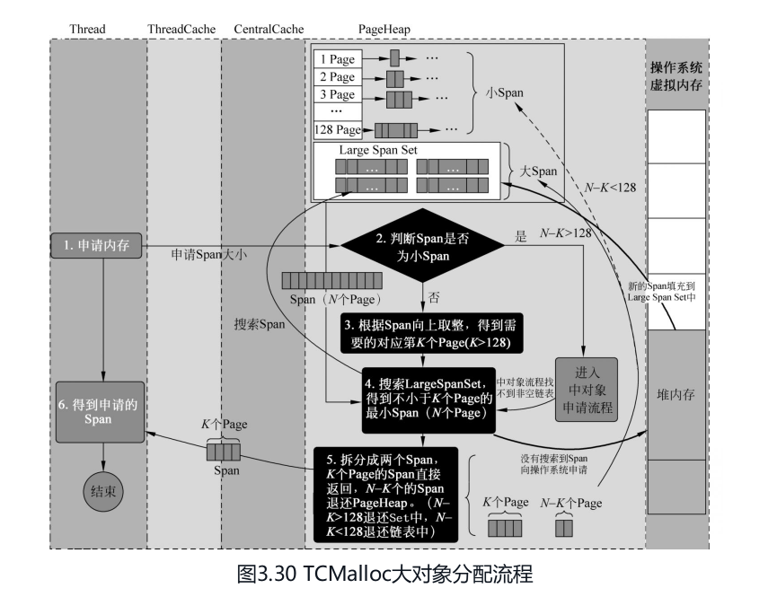

在同一经典配置下，超过 128 页的请求进入大 Span 搜索。按所需页数寻找足够大的候选，优先利用合适的空闲范围，拆分后将剩余部分归回页堆。没有候选时，后端向系统申请内存再满足请求。[1][3]

例如申请 2 MiB 需要 256 页。若有 300 页空闲 Span，可以返回 256 页，剩余 44 页进入小 Span 链表。**按大小寻找候选并不要求“严格大于请求”，大小恰好相等也可以直接使用。**

**原图边界修正：** 剩余页数为 0 时不插入空闲结构；1～128 页放入对应链表，大于 128 页进入大集合。图中只写 `<128` 与 `>128` 会漏掉等于 128 的边界。

## 9. 释放与 OS 归还：不要混为一步

经典小对象释放的概念路径是：

```text
free(对象)
  → 本地缓存复用
  → 按策略批量退回中央层
  → Span 的对象全部可回收
  → 页堆复用或合并 Span
  → 按策略向 OS 释放底层页资源
```

大对象可以直接回到页级管理，不经过小对象缓存。缓存空闲对象、空闲 Span 与 OS 可回收的物理内存是不同层次，不能用“已经 free”推导 RSS 必须立即下降。[1][4]

## 10. 经典模型与现代 TCMalloc 的差异

### 10.1 前端、中间层与后端

Google 当前官方设计文档将分配器划分为 front-end、middle-end 和 back-end：[4]

| 层 | 现代设计 |
| --- | --- |
| 前端 | 支持 per-CPU 模式和 legacy per-thread 模式；常见请求由局部缓存满足 |
| 中间层 | TransferCache 与 CentralFreeList，负责对象批量流转和 Span 内对象管理 |
| 后端 | 页级分配；支持 hugepage-aware pageheap 与 legacy pageheap |

**旧模型的适用范围：** 每线程一份 ThreadCache 是经典 per-thread 模型，不能作为现代 TCMalloc 唯一实现。per-CPU 模式按逻辑 CPU 组织缓存，并利用 restartable sequences 等机制处理访问期间的线程迁移和中断问题。

现代设计文档列出 4、8、32、256 KiB 等可选逻辑页大小，因此“所有 TCMalloc 固定 8KB”不准确。具体页大小、尺寸类和小对象上限应看所选构建，而不是套用经典截图。这里说明当前设计差异，不猜测每项变化首次出现的发行版本。

## 11. 官方参考与配图来源

1. [gperftools 官方 TCMalloc 设计文档](https://gperftools.github.io/gperftools/tcmalloc.html)：Overview、Small/Medium/Large Object Allocation、Spans、Deallocation，支持经典缓存路径、尺寸分类和释放说明。
2. [gperftools 2.16 common.h](https://github.com/gperftools/gperftools/blob/gperftools-2.16/src/common.h)：`kPageShift`、`kPageSize`、`kMaxSize`、`kMaxPages`，核对本文经典配置及边界。
3. [gperftools 2.16 page_heap.h](https://github.com/gperftools/gperftools/blob/gperftools-2.16/src/page_heap.h)：`PageHeap`、`SpanList`、`free_`、`large_normal_`、`large_returned_` 以及分配、释放和切分接口说明。
4. [Google TCMalloc 官方设计文档](https://google.github.io/tcmalloc/design.html)：前中后端、per-CPU/per-thread、CentralFreeList、页大小、后端与释放；在线版本访问于 2026-01-04。

配图来自本次提供的 12 张截图，其中图 3.26 出现两次且文件内容完全相同，合并为 11 张持久图片。保留原图编号，对不准确的术语和边界在相应图下说明；Mermaid 为依据官方机制自绘的教学图。