# Go 语言内存管理：层级结构与分配单元

## 先记：Go 内存管理层级面试复述

从整体上看，Go 的内存管理可以理解为一套从线程本地缓存到全局堆、再到底层操作系统的分层结构。程序申请内存时，编译器会先决定对象放在栈上还是堆上；需要堆分配的对象中，普通小对象优先从当前 P 绑定的 `mcache` 获取可用槽位，这条路径最快，通常不需要共享锁。`mcache` 中的 Span 用完后，会向对应尺寸类别的 `mcentral` 补充一个新的 `mspan`；`mcentral` 负责在多个 P 之间共享和复用 Span。`mcentral` 也没有可用 Span 时，再由全局 `mheap` 按页分配连续的虚拟地址，并把得到的 Span 交回上层。底层空间不足时，`mheap` 才通过操作系统的虚拟内存接口扩展堆。

这套层级的核心思路是把高频分配留在本地，把共享操作和向操作系统申请内存的成本下沉到较低频的路径：`mcache` 处理当前 P 的快速分配，`mcentral` 管理不同尺寸类别的共享 Span，`mheap` 负责全局页管理和堆扩展。大对象通常绕过小对象的槽位缓存，直接向 `mheap` 请求足够的连续页；极小的无指针对象还可能走 tiny 分配，把多个对象合并到一个块中。分配器只负责提供存储空间，GC 负责判断对象是否仍然存活并回收不可达对象，scavenger 则负责把长期空闲页背后的物理内存归还给操作系统。因此，Go 的内存管理不是“每次分配都向 OS 申请”，而是通过 `mcache → mcentral → mheap → OS` 的层级复用内存，在分配速度、并发开销和内存占用之间取得平衡。

## 0. 问答总结

### 0.1 了解 Go 的内存管理机制吗？

1. **Go 堆分配器采用分层缓存。** 普通小对象优先从当前 P 的 mcache 获取槽位，耗尽时向对应的 mcentral 补充 mspan，再不足就由 mheap 提供连续页。[1][3][4]
2. **分层是为了减少共享同步和系统调用。** 本地快路径处理高频请求，整块 Span 补充分摊慢路径成本；大对象使用页级分配路径。[1]
3. **分配器与 GC 分工协作。** 分配器安排存储空间，GC 判断对象存活并回收可复用空间，scavenger 进一步释放空闲页背后的物理内存。[1][8]
4. **本文核对 Go 1.27.1。** 下文的尺寸、编码和数据结构属于运行时实现，不是语言规范永久保证。

### 0.2 Page、mspan 和 Object（槽位） 分别是什么？

面试时可以这样理解：Page 是 Go 运行时管理内存时使用的逻辑页，大小是 8 KiB，它是 Span 的管理粒度，不等于操作系统页，也不代表运行时每次都向操作系统申请 8 KiB。mspan，也就是 Span，负责管理一段连续的虚拟页，所以它的容量等于页数乘以 8192 字节；这里要求的是虚拟地址连续，不要求物理内存连续。对于普通小对象，一个 Span 会按照对应的尺寸类别切分成许多大小相同的槽位，程序申请的对象大小和槽位大小可能不完全一致，超出的部分就形成内部碎片。还要注意，一个语言层面的对象通常对应一个槽位，但并不是绝对如此：tiny 分配可以把多个很小且不含指针的对象合并到同一个块中；而栈上的局部变量由栈管理，不经过这套小对象堆分配流程。[1][2][5]

### 0.3 Size Class 和 Span Class 有什么区别？

1. **Size Class 表示槽位尺寸类别。** 例如 8 B、16 B、24 B、32 B 是不同类别，申请大小向合适类别取整。[2]
2. **Span Class 是尺寸类别与扫描属性的组合。** 编码为 `sizeClass << 1 | noscan`，偶数是 scan，奇数是 noscan，不是 Span 页数等级。[5]
3. **同一 Size Class 对应两个 Span Class。** 分离含指针和不含指针对象，GC 就能跳过 noscan 对象内部的指针扫描；noscan 对象仍由 GC 管理。[5]
4. **Go 1.27.1 有 68 个 Size Class 索引、136 个 Span Class 编码。** Size Class 0 是特殊类别，普通小对象类别为 1～67；最大槽位为 32768 B。[2][5]

### 0.4 为什么 mcache 绑定 P，而不是 G 或 M？

1. **P 是执行 Go 代码所需的调度资源。** 普通分配时，同一 P 的本地缓存由持有该 P 的执行线程使用，因此本地槽位快路径不需要共享锁。[3][7]
2. **缓存数量主要随 P 数量变化。** 不会为每个 Goroutine 或每个阻塞线程都维护一套普通小对象缓存。[3][7]
3. **M 总数不等于 GOMAXPROCS。** 系统调用等场景会让 M 与 P 分离，P 可交给其他 M；GOMAXPROCS 限制并行执行 Go 代码的资源数量，不限制进程全部线程数量。[7]
4. **无锁限定于本地快路径。** 缓存补充、清扫、GC 辅助或堆扩展仍可能产生同步和额外开销。[1][4]

### 0.5 mcache 缺货后如何分配？

1. **按 Span Class 查找当前 Span。** 对普通小对象，先计算尺寸类别及扫描属性，再从 `mcache.alloc[spanClass]` 中的 Span 找空闲槽位。[1][3]
2. **Span 耗尽后向对应 mcentral 补充。** `mcache.refill` 换入有空闲槽位的 Span，不是每次缺一个对象都去申请一页。[3][4]
3. **mcentral 优先复用或清扫已有 Span。** 优先找已清扫的 partial Span，必要时清扫未清扫集合中的 Span。[4]
4. **仍无可用 Span 才向 mheap 请求连续页。** 请求参数是页数与 Span Class，返回值是 `*mspan`；堆也无法满足时再扩展底层内存。[4][5]

### 0.6 mcentral 是两条链表吗？访问一定加一把锁吗？

1. **Go 1.27.1 使用四个 spanSet。** `partial[2]` 和 `full[2]` 分别再区分 swept 与 unswept，不能照搬材料里的 NonEmpty/Empty 两链表结构。[4]
2. **partial 表示存在空闲槽位，full 表示暂时没有。** unswept 的 full Span 清扫后可能出现可分配空间，full 不代表对象永远存活。[4]
3. **共享访问需要并发协调，但不等于每次都获取同一把互斥锁。** spanSet 使用原子操作，添加块或扩展 spine 时需要锁；下层堆操作也可能加锁。[4][6]

### 0.7 内存浪费怎么计算？

1. **槽位取整与尾部剩余是两种浪费。** 81 B 请求使用 96 B 槽位，每个浪费 15 B；8192 B 的 Span 放 85 个槽位，还剩 32 B。[2]
2. **该例最大浪费率约为 15.95%。** `(85 × 15 + 32) / 8192 ≈ 15.95%`，分母是整个 Span 的容量。[2]
3. **这个值不是程序总体内存浪费率。** 它不包含未填满 Span、缓存保留、所有元数据等开销，也不是所有分配路径的统一模型。[1][2]

### 0.8 所有对象都走 mcache → mcentral → mheap 吗？

1. **这是普通小对象堆分配的主干路径。** tiny 分配、零尺寸分配、大对象及编译器优化后的分配需要单独看待。[1]
2. **大对象按连续页分配。** 跳过普通小对象槽位缓存与对应 central 补充路径，但仍可复用堆中已有空间，不必每次向 OS 申请。[1][3]
3. **32 KiB 是尺寸表上限，精确分流要看入口。** Go 1.27.1 通用 `mallocgc` 使用 `size <= 32768 - 8` 判断其小对象分支，不能只凭尺寸表断言所有 32768 B 请求都走小对象路径。[1][2]

### 0.9 mheap、heap arena 和 heapArena 是什么关系？

1. **全局普通堆由 `mheap_` 管理。** 它包含各 Span Class 的 central、页分配器和 arena 元数据索引，供多个 P 共享。[5]
2. **heap arena 是堆地址区域，`heapArena` 是描述它的元数据。** 后者存放在 Go 堆外，通过 `mheap_.arenas` 查找；不能说一个元数据结构本身占用 64 MiB。[5]
3. **arena 大小依赖平台。** Go 1.27.1 中 Linux/amd64 为 64 MiB，Windows/amd64 为 4 MiB；Page 仍为 8 KiB。[1][2]
4. **共享不等于每次访问都拿堆锁。** arena 索引修改受堆锁保护，读取可按源码约束不加锁；页分配也存在 P 本地页缓存路径。[5]

### 0.10 heapArena 的 bitmap 记录的是每个对象是否存活吗？

1. **arena 层主要保存页索引和 Span 状态摘要。** `spans` 关联页与 mspan；`pageInUse`、`pageMarks` 分别摘要记录在用 Span 和含已标记对象的 Span。[5]
2. **这些摘要通常只使用 Span 首页对应的位。** `pageMarks` 不是每个对象一位的完整存活表，不能据此区分同一 Span 中哪些对象存活。[5]
3. **对象级分配和标记状态由 mspan 相关元数据管理。** `allocBits` 配合分配游标表示分配状态，`gcmarkBits` 表示 GC 标记；指针扫描信息又是另一种信息。[1][5]

### 0.11 arenaHint 的 down 表示能否扩容吗？

1. **down 表示尝试增长的地址方向。** `false` 从 addr 向高地址申请，`true` 在 addr 下方申请；它不是“可以扩容”的开关。[1]
2. **addr 是候选边界，next 连接下一条提示。** arenaHint 用于寻找新增 arena 的地址，不保证指向某个已存在 arena 的首地址。[1][5]
3. **提示不保证成功。** 当前地址无法使用时换下一条提示，必要时再尝试由 OS 选择合适地址；源码还包含地址越界和特殊模式检查。[1]

## 1. 范围、版本与整体结构

本文整理用户提供的 3.6.2～3.6.5 摘录及十张配图（图 3.31～3.40），重点是 **Go 堆分配器的层级结构**。3.6.5 文字摘录截至 arenaHint 的 down 说明，相关结构使用源码核对与自绘图补充。这里的“内存管理模型”不要与讨论并发可见性、happens-before 的《The Go Memory Model》混淆。

**版本基准：Go 1.27.1，核对日期：2025-12-28。** 已读取官方仓库 `go1.27.1` 标签下的相关源码。本机是 Go 1.26.6，未将本机源码冒充为 1.27 依据。文中的数值表与结构说明以 1.27.1 为准；未核实旧结构首次变更的版本，不猜测版本号。

Go 分配器最初基于 TCMalloc，但已经有明显演进。理解它时可以先记住：**按尺寸组织对象，按 P 缓存 Span，共享层补充 Span，底层按页管理堆。**[1]

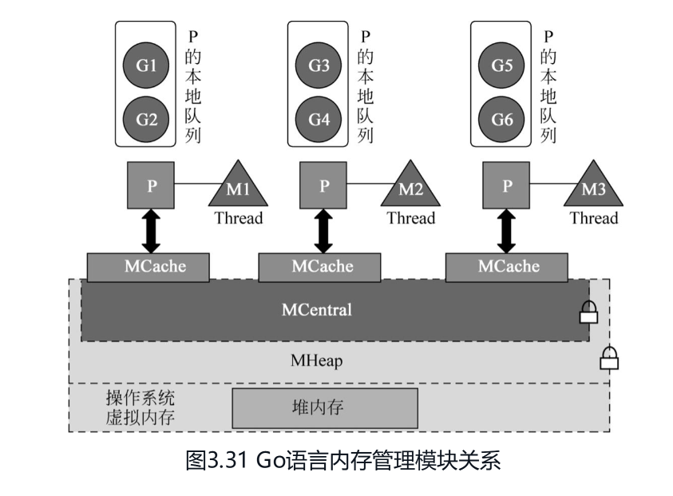

*图 3.31：用户提供的层级关系图。*

**图示限制：** mcentral、mheap 不是严格嵌套的内存容器；它们是管理结构。图中的锁表示共享层存在同步成本，不能推出每次调用都拿全局锁。P 本地运行队列与 mcache 都归 P 管理，但排队中的 G 不会各自占有一份 mcache。[3][5][7]

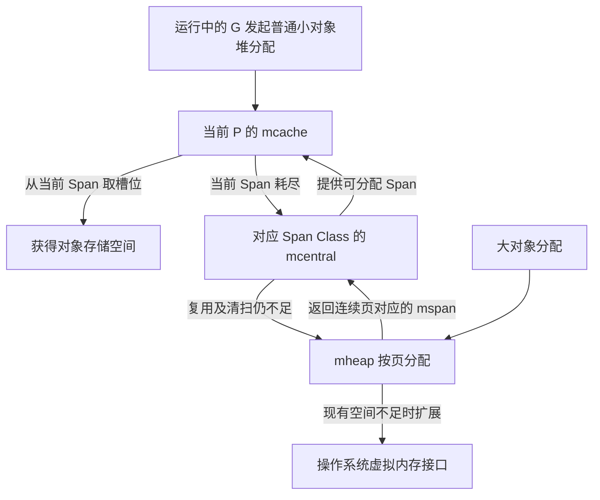

*自绘图：展示普通分配主干，省略 tiny、特殊入口及调试分支；依据 [1][3][4][5]。*

## 2. Page、mspan 与 Object

### 2.1 Page：运行时逻辑页

Go 1.27.1 的 `PageShift = 13`，因此：

```text
PageSize = 1 << 13 = 8192 B = 8 KiB
Span 字节数 = npages × 8192
```

**不准确表述：**“Page 是 Go 与操作系统交互的最小单元，操作系统虚拟内存就是 N 个 8 KB Page 的公共池。”

**准确理解：** 8 KiB 是 Go 内部管理 Span 的页粒度。OS 页大小和虚拟内存保留、提交等接口粒度由平台决定；运行时通常批量获取底层空间。不能把整个进程虚拟地址空间都当成 Go 小对象堆，也不能认为 8 KiB 是所有 TCMalloc 配置共同使用的常量。[1][2][5]

### 2.2 mspan：连续页及其管理信息

源码类型名是 **`mspan`**，资料中的 MSpan、mSpan 是教学写法。它描述起始地址、页数、元素大小、槽位数量和分配状态等信息。对于普通小对象，一个 Span 属于一个 Span Class，其中槽位尺寸一致。[5]

大对象通常由一个 Span 承载一个对象；不要把“所有 Span 都切成许多小 Object”当成无条件规则。[1][3]

### 2.3 请求大小与槽位大小

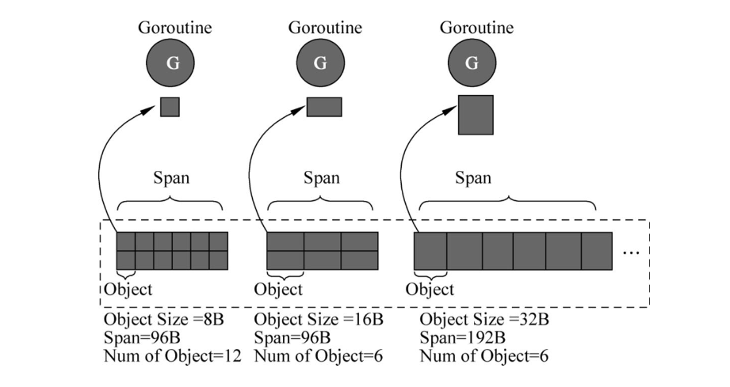

*图 3.32：用户提供的对象划分示意。*

**图示限制：** 图中 96 B、192 B 的 Span 是缩小后的教学数据，不是真实运行时 Span 容量，真实容量是 8192 B 的整数倍。此图仅解释“同一 Span 划分为等尺寸槽位”。

区分三个量：

| 量 | 含义 | 示例 |
| --- | --- | --- |
| 请求大小 | 应用对象所需的有效载荷 | 81 B |
| 槽位大小 | 分配器选定的尺寸类别 | 96 B |
| Span 容量 | 该类别使用的连续页总大小 | 8192 B |

在不另扣 Span 内元数据的尺寸表模型下：

```text
槽位数 N = floor(Span容量 / 槽位大小)
尾部浪费 T = Span容量 - N × 槽位大小
```

例如 8 B 槽位对应 `8192 / 8 = 1024` 个表内槽位，16 B 槽位对应 512 个。**这是尺寸表容量，不保证所有扫描布局下都有同样的可用对象数**；部分 scan Span 的位图可能占据 Span 内空间，部分对象使用 malloc header。[1][2]

## 3. Size Class 与 Span Class

### 3.1 Size Class：按槽位大小分类

忽略 tiny、头部和其他特殊路径时，请求向上匹配能容纳它的尺寸类别。区间应写成 **1～8 B、9～16 B、17～24 B**，而不是在 8 B 上重叠。零尺寸请求单独处理，Size Class 0 不应理解为“为零字节对象分配的常规 Span”。[1][2]

下表摘自 Go 1.27.1 的尺寸表，表示表内名义布局：

| Size Class | 槽位大小/B | 页数 | Span 容量/B | 槽位数 | 尾部浪费/B |
| --- | ---: | ---: | ---: | ---: | ---: |
| 1 | 8 | 1 | 8192 | 1024 | 0 |
| 2 | 16 | 1 | 8192 | 512 | 0 |
| 3 | 24 | 1 | 8192 | 341 | 8 |
| 4 | 32 | 1 | 8192 | 256 | 0 |
| 5 | 48 | 1 | 8192 | 170 | 32 |
| 6 | 64 | 1 | 8192 | 128 | 0 |
| 7 | 80 | 1 | 8192 | 102 | 32 |
| 8 | 96 | 1 | 8192 | 85 | 32 |
| 66 | 28672 | 7 | 57344 | 2 | 0 |
| 67 | 32768 | 4 | 32768 | 1 | 0 |

**源码路径变化：** 摘录指向 `runtime/sizeclasses.go`；本次核实的表位于 `internal/runtime/gc/sizeclasses.go`，使用 `SizeClassToSize`、`SizeClassToNPages` 等符号。[2]

### 3.2 Span Class：尺寸与扫描属性的组合

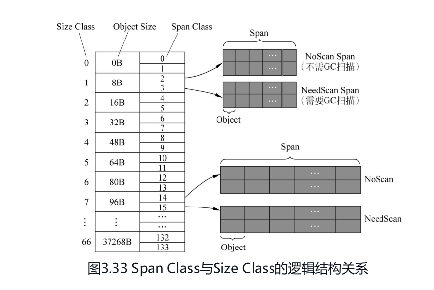

*图 3.33：用户提供的类别关系图。*

**原图纠错：**

- Span Class 不是“Span 大小的级别”，而是 **Size Class + noscan 位**。
- 图中 scan/noscan 箭头标反：Go 1.27.1 中偶数为 scan、奇数为 noscan。
- 图中缺少 24 B 类别；当前 Size Class 3 为 24 B，4 才是 32 B。
- 当前最大普通类别是 67，大小为 **32768 B**；原图的 66、37268 B 和最后编码 133 不能用作当前表。

源码编码为：[5]

```go
func makeSpanClass(sizeclass uint8, noscan bool) spanClass {
    return spanClass(sizeclass<<1) | spanClass(bool2int(noscan))
}
```

| Size Class | 槽位大小 | scan 编码 | noscan 编码 |
| --- | --- | ---: | ---: |
| 1 | 8 B | 2 | 3 |
| 2 | 16 B | 4 | 5 |
| 3 | 24 B | 6 | 7 |
| 4 | 32 B | 8 | 9 |
| 67 | 32768 B | 134 | 135 |

两类 Span 的区别是 **对象内部是否存在 GC 需要追踪的指针**，不是对象当前是否被其他对象引用。noscan 仍需要存活判定与回收，只是不扫描其内部寻找指针。[5]

### 3.3 Max Waste：取整浪费与尾部浪费

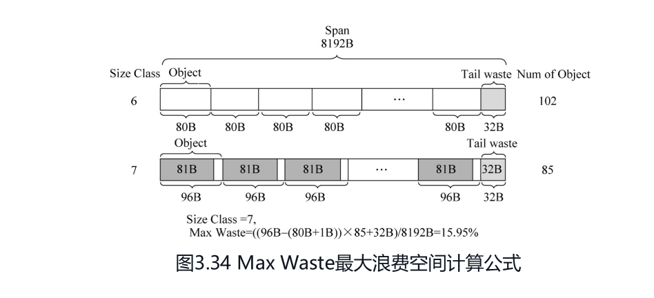

*图 3.34：用户提供的 80 B、96 B 槽位及最大浪费率示意。*

**图示修正：** 80 B、96 B 在 Go 1.27.1 中分别是 Size Class **7、8**，原图的 6、7 不适用。图中的 81 B → 96 B 计算仍可用于说明尺寸表的 max waste。[2]

设上一类别大小为 `Sprev`，当前槽位大小为 `S`，Span 容量为 `B`，则尺寸表的示意算法为：

```text
N = floor(B / S)
T = B - N × S
刚进入本类别的最小整数请求 Rmin = Sprev + 1
Max Waste = [N × (S - Rmin) + T] / B
```

代入当前 96 B 类别：

```text
N = floor(8192 / 96) = 85
T = 8192 - 85 × 96 = 32 B
Rmin = 80 + 1 = 81 B
Max Waste = [85 × (96 - 81) + 32] / 8192
          = 1307 / 8192 ≈ 15.95%
```

该公式用于理解尺寸取整，不直接预测真实程序 RSS。对象头、扫描元数据、tiny 合并、未用满的 Span 和缓存保留都可能让实际开销不同。[1][2]

## 4. mcache：P 本地的小对象分配缓存

### 4.1 与经典 ThreadCache 的绑定区别

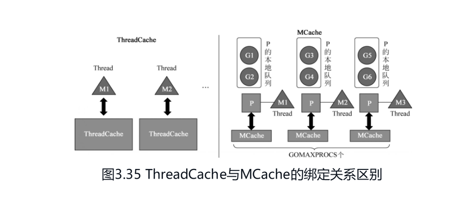

*图 3.35：用户提供的经典线程缓存与 Go per-P 缓存对比图。*

Go 的 `p` 结构持有 `mcache *mcache`。G 被调度到某个 P 上执行时，使用该 P 的缓存；G 迁移后不携带一份专属 mcache。M 在阻塞系统调用中可能不持有 P，其他 M 可以获得 P 继续运行。[3][7]

**不准确表述：**“真正可运行的 M 数量与 P 数量始终一致。”应改为：并行执行普通 Go 代码受 P 数量约束，但可能有空闲 P，也可能有阻塞或执行非 Go 工作的其他 M。图中的固定一对一连线只是一个执行时刻的示意。

与 TCMalloc 的比较限于材料采用的经典 ThreadCache 模型；不要据此声称现代 TCMalloc 只能绑定线程。相关基础见 [TCMalloc 笔记](golang-TCMalloc.md)。

### 4.2 每个 Span Class 的当前分配 Span

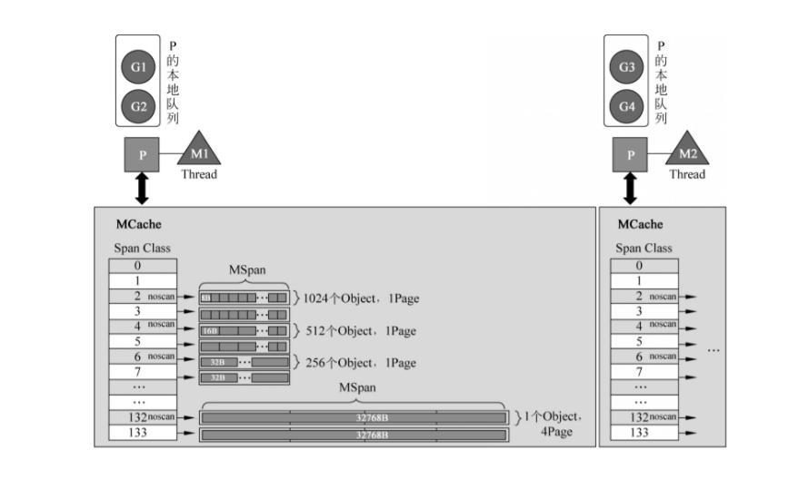

*图 3.36：用户提供的 mcache 内部槽位结构图。*

**原图纠错：** 偶数编码旁的 noscan 标签应纠正；编码 6/7 对应 24 B，32 B 对应 8/9；最后一组应是 134/135、32768 B。16 B 的“512 个”是尺寸表容量，scan 布局的元数据可能减少实际可用槽位，不能无条件套用。

当前关键字段是：[3]

```go
alloc [numSpanClasses]*mspan
```

每个索引保存该类当前用于分配的 Span 指针，**不代表初始化时就为全部类别分配满真实 Span**，也不代表全进程每类只有一个 Span。mcache 还含 tiny 状态、统计、栈缓存及可复用 noscan 对象相关字段，`alloc` 只是本文关注的主干。

普通流程是：定位 Span → 查分配位图/缓存 → 取空闲槽位 → 更新分配状态。当前 Span 耗尽时，`refill` 处理旧 Span 并向对应 mcentral 获取新 Span。[1][3]

“无锁”描述的是 per-P 本地分配快路径，不代表整个分配调用永远不阻塞，也不保证分配与 GC 无关。

## 5. mcentral：共享 Span 管理与清扫协作

### 5.1 层级之间传递什么？

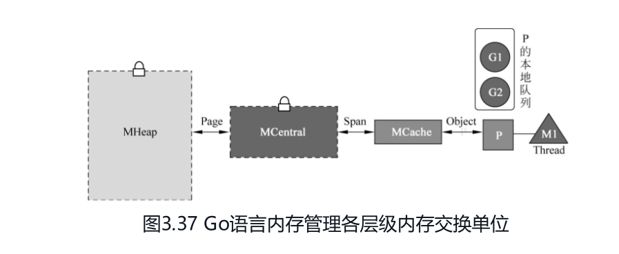

*图 3.37：用户提供的层级交换单位图。*

| 层级 | 适合记忆的粒度 | 源码层面的准确说法 |
| --- | --- | --- |
| 普通小对象分配与 mcache | Object 槽位 | 从当前 Span 中取得对象存储空间 |
| mcache 与 mcentral | Span | 获取或归还相应类别的 `*mspan` |
| mcentral 与 mheap | 连续 Page 组成的 Span | 按页数请求，返回 `*mspan` |
| mheap 与 OS | 平台相关的内存区域 | 保留、提交、释放等操作并非固定一次一页 |

**图示修正：**“mcentral 与 mheap 交换 Page”可以表示计量粒度，但不应理解为传递单个 Page 对象。`mcentral.grow` 查 `SizeClassToNPages`，随后调用 `mheap_.alloc(npages, c.spanclass)`。[4]

### 5.2 每个 Span Class 对应一个 mcentral

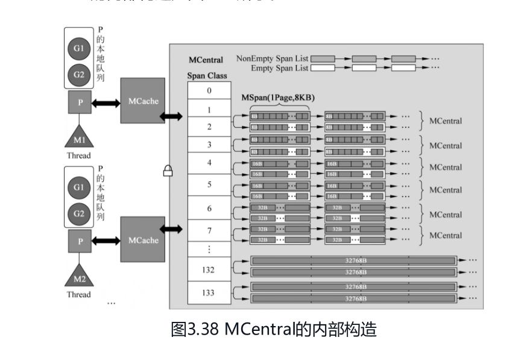

*图 3.38：用户提供的 NonEmpty/Empty 两链表结构图。*

**旧式图示与当前实现不同：** Go 1.27.1 的 mcentral 使用 `partial[2]`、`full[2]`，不是图中的两条 Span List。此处没有核实两链表结构首次被替换的版本，因此不标注猜测的历史版本。图中尺寸类别编号还需按第 3 节修正。[4]

`mheap.central` 按 Span Class 索引组织 mcentral。教学图把它们画成一个 MCentral 大层，实际每个管理单元只负责自己的类别；数组包括特殊类别位置，不等于每个位置都有普通小对象 Span。[5]

### 5.3 Go 1.27.1 的四个集合

```go
// 省略其他字段，仅展示分类结构。
partial [2]spanSet
full    [2]spanSet
```

| 槽位状态 | 已清扫 swept | 未清扫 unswept |
| --- | --- | --- |
| partial：有空闲槽位 | 可优先用于补充 mcache | 先取得清扫权并清扫 |
| full：没有空闲槽位 | 当前不能提供槽位 | 清扫后可能释放槽位 |

数组的两个位置随 GC 清扫代际交换职责，不是固定 `[0]` 永远已清扫、`[1]` 永远未清扫。源码通过 `sweepgen/2%2` 计算已清扫集合索引；消费未清扫集合时还要处理已被其他清扫者处理的条目。[4]

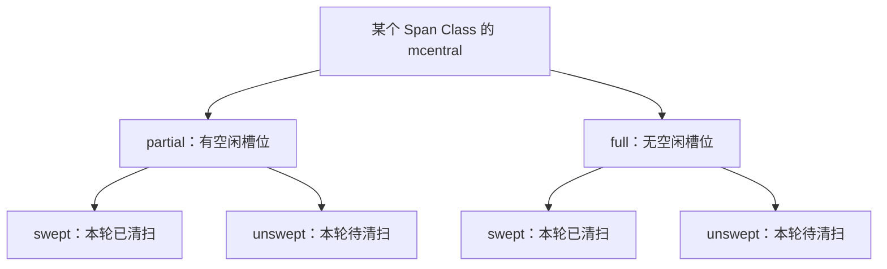

*自绘图：四个逻辑集合；物理数组位置随清扫代际变化。依据 [4]。*

`cacheSpan` 的主干顺序是：已清扫 partial → 尝试清扫未清扫 partial → 尝试清扫未清扫 full → 仍不足则 `grow`。清扫尝试有预算限制，不是无止境扫描所有 Span。[4]

### 5.4 共享同步不能简化为“一次一把大锁”

`spanSet` 支持并发 push/pop，内部采用两层存储和原子索引；访问 spine 可以不加锁，但添加块、扩展 spine 需要 `spineLock`。因此它既不是普通双向链表，也不能笼统称为“完全无锁的数据结构”。[6]

分层仍然有价值：一次补充一个 Span，后续多个对象分配可在本地完成，减少访问共享层的频率。[1][3][4]

## 6. mheap、特殊路径与回收边界

### 6.1 mheap 的职责

mheap 管理页级堆空间，为小对象 Span 和大对象分配提供连续虚拟页。现有空间不足时扩展堆；现代实现还会在满足条件时尝试 P 的页缓存，再进入共享页分配器，因此“进入 mheap 就一定拿全局锁”的图解也过于绝对。[5]

### 6.2 mheap、arenas 与 heapArena 的层级关系

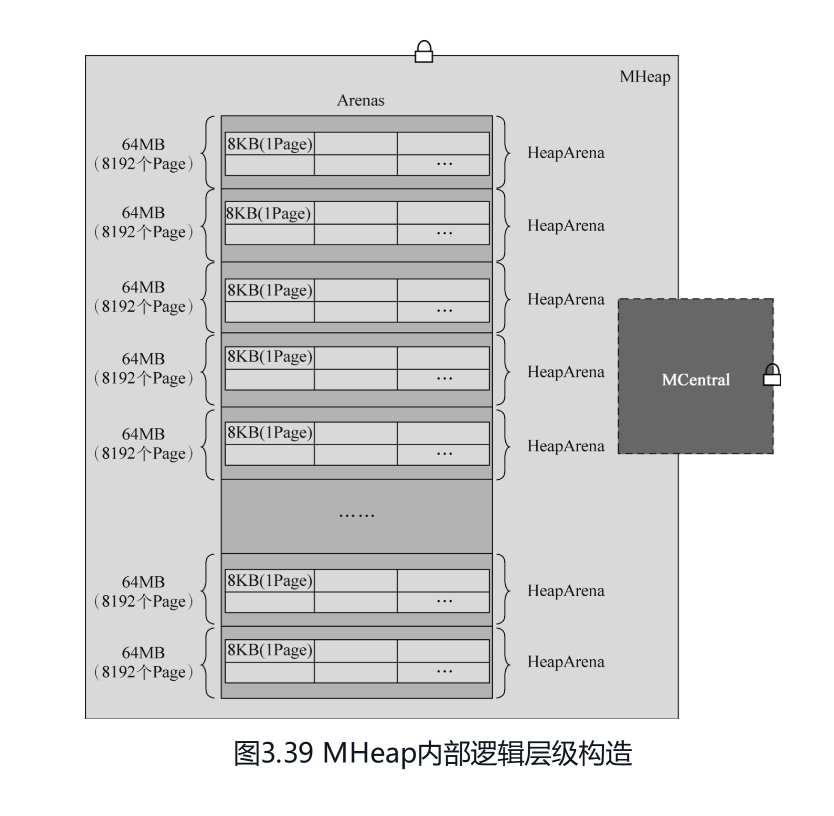

*图 3.39：用户提供的 MHeap 内部逻辑层级构造图。*

**图示限制：** 图中每块“64 MB、8192 个 Page”描述的是特定平台上的 arena 地址范围，应读作 64 MiB；Windows/amd64 的对应范围为 4 MiB。`heapArena` 是这些区域的堆外元数据，不是内联在 mheap 结构中的 64 MiB 数据块。图中的锁表示共享同步需求，不代表所有读取和分配路径都获取同一把锁。平台差异见第 6.3 节。[1][5]

运行时的全局普通堆实例为 `var mheap_ mheap`。它包含 `central` 数组，也通过页分配器管理可用页。**“mcentral 属于 mheap 的字段”是结构归属；“mcentral 向 mheap 申请”是分配职责上的分层，两者不冲突。**[4][5]

**不准确表述：**“如果没有 MCentral，就从 Arenas 中某个 HeapArena 获取 Page。”实际是对应 mcentral 暂时无法提供可分配 Span，随后通过 `grow` 请求页分配器提供连续页。`arenas` 是地址到元数据的索引，不是可直接弹出空闲 Page 的容器。[4][5]

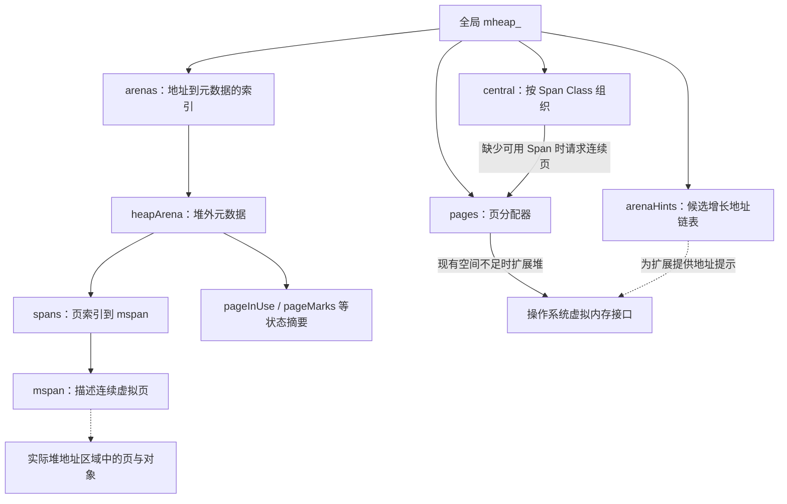

*自绘图：根据 Go 1.27.1 源码整理，与原图 3.39、3.40 对照阅读。实线包含字段引用及标明的调用关系，虚线表示描述或提示关系。[1][4][5]*

要区分三个概念：

| 名称 | 准确含义 | 不能混淆为 |
| --- | --- | --- |
| heap arena | 按 `heapArenaBytes` 对齐和划分的堆地址区域 | 一个 Go 元数据结构 |
| `heapArena` | 记录区域内页与 Span 等信息的堆外元数据 | 64 MiB 的对象存储区本身 |
| `mheap_.arenas` | 从 arena 编号查找 `*heapArena` 的索引 | 所有堆数据内联存放的大数组 |

`arenas` 的类型是：

```go
arenas [1 << arenaL1Bits]*[1 << arenaL2Bits]*heapArena
```

逻辑上支持 L1、L2 两级索引；很多平台的 `arenaL1Bits` 为 0，实际退化成单级。未由 Go 堆支撑的地址区域对应空索引，不能因为索引可以覆盖某段地址就认为已经为它分配了物理内存。修改索引受 `mheap_.lock` 保护，读取可以按运行时规定不加锁。[5]

### 6.3 arena 的大小：64 MiB 需要平台限定

**不准确表述：**“一个 HeapArena 占用内存 64 MB，里面都是 mspan。”64 MiB 描述的是特定平台上一个 **heap arena 所覆盖的地址区域大小**，不是 `heapArena` 结构体自身大小，也不意味着所有页已经放满对象或驻留物理内存。[1][5]

Go 1.27.1 的 `logHeapArenaBytes` 常量给出以下代表性配置：

| 平台 | 每个 heap arena 覆盖范围 | 8 KiB Page 数量 |
| --- | ---: | ---: |
| Linux/amd64 | 64 MiB | 8192 |
| Windows/amd64 | 4 MiB | 512 |
| Linux/386 | 4 MiB | 512 |
| iOS/arm64 | 4 MiB | 512 |
| Wasm | 512 KiB | 64 |

这些值来自具体常量表达式，不能仅凭“64 位平台”一概判断为 64 MiB；本工作区的 Windows/amd64 就是反例。源码说明 Windows 使用较小 arena，与提交内存的计费方式有关；Wasm 则考虑线性内存成本。[1]

arena 是地址划分单位，Span 是连续页分配单位。**一个大 Span 可以跨越相邻 arena 的边界**，所以不能把 arena 想象成绝不允许 Span 跨越的独立箱子。运行时尝试保持 arena 连续，以便大 Span 可以跨 arena 使用地址空间。[1]

### 6.4 heapArena 的页映射与位图

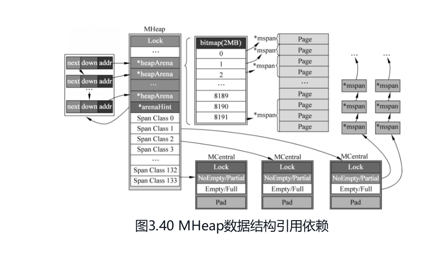

*图 3.40：用户提供的 MHeap 数据结构引用依赖图。*

**原图与 Go 1.27.1 的差异：**

- **`bitmap(2MB)` 不是当前 heapArena 的统一布局。** 当前字段应以下表的页映射、状态摘要为准；不能将图中 bitmap 解释为当前版本统一存储对象存在与存活的双标记表。原图所属历史版本未核实。
- **0～8191 是 64 MiB arena 下的页索引示意。** 对应 `spans` 的页到 mspan 映射，不能把这一索引表当成对象标记位图；已分配 Span 的多个页可指向同一个 mspan。
- **Span Class 当前编码范围是 0～135。** 原图只画到 133；类别数量和特殊类别含义见第 3 节。
- **mcentral 当前使用四个 spanSet。** 图中的 NonEmpty/Partial、Empty/Full 两链表和单把 Lock 是旧式结构示意，不能直接当作当前字段布局，详见第 5.3～5.4 节。
- **arenaHint 是候选地址链表。** 图中 `next`、`down`、`addr` 可用于记忆字段，但其箭头不表示每条提示都与一个已存在 heapArena 一一绑定；`down` 表示增长方向，详见第 6.5 节。

以上差异依据 [1][4][5][6]，原图保留用于对照理解。

**不准确表述：**“每个 HeapArena 有一个 bitmap，以两种标记记录对象是否存在、是否被 GC 标记，所有 Page 都被这样标记。”这混合了页级摘要、对象分配位图、对象标记位图及指针扫描信息。Go 1.27.1 的 `heapArena` 并不是这样一个统一双标记表。[5]

当前关键字段包括：

| 字段 | 表达的信息 | 粒度与边界 |
| --- | --- | --- |
| `spans [pagesPerArena]*mspan` | 页所属的 Span | 已分配 Span 的各页映射到同一 mspan；不能任意假设空闲页也有可靠的逐页映射 |
| `pageInUse` | 哪些 Span 处于 `mSpanInUse` | 按页号索引，只使用 Span 首页的位 |
| `pageMarks` | 哪些 Span 含有已标记对象 | 同样使用首页位，帮助快速寻找可整块回收的 Span |
| `pageSpecials` | 哪些 Span 包含 finalizer 等特殊记录 | 同样使用首页位 |
| `pageUseSpanInlineMarkBits` | 哪些 Span 在其内存尾部存放内联标记信息 | 此布局仅用于一页大小的 Span |

`spans` 的读取也有生命周期约束：必须确认所查条目对应在用或栈 Span，并遵循源码对安全点的限制。它不是可对任意地址随意解引用的通用公开 API。[5]

对象级信息则要看 `mspan` 及对象类型相关机制：

- **分配状态：** `allocBits` 配合 `freeindex` 等游标判断对象槽位是否已分配，不能只读取某个位就忽略游标语义。
- **GC 标记状态：** `gcmarkBits` 记录对象标记，与 `pageMarks` 的“整个 Span 是否存在已标记对象”摘要不同。
- **指针扫描信息：** 用于说明对象内哪些位置是指针，依据对象布局使用相应位图或类型信息；它不等于对象存活标记。

上述分工按 Go 1.27.1 源码核对；原材料未提供版本，不能将它的双标记解释认定为某个已经核实的历史实现。[1][5]

### 6.5 arenaHint：扩展地址提示，不是扩容许可

用户文字摘录只列出了前两个字段，补充的图 3.40 中可见 `next`。下面字段及行为说明已 **根据 Go 1.27.1 源码核对**，不是恢复缺失原文：[5]

```go
// 省略运行时内部的 NotInHeap 标记字段。
type arenaHint struct {
    addr uintptr
    down bool
    next *arenaHint
}
```

| 字段 | 含义 |
| --- | --- |
| `addr` | 尝试增长的候选地址边界，不保证是已有 arena 的首地址 |
| `down` | 是否向低地址方向尝试申请 |
| `next` | 指向下一条候选提示，构成链表 |

假设申请长度为 `n`，忽略地址溢出等检查，候选区间是：

```text
down == false：尝试 [addr, addr + n)，成功后 addr += n
down == true ：尝试 [addr - n, addr)，成功后 addr -= n
```

因此 **`down == false` 不表示不能扩容**，`down == true` 也不保证扩容成功。`mheap.sysAlloc` 依次尝试提示地址；当前提示失败会丢弃并转向 `next`。普通回退路径可以请求 OS 选择满足对齐要求的其他地址，特殊模式仍有额外限制。[1]

### 6.6 tiny、对象头与 32 KiB 边界

- **tiny：** 通用非特化分支对满足条件的 `<16 B` 无指针请求使用 tiny allocator，将多个请求按对齐装入 16 B 块；特化入口及特殊模式会影响是否采用该路径，不能仅凭请求大小判断。[1]
- **对象头：** 某些 scan 分配会加上 8 B malloc header 再选 Size Class；不能将有效载荷大小直接当作槽位大小。[1][2]
- **尺寸上限：** 最大普通尺寸类别槽位为 32768 B。Go 1.27.1 通用 `mallocgc` 的小对象分流条件是 `size <= maxSmallSize - gc.MallocHeaderSize`，即 32760 B；这与槽位上限是不同概念。本文不把该单一入口条件泛化到全部编译器特化入口。[1]
- **大对象：** 页数向上取整，Span Class 使用特殊 Size Class 0 与扫描位组合，分配不走普通 `mcache.alloc` 槽位补充链。[3]

### 6.7 对象回收不等于立即归还 OS

清扫可以让对象槽位重新可用；整个 Span 不再有存活对象时，其页可回到堆的可复用空间。scavenger 再按策略释放空闲页背后的物理内存。因此，“对象不可达”“槽位可复用”“整 Span 可复用”“RSS 下降”是不同阶段，不能画成每次对象回收立即逐层返回 OS 的同步流程。[1][8]

## 7. 官方参考与核对入口

以下源码链接均固定到 **go1.27.1**；编号覆盖对应正文的机制与数据。

1. [runtime/malloc.go](https://github.com/golang/go/blob/go1.27.1/src/runtime/malloc.go)：分层设计说明，`mallocgc`、`mallocgcTiny`、`mallocgcSmallScanHeader`、`mallocgcLarge`，分流、tiny 与头部处理。
2. [internal/runtime/gc/sizeclasses.go](https://github.com/golang/go/blob/go1.27.1/src/internal/runtime/gc/sizeclasses.go) 与 [internal/runtime/gc/malloc.go](https://github.com/golang/go/blob/go1.27.1/src/internal/runtime/gc/malloc.go)：尺寸表、页大小、类别数量、尾部浪费、`MallocHeaderSize` 和 `MinSizeForMallocHeader`。
3. [runtime/mcache.go](https://github.com/golang/go/blob/go1.27.1/src/runtime/mcache.go)：`mcache`、`alloc`、`refill`、`allocLarge`，per-P 缓存和大对象路径。
4. [runtime/mcentral.go](https://github.com/golang/go/blob/go1.27.1/src/runtime/mcentral.go)：`mcentral`、四个 spanSet、`cacheSpan`、`uncacheSpan`、`grow`。
5. [runtime/mheap.go](https://github.com/golang/go/blob/go1.27.1/src/runtime/mheap.go)：`mheap_`、`mheap`、`heapArena`、`arenaHint`、`mspan`、`makeSpanClass`、`numSpanClasses`、`allocSpan`，类别编码、页缓存、arena 索引与位图。arena 平台大小和地址提示的实际使用另见 [runtime/malloc.go](https://github.com/golang/go/blob/go1.27.1/src/runtime/malloc.go) 的 `logHeapArenaBytes` 与 `mheap.sysAlloc`。
6. [runtime/mspanset.go](https://github.com/golang/go/blob/go1.27.1/src/runtime/mspanset.go)：`spanSet`、`push`、`pop`、`spineLock`，共享集合的并发机制。
7. [runtime/runtime2.go](https://github.com/golang/go/blob/go1.27.1/src/runtime/runtime2.go)：`p`、`m` 的字段及绑定关系。调度背景另见已有 [GPM 笔记](golang-GPM调度模型.md)。
8. [runtime/mgcscavenge.go](https://github.com/golang/go/blob/go1.27.1/src/runtime/mgcscavenge.go)：后台与分配时 scavenging，释放堆空闲页的物理后备内存。

配图来源为用户提供的十张截图，保留原图并就地勘误；自绘 Mermaid 为根据上述源码整理的教学图，不是官方原图。
