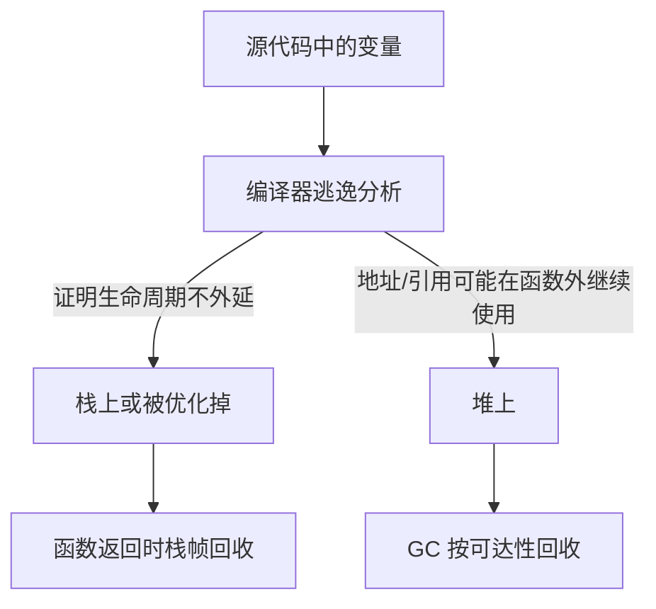

# Go 内存逃逸：变量何时在栈、何时在堆

## 0. 问答总结

### 0.1 什么是内存逃逸？

1. **逃逸是编译器的分配位置判断。** 如果编译器无法证明一个值只在当前函数及其调用范围内使用，就可能把它放到堆上。
2. **逃逸分析发生在编译期。** 它依据变量之间的指针流动、返回值、参数传递、闭包捕获等关系推导生命周期，不是运行时临时决定。
3. **逃逸不是错误。** 堆对象由 GC 管理，栈对象随栈帧回收；开发者不需要手动 free。
4. **“可能”很重要。** 最终位置是编译器实现和上下文的结果，不能只凭 `new`、`&` 或变量类型下结论。

### 0.2 `new` 出来的变量一定在堆上吗？

1. **不一定。** `new(T)` 只是返回一个 `*T`，规范不规定必须使用堆；编译器若证明指针不会逃逸，可以把对象放在栈上。
2. **返回给调用者时通常逃逸。** 调用者仍要使用该地址，当前函数结束后对象必须继续存在，因此常见结果是堆分配。
3. **只在函数内部使用时可能不逃逸。** 例如 `p := new(int); *p = 1; return *p`，指针没有离开函数，编译器可能消除堆分配。
4. **用 `go test -gcflags=-m=2` 查看实际结论。** 诊断信息比根据语法猜测可靠。

### 0.3 结构体嵌套会导致逃逸吗？

1. **直接嵌入不会自动逃逸。** `A` 中的 `B` 是 A 对象内部的一段内存，是否堆分配按 A 整体的生命周期判断。
2. **指针字段会形成新的引用边。** `A{B: &b}` 可能让 `b` 逃逸；但如果编译器能证明该指针只在局部使用，也可能仍留在栈上。
3. **A 返回值和 A 返回指针是不同情况。** 返回 `A` 可以复制值，返回 `*A` 则需要让 A 在调用者继续有效，通常更容易逃逸。
4. **结构体是否含指针影响 GC 扫描，不等于决定栈或堆。** noscan 只表示 GC 不扫描其内部指针，不能据此断言它一定在栈上。

### 0.4 哪些写法最容易触发逃逸？

1. **返回局部变量地址。** `return &x` 是最直观的逃逸路径。
2. **把指针存进长期存活对象。** 例如全局变量、堆对象字段、map、slice 或 channel。
3. **传给编译器无法内联证明的接口或函数调用。** 接口装箱、反射和外部调用边界会增加逃逸可能性。
4. **闭包捕获局部变量。** 闭包在外层函数返回后仍可能执行，被捕获变量必须延长生命周期。

### 0.5 逃逸一定是性能问题吗？

1. **堆分配通常比栈分配成本高。** 它会增加分配器工作和 GC 跟踪范围。
2. **减少逃逸不能牺牲正确性和可读性。** 强行改成值复制可能复制大对象，或破坏共享语义。
3. **先测量再优化。** 用 benchmark、`-benchmem`、pprof 和编译器逃逸诊断确认热点。
4. **编译器会优化很多表面分配。** 内联、标量替换和死代码消除可能使源码中的 `new` 最终不产生堆对象。

## 1. 栈、堆与逃逸分析

栈帧适合保存函数调用期间的临时值。函数返回后，栈帧可以整体回收；堆对象的生命周期则由可达性和 GC 决定。Go 编译器在编译期做逃逸分析，选择栈或堆，并插入相应的分配与写屏障处理。语言规范只规定程序语义，不保证某个变量一定在栈或堆。[1][2]



**注意：**“作用域结束”只是帮助理解的简化说法。真正判断的是值的生命周期和指针是否可能流向更长寿命的位置；词法作用域与堆栈位置不是同一个概念。[3]

## 2. `new`、取地址与分配位置

### 2.1 `new` 只是表达式，不是“强制堆分配”

```go
func local() int {
    p := new(int)
    *p = 42
    return *p
}

func returned() *int {
    p := new(int)
    *p = 42
    return p
}
```

`local` 中 p 指向的值没有离开函数，编译器可能将它放在栈上，甚至通过优化完全消除这次分配。`returned` 把地址交给调用者，通常需要堆分配。用诊断命令核实：

```bash
go test -gcflags='-m=2' ./...
```

Windows PowerShell 可写成：

```powershell
go test -gcflags='-m=2' ./...
```

输出中的 `moved to heap: x`、`x escapes to heap` 是编译器诊断；没有这两类信息也不等于源码中绝无任何运行时分配，需结合 benchmark 验证。

### 2.2 取地址也不等于必然逃逸

```go
func sum() int {
    x := 10
    p := &x
    return *p
}
```

`x` 的地址只在本函数内使用，编译器可以证明其安全。相反：

```go
func address() *int {
    x := 10
    return &x
}
```

返回地址使 `x` 的生命周期超出当前栈帧，通常会报告 `moved to heap: x`。

## 3. 普遍的逃逸路径

### 3.1 返回指针、接口和闭包

```go
var global *int

func save() {
    x := 1
    global = &x // 地址存入全局变量
}

func closure() func() int {
    x := 1
    return func() int { return x } // 闭包捕获 x
}
```

二者都要求 `x` 在当前函数返回后仍可访问。闭包捕获变量的具体实现可能通过环境对象、堆提升或其他优化完成，但不能依赖某种固定布局。[3][4]

### 3.2 存入 map、slice、channel 或接口

```go
func put(m map[string]*int, ch chan *int) {
    x := 1
    m["x"] = &x
    ch <- &x
}
```

容器或接收方可能在函数返回后保留指针，因此 `x` 常见地逃逸。接口参数也可能发生装箱：

```go
func consume(anyValue any) {}

func example() {
    x := 1
    consume(x) // 是否产生分配取决于类型、内联和后续使用
}
```

不能把“传接口必然堆分配”当成规则；应以当前编译器诊断和基准结果为准。[3]

### 3.3 指针字段与嵌套结构体

```go
type B struct { Value int }
type A struct { Inner B }

func valueA() A {
    return A{Inner: B{Value: 1}}
}
```

这里 B 是 A 的内嵌字段，没有独立的 B 地址。A 是否逃逸由 A 的使用方式决定：作为值返回可能留在调用者栈上，作为 `*A` 返回则通常需要延长生命周期。

```go
type C struct { Inner *B }

func pointerC() *C {
    b := B{Value: 1}
    return &C{Inner: &b}
}
```

这里 C 和 b 通过指针连接，二者都必须在返回后有效，通常都会被提升到堆。**但“通常”不是语言保证**，编译器可能通过内联或其他转换改变具体分配结果。

## 4. 如何读逃逸诊断

建议为最小示例建立临时包后运行：

```bash
go test -gcflags='all=-m=2' ./path/to/package
```

常见信息含义：

| 诊断片段 | 通俗含义 |
| --- | --- |
| `moved to heap: x` | 编译器把变量 x 从栈候选位置提升到堆 |
| `x escapes to heap` | x 的值或地址流向了更长生命周期的位置 |
| `leaking param: p` | 参数 p 的指针可能通过返回值或存储继续流出 |
| `does not escape` | 当前分析认为该参数不会通过该调用边界逃逸 |
| `can inline` | 内联可能改变最终逃逸结论，需结合完整输出理解 |

诊断是编译器实现细节，版本、架构、构建标签和优化开关都可能影响输出。[3]

## 5. 优化时的正确思路

1. **减少不必要的堆分配。** 让短生命周期的小值保持局部，复用切片容量，减少循环中反复创建临时对象。
2. **减少不必要的指针。** 直接嵌入小结构体通常能减少独立对象和 GC 扫描，但大对象共享时指针可能更合适。
3. **批量连续存储。** `[]T` 往往比分散的 `[]*T` 少许多独立分配和指针跳转，但要考虑复制成本。
4. **不要围绕固定阈值设计。** “512 B 以下都走 Green Tea”不是逃逸规则；Green Tea 是 GC 标记扫描实现，是否堆分配由编译器逃逸分析决定。[5]
5. **用数据验证改动。** 结合 `go test -bench . -benchmem`、`allocs/op`、`B/op` 和 pprof 判断优化是否真的有效。

## 6. 易错点

- **`new` 不等于堆。** 它只负责生成零值并返回指针。
- **`&x` 不等于堆。** 只有当地址或值的生命周期需要外延，才可能逃逸。
- **结构体嵌套不等于多次分配。** 直接字段嵌入通常属于同一个对象布局。
- **有指针不等于一定堆分配。** 指针影响 GC 扫描和引用关系，位置仍由逃逸分析决定。
- **堆分配不等于立刻产生一次独立系统调用。** 运行时分配器会从 mcache、mcentral 和 mheap 分层获取空间。[6]

## 7. 官方参考

1. [Go 语言规范：Variables](https://go.dev/ref/spec#Variables)：变量、指针和值语义；规范不规定实现必须选择栈或堆。
2. [Go 语言规范：Allocation](https://go.dev/ref/spec#Allocation)：`new` 分配零值对象并返回指针的语言语义。
3. [Go 编译器源码：escape](https://github.com/golang/go/tree/go1.27.1/src/cmd/compile/internal/escape)：Go 1.27.1 的逃逸分析实现，包括 `escape.go`、`expr.go`、`call.go`、`leaks.go`。
4. [Go 语言规范：Function literals](https://go.dev/ref/spec#Function_literals)：闭包与捕获变量语义。
5. [Go 运行时 Green Tea GC](https://github.com/golang/go/blob/go1.27.1/src/runtime/mgcmark_greenteagc.go)：批量标记扫描机制；它不是逃逸分析，也不限定对象必须小于 512 B。
6. [Go 运行时内存分配器](https://github.com/golang/go/blob/go1.27.1/src/runtime/malloc.go)：mcache、mcentral、mheap 分层分配说明。
