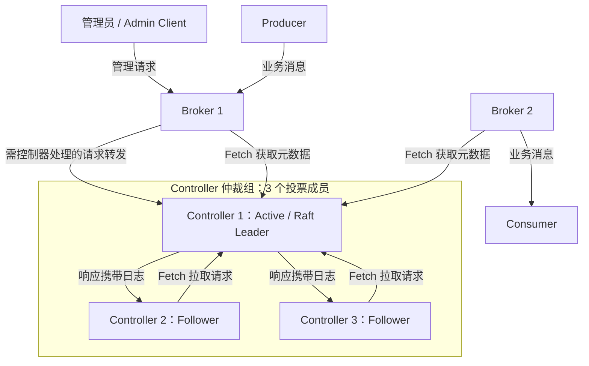
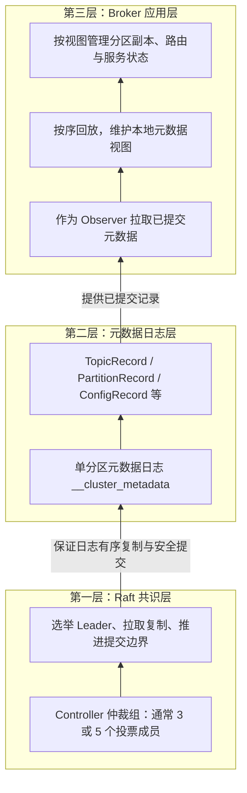
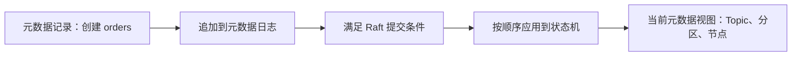
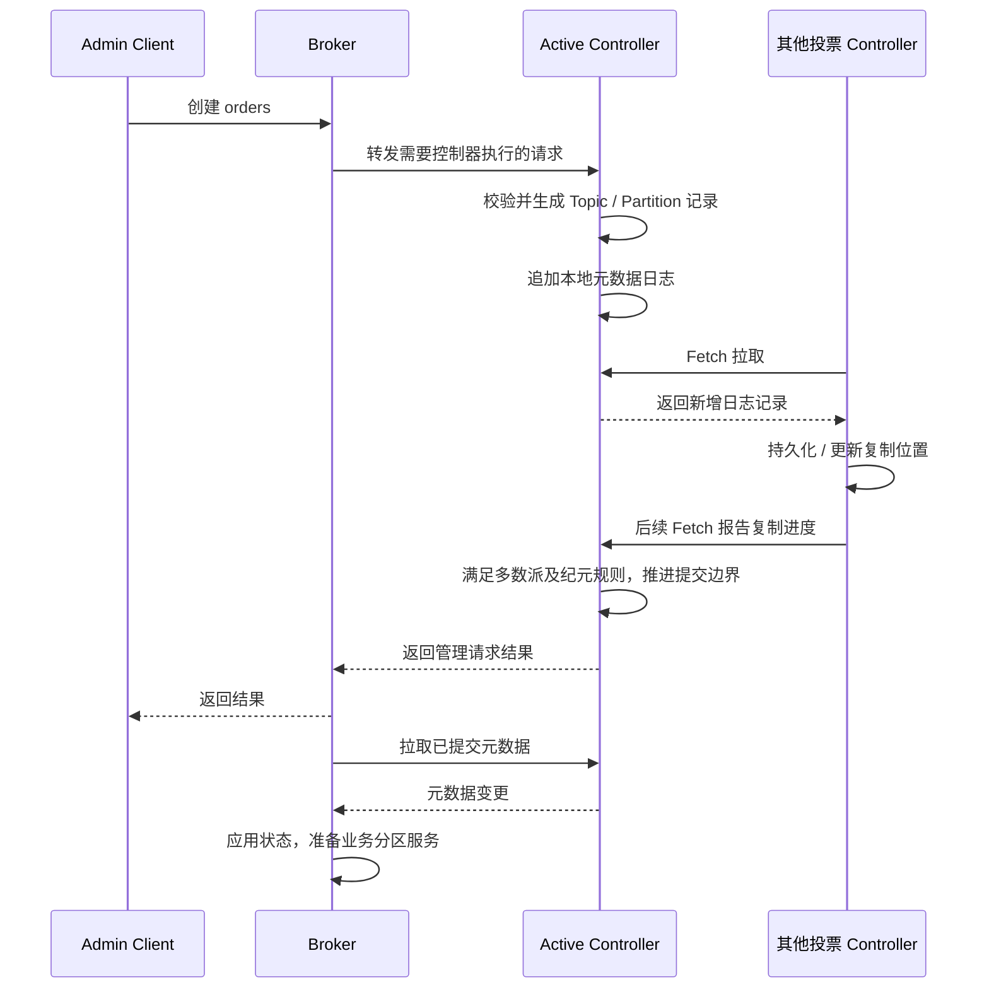
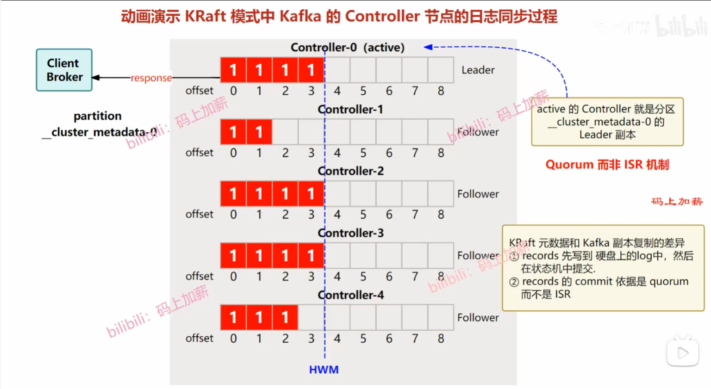
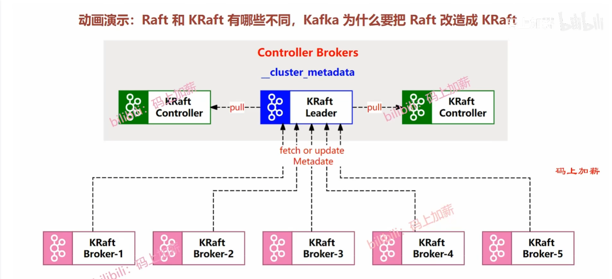
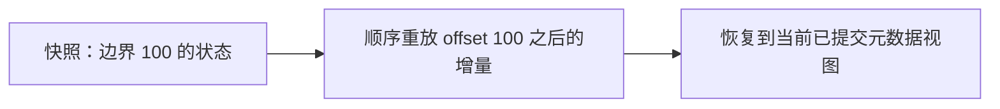
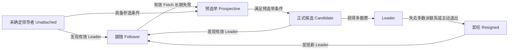

# 从零理解 Kafka KRaft 控制器

**KRaft 是 Kafka 用来维护集群元数据的一套复制与协调机制。多个 Controller 保存同一份元数据日志，通过 Raft 选出一个活动控制器；重要变更经投票成员多数派确认后提交，Broker 再获取这些变更来执行数据服务。**

本文以 Kafka 4.2 为配置和工具基线，从职责、日志、选举到部署逐步展开。设计依据为 KIP-500、KIP-595、KIP-631；动态成员管理补充 KIP-853 和当前运维文档。KIP 描述设计意图，命令以发行版本文档为准。全文不要求先了解其他元数据管理系统。

## 1. 为什么需要 Controller

假设有 3 台 Broker，准备创建 `orders`，包含 3 个分区、每分区 3 个副本。集群必须共同知道：

- Topic 是否存在、唯一 ID 是什么、有哪些配置。
- 每个分区副本放在哪些 Broker，当前由谁担任 Leader。
- Broker 是否已注册、是否处于可提供服务的状态。
- 副本集合、ISR、分区 Leader 等状态变化是否已经生效。

这些是**描述集群结构和状态的元数据**，不是订单消息内容。若每台 Broker 自行决定，可能对同一分区产生互相冲突的认识，因此需要统一的状态变更入口和可恢复的权威记录。

Controller 负责决定并记录这些状态，Broker 根据已获知的状态管理本地副本、接收生产请求和提供读取。Controller 不逐条转发业务消息，也不执行消费者的业务代码。

## 2. 先看清三个角色

| 角色 | 做什么 | 不承担什么 |
|---|---|---|
| 活动控制器（Active Controller） | 提出并协调元数据变更；是元数据 Raft Leader | 不是所有业务分区的 Leader |
| 其他投票控制器（Follower / Voter） | 复制元数据日志、参与选举，可在故障时接任 | 不是每台都同时决定集群变更 |
| Broker | 复制已提交元数据到本地视图，管理业务分区并服务客户端 | Broker-only 节点不参与控制器投票 |



普通客户端通过 Broker 访问业务服务；需要控制器处理的管理请求可由 Broker 转发。某些运维工具也支持直接连接 Controller，此时使用控制器专用入口。

“仲裁组”（Quorum）是参与一致性维护的集合，“多数派”是完成关键决策所需的数量。Broker 从元数据 Raft 的角度通常是观察者（Observer）：拉取记录，但没有投票权。

进程角色由 `process.roles` 决定：`broker`、`controller` 或 `broker,controller`。兼任角色适合本地学习；生产一般将 Broker 和 Controller 分开部署。

### 三层架构：共识、日志与应用

可以按你提供的图，将 KRaft 的元数据路径理解为三层：**Raft 共识层保证哪些记录可以提交，元数据日志层表达集群发生了什么，Broker 应用层将已提交变更回放为本地状态。** 这是便于理解的逻辑分层，不是要求部署三套独立服务。



| 层次 | 核心问题 | 主要职责 |
|---|---|---|
| Raft 共识层 | 谁能追加？哪些变更已经确定？ | 选举、纪元、投票成员复制和多数派提交；保护已提交日志前缀 |
| 元数据日志层 | 集群状态如何记录和恢复？ | 以有序记录表达 Topic、分区、副本、配置等变更，并结合快照恢复状态 |
| Broker 应用层 | 数据节点怎样执行共同的集群状态？ | 拉取和回放已提交记录，更新本地视图，驱动业务分区管理 |

例如创建 `orders`：Active Controller 校验请求并生成 Topic、分区记录；记录写入元数据日志，由 Raft 层完成复制和提交；Broker 获取已提交记录并更新状态，准备相应分区副本。图中的箭头表达底层向上层提供的能力，不代表创建请求只能从下往上流动。

理解这张图时还需注意：

- “订阅并回放”是形象说法。Broker 使用内部元数据复制机制，不是创建普通 Consumer Group 订阅 `__cluster_metadata`。
- 单分区日志是全局有序的逻辑日志，会复制到多个节点，不是只存一份文件；它保存的是集群元数据，不是所有 Topic 的业务消息。
- Controller 自身也会回放元数据并维护状态机，不能把所有状态应用都归给 Broker。上图突出的是元数据最终服务 Broker 的路径。
- 3 或 5 是常见投票节点部署数量，不是协议只允许这两种数量；实验环境可以只有 1 个，但没有容错能力。

## 3. 元数据如何变成可恢复的状态

### 一份有序日志，而不是反复复制整张表

创建 Topic、注册 Broker、改变分区状态等操作被编码为元数据记录，追加到特殊的元数据日志中。常见记录包括 TopicRecord、PartitionRecord、RegisterBrokerRecord、ConfigRecord 等。



状态机可以理解成一份内存中的集群状态表：给定相同初始状态和同一串已提交记录，各节点重放后得到相同结果。实现内部可以暂存推测性状态，但不能将未提交变更视为已确定的集群事实。

元数据日志使用特殊的 `__cluster_metadata` 单分区，常见磁盘目录名为 `__cluster_metadata-0`。它不是用户通过 Producer 写入、Consumer Group 读取的普通业务 Topic，也不使用业务分区 ISR 作为提交规则。

业务订单在 `orders` 分区日志中；消费者提交位点主要保存在 `__consumer_offsets`；事务协调状态主要保存在 `__transaction_state`。这几类状态不能统称为“全都写到 Controller 元数据日志里”。

### 三个不同的标识

| 标识 | 含义 |
|---|---|
| Offset（偏移量） | 记录在元数据日志中的位置 |
| Leader Epoch（领导者纪元） | 一届领导权的编号，帮助识别旧 Leader 和日志分叉 |
| High Watermark（高水位，HW） | 已提交日志的边界；按 Kafka 的下一位置约定，offset 小于 HW 的记录已提交 |

Epoch 类似 Raft 的 term，offset 类似 Raft 的 index；不要把 epoch 当时间戳，也不要把 Controller epoch 与某个业务分区的 Leader epoch 混为一谈。

## 4. 一次创建 Topic 的完整过程



这是简化流程，数据准备、响应和各 Broker 拉取之间可能并发发生。管理请求成功不等于所有 Broker 和客户端缓存同一瞬间都已经更新；客户端仍要正常处理元数据刷新和短暂不可用。

Follower 主动发送 Fetch，所以称为**拉取式复制**。请求方向是 Follower 到 Leader，日志数据方向则通过响应从 Leader 返回 Follower。图上必须分清这两种箭头。

KIP-595 为元数据日志设计了持久化约束，不能把多数派确认简化成“几个节点的内存看到了”。也不要把它推导成 Kafka 的每条业务消息在 `acks=all` 下都会逐条执行相同刷盘流程。

## 5. 多数派与高水位：读懂你提供的第一张图



图中共有 5 个投票 Controller，多数派是 `floor(5 / 2) + 1 = 3`，包括 Leader 自己。图中 Controller 0、2、3 已拥有 offset 0～3，Controller 1 只有 0～1，Controller 4 只有 0～2。

在相应纪元和提交条件成立、Leader 已获知复制进度的前提下，前三个节点形成多数派，因此可以把 **HW 推进到 4**：表示 offset 0、1、2、3 已提交，不表示 offset=4 已提交。图中红色数字不应当作订单值或固定格式字段来理解。

慢副本不必全部追上才允许提交，但需要最终追赶。不能每次从任意副本多数“投票决定一条记录的值”：Leader 决定追加顺序，复制与选举规则共同保护已提交前缀。

| 投票 Controller 数量 | 多数派 | 可容忍同时失效数 |
|---|---|---|
| 1 | 1 | 0 |
| 3 | 2 | 1 |
| 4 | 3 | 1 |
| 5 | 3 | 2 |

所以常选 3 或 5。4 台比 3 台多一台，却没有增加可容忍故障数。这里假设剩余多数成员可通信、持久化状态正常；Observer 不计入多数派。

## 6. Active Controller 故障后如何接任

1. Follower 持续无法与有效 Leader 通信，按超时和选举规则开始竞争。现代实现还可通过预投票减少无效选举。
2. 候选者进入新的 epoch，请求其他投票成员支持；投票规则检查纪元和日志新旧程度，同一纪元不能任意投给多个候选者。
3. 获得多数票后成为新的元数据 Leader，也承担 Active Controller 的职责。
4. 节点按日志纪元 / 偏移量检查差异，必要时截断未提交的分叉尾部，再复制和应用权威日志。
5. 新 Leader 继续处理元数据变更，Broker 发现并连接新 Leader。

多数派之间必然相交，结合投票和日志新旧规则，保护已经提交的记录不会被一个落后候选者任意覆盖。不能只用“谁的 offset 最大就选谁”来概括选举，也不能忽略 epoch。


失去多数派时，不能继续提交新的元数据变更。已有业务分区是否还能短时读写取决于 Leader、副本、注册状态及请求需求，不能承诺数据面完全不受影响，也不能说所有业务日志立即丢失。

网络隔离中的旧 Leader 可能短时仍以为自己有领导权，但无法拿到多数派完成有效提交，并会根据协议退出领导状态。业务侧仍需正确处理超时与重试。

## 7. Broker 怎样使用元数据：读懂第二张图



图上方是控制器仲裁组，下方是 Broker。Follower Controller 和 Broker 都可以向 Active Controller 拉取元数据，但前者是投票成员，后者是 Observer。

图中 “Controller Brokers” 容易引起误解：Controller 是角色，不要求同时是业务 Broker。`fetch or update metadata` 也不是 Broker 随意修改元数据日志：Broker 注册、心跳及分区状态请求由控制器校验，权威变更由 Active Controller 生成并提交。

Broker 启动后需注册身份、同步元数据，并通过控制器协调的状态转换进入可服务状态。Broker 心跳用于节点存活和状态管理；它不是 Consumer Group 心跳。消费者组 Coordinator 虽也运行在 Broker 上，但负责组成员和消费协调，不是 KRaft Active Controller。

## 8. 快照与重启：不必从第一条历史记录重放

日志不断增长，而当前集群状态可能只有有限大小。快照（Snapshot）将某个已提交边界的元数据状态汇总保存，再结合后续日志恢复：



不同副本可以有不同时间点的快照，只要快照和后续日志构成完整一致的恢复链。落后副本缺失的日志已被清理时，可通过快照恢复后继续追赶。快照是元数据状态，不是订单消息备份。

`metadata.log.dir` 指定元数据存储目录，未设置时使用 `log.dirs` 的第一个目录。目录里的 `meta.properties` 保存集群和节点等身份信息，日志及 checkpoint 保存状态。不能删掉目录再格式化来“修复”复制落后；丢失多数成员的持久状态会危及集群恢复。

## 9. 身份、入口与投票成员：配置前先分清

| 配置 / 标识 | 含义 | 常见误区 |
|---|---|---|
| `process.roles` | 进程承担 Broker、Controller 或兼任角色 | 每台 Kafka 进程必须兼任 |
| `node.id` | 节点唯一编号 | 不同节点重复使用 ID |
| Cluster ID | 整个集群的身份，由存储格式化写入 | 每台节点生成不同 Cluster ID |
| Directory ID | 标识具体存储目录，动态成员管理会使用 | 重建目录后仍当成完全相同的投票成员 |
| `listeners` | 本进程监听的协议名、地址和端口 | 与客户端应连接的公布地址混淆 |
| `controller.listener.names` | 哪种 listener 用于控制器通信 | 把控制器端口交给普通 Producer |
| `controller.quorum.bootstrap.servers` | 动态仲裁组的发现入口 | 地址列在这里就自动获得投票权 |
| `controller.quorum.voters` | 静态仲裁组的投票节点列表 | 与动态成员模式混用或以为修改它即可在线扩缩容 |
| `metadata.log.dir` | 元数据日志和快照位置 | 当成所有业务 Topic 的数据目录 |

动态组的投票成员状态由协议持久化管理。Bootstrap 地址只负责找到集群，**发现入口不是投票成员名单**。增加 Broker 不等于增加 Controller；增加 Controller 也不增加业务 Topic 的副本因子。

Kafka 4.2 部署优先按动态仲裁组流程学习；已有静态组迁移应按官方特性升级流程处理。`metadata.version`、`kraft.version` 是协议 / 特性级别，不等于安装包版本号。KIP 的早期静态配置样例不应直接当作所有 4.x 部署的唯一方式。

## 10. 本地最小实验：一台进程看懂流程

下面为 Kafka 4.2 的**新建本地实验集群**，兼任 Broker 和 Controller；不具备容错能力。使用发行包要求的 Java 环境，从 Kafka 解压目录运行。配置示例使用明文 localhost，仅用于本机学习。

保存为 `config/kraft-lab.properties`：

```properties
process.roles=broker,controller
node.id=1
listeners=PLAINTEXT://localhost:9092,CONTROLLER://localhost:9093
advertised.listeners=PLAINTEXT://localhost:9092
listener.security.protocol.map=PLAINTEXT:PLAINTEXT,CONTROLLER:PLAINTEXT
inter.broker.listener.name=PLAINTEXT
controller.listener.names=CONTROLLER
controller.quorum.bootstrap.servers=localhost:9093
log.dirs=D:/data/kafka-kraft-lab/data
metadata.log.dir=D:/data/kafka-kraft-lab/metadata
num.partitions=1
default.replication.factor=1
offsets.topic.replication.factor=1
transaction.state.log.replication.factor=1
transaction.state.log.min.isr=1
```

PowerShell 下使用发行包的 Windows 脚本：

```powershell
# 只为新的实验集群生成一次，并保存输出。
$kraftLabClusterId = & .\bin\windows\kafka-storage.bat random-uuid

# 仅格式化新目录。已有集群重启不要重复执行。
& .\bin\windows\kafka-storage.bat format --standalone -t $kraftLabClusterId -c .\config\kraft-lab.properties

& .\bin\windows\kafka-server-start.bat .\config\kraft-lab.properties
```

`--standalone` 初始化只有本节点一个投票成员的动态仲裁组。不要分别在三台节点上执行 standalone，再期待三个独立仲裁组自动合并。

Linux 使用 `bin/*.sh`，同时将配置中的目录换为 Linux 路径。上面是阅读和实验示例，本文编写过程中没有实际启动集群验证。

## 11. 扩展到生产：3 个 Controller 的准备顺序

生产通常使用 3 个独立 Controller，跨故障域部署；Broker 单独部署。Controller 的磁盘延迟、CPU、网络稳定性影响元数据提交，不宜与高负载业务争抢资源。

动态组有两种初始化思路：先初始化一个 voter，再依次加入其他 Controller；或为多节点生成各自目录身份，使用一致的 `--initial-controllers` 列表初始化。生产投入使用前完成所需冗余，不能长期停留在单投票成员阶段。

加入已有动态组时：

1. 使用相同 Cluster ID、新节点唯一 ID、正确的发现入口准备新 Controller。
2. 按官方流程使用 `--no-initial-controllers` 格式化新目录，不创建独立仲裁组。
3. 启动并观察其作为非投票复制节点追赶日志。
4. 确认追上后通过 `kafka-metadata-quorum` 的 `add-controller` 操作加入投票集合。
5. 再次检查 CurrentVoters 和复制状态，确认变更完成。

移除则先执行协议成员移除、验证新集合，再停机；动态成员变更不是只编辑发现地址。具体 CLI 参数、认证和目录 ID 见 [Kafka 4.2 KRaft 运维文档](https://kafka.apache.org/42/operations/kraft/)。这里不把集群修改命令与只读排查混在一起。

## 12. 怎样看见控制器正在做什么

另开终端，以下命令以 Linux 脚本名展示；Windows 替换为 `bin/windows/` 下对应 `.bat`。

```bash
# 通过 Broker 查询仲裁组概要。
bin/kafka-metadata-quorum.sh --bootstrap-server localhost:9092 describe --status

# 查看每个复制节点的进度和延迟。
bin/kafka-metadata-quorum.sh --bootstrap-server localhost:9092 describe --replication

# 直接通过 Controller 查看特性级别。
bin/kafka-features.sh --bootstrap-controller localhost:9093 describe
```

| 字段 | 如何解读 |
|---|---|
| LeaderId | 当前元数据 Leader，不是订单分区 Leader |
| LeaderEpoch | 频繁增加可提示选举不稳定，需要结合日志排查 |
| HighWatermark | 元数据已提交边界，不是业务消费位点 |
| CurrentVoters | 实际投票成员，核对是否达到计划的 3 / 5 个 |
| CurrentObservers | 非投票复制节点，不增加容错票数 |
| LogEndOffset / Lag | 各节点复制位置和落后量；结合时间判断是否持续落后 |

离线检查日志 / 快照时使用实际文件路径，优先检查副本文件，避免干扰运行节点：

```bash
bin/kafka-dump-log.sh --cluster-metadata-decoder --files /path/to/__cluster_metadata-0/00000000000000000000.log
bin/kafka-metadata-shell.sh --snapshot /path/to/__cluster_metadata-0/00000000000000000100-0000000001.checkpoint
```

示例文件名不保证在你的目录存在。Dump Log 解码记录，Metadata Shell 将快照呈现为可浏览的元数据状态，不是直接修改在线集群的 SQL 控制台。KIP-631 中的早期工具参数与正式版本可能不同，执行前以发行包 `--help` 为准。

### 常见现象如何定位

| 现象 | 优先检查 |
|---|---|
| 没有 Leader | 实际 voter 是否形成多数、端口和认证是否互通、节点 / 集群身份是否匹配 |
| 频繁选举 | Controller 长暂停、磁盘延迟、网络抖动、超时配置；不是先无限调大超时 |
| 一个副本长期落后 | 该节点 Fetch、磁盘、网络、日志错误及快照恢复状态 |
| 管理请求卡住但部分生产正常 | 元数据多数派、控制器请求链路、Broker 与 Controller 的连接 |
| Broker 无法进入正常服务状态 | 注册 / fencing 状态、元数据追赶、身份和 listener 配置 |

## 13. 学习资料与下一步

- [KIP-500：整体架构](https://cwiki.apache.org/confluence/display/KAFKA/KIP-500%3A+Replace+ZooKeeper+with+a+Self-Managed+Metadata+Quorum)：看 Controller、Broker 与元数据日志的职责关系。
- [KIP-595：元数据 Raft 协议](https://cwiki.apache.org/confluence/display/KAFKA/KIP-595%3A+A+Raft+Protocol+for+the+Metadata+Quorum)：看 epoch、投票、拉取复制、提交与故障恢复。
- [KIP-631：仲裁组控制器](https://cwiki.apache.org/confluence/display/KAFKA/KIP-631%3A+The+Quorum-based+Kafka+Controller)：看元数据状态机、快照、注册和管理工具设计。
- [Kafka 4.2 KRaft 运维](https://kafka.apache.org/42/operations/kraft/)：动态仲裁组、特性级别、初始化、成员变更和排查命令；包含 KIP-853 动态成员设计入口。
- [Kafka 4.0 快速入门](https://kafka.apache.org/40/getting-started/quickstart/)：核对 standalone 实验流程的版本背景。
- [waylau Kafka 教程](https://github.com/waylau/apache-kafka-tutorial)：作为中文学习入口；本篇协议细节已于 2026-04-30 直接查阅上述 KIP 和官方文档。

继续阅读 [基础知识](kafka-基础知识.md) 了解业务分区和副本，阅读 [消费者配置与再均衡](kafka-消费者配置与再均衡.md) 区分组协调器与 KRaft Controller。

## 14. 协议消息：选举、复制和退出怎样配合

KRaft 不只有三个 RPC。下面按职责列出学习时最常接触的消息；它们服务于元数据协议，不是应用发送业务消息的接口。

| RPC | 方向与作用 | 理解重点 |
|---|---|---|
| Vote | 竞争领导权的节点向其他 voter 请求投票；现代协议也支持预投票 | 检查 epoch、候选者日志的新旧及既有投票状态 |
| BeginQuorumEpoch | 新 Leader 通知其他成员本届领导权信息 | 节点仍需校验纪元与身份，不能无条件接受声明 |
| EndQuorumEpoch | Leader 通知结束本届领导状态 | 帮助正常退出和领导权交接，不代表已有提交失效 |
| Fetch | Follower / Observer 请求复制日志 | 请求向 Leader 发出，记录在响应中返回；后续请求也让 Leader 获知复制进度 |
| FetchSnapshot | 需要时获取快照内容 | 用于无法仅靠保留日志追赶的恢复场景 |
| DescribeQuorum | 管理工具查询仲裁组 | 观察成员与复制状态，不参与投票 |
| AddRaftVoter / RemoveRaftVoter | 动态仲裁组管理投票成员 | 需要通过受控协议变更持久化成员集合，不能以编辑发现地址替代 |

“复用 Kafka 的日志和 Fetch 基础设施”不等于“只是一个普通 Topic”：投票、纪元、提交与持久化规则仍是专门的 Raft 协议。动态加入时，AddRaftVoter 是协议请求名；成员集合通过相应控制记录持久化，不应笼统称为写入一条普通的 AddVoter 业务消息。

## 15. 选举状态与持久化投票

### 为什么不能只背五个状态

早期讲解常使用 Unattached、Voted、Candidate、Leader、Follower 五态。Kafka 4.2 实现还涉及预选举（Prospective）、卸任（Resigned）等状态；“已投票”信息也可以附着于其他状态。源码状态与监控指标显示的标签不必一一对应。



这是主路径示意，不穷举所有版本状态转换。Observer 没有投票资格，不能沿这条路径竞选 Leader。

**获知更高 epoch 后必须停止基于旧纪元采取不合法行动，但不一定立即进入 Follower。** 是否已知有效 Leader、消息种类和当前状态都会影响转换；还不知道 Leader 时可能进入 Unattached，而不是凭 epoch 自动推导出跟随对象。

### 重启后也要记得投给了谁

正式选举中，节点需要持久化相关 epoch 和投票信息，随后才完成依赖该状态的协议动作。否则一次重启抹掉内存中的投票记录，就可能在同一 epoch 给不同候选者投票，破坏安全性。预投票则用于探测选举可行性，不能把它与正式投票的持久化语义混同。

多数派交集也不是独立的完整证明。例如记录 X 已由 A、B 构成提交多数派，新选举涉及 B、C，两组相交于 B；但不能仅凭交集就断言 C 必然有 X。还需要日志新旧比较、投票约束及纪元提交规则，确保落后候选者不能绕过已提交历史当选。

## 16. 故障检测参数：2 秒不等于恢复 SLA

以下为 Kafka 4.2 `QuorumConfig` 默认值，属于 Controller 仲裁配置，不是 Sarama 消费者心跳或网络超时。

| 参数 | 默认值 | 作用与调整建议 |
|---|---|---|
| `controller.quorum.fetch.timeout.ms` | `2000`（2 s） | voter 长期无法成功从 Leader Fetch 时推进选举流程；Leader 长期收不到多数派有效 Fetch / FetchSnapshot 时退出领导状态。通常保留默认，结合网络和磁盘延迟评估 |
| `controller.quorum.election.timeout.ms` | `1000`（1 s） | 选举等待和重试相关的基础超时；实际行为结合当前状态及随机化处理，不是总恢复时间 |
| `controller.quorum.election.backoff.max.ms` | `1000`（1 s） | 选举竞争失败后的指数退避上限，避免节点持续相互竞争 |

```properties
# Kafka 4.2 默认值；不是要求为了更快切换而缩短。
controller.quorum.fetch.timeout.ms=2000
controller.quorum.election.timeout.ms=1000
controller.quorum.election.backoff.max.ms=1000
```

**检测的是与 Leader 的有效通信，不是有没有新元数据。** 集群长期没有 Topic 变更时，Fetch 可以正常返回空结果，这不构成 Leader 故障。拉取式协议将通信和存活检测结合，不需要用“必须持续新增日志”维持存活。

一次故障切换通常包含检测等待、预投票 / 正式投票、日志校正、提交推进、Broker 发现和状态应用等阶段。把 Fetch 超时从 2 s 调到 500 ms 不保证 500 ms 恢复，还可能把短暂 GC、磁盘抖动或网络拥塞变成频繁选举。应先测量故障恢复与正常延迟分布，再决定是否调整。

“百万分区从 20 分钟降到 1 秒”“宕机后业务固定 2 秒恢复”需要明确测试版本、硬件、日志状态和测量口径，本篇不将字幕中的数字当作通用性能承诺。

## 17. 监控与故障域：从能容错到可运维

Kafka Raft 指标可以通过 JMX 采集；接入 Prometheus 通常还需 JMX Exporter 或相应采集组件，不是打开 Kafka 就自动提供所有 Prometheus 指标。以下名称按 Kafka 4.2 `KafkaRaftMetrics` 源码核对，具体导出名称由采集规则决定。

| 指标 / 信息 | 应观察的异常 |
|---|---|
| `current-state`、`current-leader` | 长时间没有稳定 Leader，或反复处于选举相关状态 |
| `current-epoch` | 短期频繁增长，结合网络、GC 和 Controller 日志排查 |
| `high-watermark`、`log-end-offset` | 有元数据写入需求时提交进度长期不推进；空闲时不增长正常 |
| `commit-latency-avg` / `commit-latency-max` | 元数据提交延迟升高，检查磁盘、网络和多数派响应 |
| `election-latency-avg` / `election-latency-max` | 选举耗时恶化，但不等于完整业务恢复耗时 |
| `describe --replication` 的节点进度 | 个别成员持续落后、成功复制时间异常 |

平均值可能掩盖偶发暂停，应结合最大值、时间趋势和实例日志。不要把字幕中的语音识别名称直接当作真实指标，也不要将这些能力统一标为“4.2 首次新增”。

### 节点数量之外，还要考虑同时失效的范围

3 个 Controller 分布在三个独立故障域，通常能容忍任一域丢失一个节点；如果其中两个 Controller 放在同一故障域，该域故障就会丢失多数派。5 个节点放成 3+2 两个机房，也不能容忍任意机房故障。跨区域会增加复制延迟，应按可用区、网络与灾备目标设计。

失去多数派时优先恢复原投票节点、网络及持久化目录，保留日志和身份信息用于判断恢复方案。本文未核实字幕所称通用 `unsafe-recover` 命令，不提供“强制降低 quorum”的操作示例；不能把格式化目录、改投票列表作为安全恢复的捷径。

## 18. 字幕中需要保留版本边界的说法

本节对照用户提供的《Kafka 4.2 KRaft控制器仲裁——3节点容忍1故障的元数据Raft协议深度解析》字幕整理。字幕有自动转写误差，只作为知识点线索，不作为配置和命令的唯一依据。

| 字幕概括 | 本篇采用的准确说法 |
|---|---|
| 多数派“不相交”定理 | 任意两个多数派必相交；安全性还依赖投票、日志和纪元规则 |
| 小于等于高水位都已提交 | Kafka 的下一位置边界约定下，offset **小于** HW 的记录已提交 |
| 四节点写入开销翻倍 | 四节点仍只容忍一个故障、需要三票，但实际带宽和延迟不能简单推导为翻倍；所有副本也需要最终追赶 |
| 元数据 Topic 永不删除 | 元数据身份与有效状态需要保留，不代表历史日志文件永久不清理；快照与日志保留共同管理空间 |
| 动态仲裁迁移是 4.2 才有 | 4.2 支持动态仲裁；静态转动态的升级能力在 4.1 已提供，应按实际特性级别与官方流程操作 |
| 4.2 特定快照 I/O 优化 | 本次未核实到字幕所指的具体变更，不将其写成确定的版本特性 |
| 必须先升 3.6，整个迁移过程都可回滚 | 历史集群需在受支持的 3.x 路径完成迁移再升 4.x；中间版本和回滚边界取决于迁移阶段，完成最终切换后不能承诺任意回退 |

本次补充于 2026-04-30 核对：

- [Kafka 4.2 QuorumConfig：超时定义与默认值](https://github.com/apache/kafka/blob/4.2/raft/src/main/java/org/apache/kafka/raft/QuorumConfig.java)
- [Kafka 4.2 QuorumState：状态转换与投票状态](https://github.com/apache/kafka/blob/4.2/raft/src/main/java/org/apache/kafka/raft/QuorumState.java)
- [Kafka 4.2 KafkaRaftMetrics：指标定义](https://github.com/apache/kafka/blob/4.2/raft/src/main/java/org/apache/kafka/raft/internals/KafkaRaftMetrics.java)
- [Kafka 4.2 KRaft 运维](https://kafka.apache.org/42/operations/kraft/)

以上补充与前文 RPC、快照和多数派解释配合阅读；原有三层架构、两张图片解读及实验步骤保持有效。
