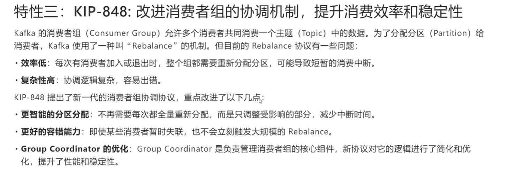
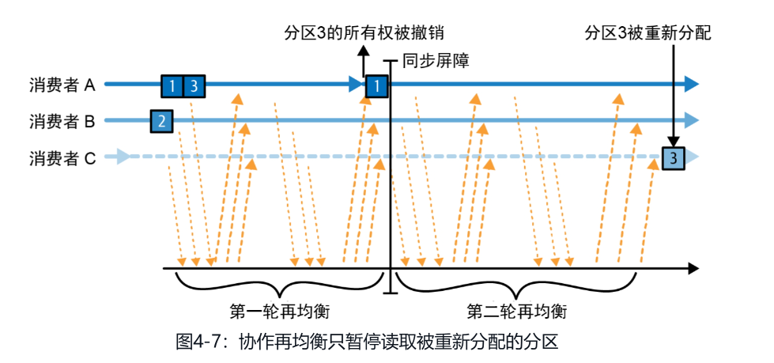
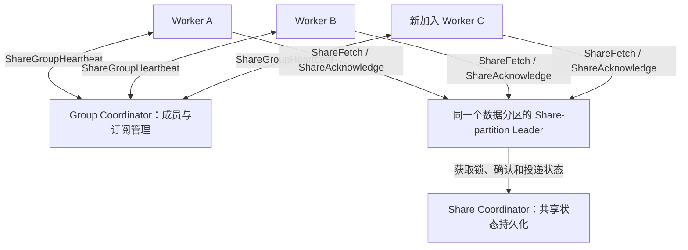

# Kafka 重平衡与共享组：经典协议、KIP-848 与 Share Groups

**重平衡（Rebalance，也称再均衡）协调消费者组的分区分工。经典协作式和 KIP-848 减少分区交接停顿；Kafka 4.2 生产就绪的共享组进一步取消同组分区独占，按记录锁和确认分发任务，降低成员抖动造成的连锁停顿。它仍有成员协调与分配更新，并不是完全没有重平衡。**

本文覆盖 Kafka 4.2，并明确区分 IBM Sarama v1.60.2 的经典消费者组支持。参数、提交和默认配置代码见 [消费者配置](kafka-消费者配置与再均衡.md)。
## 1. 再均衡的本质，以及 Kafka 4.x 的变化

**再均衡（Rebalance）的本质，是消费者组在成员、订阅和分区状态变化后，通过组协调协议重新确定分区所有权，并安全地完成所有权交接。** 可以通俗理解为“重新达成分配约定”，但不是消费者共同推导一个数学公式，也不是所有消费者之间执行 Raft / Paxos 共识。

对传统 Consumer Group，不变量是：**同一个分区，在同一个组内同一时刻最多由一个成员持有有效消费分配。** “最多一个”比“必定一个”准确：故障和交接期间可以暂时无人持有。成员加入 / 退出、分区增加或订阅变化会要求重新评估分配，但不一定需要移动所有分区，也不保证每个事件独立触发一轮再均衡。

协议约束的是有效成员和分配；旧进程已经取到的消息、未结束的外部调用不会自动消失。因此，应用仍须响应会话取消、避免旧会话继续提交，并保证业务幂等。

### KIP-848：从全组同步协调转向服务端分配和增量收敛

Kafka 4.0 将 **KIP-848 新一代消费者组协议**正式发布为 GA。它改变的是协调协议，不只是新增一个分配策略。

| 对比项 | 经典协议（Classic） | 新消费者协议（Consumer，KIP-848） |
|---|---|---|
| 分配方案由谁计算 | Coordinator 选出的消费者组 Leader | Broker 端 Group Coordinator 使用服务端分配器 |
| 核心交互 | JoinGroup、SyncGroup 和 Heartbeat | ConsumerGroupHeartbeat，携带成员状态并返回分配调整 |
| 如何完成变更 | Eager 全量撤销，或 Cooperative 分阶段撤销；仍需经典组协调 | Coordinator 管理目标分配和成员进度，各成员逐步撤销 / 接受分区，减少全组同步屏障 |
| 心跳与会话超时 | 由客户端配置，并受 Broker 范围限制 | 由 Broker 的 `group.consumer.heartbeat.interval.ms`、`group.consumer.session.timeout.ms` 控制 |
| 分配策略配置 | 客户端提供候选策略 | Broker `group.consumer.assignors` 配置；默认提供均匀分配（Uniform）和范围分配（Range），默认优先 Uniform |
| 分区独占规则 | 同组每分区最多一个有效所有者 | 保留该规则，没有变成多人同时消费同一分区 |

新协议减少全组停顿，并不消除所有协调成本或故障检测等待；需要转移的分区仍要安全撤销、再交付。也不能说经典协议每次都全量撤销，因为此前的协作式协议已经能够增量移交。



图片来自本次提供的资料，适合作为方向性概览。图中“旧协议整个组重新分配”主要描述 eager 场景；“暂时失联不会立刻大规模再均衡”也不是新协议独有特性，经典协议同样通过会话超时判定失联。

### Broker 升级与 Sarama 支持是两回事

Kafka 4.0 / 4.2 官方说明中，支持新协议的 Java Consumer 通过 `group.protocol=consumer` 选择它；Broker 支持不代表客户端默认启用。选用新协议后，不再使用经典客户端的心跳间隔、会话超时和分配策略配置；可用 `group.remote.assignor` 选择服务端提供的分配器。

这些名称仅用于说明 KIP-848，**不是本文 Sarama 配置示例中可以设置的字段**。本次核对的 **IBM/sarama v1.60.2 仍使用经典 JoinGroup / SyncGroup 消费者组接口，没有 KIP-848 新消费者协议的可用配置入口**。

因此，`NewBalanceStrategyCooperativeSticky()` 表示经典协议下的协作黏性策略，不表示启用了 KIP-848。之前的 Sarama 默认值、分配策略和心跳配置仍适用；不要因为 Kafka 升级到 4.x 就删除或替换它们。

## 2. 什么是消费者再均衡

再均衡是消费者组重新分配分区所有权的过程。成员加入、离开、心跳超时、订阅或分区变化都可能触发它，提供扩缩容和故障接管能力，但会引入暂停、位点提交和状态恢复开销。

同组一个分区同一时刻只应交给一个成员消费；不同组独立分配。再均衡不是 Broker 之间迁移分区副本，也不是消费者提交 offset。

### Eager：全量撤销再分配

也称急切式再均衡，一些资料译为“主动再均衡”。成员先停止旧分配、释放全部分区，再加入新一轮分配。即使分区最终仍归原成员，也经历撤销，造成组级消费停顿。停顿可能是毫秒级，也可能持续数秒甚至更长，不能保证固定时长。

### Cooperative：增量撤销再分配

协作式再均衡只要求撤销要转移的分区，先确保旧所有者放弃，再将其分配给新所有者；可能需要两轮或更多轮。未转移分区在协议层面可保留所有权，减少全量撤销和迁移成本。



图片来自本次提供的资料：A 持有分区 1、3，B 持有分区 2，C 加入；第一轮 A 放弃分区 3，第二轮 C 获得分区 3。**这是协议示意图，不承诺 Sarama 应用处理完全没有暂停。** v1.60.2 仍有会话结束与重建、`Cleanup` / `Setup` 生命周期；应用应正确响应取消并通过实测判断暂停时间。

### Sarama 支持的策略

| 策略（中文 / 英文） | 再均衡方式 | 特点 |
|---|---|---|
| 范围分配（Range） | 全量撤销（Eager） | **默认策略**；每个 Topic 内按连续范围分配，多 Topic 场景可能导致总体负载不均 |
| 轮询分配（Round Robin） | 全量撤销（Eager） | 轮询分配可订阅的分区；订阅一致时数量较均匀，但不尽力保留原分配 |
| 黏性分配（Sticky） | 全量撤销（Eager） | 在均衡基础上尽量保留原分配、减少移动；黏性不等于协作式 |
| 协作黏性分配（Cooperative Sticky） | 增量撤销（Cooperative） | 黏性分配结合增量移交；本文核对的 v1.60.2 支持，旧版本需检查是否提供该策略 |

### 配置方式

通过 `Consumer.Group.Rebalance.GroupStrategies` 设置策略列表。下面四种配置**选择一种**；代码里的函数负责创建策略对象，不能直接填入中文名称或英文字符串。

```go
// 范围分配（Range）：默认策略，不设置时也使用它。
config.Consumer.Group.Rebalance.GroupStrategies = []sarama.BalanceStrategy{
    sarama.NewBalanceStrategyRange(),
}

// 轮询分配（Round Robin）。
config.Consumer.Group.Rebalance.GroupStrategies = []sarama.BalanceStrategy{
    sarama.NewBalanceStrategyRoundRobin(),
}

// 黏性分配（Sticky）：减少分区移动，但仍全量撤销。
config.Consumer.Group.Rebalance.GroupStrategies = []sarama.BalanceStrategy{
    sarama.NewBalanceStrategySticky(),
}

// 协作黏性分配（Cooperative Sticky）：增量移交分区。
config.Consumer.Group.Rebalance.GroupStrategies = []sarama.BalanceStrategy{
    sarama.NewBalanceStrategyCooperativeSticky(),
}
```

配置多个策略表示声明支持的候选列表，不是同时执行多种分配算法；组内成员需要存在共同支持的策略。

已有组从默认的范围分配（Range）迁移到协作黏性分配（Cooperative Sticky），按该版本源码建议做两次滚动部署：

1. 第一次部署让所有成员同时支持协作黏性和原来的范围分配，等待全组升级完成。
2. 第二次部署移除范围分配，只保留协作黏性。

```go
// 第一次滚动部署：兼容原来的范围分配策略。
config.Consumer.Group.Rebalance.GroupStrategies = []sarama.BalanceStrategy{
    sarama.NewBalanceStrategyCooperativeSticky(),
    sarama.NewBalanceStrategyRange(),
}

// 全组完成第一次升级后，第二次滚动部署：仅保留协作黏性。
config.Consumer.Group.Rebalance.GroupStrategies = []sarama.BalanceStrategy{
    sarama.NewBalanceStrategyCooperativeSticky(),
}
```

从其他全量撤销策略迁移时，过渡列表应保留实际使用的旧策略。协作策略对象带状态，不可跨 ConsumerGroup 共享。

## 3. 分区分配、协调器和心跳

以下描述 Sarama 所用的经典 JoinGroup / SyncGroup 流程；Kafka 4.x 的新 Consumer Group Protocol 不能直接套用这套“消费者首领分配”流程，也不会因 Broker 升级就自动启用。

1. 消费者找到本组的 Group Coordinator（某个 Broker），发送 `JoinGroup`，携带订阅和支持的策略。
2. Coordinator 组织成员加入并选择组内 Leader 和共同分配策略。首个加入者常成为 Leader，但应用不能依赖固定的首领选举顺序。
3. Consumer Leader 获取本轮成员订阅信息，执行 Sarama `BalanceStrategy` 生成分配方案。它不是 Java 的 `PartitionAssignor` 实例。
4. Leader 通过 `SyncGroup` 提交方案；Coordinator 将各自的分配结果返回成员。
5. 各成员消费所获分区，由 Sarama 后台 goroutine 向 Coordinator 发送心跳。成员持续失联超过 Session Timeout 后可被移除。

**有心跳不代表业务处理健康。** 外部数据库调用卡住时，后台心跳可能仍正常；必须设置业务超时、监控消费延迟，并在会话取消时退出处理。再均衡预算也必须容纳停止任务和清理提交。

## 4. 静态成员：KIP-345 与服务重启

`Consumer.Group.InstanceId` 是同一组内稳定的实例身份，`ClientID` 是观测标签，动态 `MemberID` 是协议分配的成员标识，三者不同。

### Kubernetes 和虚拟机如何取值

- Kubernetes 优先使用 StatefulSet 的稳定 Pod 名称 / ordinal；Deployment 重建 Pod 后名称会变化，不天然提供稳定身份。
- 虚拟机可使用运维分配的固定槽位，如 `order-consumer-vm03-worker0`，存入配置文件或环境变量。单 VM 多进程要带不同槽位后缀。
- 主机名只有在重启后稳定、组内唯一且不会并发复用时才适合。不要每次启动随机生成，也不要给克隆出来的两台 VM 复用 ID。

同一 ID 的实例不能重叠运行；滚动发布先停旧实例，再启动使用该 ID 的新实例，否则可能出现 fencing 错误。

### 重启是否必然触发两次再均衡

| 情况 | 典型行为 |
|---|---|
| 动态成员，正常执行 `group.Close()` | Sarama 尝试发送 `LeaveGroup`，退出与重新加入都可能触发再均衡；请求时序可能合并，不能断言恰好两次 |
| 动态成员，崩溃后 1 秒重启 | 旧成员可能尚未超时，新进程作为新的动态成员加入仍可触发再均衡；旧成员随后超时可能再次触发 |
| 静态成员，正常关闭后快速重启 | Sarama 的关闭路径跳过 `LeaveGroup`，Coordinator 暂时保留身份。若在会话超时前恢复、订阅和组状态兼容，通常可避免因短暂停机产生的再均衡 |
| 静态成员，超过会话超时才恢复 | Coordinator 可移除旧成员、重新分配；恢复后也可能再次再均衡 |

因此，“未设置静态 ID 的新进程与旧进程产生同名 MemberID 冲突”是不准确的；动态成员通常是不同身份。“静态成员发了 LeaveGroup 但被忽略”也不符合本版本 Sarama 的实现：它直接跳过发送。

收到 `SIGTERM` 不等于已优雅关闭，应用必须主动处理信号、结束消费并执行关闭。也不要用 `kill -9` 作为避免再均衡的办法。

静态成员不是无缝可用保证：实例停机期间其分区可能无人消费；延长 Session Timeout 可容忍更长重启，也会延迟真实故障的接管。永久缩容应通过管理操作移除静态成员，或等待超时，不能期待 `Close()` 立即释放身份。

## 5. KIP-932：Kafka 队列与共享组（Share Groups）

### 哪个版本开始可以用于生产

“Share Groups 已正式发布”需要加上明确版本：

| Kafka 版本 | 官方发布状态 |
|---|---|
| 4.0 | Early Access，早期访问 |
| 4.1 | Preview，预览；官方明确表示尚未准备好用于生产 |
| **4.2** | **Production-ready，生产就绪**；4.2.0 发布公告明确确认，并加入续租确认、批量优化和消费延迟指标等能力 |

因此准确表述是：**Kafka 4.2 起，Queues for Kafka / Share Groups 已达到官方生产就绪状态，可按生产功能评估使用。** 这不是“任意 Kafka 4.x、任意客户端、任意业务都能直接放心切换”的承诺；仍需选择支持的客户端，并验证消息重复、失败重投及处理时长要求。

### 它解决的是任务分发，而不是另一种黏性分配策略

Share Groups 继续使用普通 Kafka Topic，不要求创建新的“队列”存储类型；它引入不同于 Consumer Group 的共享消费模型。

| 对比项 | 消费者组（Consumer Group） | 共享组（Share Group） |
|---|---|---|
| 并发分工单位 | 分区 | 分区内的记录 / 获取批次 |
| 同组一个分区 | 最多一个有效消费所有者 | 可以分配给多个共享消费者，合作处理不同记录 |
| 消费者数量 | 超过分区数后通常有空闲成员 | 可以超过分区数量 |
| 处理进度 | 提交每分区下一条 offset | 每条记录确认；实现可批量传输确认 |
| 失败恢复 | 从已提交位点继续，可能重放一段消息 | 释放或锁超时后，未完成记录可以重新投递 |
| 处理顺序 | 分区内有序日志，可通过顺序处理保持业务顺序 | 并行处理和重投不保证分区内业务完成顺序 |
| 常见场景 | 事件流、按 key 保序、日志回放 | 多 worker 任务分发、处理耗时不均、细粒度重试 |

“同组一个分区只能给一个消费者”是 Consumer Group 的规则，**不能扩展到 Share Group**。但这不表示同一条记录在同一共享组内可以任意同时交付：Broker 用有期限的获取锁保护在途记录。

不同 Share Group 各自独立消费；成功确认不等于立即从 Topic 物理删除消息，日志仍由保留策略管理。

### 单条确认、锁与重投

共享消费者获取记录时，Broker 为其建立有期限的获取锁。锁有效期间，该记录不会再交付给同组其他成员；消费者需要对获取的记录作出处理决定：

| 确认类型 | 含义 | 典型用途 |
|---|---|---|
| 接受（ACCEPT） | 处理成功，完成该记录在本共享组中的消费 | 业务写入成功后确认 |
| 释放（RELEASE） | 释放记录，使其可再次投递 | 可重试失败，稍后由本组成员重新处理 |
| 拒绝（REJECT） | 记录不可处理，停止继续投递该记录 | 无法恢复的格式 / 业务错误，按业务需要另外保存错误信息 |
| 续租（RENEW，4.2 新增） | 延长获取锁的持有时间 | 长耗时任务，避免正常执行期间锁到期 |

未确认且锁到期的记录可以再次投递给同组成员。系统记录投递次数，用于限制反复失败记录的重投；拒绝或达到投递上限不等于自动写入业务死信 Topic，若需要死信存储应明确实现相应处理。

锁超时后，旧 worker 的外部业务调用可能还没结束，新 worker 又开始处理，所以仍有重复副作用的可能。**单条确认与续租不提供数据库 / 外部服务的端到端恰好一次保证**，需使用幂等键或业务去重。RELEASE 也不是业务延迟队列的定时调度承诺。

### Go Sarama 能否直接使用

本次核对 **IBM/sarama v1.60.2 没有 Share Consumer / Share Group 的公开消费 API**。现有 `NewConsumerGroup`、`MarkMessage` 和 `Commit` 不能通过切换分配策略变成共享组消费，也不能将 MarkMessage 当成 Share Group 的逐条 ACCEPT。

要使用这项功能，需要选择明确支持相应 Share 协议版本的客户端，例如 Kafka 4.2 的 Java `KafkaShareConsumer`，或在引入其他 Go 客户端前单独核对其 Share API 和支持版本。本篇不提供虚构的 Sarama Share 配置。

## 6. Kafka 4.x 变化的官方资料

以下资料于 2026-04-22 查阅；发布状态以各版本公告为准，客户端支持结论限定为本文核对的 Sarama v1.60.2。

- [Kafka 4.0 发布公告：KIP-848 GA，KIP-932 Early Access](https://kafka.apache.org/blog/2025/03/18/apache-kafka-4.0.0-release-announcement/)
- [Kafka 4.1 发布公告：Queues for Kafka 仍为 Preview](https://kafka.apache.org/blog/2025/09/04/apache-kafka-4.1.0-release-announcement/)
- [Kafka 4.2 发布公告：Queues for Kafka 生产就绪](https://kafka.apache.org/blog/2026/02/17/apache-kafka-4.2.0-release-announcement/)
- [Kafka 4.2 新消费者再均衡协议：配置、分配器及迁移](https://kafka.apache.org/42/operations/consumer-rebalance-protocol/)
- [Kafka 4.2 设计：Consumer Groups 与 Share Groups、获取锁和确认](https://kafka.apache.org/42/design/design/)
- [Sarama v1.60.2 配置接口](https://github.com/IBM/sarama/blob/v1.60.2/config.go)
- [Sarama v1.60.2 消费者组实现](https://github.com/IBM/sarama/blob/v1.60.2/consumer_group.go)


## 7. 重平衡风暴是什么，Share Groups 如何降低影响

### 风暴来自成员变动与恢复开销的相互放大

重平衡风暴不是一种独立协议错误，而是组长时间反复重组、无法稳定消费的现象。例如实例不断重启、滚动发布过快、网络抖动或处理任务无法及时退出，都可能反复触发协调。消费暂停带来积压，积压又增加处理和资源压力，可能进一步导致超时和重启。

经典 eager 协议的全量撤销会放大这个循环。协作黏性减少不必要的分区移交；KIP-848 用服务端分配和成员独立收敛降低全组屏障，但二者仍需维护传统组的分区独占规则。

### Share Groups 的新实现：分配只指引拉取，记录锁保护任务

KIP-932 将成员管理与记录处理状态分开：

| 组件 / 协议 | 责任 |
|---|---|
| Group Coordinator + `ShareGroupHeartbeat` | 管理共享组成员、订阅、成员纪元及服务端分配；通过心跳返回应拉取的分区 |
| Share-partition Leader | 在对应数据分区 Leader 所在 Broker 上处理共享拉取，选择可交付记录，管理记录获取锁和投递次数 |
| `ShareFetch` | 请求可处理记录；由服务端选择记录，客户端不靠提交连续 offset 决定下一条任务；也可携带确认 |
| `ShareAcknowledge` | 单独确认记录处理结果，协议可批量携带确认 |
| Share Coordinator 与状态持久化组件 | 持久化共享消费状态，支持故障后恢复；与管理组成员的 Group Coordinator 是不同职责 |

这些是 Broker 侧能力，不由 KRaft Active Controller 逐条调度任务。共享组复用普通 Topic 数据，但使用不同的消费协议与状态管理。



传统组分配意味着“这个分区当前归你独占”，共享组分配更接近“你应到这些分区领取任务”。多个成员可以同时从同一分区领取不同记录，成员变化不必先完成旧成员的独占分区撤销，才能让新成员取得任务。

KIP-932 不把组分配变化作为传统分区独占的 fencing 屏障。这里不等于取消身份、权限、会话和记录锁校验；记录能否确认、能否重投仍由共享协议和获取状态决定。

### 用一个扩容与故障例子理解

假设只有一个分区 P0，A 正在处理记录 100，B 正在处理 101：

1. C 加入后，服务端更新组分配，C 可以从 P0 领取其他可用记录，例如 102。
2. A、B 的有效在途记录不需要仅因 C 加入就全部中止，也不必交出整个 P0。
3. A 随后崩溃，100 未完成确认；获取锁到期或被相应释放后，该记录可再次交给其他成员。
4. B、C 可以继续处理其他可用记录，无需等待一次 P0 独占所有权转移来恢复全部任务处理。

例子用于说明并行与重投，不承诺严格按 100、101、102 顺序交付或完成。新成员仍需完成心跳、分配、连接和拉取，故障任务也仍有锁等待。

### 它解决了哪一部分，仍留下什么

| 机制 | 对风暴的改善 | 仍然存在的限制 |
|---|---|---|
| 经典协作黏性 | 缩小撤销与移动范围 | 仍有经典组协调和独占分区交接 |
| KIP-848 | 服务端分配、增量收敛，减少全组同步等待 | 仍保持分区独占；成员抖动会产生协调工作 |
| Share Groups | 分区可共享，记录级锁和确认让成员变化不必演变为全分区交接停顿 | 仍有心跳、分配更新、锁过期、重投及状态持久化成本 |

**Share Groups 消除了任务分发必须依赖独占分区移交这一前提，因此显著降低了重平衡风暴对其他 worker 的连锁影响；它没有消除成员抖动本身。** 若 Broker、Coordinator 或状态存储过载，或者大量慢任务同时锁过期，仍可能出现请求风暴、重复处理和积压。

生产中还应控制发布和扩缩容节奏、为长任务合理续租、限制并发和失败重投，并监控处理延迟、锁占用、投递次数及协调错误。持续失败的任务需要明确拒绝或错误存储策略，不能无限重试。

### 怎么选择

- 需要按 key 保序、连续位点回放：优先传统消费者组；通过可用的协作策略或支持 KIP-848 的客户端降低协调影响。
- 任务彼此独立、耗时差异大、希望 worker 数超过分区数：评估 Kafka 4.2 Share Groups，接受处理顺序变化并实现业务幂等。
- 使用本文核对的 Sarama v1.60.2：可配置经典协作黏性，但没有 Share Consumer API；不能仅改一个策略字段就切换共享组。

本节于 2026-04-23 核对 [KIP-932 的组件、共享分区分配与重平衡流程](https://cwiki.apache.org/confluence/display/KAFKA/KIP-932%3A+Queues+for+Kafka)。设计提案解释机制，4.2 的正式可用状态及功能边界以第 6 节官方资料为准。
