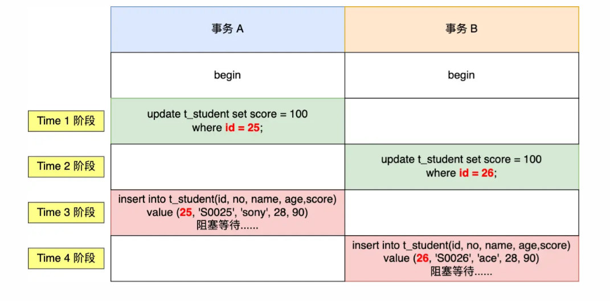
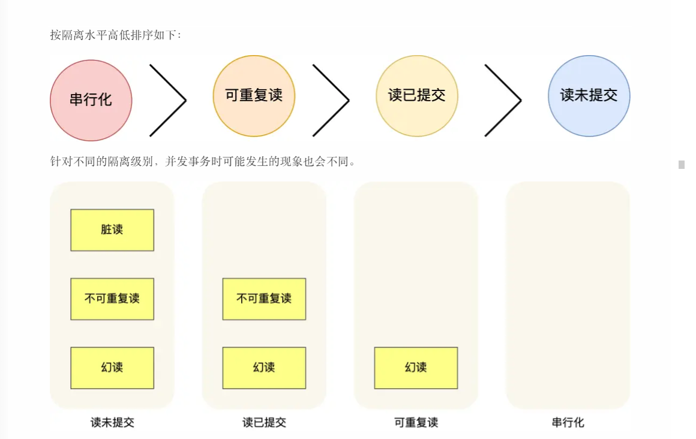
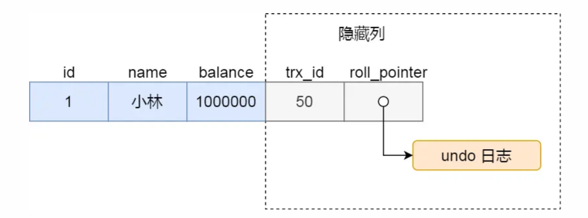
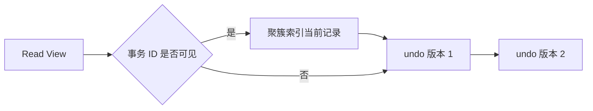
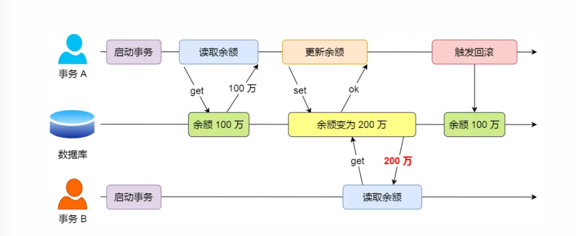
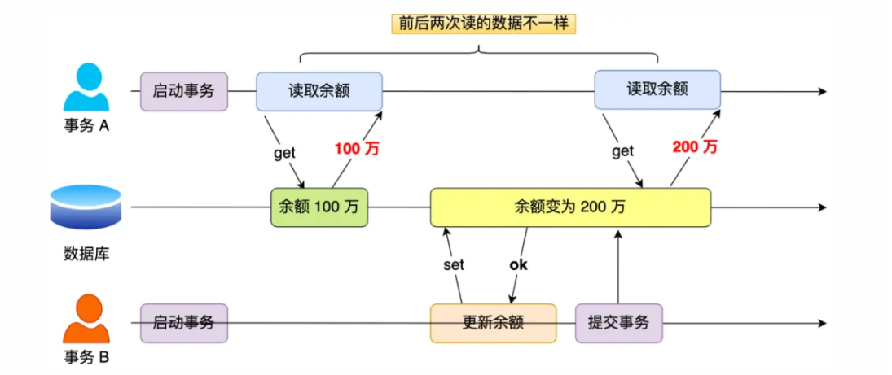
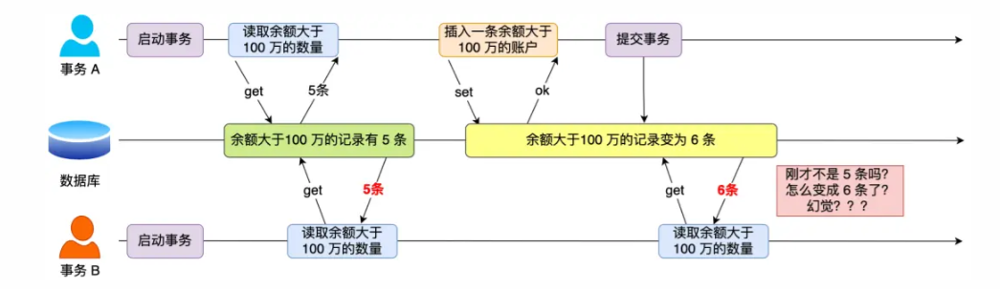
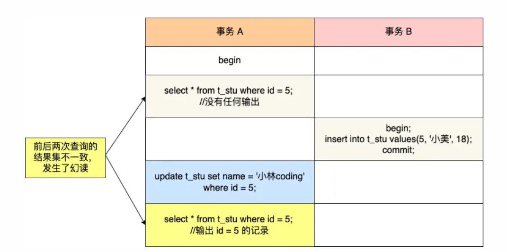

# MySQL 事务与 MVCC

> 本文以 MySQL 8.4 LTS、InnoDB 为基准。事务隔离的具体表现还受存储引擎、语句类型和锁定读影响。

## 0. 问答总结

### 0.1 什么是事务的 ACID 四个特性？

1. **原子性（Atomicity）：事务中的操作要么全部提交，要么全部回滚。** 事务执行失败时，数据库撤销本事务已经产生的修改，不留下部分结果。例如转账时，扣款和入账必须作为一个整体完成。
2. **一致性（Consistency）：事务前后都必须满足数据库和业务完整性约束。** 一致性是事务正确执行的结果，不是某一个单独组件提供的功能；它依赖原子性、隔离性、持久性以及约束和业务逻辑共同保证。
3. **隔离性（Isolation）：并发事务的中间状态不会被不恰当地相互观察或覆盖。** 实际隔离程度由隔离级别、MVCC 和锁共同决定；不同级别允许的并发现象不同，并非所有事务都拥有完全独立的数据副本。
4. **持久性（Durability）：事务提交成功后，修改在崩溃恢复后仍然存在。** 提交确认意味着数据已达到引擎承诺的持久化条件，但具体保证仍受配置、硬件和故障类型影响。

### 0.2 InnoDB 如何保证 ACID？

1. **原子性主要由 undo log 和回滚流程保证。** undo log 保存修改前的版本；事务回滚或崩溃恢复时，InnoDB 使用它撤销未提交修改。
2. **持久性主要由 redo log 和崩溃恢复保证。** 数据页修改先记录 redo log，提交时按日志持久化策略确保恢复所需的日志存在；重启后通过 redo 重做已提交修改。
3. **隔离性由 MVCC 与锁机制共同保证。** 普通一致性读通过 Read View 和 undo 版本链读取可见版本；更新、删除和锁定读使用记录锁、间隙锁或临键锁等控制并发写入。
4. **一致性由上述机制与约束共同保证。** redo/undo、MVCC、锁、事务提交协议，以及主键、唯一键、外键（如启用）和业务校验共同维护事务前后的有效状态。

### 0.3 MySQL 的四种事务隔离级别是什么？

1. **读未提交（READ UNCOMMITTED）允许读取其他事务尚未提交的数据。** 可能发生脏读。
2. **读已提交（READ COMMITTED）只能读取已提交版本。** 可避免脏读，但同一事务两次快照读可能结果不同，即不可重复读。
3. **可重复读（REPEATABLE READ）在事务内复用一致性读视图。** InnoDB 默认使用该级别，可避免常见的不可重复读；当前读仍会加锁。
4. **串行化（SERIALIZABLE）通过更强的锁定限制并发。** 并发能力最低，适合需要严格串行语义的场景。

隔离强度通常按“串行化 > 可重复读 > 读已提交 > 读未提交”理解；隔离越强，并发冲突和等待通常越多。下表描述 SQL 标准现象与 InnoDB 常见行为，具体结果仍取决于快照读、当前读和索引范围。

| 隔离级别 | 脏读 | 不可重复读 | 幻读 |
|---|---|---|---|
| 读未提交 | 可能 | 可能 | 可能 |
| 读已提交 | 避免 | 可能 | 可能 |
| 可重复读（InnoDB 默认） | 避免 | 快照读通常避免 | 快照读通常不出现；当前读需范围锁控制 |
| 串行化 | 避免 | 避免 | 避免（通过串行化/锁定） |

### 0.4 脏读、不可重复读、幻读分别是什么？

1. **脏读是读到了其他事务未提交的数据。** 读未提交允许这种现象。
2. **不可重复读是同一事务两次读取同一行得到不同已提交值。** 读已提交下可能发生。
3. **幻读是同一范围查询前后出现了新增或消失的行。** 快照读和锁定读的表现不同；需要防止并发插入时通常要使用合适的范围锁。

### 0.5 MVCC 如何实现一致性读？

1. **快照读通过 Read View 选择可见版本。** 普通 `SELECT` 通常属于快照读。
2. **更新和删除会产生 undo log 版本链。** 读取旧版本可以避免读写互相阻塞，也支持回滚。
3. **RR 与 RC 的差异主要在 Read View 生成时机。** RR 通常在事务第一次一致性读后复用视图，RC 通常每次一致性读生成新视图。

### 0.6 三种并发读现象如何区分？

1. **脏读看的是“未提交后又回滚”的值。** 事务 A 修改数据但尚未提交，事务 B 已经读到该值；A 回滚后，B 读到的内容从未成为有效数据。读未提交允许脏读，其他隔离级别应避免它。
2. **不可重复读看的是“同一行前后值不同”。** 事务 B 两次读取同一行期间，事务 A 提交了更新，导致 B 在两次读取中得到不同的已提交值。读已提交下可能发生，InnoDB 可重复读通常通过复用 Read View 避免快照读中的该现象。
3. **幻读看的是“同一范围前后行数或行集合不同”。** 事务 B 两次按条件查询期间，事务 A 插入或删除了满足条件的行，第二次查询出现或缺少整行记录。需要阻止并发范围写入时，应使用锁定读和合适的范围锁；不能把幻读简单等同于单行值变化。

图示中的金额和记录数仅用于说明时序，实际是否可见取决于隔离级别、快照读/当前读和锁配置。

## 1. ACID 与 InnoDB 实现

事务把一组操作作为一个整体提交或回滚。InnoDB 中四个特性与主要机制的对应关系如下：

| 特性 | 含义 | InnoDB 主要机制 | 说明 |
|---|---|---|---|
| 原子性 | 全部成功或全部撤销 | `undo log`、回滚段、崩溃恢复 | 撤销未提交事务的行修改 |
| 一致性 | 满足约束并保持有效状态 | 原子性 + 隔离性 + 持久性 + 约束/业务逻辑 | 不是单一日志独立提供 |
| 隔离性 | 并发事务按隔离级别互不产生不允许的影响 | MVCC、Read View、行锁/间隙锁/临键锁 | 快照读与当前读机制不同 |
| 持久性 | 提交后故障恢复仍保留 | `redo log`、双写缓冲、崩溃恢复 | 具体效果受刷盘配置和硬件影响 |

一次提交通常遵循预写日志思想：先把必要的修改信息写入日志，再将提交结果持久化；发生崩溃时，使用 redo 重做已提交修改，使用 undo 清理未提交修改。事务完整性还要求应用显式控制 `COMMIT`/`ROLLBACK`，并正确处理约束错误和死锁重试。

## 2. 事务基础

InnoDB 通过 redo log、undo log、锁和崩溃恢复机制实现 ACID；完整语义还依赖应用正确提交事务以及数据库约束和业务逻辑。

### 2.1 哪些场合需要显式开启事务？

是否开启事务，关键看多条 SQL 是否需要共享一个原子性边界、锁定边界或一致性快照，而不是看语句中有没有 `SELECT`。

| 场景 | 是否需要显式事务 | 典型做法 |
|---|---|---|
| 多条写必须一起成功或一起失败 | 需要 | `BEGIN` 后执行多条 `INSERT`/`UPDATE`，全部成功才 `COMMIT`，任一步失败则 `ROLLBACK` |
| 先读后改，且读到的行不能被并发修改 | 需要 | 使用 `SELECT ... FOR UPDATE` 当前读，检查结果后修改并提交；也可优先使用带条件的原子 `UPDATE` |
| 连续多条读必须看到同一份快照 | 需要 | 显式事务中执行普通快照读；纯读场景可使用只读事务 |

#### 1. 多条写必须保持原子性

例如先写 `click`，再写 `event`，两条写入表示同一个业务动作。中间任一步失败，都应回滚整组操作。即使整个流程没有读，也需要事务，因为这里要求的是原子性。

```sql
START TRANSACTION;
INSERT INTO click (...) VALUES (...);
INSERT INTO event (...) VALUES (...);
COMMIT;
```

应用应捕获异常并执行回滚；连接归还连接池前必须确认事务已提交或回滚，避免事务状态泄漏到下一次请求。

#### 2. 先读后改需要锁住读到的对象

例如读取余额后扣款、读取容量后加一。仅仅把两条语句放进事务，并不能自动阻止两个事务同时读到同一个旧值。需要使用 `SELECT ... FOR UPDATE` 获取当前读锁，或直接使用带条件的原子更新：

```sql
START TRANSACTION;
SELECT balance FROM account WHERE id = ? FOR UPDATE;
UPDATE account SET balance = balance - ? WHERE id = ?;
COMMIT;
```

如果业务允许用一条条件更新表达不变量，通常可以省去先读：`UPDATE account SET balance = balance - ? WHERE id = ? AND balance >= ?`，再根据受影响行数判断是否成功。多个事务涉及多行时，应保持一致的加锁顺序并处理死锁重试。

#### 3. 连续多条读需要同一份快照

例如先查国家列表，再按国家查询明细，并要求两次读取属于同一时刻。`autocommit` 开启时，每条 SQL 都是独立事务，各自生成一致性读视图；两条语句之间其他事务提交后，第二条可能看到更新数据。此时应使用一个显式只读事务：

```sql
START TRANSACTION READ ONLY;
SELECT ...;
SELECT ...;
COMMIT;
```

只读事务仍会持有 Read View；应尽快结束，避免长事务延迟 undo 清理。

### 2.2 哪些场合通常不需要显式事务？

以下场景通常可以依赖 InnoDB 的语句级一致性和隐式事务，但前提是每条语句独立完成即可，业务不要求跨语句的原子性、锁定或统一快照：

1. **单条 `SELECT`（包括 `JOIN`）。** 普通查询在语句执行期间使用一致性读；如果不要求与后续语句共享同一快照，无需额外开启事务。
2. **单条 `INSERT`、`UPDATE` 或 `DELETE`。** InnoDB 会把单条 DML 作为一个隐式事务执行，语句成功则提交，失败则回滚。
3. **多次读彼此独立，允许轻微陈旧或不同步。** 例如 `SelectOffers` 这类刷新缓存的查询，各次读取不要求来自同一时刻时，可以让每条语句独立执行。

“通常不需要”不等于“禁止开启”：显式事务会改变快照生命周期和锁持有时间，纯读或缓存查询应避免无必要的长事务。

### 2.3 死锁：处理与预防

死锁通常需要同时满足四个条件：**互斥、占有且等待、不可剥夺、循环等待**。数据库无法通过“等待更久”消除真正的循环等待，因此 InnoDB 会检测或超时回滚事务，释放其持有的锁。

#### 发生死锁后的处理

1. **主动死锁检测。** `innodb_deadlock_detect=ON`（默认开启）时，InnoDB 检测等待图中的环，并主动回滚其中一个事务，让其他事务继续执行。被回滚的事务通常收到 `ERROR 1213 (40001): Deadlock found when trying to get lock`。
2. **锁等待超时。** `innodb_lock_wait_timeout`（默认 50 秒）限制等待普通锁的最长时间。超时后等待语句会失败；应用应明确回滚整个事务。锁等待超时不是死锁专属机制，普通的长时间阻塞也会触发它。

主动检测与超时是故障恢复手段，不是避免事务进入死锁的办法。应用必须捕获 1213 和必要时的 1205，并在事务边界内回滚后重试；重试应设置次数上限和退避，确保操作幂等。

#### 业务和 SQL 层面的预防

1. **统一加锁顺序。** 多个事务都按相同顺序锁定多行或多表，例如按递增主键顺序锁账户，破坏循环等待条件。
2. **缩短事务范围。** 不在事务中执行网络请求、文件 I/O 或复杂计算，尽早提交或回滚。
3. **让锁定读走合适索引。** 无索引的 `UPDATE`、`DELETE` 或 `SELECT ... FOR UPDATE` 可能扫描并锁定大量记录，扩大死锁机会；使用 `EXPLAIN` 检查访问路径。
4. **减少锁定范围。** 使用准确的主键或唯一键条件，避免不必要的范围锁；在确认不需要锁定时使用普通快照读。
5. **保证幂等并正确处理唯一约束。** 例如将 `order_no` 建为唯一索引，防止重复订单。重复插入会返回唯一键冲突，应用应把它作为可预期业务结果处理，而不是依赖并发事务“碰巧”避免重复。

#### 经典案例：间隙锁与插入意向锁形成死锁

假设聚簇索引中已有 `id=20` 和 `id=30`，但没有 `id=25`、`id=26`。在 RR 下，两个事务分别执行不存在键的等值更新：

```sql
-- 事务 A
UPDATE t_student SET score = 100 WHERE id = 25;

-- 事务 B
UPDATE t_student SET score = 100 WHERE id = 26;
```

唯一索引等值查找未命中时，InnoDB 可能对同一索引间隙 `(20, 30)` 加 gap lock。gap lock 之间通常兼容，所以 A、B 都能持有该间隙锁。随后 A 插入 `id=25`，B 插入 `id=26`；两次插入都需要 insert intention lock，而插入意向锁与对方持有的 gap lock 冲突，于是 A 等 B、B 等 A，形成循环等待。




这个案例的关键是：**gap lock 彼此兼容，但 insert intention lock 会等待覆盖该间隙的 gap lock。** InnoDB 的死锁检测会回滚其中一个事务，另一个事务才能继续。

可选的改进方式包括：

1. **避免“先更新不存在的键、再插入”。** 若业务语义允许，可使用 `INSERT ... ON DUPLICATE KEY UPDATE`，并根据唯一键设计幂等写入；`REPLACE` 可能先删除再插入，不应在不了解副作用时作为等价替代。
2. **统一访问顺序并减少间隙竞争。** 为并发写入设计明确的唯一键和索引，缩短事务，并保持多行操作的加锁顺序一致。
3. **评估 READ COMMITTED。** RC 通常减少普通范围扫描的 gap lock，但外键检查、唯一键冲突检查等场景仍可能加间隙相关锁，且会牺牲 RR 的快照语义；不能简单认为 RC 完全没有 gap lock。
4. **捕获 1213 后回滚整个事务并重试。** 重试操作必须幂等，并设置次数上限和退避。

## 3. 快照读与当前读

### 3.1 隔离级别与并发现象



图中从左到右表示隔离强度逐步提高、允许出现的并发现象逐步减少。图示是概念化总结：在 InnoDB 的可重复读下，普通 `SELECT` 使用一致性读视图，通常不会因其他事务已提交的插入而改变；`SELECT ... FOR UPDATE` 等当前读读取最新版本并加锁，是否出现范围变化取决于索引和间隙锁/临键锁。

| 类型 | 示例 | 主要机制 |
|---|---|---|
| 快照读 | `SELECT ...` | MVCC + Read View，不主动等待行锁 |
| 当前读 | `SELECT ... FOR UPDATE`、`LOCK IN SHARE MODE`、`UPDATE` | 读取最新版本并申请锁 |

> 待补图：事务时间线、快照读/当前读对比图。

### 3.2 当前读未走索引的锁风险

在 RR 下，`SELECT ... FOR UPDATE`、`UPDATE`、`DELETE` 等当前读会对扫描到的索引记录申请锁。若谓词没有合适索引，或优化器选择了全表扫描，InnoDB 可能从聚簇索引逐行扫描并锁定大量记录及其间隙；在常见范围条件下，效果可能接近锁住整张表，导致其他事务的更新、删除和插入长时间等待。

这不是“只锁住最终匹配行”：锁定读的锁范围由实际访问路径、索引结构、扫描范围和隔离级别共同决定。生产环境执行此类 SQL 前，应使用 `EXPLAIN`/`EXPLAIN ANALYZE` 确认访问路径，并为高频过滤条件设计合适索引；事务也应尽快提交或回滚。

```sql
-- 需要确认 WHERE 条件是否能使用合适索引
EXPLAIN SELECT * FROM orders WHERE status = 'PENDING' FOR UPDATE;
```

## 4. Read View 与版本链

Read View 会记录创建时的活跃事务集合、最小活跃事务 ID、下一个待分配事务 ID，以及创建该视图的事务 ID。InnoDB 根据记录的事务 ID 判断版本是否可见；不可见时沿 `DB_ROLL_PTR` 指向的 undo 版本链回溯。

### 4.1 聚簇索引记录的隐藏列



InnoDB 的聚簇索引记录包含用于 MVCC 和回滚的隐藏系统字段：

1. **`DB_TRX_ID`（常简称 `trx_id`）记录最近一次改动该记录的事务 ID。** InnoDB 据此判断当前版本对某个 Read View 是否可见。
2. **`DB_ROLL_PTR`（图中写作 `roll_pointer`）指向该记录对应的 undo 记录。** 更新或删除时，旧版本信息写入 undo log；沿回滚指针可以逐级找到更早版本，供一致性读构造可见版本，也供事务回滚使用。
3. **回滚指针不是完整旧行的直接内存地址。** undo 记录通常保存反向修改所需的信息，读取旧版本时需要结合当前记录和 undo 内容重建记录。
4. **没有显式主键或非空唯一索引时还可能存在隐藏行 ID。** 因此不能简单概括为每张 InnoDB 表都只有这两个隐藏列；具体系统字段取决于表定义和版本实现。

### 4.2 版本链示例

同一行可能形成如下版本链（示意）：

| id | name | `trx_id` | `DB_ROLL_PTR` |
|---:|---|---:|---|
| 100 | 王二 | 2 | 指向上一版本 |
| 100 | 李四 | 1 | 指向更早版本 |
| 100 | 张三 | 0 | `NULL`，初始版本 |

事务更新或删除时写入 undo log；快照读若判断当前版本对 Read View 不可见，就沿 `DB_ROLL_PTR` 回溯到可见版本。新增记录没有可回溯的旧版本，是否可见由其创建事务 ID 判断。

### 4.3 Read View 可见性规则

以 `trx_id` 表示记录版本的创建事务 ID，`m_ids` 表示创建视图时仍活跃的事务集合：

1. **`trx_id = creator_trx_id`：可见。** 事务可以看到自己修改的数据。
2. **`trx_id < min_trx_id`：可见。** 该事务在 Read View 创建前已经提交。
3. **`trx_id >= max_trx_id`：不可见。** 该版本由 Read View 创建后才分配的事务产生。
4. **`min_trx_id <= trx_id < max_trx_id`：检查 `m_ids`。** 在 `m_ids` 中表示当时未提交，不可见；不在其中表示已提交，可见。

示例：

```text
RR 事务 3 创建 Read View：m_ids={1,2,3}, min_trx_id=1,
max_trx_id=4, creator_trx_id=3
RC 事务 3 的另一份视图：m_ids={2,3}, min_trx_id=2,
max_trx_id=4, creator_trx_id=3
```

### 4.4 RR 与 RC 的时间线

事务 0 新增、事务 1 和事务 2 修改、事务 3 快照读时，RR 通常复用第一次一致性读生成的视图；RC 通常每次一致性读重新生成视图。因此同一事务在 RC 下可能看到后续已提交修改，在 RR 下通常保持第一次快照的一致性。



## 5. 使用边界

### 5.1 脏读



事务 A 将余额从 100 万改为 200 万但随后回滚；事务 B 在 A 提交前读到 200 万，因此读到了最终不存在的中间结果。这是脏读。

### 5.2 不可重复读



事务 A 第一次读取余额为 100 万；事务 B 将余额更新为 200 万并提交；事务 A 再次读取同一行得到 200 万，因此同一事务内两次读取结果不同。这是不可重复读。

### 5.3 幻读



事务 A 第一次查询“余额大于 100 万”的记录得到 5 条；事务 B 插入一条满足条件的记录并提交；事务 A 再次查询得到 6 条，新增记录像“幻影”一样出现。这是幻读。

#### InnoDB 可重复读如何降低幻读

InnoDB 的默认隔离级别是 `REPEATABLE READ`。它对两类读采用不同方式处理幻读：

1. **快照读（普通 `SELECT`）依靠 MVCC。** 事务建立一致性读视图后，后续普通查询按同一视图判断版本可见性。其他事务后来提交的插入记录通常不在该视图中，因此不会出现在同一事务后续的快照查询中。
2. **当前读（`SELECT ... FOR UPDATE`、`UPDATE`、`DELETE` 等）依靠锁。** 对有合适索引的范围执行当前读时，InnoDB 通常使用 next-key lock（记录锁 + 间隙锁）锁住索引记录及其间隙，阻止其他事务在该范围插入，从而抑制幻读。

这不是对任意 SQL 的绝对保证：锁的范围受索引、查询条件、访问路径和语句类型影响；无索引范围查询可能锁定更大范围，锁定读与快照读也不能混为一谈。需要稳定地检查并修改一个范围时，应使用合适索引、当前读和明确的事务边界。

#### RR 下仍可能出现的特殊幻读

即使在 InnoDB 的 `REPEATABLE READ` 下，快照读和当前读混用也可能让同一事务先后看到不一致的记录集合：

1. **先快照读、后更新再快照读。** 事务 A 先执行 `SELECT * FROM t_stu WHERE id = 5`，结果为空；事务 B 插入 `id = 5` 并提交；事务 A 执行 `UPDATE t_stu SET name = '小林coding' WHERE id = 5`，这是当前读，会处理最新已提交记录；事务 A 随后再次执行普通 `SELECT`，仍可能按原 Read View 看不到该行。若更新后使用当前读检查，则会看到这条记录，形成读视图与当前版本之间的差异。



2. **先快照读、后范围当前读。** 事务 A 在 `id > 100` 上做普通 `SELECT` 得到 3 行；事务 B 插入 `id = 200` 并提交；事务 A 再执行 `SELECT ... WHERE id > 100 FOR UPDATE`，当前读读取最新版本，可能得到 4 行。这也是幻读，因为两次查询的读类型不同。

需要在事务内稳定检查并随后修改一个范围时，通常应在事务开始后尽早使用带合适索引的 `SELECT ... FOR UPDATE`（或其他锁定读），让 next-key lock 提前保护记录和间隙，阻止并发插入。该建议不能脱离索引、隔离级别和实际锁范围单独理解。

- MVCC 不等于所有语句都不加锁；更新、删除和锁定读属于当前读。
- 隔离级别不能替代业务约束。转账、库存扣减等场景仍需明确锁定顺序和异常重试。
- 长事务会保留旧版本，增加 undo 压力并影响 purge，应及时提交或回滚。

## 6. 参考

- [MySQL 8.4 Reference Manual：InnoDB Transaction Model](https://dev.mysql.com/doc/refman/8.4/en/innodb-transaction-model.html)
- [MySQL 8.4 Reference Manual：InnoDB Redo Log](https://dev.mysql.com/doc/refman/8.4/en/innodb-redo-log.html)
- [MySQL 8.4 Reference Manual：InnoDB Undo Logs](https://dev.mysql.com/doc/refman/8.4/en/innodb-undo-logs.html)
- [MySQL 8.4 Reference Manual：Consistent Nonlocking Reads](https://dev.mysql.com/doc/refman/8.4/en/innodb-consistent-read.html)
- [MySQL 8.4 Reference Manual：InnoDB Multi-Versioning](https://dev.mysql.com/doc/refman/8.4/en/innodb-multi-versioning.html)
