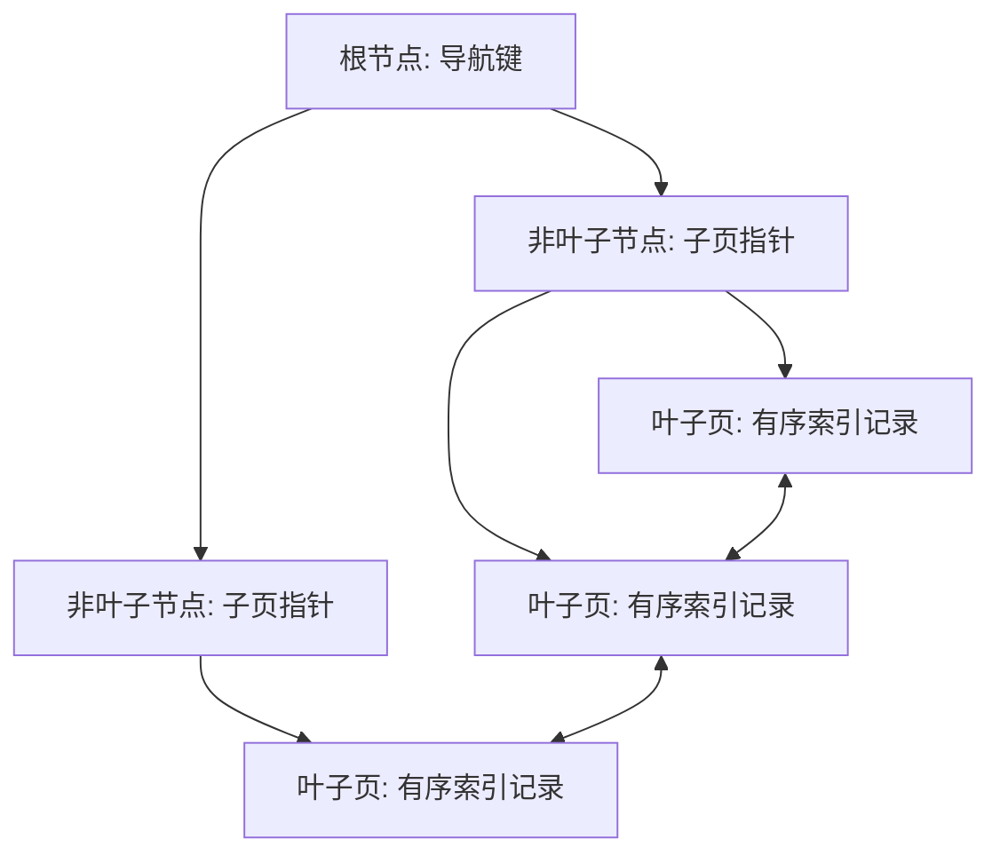
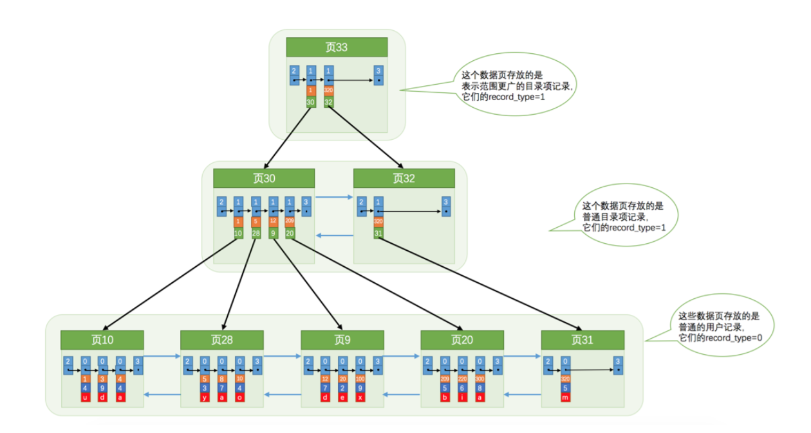
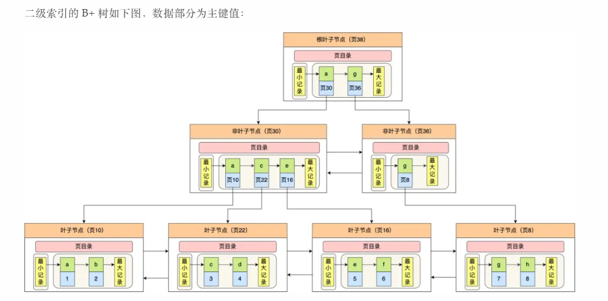
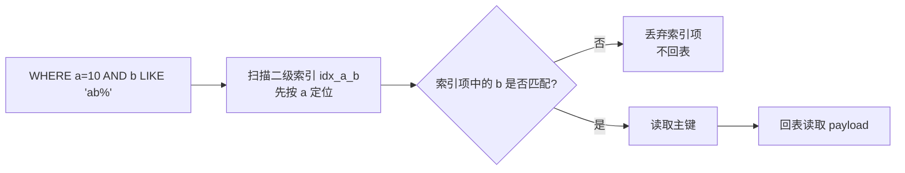
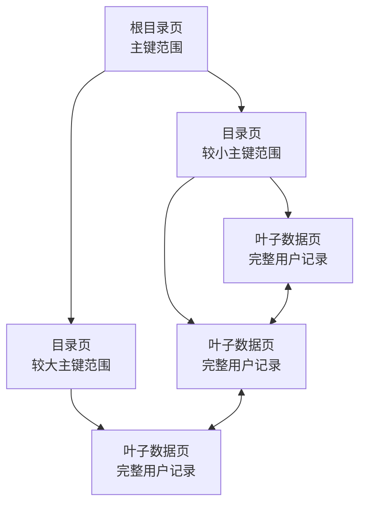

# MySQL B+ 树索引

> 本文以 MySQL 8.4 LTS、InnoDB 为基准。索引的具体执行计划仍会受版本、统计信息、数据分布和配置影响。

## 0. 问答总结

### 0.1 了解 MySQL 的 B+ 树索引吗？

1. **B+ 树是有序的多路平衡查找树。** InnoDB 把索引组织成页，树高较低，查找主要依赖少量随机 I/O。
2. **非叶子节点保存导航键，叶子节点保存索引记录。** 叶子节点按键有序，并通过链表连接，适合范围扫描。
3. **索引降低扫描范围，但会增加写入和存储成本。** 插入、更新、删除可能维护页分裂、合并及多个索引。

### 0.2 B+ 树一次查询如何定位记录？

1. **从根页开始比较键值。** 根据导航键选择对应的子页，逐层向下直到叶子层。
2. **在叶子页定位索引项。** 聚簇索引叶子项包含整行记录；二级索引叶子项包含索引列和主键值。
3. **二级索引可能需要回表。** 根据主键再次查聚簇索引；覆盖索引则可以直接返回所需列。

### 0.3 为什么 B+ 树适合范围查询？

1. **叶子项全局有序。** 找到范围起点后，可以沿叶子页链表顺序读取。
2. **范围条件通常只需一次树下降。** 后续记录按顺序扫描，避免为每行重新从根节点查找。
3. **范围过大时收益会下降。** 优化器可能选择全表扫描，最终以 `EXPLAIN` 计划为准。

### 0.4 聚簇索引和二级索引有什么区别？

1. **聚簇索引决定 InnoDB 的主存储顺序。** 主键 B+ 树叶子页保存整行记录，表数据本身就是主键索引。
2. **二级索引叶子保存主键值。** 使用二级索引取得非索引列时，通常还要按主键回到聚簇索引。
3. **主键应尽量短且稳定。** 二级索引会携带主键，过大的主键会放大所有二级索引的空间和 I/O 成本。

### 0.5 什么是联合索引的最左前缀原则？

1. **联合索引按从左到右的列顺序组织有序键。** 例如 `(a, b, c)` 可以利用 `a`、`(a,b)` 或 `(a,b,c)` 形成的前缀来定位和扫描。
2. **跳过最左列通常不能直接利用后续列的有序定位能力。** 仅有 `b` 或 `c` 条件时，不能把 `(a,b,c)` 当作 `INDEX(b)` 使用；优化器仍可能选择索引扫描或其他路径，但不等于按 `b` 快速查找。
3. **遇到范围条件后，后续列的定位能力可能受限。** 例如 `a > 10 AND b = 2` 中，`b` 通常不能继续缩小 B+ 树的连续定位范围；实际访问方式以执行计划为准。

### 0.6 什么是索引下推（ICP）？

1. **索引下推是在存储引擎回表前执行可下推的索引列条件。** 它先检查二级索引记录中的列值，过滤不满足条件的索引项，再为剩余项回表读取整行。
2. **主要收益是减少回表次数和聚簇索引 I/O。** 它不会扩大索引的可定位范围，也不会让不满足最左前缀的列突然具备独立索引查找能力。
3. **是否使用由优化器决定。** 可通过 `EXPLAIN` 中的 `Extra: Using index condition` 观察；`optimizer_switch='index_condition_pushdown=off'` 可关闭该优化（具体计划仍受数据分布影响）。

### 0.7 什么时候需要或不需要创建索引？

1. **优先为高频过滤、连接、排序或分组设计索引。** 唯一性约束字段通常已有唯一索引；多个条件经常一起出现时，可按查询模式设计联合索引。
2. **索引有空间和写入维护成本。** 插入、删除及索引列更新都要维护索引页，索引越多、越宽，写放大和存储开销通常越大。
3. **低选择性、低频使用或小表字段未必值得单独建索引。** 性别等低基数字段不是绝对不能建索引；当与其他高选择性列组成联合索引，或查询只返回少量匹配行时仍可能有价值，最终以 `EXPLAIN` 和实际负载验证。
4. **频繁更新的字段要评估收益与代价。** 更新索引列会修改索引项，但不是每次都重建整棵 B+Tree；若查询收益很低，才应考虑不建索引。

## 1. B+ 树的结构

B+ 树把大量键值分布在多个索引页中。每个页通常是 InnoDB 的固定大小页，节点可容纳许多条目，因此树高通常低于二叉树。



图 1：根节点和非叶子节点负责导航，叶子页保存记录并按顺序连接。用户提供的 InnoDB 页面示意图见下文。



图 2：InnoDB 页面中，目录记录位于非叶子层，普通记录位于叶子层；页面之间通过链表支持顺序遍历。图中 `record_type` 等字段属于 InnoDB 页内实现细节，不能泛化为所有数据库的 B+ 树结构。

### 1.1 结构图要点（截图转写）

截图以一个三层 B+ 树为例：

1. **根节点和中间节点只承担导航作用。** 例如根节点中的 `8`、`15` 会在对应子节点中作为分隔键重复出现；父节点键值通常代表其子树中的边界键。
2. **所有实际索引记录位于最底层叶子节点。** 示例叶子页依次包含 `(1, 2)`、`(3, 5)`、`(6, 8)`、`(9, 11)`、`(13, 15)` 等有序键。
3. **相邻叶子节点通过双向指针连接。** 找到范围起点后，可以沿叶子链表向后（或向前）扫描，不必反复从根节点查找。
4. **叶子节点中的“数据”含义取决于索引类型。** 聚簇索引叶子项保存整行记录；二级索引叶子项保存索引列和主键值，查询其他列时还需要回表。

```text
根:             [8 | 15]
                 /       \
中间层:      [2 | 5 | 8]  [11 | 15]
              /  |  |       /   \
叶子层:   [1,2] <-> [3,5] <-> [6,8] <-> [9,11] <-> [13,15]
              每个叶子项继续指向聚簇索引记录或整行数据
```

> 这是教学简化图。真实 InnoDB B+ 树按页组织，树高、每页记录数和分隔键数量取决于页大小、记录宽度及数据分布。

### 1.2 二级索引 B+ 树示意图

下图以主键值作为二级索引的索引列，展示根节点、非叶子节点和叶子节点之间的层级关系：



图 2：二级索引的非叶子节点保存用于导航的索引键和页号，叶子节点按索引键有序保存索引键及对应主键值。叶子页之间通过链表连接，因此范围查询找到起点后可以顺序扫描。该图是教学示意，页号、记录数量和节点布局不代表固定的 InnoDB 物理格式。

## 2. 查找、插入与删除

### 2.1 点查找

例如查询 `WHERE id = 320`：

1. 从根页读取导航键，选择包含 320 的子页。
2. 重复该过程，直到目标叶子页。
3. 在叶子页内定位键值；若是二级索引，再使用叶子项中的主键回表。

```sql
CREATE TABLE user_account (
  id BIGINT UNSIGNED NOT NULL AUTO_INCREMENT,
  email VARCHAR(255) NOT NULL,
  nickname VARCHAR(64) NOT NULL,
  PRIMARY KEY (id),
  UNIQUE KEY uk_email (email)
) ENGINE = InnoDB;

EXPLAIN SELECT nickname FROM user_account WHERE email = 'a@example.com';
```

`uk_email` 是二级唯一索引。查询只需要 `email` 和 `id` 时可能成为覆盖索引；需要 `nickname` 时通常需要回表，实际是否回表以执行计划为准。

### 2.2 范围查询

`WHERE id BETWEEN 100 AND 200` 会先定位 100 所在的叶子位置，再沿叶子页的有序链表读取到 200。复合索引中，等值列通常放在范围列之前，例如 `(tenant_id, created_at)` 支持租户内的时间范围查询。

### 2.3 插入和页分裂

新键插入目标叶子页。页空间不足时，InnoDB 会分裂页面并更新父节点；随机主键更容易造成非顺序写入和页分裂，单调递增键通常更适合写密集型表，但仍需结合真实负载验证。

### 2.4 删除和更新

删除索引项可能留下可复用空间；更新索引键相当于删除旧项并插入新项。二级索引列被更新时，所有受影响的索引都需要维护。

## 3. 聚簇索引、二级索引与覆盖索引

| 类型 | 叶子节点内容 | 典型代价 |
| --- | --- | --- |
| 聚簇索引（主键） | 主键和整行记录 | 主键查找直接得到整行 |
| 二级索引 | 索引列和主键值 | 查询非索引列通常需要回表 |
| 覆盖索引 | 已包含查询所需列 | 可减少或避免回表，但增加索引宽度 |

InnoDB 表没有显式主键时，会选择第一个合适的 `UNIQUE NOT NULL` 索引作为聚簇索引；如果也没有，会生成隐藏的聚簇索引。生产表应显式设计稳定、短小的主键，避免依赖隐藏行为。

### 3.1 回表与覆盖索引示例

假设 `user(id, name, age)` 的主键为 `id`：

```sql
SELECT name, age FROM user WHERE name = '张三';
```

- 只有普通索引 `(name)` 时，二级索引先返回 `name` 和 `id`，再根据 `id` 查询聚簇索引取得 `age`，这一步叫**回表**。
- 建立组合索引 `(name, age)` 后，二级索引已包含查询所需列，可能直接返回 `name`、`age`，形成**覆盖索引**，无需回表。

```sql
CREATE INDEX idx_user_name ON user (name);
CREATE INDEX idx_user_name_age ON user (name, age);
EXPLAIN SELECT name, age FROM user WHERE name = '张三';
```

是否实际使用覆盖索引，应以 `EXPLAIN`/`EXPLAIN ANALYZE` 为准。

## 4. 使用边界与常见误区

- **不是所有查询都会使用索引。** 低选择性条件、返回大部分行、统计信息不准确或隐式类型转换，都可能使全表扫描更划算。
- **最左前缀规则不是“索引只能查第一列”。** 复合索引 `(a,b,c)` 可利用 `a`，也可利用 `a,b`；遇到范围条件后，后续列的定位能力可能受限。
- **索引不能保证排序免费。** 排序方向、连接方式、范围条件和选择列都可能导致额外排序。
- **函数和隐式转换可能阻碍索引使用。** 需要函数索引时，应核对 MySQL 8.4 的语法、数据类型和执行计划。
- **B+ 树不等于绝对 O(log n) 成本。** 缓冲池命中、页分裂、并发锁、回表次数和磁盘状态都会影响实际延迟。

## 5. 最左前缀与索引下推

### 5.1 最左前缀原则

联合索引 `(a, b, c)` 的键按字典序排列：先比较 `a`，`a` 相同时再比较 `b`，最后比较 `c`。因此，查询必须从最左列开始，才能利用前缀的有序性：

| 条件 | 对 `(a,b,c)` 的典型利用方式 |
| --- | --- |
| `a = 1` | 定位 `a=1` 的连续范围 |
| `a = 1 AND b = 2` | 在 `a=1` 范围内继续按 `b` 定位 |
| `a = 1 AND b > 2 AND c = 3` | 用 `a,b` 确定扫描范围，`c` 通常作为扫描过滤条件 |
| `b = 2` | 无法按 `b` 直接定位；可能发生全索引扫描、索引跳跃扫描或选择其他计划 |

等值条件通常应放在范围条件之前，但列顺序不是绝对规则，需结合实际查询、选择性和排序需求设计。`EXPLAIN`/`EXPLAIN ANALYZE` 才能确认具体计划。

### 5.2 索引下推的工作过程

以二级索引 `idx_a_b (a,b)` 和查询为例：

```sql
CREATE INDEX idx_a_b ON t (a, b);
SELECT payload FROM t WHERE a = 10 AND b LIKE 'ab%';
```

没有索引下推时，存储引擎先扫描 `a=10` 的索引项，取得每个主键并回表，再由 Server 层判断 `b LIKE 'ab%'`。启用索引下推后，`b` 的条件在扫描二级索引时就可检查，只有匹配的索引项才回表：



图 5：索引下推把能在索引记录上判断的条件交给存储引擎，减少不必要的回表；图示省略了并发、MVCC 和缓存等实现细节。

`EXPLAIN` 可能显示：

```text
Extra: Using index condition
```

这表示使用了索引条件下推，不表示查询已经覆盖索引；如果所需列都在索引中，可能显示 `Using index`，此时本身就无需回表。ICP 对主要索引列条件、覆盖索引查询或不需要回表的访问路径通常没有额外收益；最终是否启用由优化器评估。

## 6. InnoDB 索引组织

### 6.2.2.1 聚簇索引

前文介绍的 B+ 树同时承担目录和索引的作用。InnoDB 将完整的用户记录直接放在聚簇索引的叶子节点中，因此常说“索引即数据，数据即索引”。

聚簇索引按记录主键值组织排序，具体表现为：

1. **页内记录按主键有序。** 同一数据页中的用户记录按主键大小排列，并通过页内记录链表连接。
2. **数据页按主键有序。** 保存用户记录的数据页按照页内记录的主键范围排序，并通过双向链表连接，便于顺序扫描和范围扫描。
3. **目录页按层级有序。** 存放目录项记录的页分为多个层次；同一层级中的页按目录项所代表的主键范围排序，并通过双向链表连接。
4. **叶子节点保存完整记录。** 叶子节点包含用户定义的全部列以及 InnoDB 的必要隐藏列，而不是只保存主键或指针。



图 3：聚簇索引的叶子层就是 InnoDB 表数据。图中的链表表示逻辑顺序，实际页布局和页内记录格式以对应版本的 InnoDB 实现为准。

#### 页面中的最少记录数

在 InnoDB 的 B+ 树索引页中，**一个页面至少需要容纳两条用户记录**，这样页面才有实际的索引节点或数据页意义；当插入导致页面无法继续容纳记录时，会触发页分裂。这里的“两条记录”指用户记录，不应把 `infimum`、`supremum` 等页内哨兵记录计算在内。

该表述用于说明 B+ 树页分裂和页面布局的实现约束，并非所有 MySQL 存储引擎、所有类型页面或任意页状态下的通用数学定理。记录大小、页大小和具体版本实现仍会影响单页实际可容纳的记录数量。

#### 聚簇索引如何产生

聚簇索引不需要通过 `CREATE INDEX` 单独创建，InnoDB 会在建表时自动确定：

1. **优先使用主键。** 显式定义的 `PRIMARY KEY` 作为聚簇索引。
2. **其次选择合适的唯一非空索引。** 没有主键时，InnoDB 会选择第一个满足条件的 `UNIQUE NOT NULL` 索引。
3. **最后生成隐藏聚簇索引。** 既没有主键，也没有合适的唯一非空索引时，InnoDB 会创建隐藏的 6 字节 row ID 聚簇索引。

因此，生产表通常应显式定义短小、稳定且不随业务变化的主键。聚簇索引的主键值还会被复制到二级索引叶子项中，主键过宽会放大二级索引的存储和回表成本。

#### 与二级索引的关系

使用二级索引定位到一条记录时，二级索引叶子项通常只包含二级索引列和主键值。若查询还需要其他列，InnoDB 会使用该主键值再次查找聚簇索引，这一步称为**回表**；如果查询所需列都在二级索引中，则可能直接完成覆盖索引读取。

> **版本核对提示：** 上述“选择第一个唯一非空索引”和隐藏 row ID 的规则属于 InnoDB 索引组织行为。具体选择顺序、隐藏列名称和页内实现细节应以目标 MySQL 8.4 小版本的官方手册及源码标签为准，不能据此推断其他存储引擎。

### 6.2.2.2 二级索引

除聚簇索引以外的索引都属于二级索引，也称辅助索引。二级索引的叶子节点不保存完整的用户记录，而是保存索引列值和对应的主键值。


图 4：二级索引先定位索引项，再根据主键访问聚簇索引。

#### 回表

当查询使用二级索引定位后，还需要返回索引中没有保存的列时，InnoDB 会取出二级索引叶子项中的主键值，再到聚簇索引中查找完整记录，这个过程称为**回表**。

```sql
CREATE TABLE t (
  id BIGINT UNSIGNED NOT NULL,
  c2 INT NOT NULL,
  c3 INT NOT NULL,
  payload VARCHAR(100) NOT NULL,
  PRIMARY KEY (id),
  KEY idx_c2 (c2)
) ENGINE = InnoDB;

-- 可能使用 idx_c2 定位，再回表读取 payload
EXPLAIN SELECT payload FROM t WHERE c2 = 10;
```

如果查询所需的列已经全部包含在二级索引中，就可能直接从二级索引返回结果，形成**覆盖索引**，从而减少回表次数。是否实际回表仍应以 `EXPLAIN` 或 `EXPLAIN ANALYZE` 为准。

#### 联合索引

以 `c2` 和 `c3` 的联合值作为排序依据建立的 B+ 树，称为**联合索引**，本质上仍是二级索引。例如：

```sql
CREATE INDEX idx_c2_c3 ON t (c2, c3);
```

它使用字典序排序：先比较 `c2`，只有 `c2` 相同时才比较 `c3`。可以把它理解为：

```text
(c2=1, c3=1) < (c2=1, c3=2) < (c2=2, c3=1)
```

联合索引 `(c2, c3)` 与分别创建 `INDEX(c2)`、`INDEX(c3)` 并不等价：

| 索引设计 | 主要排序关系 | 典型能力 |
| --- | --- | --- |
| `(c2, c3)` | 先按 c2，再按 c3 | 支持 `c2`，以及 `c2` 等值时的 `c3` 查找和排序 |
| `INDEX(c2)` + `INDEX(c3)` | 两棵彼此独立的 B+ 树 | 分别支持 c2 或 c3，优化器可能选择其一或使用索引合并 |

联合索引遵循最左前缀规则。通常可以利用 `(c2, c3)` 的 `c2` 前缀，但只查询 `c3` 时不能直接获得与单独 `INDEX(c3)` 相同的有序访问能力；最终是否使用索引仍取决于谓词、选择性、统计信息和返回行数。

## 7. 官方参考

1. [MySQL 8.4 Reference Manual: InnoDB Indexes](https://dev.mysql.com/doc/refman/8.4/en/innodb-index-types.html)：聚簇索引、二级索引及索引组织方式。
2. [MySQL 8.4 Reference Manual: InnoDB Physical Structure](https://dev.mysql.com/doc/refman/8.4/en/innodb-physical-structure.html)：页、区、段及物理存储结构。
3. [MySQL 8.4 Reference Manual: Multiple-Column Indexes](https://dev.mysql.com/doc/refman/8.4/en/multiple-column-indexes.html)：复合索引和最左前缀规则。
4. [MySQL 8.4 Reference Manual: EXPLAIN](https://dev.mysql.com/doc/refman/8.4/en/explain.html)：验证优化器选择和访问路径。
5. [MySQL 8.4 Reference Manual: Index Condition Pushdown Optimization](https://dev.mysql.com/doc/refman/8.4/en/index-condition-pushdown-optimization.html)：ICP 的适用条件、执行过程与 `Using index condition`。
6. [MySQL Server source](https://github.com/mysql/mysql-server/tree/mysql-8.4.0/storage/innobase)：InnoDB 索引页和 B+ 树实现源码。源码细节应以对应已发布标签核对。
