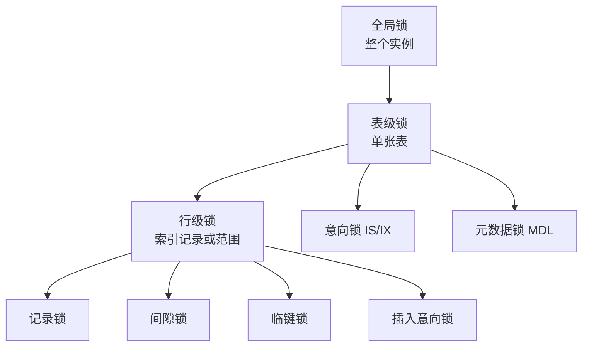

# MySQL InnoDB 锁

> 本文以 MySQL 8.4 LTS、InnoDB 为基准。锁范围受索引、隔离级别、优化器执行计划和谓词条件影响，不能仅凭 SQL 文字永久推断。

## 0. 问答总结

### 0.1 共享锁和排他锁有什么区别？

1. **共享锁（S 锁）允许多个事务同时读取同一记录。** 持有 S 锁时，其他事务不能对该记录加排他锁并修改。
2. **排他锁（X 锁）允许持有者读写记录。** 其他事务不能再获取该记录的 S 锁或 X 锁。
3. **锁定读必须放在事务中观察效果。** 自动提交开启时，语句结束可能立即释放锁。

### 0.2 如何显式加共享锁和排他锁？

1. **共享锁使用 `FOR SHARE`。** 旧语法 `LOCK IN SHARE MODE` 仍常见，但新代码优先使用标准化写法。
2. **排他锁使用 `FOR UPDATE`。** 它读取最新版本并阻塞冲突的并发写入。
3. **关闭自动提交或显式开启事务。** 例如 `START TRANSACTION; SELECT ... FOR UPDATE; ... COMMIT;`。

### 0.3 记录锁、间隙锁、临键锁是什么？

1. **记录锁（record lock）锁住索引上的一条记录。** 主键等值命中通常表现为记录锁。
2. **间隙锁（gap lock）锁住两个索引记录之间的范围。** 主要用于阻止范围内插入。
3. **临键锁（next-key lock）是记录锁与间隙锁的组合。** InnoDB 在 RR 下的范围扫描常使用临键锁；具体区间取决于索引访问路径。

### 0.4 按加锁范围，MySQL 有哪些锁？

1. **全局锁作用于整个 MySQL 实例。** 典型是 `FLUSH TABLES WITH READ LOCK` 获取的全局读锁；它主要用于一致性备份，会阻塞需要写入的操作。MySQL 8.0 还提供备份锁相关能力，但具体可用语句取决于备份组件和版本。
2. **表级锁作用于一张表。** 常见包括表读锁（`LOCK TABLES ... READ`）、表写锁（`LOCK TABLES ... WRITE`）、元数据锁（MDL）、InnoDB 意向锁（IS/IX）、AUTO-INC 锁，以及显式的 InnoDB 表锁（`LOCK TABLES`）。
3. **行级锁作用于索引记录或索引范围。** InnoDB 常见锁包括记录锁、间隙锁、临键锁和插入意向锁；空间索引范围查询还可能使用谓词锁。

## 1. 按加锁范围分类

本文按锁覆盖范围列举常见锁；同一条语句可能同时持有多个层次的锁。

| 类别 | 锁 | 作用与典型来源 |
|---|---|---|
| 全局锁 | 全局读锁（Global Read Lock，`FLUSH TABLES WITH READ LOCK`） | 锁定全实例的表访问，用于需要全库静止的一致性备份；释放使用 `UNLOCK TABLES`。 |
| 全局锁 | 备份锁（Backup Lock） | 由 MySQL 备份组件或备份工具使用，允许比全局读锁更细粒度地限制 DDL/写入；可用性取决于版本、组件和权限。 |
| 表级锁 | 表读锁、表写锁 | `LOCK TABLES t READ/WRITE` 显式获取；表写锁排斥其他会话访问。 |
| 表级锁 | 元数据锁（MDL） | 保护表定义；DML 通常持有 MDL 读锁，DDL 通常需要 MDL 写锁。 |
| 表级锁 | 意向共享锁（IS）、意向排他锁（IX） | InnoDB 在表内加行级 S/X 锁前加的意向锁，用于与表级锁快速判冲突。 |
| 表级锁 | AUTO-INC 锁 | InnoDB 为某些自增值分配操作保护表级自增计数；具体算法受 `innodb_autoinc_lock_mode` 影响。 |
| 行级锁 | 记录锁（Record Lock，S/X 模式） | 锁住索引中的单条记录；InnoDB 行锁实际加在索引上，S/X 表示共享/排他两种主要模式。 |
| 行级锁 | 间隙锁（Gap Lock） | 锁住索引记录之间的间隙，阻止其他事务在范围内插入；主要用于 RR。 |
| 行级锁 | 临键锁（Next-Key Lock） | 记录锁与其前方间隙锁的组合，是 InnoDB RR 范围锁定读的常见形式。 |
| 行级锁 | 插入意向锁（Insert Intention Lock） | 插入前在目标间隙声明插入意图；同一间隙中不同位置的插入通常可并发。 |
| 行级锁 | 谓词锁（Predicate Lock） | 空间索引的谓词范围锁，用于防止空间范围冲突；普通 B+Tree 查询不使用。 |

> “表级/行级”是按覆盖范围的归类。MDL、意向锁和 AUTO-INC 锁的实现细节不同于普通表锁；锁定读无合适索引时，仍可能因扫描而持有大量行锁。



> 图示按覆盖范围简化；一次事务可以同时持有全局/表级协调锁和多把行级锁，实际兼容性以具体锁矩阵和存储引擎实现为准。

## 2. 典型 SQL

```sql
START TRANSACTION;
SELECT * FROM account WHERE id = 1 FOR SHARE;
SELECT * FROM account WHERE id = 1 FOR UPDATE;
COMMIT;
```

### 2.1 图片中的实验 SQL（可直接复制）

下面代码按截图原意转写，表名为 `task`。其中 `LOCK IN SHARE MODE` 是共享锁的旧语法；在 MySQL 8.4 中可改写为 `FOR SHARE`。

```sql
-- 共享锁
SELECT * FROM task WHERE id = 1 LOCK IN SHARE MODE;

-- 排他锁：无索引（title 列未建立索引）
SET autocommit = 0;
SELECT * FROM task WHERE title = '交流贴1' FOR UPDATE;
SET autocommit = 1;

-- 排他锁：聚簇索引等值查询，查到了（主键 id = 1）
-- 等值查询：查到了
SET autocommit = 0;
SELECT * FROM task WHERE id = 1 FOR UPDATE;
SET autocommit = 1;

-- 排他锁：聚簇索引等值查询，未查到（主键 id = 4）
-- 等值查询：没查到
SET autocommit = 0;
SELECT * FROM task WHERE id = 4 FOR UPDATE;
SET autocommit = 1;

-- 排他锁：聚簇索引范围查询，查到了（id < 5）
SET autocommit = 0;
SELECT * FROM task WHERE id < 5 FOR UPDATE;
SET autocommit = 1;

-- 排他锁：聚簇索引范围查询，查不到（id > 2881）
SET autocommit = 0;
SELECT * FROM task WHERE id > 2881 FOR UPDATE;
SET autocommit = 1;
```

> 实验前请确认 `task` 表和数据已准备好。更推荐显式使用 `START TRANSACTION`/`COMMIT` 控制事务边界；`SET autocommit = 1` 会提交当前连接中尚未提交的事务。

## 3. 聚簇索引上的典型范围

| 查询 | 常见锁形态（RR、命中聚簇索引） |
|---|---|
| `id = 1` 且存在 | 记录锁 |
| `id = 4` 且不存在 | 覆盖该插入位置的间隙锁 |
| `id < 5` | 扫描范围上的临键锁/间隙锁组合 |
| `id > 2881` 且无匹配 | 从相应间隙到正无穷的范围锁 |

这些是典型 InnoDB 行为，实际锁可用 `performance_schema.data_locks` 检查。

## 3.1 临键锁的退化规则

临键锁（Next-Key Lock）可以理解为“记录锁 + 记录前面的间隙锁”。在满足特定索引访问条件时，它可能退化为记录锁或间隙锁。下面是基于截图示例的典型整理；实际范围仍应结合索引定义、数据分布、隔离级别和执行计划确认。

### 聚簇索引等值查询

```sql
SELECT * FROM `table_name` WHERE `id` = 5 FOR UPDATE;
```

- 查询记录存在：临键锁退化为记录锁，记录锁范围为 `5`。
- 查询记录不存在：临键锁退化为间隙锁。若相邻索引值为 `4` 和 `6`，间隙范围为 `(4, 6)`。

### 聚簇索引范围查询

```sql
SELECT * FROM `table_name` WHERE `id` > 5 FOR UPDATE;
```

- 查询到记录：通常锁定扫描范围，例如从下一条索引记录开始的临键锁，示意范围为 `(6, +∞)`。
- 查询不到记录：临键锁退化为间隙锁，示意范围为 `(5, +∞)`。

### 非聚簇索引等值查询

```sql
SELECT * FROM `table_name` WHERE `age` = 5 FOR UPDATE;
```

- 查询记录存在：如果有多条 `age = 5`，二级索引上可能加多个临键锁，示意锁定范围为 `(-∞, 5]`；同时还可能锁定对应的聚簇索引记录。
- 查询记录不存在：临键锁可能退化为间隙锁，示意范围为 `(5, +∞)`。

### 非聚簇索引范围查询

```sql
SELECT * FROM `table_name` WHERE `age` > 5 FOR UPDATE;
```

范围查询通常不会按单个“等值命中”规则退化，锁范围取决于二级索引扫描路径及回表过程，应通过 `performance_schema.data_locks` 实测确认。

> 待补图：记录锁、间隙锁、临键锁区间示意图；无索引与二级索引锁范围实验图。

## 4. 易错点

- “用了索引就一定只有一把行锁”不成立；范围扫描可能锁住多条记录和间隙。
- 二级索引上的锁定读还可能涉及聚簇索引记录。
- 不要把“无索引必然整表锁”当作精确实现规则；应结合执行计划和实际锁监控判断。
- 多事务按不同顺序加锁容易死锁，应用应捕获死锁错误并重试整个事务。

## 5. 参考

- MySQL 8.4 Reference Manual：**Server Locks**（`LOCK TABLES`、`FLUSH TABLES WITH READ LOCK`）。
- MySQL 8.4 Reference Manual：**Metadata Locking**。
- MySQL 8.4 Reference Manual：**InnoDB Locking**（record/gap/next-key/insert intention/predicate locks、意向锁与 AUTO-INC 锁）。
- MySQL 8.4 Reference Manual：**Locking Reads**、**Deadlocks in InnoDB**。
