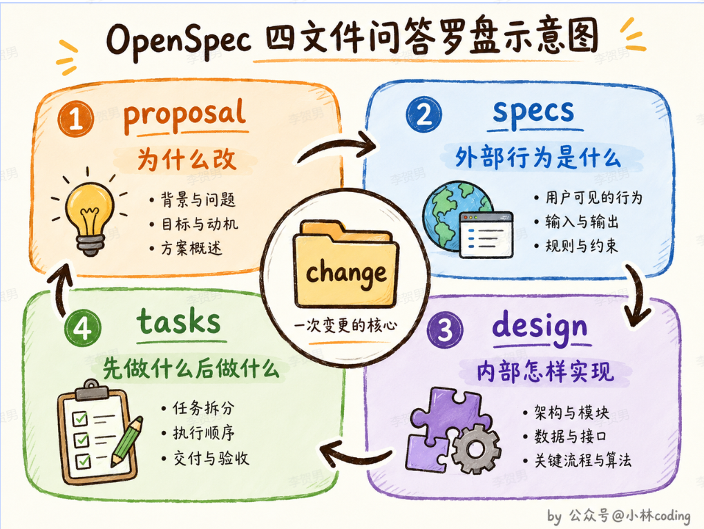

# SDD 与 OpenSpec 入门笔记

> 记录日期：2026-10-13
> 实测环境：Windows 11 + Node v24.21.0 + npm 11.19.0，OpenSpec CLI **v1.14.3**（npm 当前 latest）
> 本文所有命令、目录树、输出都是我本机真跑出来的；课程视频里与现状不一致的地方我在第 0 节单独标出。

---

## 1. SDD 是什么

**一句话：SDD（Spec-Driven Development，规格驱动开发）是先把「要做什么」写成结构化、可校验、进 Git 的规格文件，再让 AI/人按规格写代码。**

不是新概念（形式化规格、TDD、RFC 流程都是它的亲戚），是**在 AI 编码时代被重估**：以前写代码贵、写文档更贵，所以大家默认「代码是唯一真相」；现在生成代码便宜了，**「对不对」变成最贵的一环**。YC 那句原话就是这个意思 —— 生成代码便宜了，正确性仍然昂贵。

它和你以前写的需求文档（PRD）有三点硬区别，这三点就是能不能用起来的全部：

1. **和代码同仓同版本**：`openspec/` 提交进 Git，规格和实现同一次 review、同一次回滚。办公软件里的 PRD 天然会漂移。
2. **粒度是「一次变更」而不是「整个系统」**：一个 change 一个文件夹，只写这次改什么（delta），不是重写整套需求。
3. **机器可读**：Markdown + 固定标题层级，AI 能直接解析；`openspec validate` 能挑出格式错（比如 scenario 用了 `###` 而不是 `####`）。

**SDD 就是把你脑子里的验收规则写成图纸。** 图纸的价值不在「好看」，在「换人也不跑偏」。

三条主线你自己也要能分清（面试会问）：
- **Spec-first**：先规格后代码（OpenSpec、spec-kit 走这条）
- **Spec-anchored**：代码是主体，规格做锚点持续校准（OpenSpec 的 archive 合并 + sync 是这个思路）
- **Spec-as-source**：规格直接生成代码，人只改规格（目前最激进，工程上最不成熟）

---

## 2. OpenSpec：解决什么问题、好处、缺点、适用场景

### 2.1 它解决的问题

AI 编码的痛点不是「不会写」，是**上下文一清空就失忆**：

- 需求散在聊天记录里，`/new` 一下就没了；
- AI 做着做着开始「顺手优化」你没让它改的东西；
- 同一个需求换 Cursor 换 Claude Code 换 Codex，要重新讲一遍；
- 一个需求跨 3 个仓，AI 只看到其中一个。

OpenSpec 的定位不是「AI 编码工具」，而是**插在「聊天」和「代码」之间的一层轻量规格层**：人 + AI 先在 markdown 里对齐「做什么、不做什么、怎么验收」，然后再动手。所以它本质卖的是**对齐**，不是代码生成。

一个容易忽略的工程设计：**它不生成代码，只生成 prompt/instructions**。你敲 `/opsx:propose`，AI 工具里跑起来的那条命令做的事情是：读 `schemas/spec-driven/schema.yaml` → 拼出该写哪个文件、写什么结构 → 让模型写。所以同一套规格能适配 30+ 个工具（适配器 + 注册表模式），换工具只换壳。

### 2.2 好处（挑真能兑现的）

- **对齐成本前移**：错在 proposal 阶段改，成本是 10 分钟；错在实现完改，成本是半天。
- **每个 change 一个目录**：proposal / specs / design / tasks 四件套 + `.openspec.yaml` 元数据，任务勾选状态可追踪（`openspec status`）。
- **delta 而不是全量**：只写这次 ADDED/MODIFIED/REMOVED 什么，上下文小。
- **无阶段门（fluid not rigid）**：任何产物随时可改，改完再 apply，不像 spec-kit 那样必须按阶段走。
- **brownfield 友好**：这是它和 spec-kit 最大的差异点。你要给已有的 SSP 后台加功能，不需要先补全系统规格，只写这次改动的 delta，archive 时自动合并进主 spec。
- **规格有版本、可审计**：谁在哪个 commit 改了哪条 requirement，git log 直接给答案。合规/交接场景是真价值。
- **AI 工具无关**：今天 Claude Code，明天 Codex，规格不搬家。

### 2.3 缺点（这才是选不选它的关键）

- **漂移风险换了个形式**：spec 和代码同仓不代表同步。开发图省事跳过 apply / 直接改代码，spec 就变成"过去时"。OpenSpec 靠 `/opsx:verify`（要 custom profile）和 archive 校验兜着，但**兜不住人不执行流程**。
- **仪式成本真实存在**：一个加按钮的需求也要 proposal + specs + design + tasks。小改动用起来会烦 —— 官方给了两个减压阀：`design.md` 只在跨模块/新依赖/有歧义时才写；纯重构可以 `.openspec.yaml` 里 `skip_specs: true`。
- **archive 合并靠约定，出错很隐蔽**（我实测踩到）：
  - `openspec archive --skip-specs` 会**直接归档、不合并 delta**，主 spec 静默不变，而且**不可逆**（我在实验里就这样丢了一次合并，只能把归档目录移回来重来）。
  - `MODIFIED` 必须**整块复制原 requirement 全文再改**，只贴改动的行 → archive 时原来的 scenario 全丢。
  - scenario 必须 `####` 四层井号，写成 `###` 或 bullet **不报错**，只是不生效。
- **仓库膨胀**：`openspec/changes/archive/` 只增不减。社区 issue #837 就是这个争议（归档的 spec 到底该不该一直留、spec 长期能不能代表代码）。规模型项目要定期清理策略。
- **强依赖模型质量**：propose 阶段 AI 编出一个不存在的 capability，后面全歪。它校验的是**结构**，不是**内容对不对**。
- **换语言/换团队要额外约定**：`openspec init --language` 能指定产物语言，但代码注释、提交信息、spec 三者语言不统一时 review 会难受。

### 2.4 适用场景

**适合**：
- 已有项目持续加功能（brownfield），尤其需求要跨模块/跨仓；
- 你需要给「AI 改了什么、为什么改」留审计痕迹；
- 多人 + 多 AI 工具混用，需要单一事实来源；
- 需求本身就复杂（广告归因、风控规则这类边界多的），写清楚能省掉来回返工；
- 需要「AI 工程化落地」有可检查的物证 —— 见第 7 节。

**不适合**：
- 一次性脚本、demo、探索性 spike（这种直接 `/opsx:explore` 或者干脆不写规格）；
- 需求自己都还没想清（先 explore，别急着 propose）；
- 团队没人愿意 review markdown（那规格会退化成形式主义）；
- 小而碎的 UI 调整流水线（用它的 skip_specs 或干脆不用）。

---

## 3. 安装

前置：**Node.js >= 20.19.0**（你本机 v24.21.0，满足）。Homebrew / Nix 会自带运行时。

### 3.1 全局安装（官方推荐，日常用这个）

```bash
npm install -g @fission-ai/openspec@latest
openspec --version      # 实测：1.14.3
```

其他包管理器等价命令：`pnpm add -g` / `yarn global add` / `bun add -g`；macOS/Linux 也可 `brew install openspec`；Nix 见 docs/installation#nix。

### 3.2 项目内安装（我这次实验就是这么装的，不污染全局）

```bash
mkdir openspec-lab && cd openspec-lab
npm init -y
npm i @fission-ai/openspec
./node_modules/.bin/openspec --version
```

Windows git-bash 下路径注意：给原生程序传路径用 `C:/...` 正斜杠，`/tmp/...` 会失败。

### 3.3 初始化项目

```bash
cd your-project
openspec init --tools codex,cursor --language zh-CN                 # 交互式选 AI 工具
openspec init --tools codex,cursor --force    # 非交互，CI/脚本用
openspec init --tools all
```

`--tools` 可选值（v1.14.3 实测，50 个名字，含别名）：
`amazon-q amp antigravity atomcode auggie bob claude cline command-code codeartsagent codex dsh devin forgecode codebuddy codestudio continue costrict crush cursor easycode factory gemini github-copilot gigacode grok gsd hermes iflow junie kilocode kimi kiro lingma minimax-code vibe oh-my-pi opencode pi codeassistant qoder qwen rovodev roocode trae veai warp zed zcode agents`

其他开关：`--language zh-CN`（产物语言）、`--profile core|custom`、`--no-animation`（静态欢迎页，脚本里建议加）、`--copilot-cloud/--no-copilot-cloud`。

### 3.4 升级 & 关掉遥测

```bash
npm install -g @fission-ai/openspec@latest
cd your-project && openspec update     # 重新生成 AI 工具里的 skill/command
openspec config set telemetry.enabled false           # 或 export OPENSPEC_TELEMETRY=0
```

`openspec update` 这个坑记一下：**升级 CLI 不会自动更新你项目里的 skill/command 文件**，必须进项目跑一次 update，否则 AI 用的还是老提示词。

---

## 4. 命令清单（v1.14.3 实测 `openspec --help`）

### 4.1 装/配

| 命令 | 用途 |
|---|---|
| `openspec init [path]` | 初始化：建 `openspec/` 结构 + 装 AI 工具的 skill/command |
| `openspec update [path]` | 升级后刷新项目内的 skill/command |
| `openspec config list/get/set/unset/reset/path/edit` | 全局配置（在 `%APPDATA%\openspec\config.json`） |
| `openspec config profile [core]` | 工作流集合（core / 交互式自定义），见第 6 节 |

### 4.2 日常看状态

| 命令 | 用途 |
|---|---|
| `openspec list` | 列出**进行中**的 change |
| `openspec list --specs` | 列**已有能力**（这个才是"系统现在有什么"，容易搞混） |
| `openspec list --archived / --all` | 归档的 / 全部 |
| `openspec show <name>` | 打印某个 change 或 spec（`--json` 给 Agent 用，`--no-scenarios` 只看 requirement 标题和摘要） |
| `openspec view` | 终端 TUI 仪表盘（specs + changes 一屏） |
| `openspec status --change <name>` | **产物完成度 0/4**，告诉你下一个该写哪个文件 |
| `openspec doctor` / `context` | 检测 root 关系健康 / 打印工作上下文 |

### 4.3 写与验收

| 命令 | 用途 |
|---|---|
| `openspec new change <name>` | 建空 change 目录（`.openspec.yaml` 只有 schema + created） |
| `openspec instructions <artifact> --change <name>` | **给 AI 读的施工说明**：写哪个文件、什么结构、依赖哪些已有产物、模板长什么样 |
| `openspec templates` / `openspec schemas` / `openspec schema` | 看模板路径 / 可用 schema / 改 schema（experimental） |
| `openspec validate <name> [--strict] [--all]` | 结构校验；`--strict` 额外查 requirement 描述 >500 字、Purpose 太短 |
| `openspec archive <name> [-y]` | **归档 + 把 delta 合并进 `openspec/specs/`** |

### 4.4 多仓 / beta

`openspec store`（独立规格仓）、`openspec workset`（个人工作视图）、`openspec doctor`、`openspec context`。

### 4.6 工具层：`/opsx:*` 斜杠命令（不是 CLI）

这些是 `openspec init` 装进 AI 工具的入口，CLI 里敲不出来：

core（默认 6 个）：`/opsx:explore`、`/opsx:propose`、`/opsx:apply`、`/opsx:update`、`/opsx:sync`、`/opsx:archive`
optional（6 个）：`/opsx:new`、`/opsx:continue`、`/opsx:ff`、`/opsx:verify`、`/opsx:bulk-archive`、`/opsx:onboard`

命名差异记一下：Cursor / GitHub Copilot 是 `/opsx-propose`，Amazon Q 是 `@opsx-propose`，Codex 是 `$openspec-propose`。`openspec init` 会打印你选的工具对应的正确写法。

---

## 5. 文件结构、迭代方式、为什么这么设计

### 5.1 初始化后的真实目录（我实测 `find` 结果）

```
openspec/
├── config.yaml                 # 项目级约束（context / rules / operations）
├── specs/                      # 主规格库 = 系统「现在是什么样」
│   └── .gitkeep
└── changes/                    # 进行中的变更
    ├── archive/
    │   └── .gitkeep
    └── <change-name>/
        ├── .openspec.yaml      # schema: spec-driven  created: 2026-10-13
        ├── proposal.md         # WHY + WHAT + Capabilities + Impact
        ├── specs/<capability>/spec.md   # delta：ADDED/MODIFIED/REMOVED/RENAMED
        ├── design.md           # HOW（可省略）
        └── tasks.md            # 带 checkbox 的清单，apply 靠它追踪进度
```

AI 工具侧同时生成（选 claude 时）：

```
.claude/commands/opsx/{propose,apply,explore,update,sync,archive}.md
.claude/skills/openspec-*/SKILL.md
```

一份规格 → 每个工具一套专属壳（skill/command），这就是"多工具适配器"落到文件系统的样子。

### 5.2 四件套各管什么（这是设计核心）



> 图：四件套的分工一眼版（来源：公众号 @小林coding）。四个文件都挂在同一个 `change` 目录下，箭头是依赖顺序：proposal → specs → design → tasks。记住每格的那个问句就够了：**为什么改 / 外部行为是什么 / 内部怎么实现 / 先做什么后做什么**。注意这张图是示意图，和实盘有一点差别：design.md 是**可选**的（纯后端小改动、无新依赖时可以不写），而 proposal→specs→tasks 是硬依赖（`openspec status` 会显示 `[-] blocked by`）。

- `proposal.md`：**WHY**。1-2 句动机 + 改什么 + **Capabilities**（新/改哪个能力）+ 影响面。Capabilities 是 proposal 和 specs 之间的**契约** —— 这里点了几个能力，specs 阶段就必须有几个文件。
- `specs/<capability>/spec.md`：**WHAT**，行为契约。判据很狠：**实现怎么换都行、但外部可见行为不变的东西，不属于 spec**。所以里面不许写类名、库选型、步骤。
- `design.md`：**HOW**。只在跨模块/新依赖/数据模型变更/有安全性能风险/有歧义时写。
- `tasks.md`：**ORDER**。`- [ ] 1.1 xxx` 是唯一被追踪的格式（`[x]` 算完成，`[~]` `[-]` `[]` 一律未完成），每条任务自带验收方式。

`config.yaml` 是**全局约束注入点**，只放"AI 从代码里读不出来的约束"，比如"设计必须覆盖 Windows/macOS/Linux"、"proposal 不超过 500 字"。别把通用项目文档塞进去，会把每个 prompt 都撑大。

### 5.3 迭代闭环（每一步配我实测的输出）

```
① openspec init            建骨架 + 装工具壳
② /opsx:propose "加 PDF 导出"    AI 生成 proposal → specs → design → tasks
③ openspec validate --strict  结构校验  ← 实测输出：Change 'add-pdf-export' is valid
④ /opsx:apply              按 tasks 逐条实现，勾 checkbox
⑤ openspec archive <name>  delta 合并进 specs/ 并把 change 挪进 archive/日期-名字/
```

我实测的 archive 输出（新能力）：

```
Specs to update:
  report-export: create
Applying changes to openspec/specs/report-export/spec.md:
  + 1 added
Totals: + 1, ~ 0, - 0, → 0
Change 'add-pdf-export' archived as '2026-10-13-add-pdf-export'.
```

第二个 change 改了同一条 requirement（MODIFIED 整块覆盖），archive 变成：

```
  report-export: update
  ~ 1 modified
Totals: + 0, ~ 1, - 0, → 0
```

**这就是 delta 系统的本质：`specs/` 是当前状态，`changes/` 是待应用的 patch，archive 是 `git apply`。** 类比 Go：`specs/` 是当前代码，`changes/<name>/specs/*` 是 patch 文件，`archive` 是合并 + 打 tag（日期前缀归档目录 = 审计轨迹）。

**迭代方式**（重要，别当成瀑布）：

- 没有"阶段门"：proposal 写完就 apply 也行，改需求回头改 proposal 也行，随时 `openspec update` 类操作重生成下一个产物。
- change 可以长期挂着：想先合并规格、代码还没上，用 `/opsx:sync`（合 spec 但不归档）——这个 workflow 没在课程截图里，是现在 core 的一部分。
- 一个需求做不完就拆下一个 change，不要在一个 change 里堆 20 条 task。
- 归档是终点，不是"发布"：代码上线了但任务没勾完，archive 会告警（我实测 `Warning: 3 incomplete task(s) found`），这是提醒你回去勾 checkbox 或补验收。

### 5.4 为什么这么设计（四条原则逐条对应）

| 原则 | 落地方式 | 解决什么 |
|---|---|---|
| fluid not rigid | 无阶段门、任何产物随时改、`update` 重生成 | 需求本来就会变，硬门只会逼人说谎 |
| iterative not waterfall | 一个 change = 一次迭代；archive 只增 patch | 规格是滚出来的，不是一次写完的 |
| easy not complex | 全是 markdown，零 DSL；校验用结构 + zod 规则 | 门槛低到"不想写也能被 AI 逼着写" |
| brownfield-first | delta 只描述改动，archive 自动合并 | 真实项目都是存量，要求先补全系统规格的方案在存量项目上必死 |

再加两条工程选择：
- **为什么不塞数据库/JSON**：markdown 能进 git diff、能人肉 review、能喂任何模型。用 zod 校验的是结构，不是内容 —— 宁可宽松也不阻断。
- **为什么一个 change 一个目录**：并发。两个人两个 change，文件不冲突；合到主 spec 时才收敛。本质上和 Go 的分支 + 小 PR 是一个思路。
- **为什么 specification 而不是 code 是 first-class**：AI 每次上下文都会重置，落在磁盘上的东西才是它记得住的"记忆"。这是个很朴素但很对的判断。

### 5.5 我实测踩到的 4 个坑（提前告诉你）

1. `--skip-specs` 归档 = **静默丢 delta**，主 spec 不变且不可逆。
2. `MODIFIED` 只贴改动行 → archive 时被覆盖成残篇。必须整块复制再改。
3. `#### Scenario` 写成 `###` 不报错，只是不生效 —— validate 不会救你。
4. `openspec list` 默认列的是 **changes**，不是 specs。要 `--specs`。这个坑连官方 instructions 都专门提醒。

---

## 6. 两种模式：core profile vs custom（expanded）profile

课程说的"两种模式"就是这个，v1.14 的官方命名是 **profile（工作流集合）**，存在全局 `config.json` 里，默认 `core`。

### core（默认，只有 6 个 workflow）

`explore → propose → apply → archive`（+ update 改产物、sync 只合 spec 不归档）

- propose **一次性**产出 proposal / specs / design / tasks 四件套；
- 适合：需求清楚、你自己掌控节奏、想快。

### custom（课程叫 expanded，+6 个 workflow）

新增的是**把 propose 拆成一步一步**的三个，加两个验收，加一个教学：

| workflow | 作用 | 什么时候用 |
|---|---|---|
| `new` | 只建空脚手架 | 想一个产物一个产物地审 |
| `continue` | 生成"下一个"产物 | 分好几次对话推进，每次上下文都干净 |
| `ff` | 一次生成"实现所需"的全部产物 | 和 propose 一样图快，区别是产物集合按 schema 的 `apply.requires` 来定 |
| `verify` | 校验实现是否匹配规格 | 交付前自查，这是 core 里没有的硬缺口 |
| `bulk-archive` | 批量归档 | 攒了几个小 change 一起收 |
| `onboard` | 带你完整走一个真 change | 第一次上手 |

切换两条命令 + 每个项目都要 update：

```bash
openspec config profile        # 交互式勾选 12 个 workflow
openspec config profile core   # 一键回 core
openspec update                # 在项目里应用（会重写 .claude/ 下的 skill/command）
```

任何不等于 core 六件的选择都存成 `custom`。我实测：`openspec config profile expanded` 会报错 `Unknown profile preset "expanded". Available presets: core` —— **expanded 只是课程里的说法，CLI 里没有这个 preset**，必须走交互式勾选（`openspec config profile`）。

### 还有第二条"两种"（别和上面混）

`delivery`：workflow 以什么形式装 —— **commands / skills / both（默认）**。`openspec config set delivery skills`。同一套工作流两种壳：`commands` 是斜杠命令（你主动敲），`skills` 是模型按需自己加载的能力描述（AI 判断该用时自动用）。

---

## 7. 落地判断：什么时候值得用

不是为了学工具而用。值得引入的情况：

1. **需求会反复变异**：同一份规格改到第三遍时，delta spec 的收益才显现——每次只写改动，archive 时合并进主 spec。
2. **需要在 AI 编码与人工评审之间留证据**：archive 目录本身就是"改了什么、为什么改"的结构化记录，比 commit message 可审计。
3. **规格必须和代码同仓同版本**：specs/ 与代码同一个 PR 评审，避免文档烂在另一套系统里。

与后端工程概念的映射：`specs/` ≈ 当前代码，`changes/` ≈ 待合入 patch，`archive` ≈ merge + tag，`validate` ≈ vet/lint，`instructions` ≈ codegen 模板 + 依赖注入。

按顺序尝试：

1. 在一个真实需求上跑通一次完整闭环（含 `verify`，需要切 custom profile）——只有闭环才能把工具变成经验；
2. 读 `openspec.dev/docs/schemas/schema-yaml`，看懂 `schema.yaml` 的 artifacts 依赖图，才明白 `status` 的 `[-] blocked by` 怎么算；
3. 有余力再看 `stores`（跨仓规格），多服务架构下它的价值最直观。

---

## 8. Codex 从零起一个 SDD 项目（2026-10-13 实跑）

### 8.1 init 的真实产物

```bash
cd <新项目根> && git init
openspec init --tools codex --language zh-CN --no-animation
```

输出：

```
Created: Codex
6 skills in .agents/
Commands skipped for: codex (uses skills)
Config: openspec/config.yaml (schema: spec-driven)
```

产物树：

```
.agents/skills/
├── .openspec-target            # 一行：codex
├── openspec-explore/SKILL.md
├── openspec-propose/SKILL.md
├── openspec-apply-change/SKILL.md
├── openspec-update-change/SKILL.md
├── openspec-sync-specs/SKILL.md
└── openspec-archive-change/SKILL.md
openspec/{config.yaml, specs/, changes/archive/}
```

**Codex 只装 skill、不装 slash command**（所以 Cursor 的 `/opsx-propose` 在 Codex 里没有，用 `$openspec-propose`）。每个 SKILL.md 的 frontmatter 里有 `allowed-tools: Bash(openspec:*)`，description 里带触发词，所以自然语言也能唤起。

### 8.2 `--language zh-CN` 落到哪

直接写进 `config.yaml` 的 context，不是装饰：

```yaml
context: |
  Language: zh-CN
  All artifacts must be written in zh-CN.
  Keep OpenSpec structural headings and SHALL/MUST keywords in English.
```

即：正文中文，`## Requirements` / `SHALL` / `WHEN` / `THEN` / `MUST` 保持英文。这正是课程 spec 的写法。

### 8.3 项目宪法该放哪（OPSX 已废 project.md）

- **`openspec/project.md` 在 v1.x（OPSX）已废弃**。项目上下文改到 `openspec/config.yaml` 的 `context:`，且**每次生成 artifact、apply、archive 时自动注入**。
- 验证方式（实测）：造一个 change 再跑 `openspec instructions proposal --change <id>`，输出里会出现 `<project_context>…</project_context>`，内容就是你 context 里的原文；`rules:` 则以 `<rules>` 单独注入。
- 分工：`context:` 放压缩版（Mission 一句 + 不可谈判原则 + 技术栈一行 + roadmap 一行，官方要求短）；完整版另放仓库根 `CONSTITUTION.md` 当单一真相源，context 首行指向它。四件套（Constitution / Mission / Tech stack / Roadmap）是一根「约束力递减、变化频率递增」的轴，不是四份平级文档。
- 什么时候值得写宪法：出现第二个实现 / 第二个开发者 / 需要一个裁决冲突的判据时。单人小工具用 Mission + Tech stack 就够。

### 8.4 对 Codex 说的四句话

1. `$openspec-explore 我想做 <一句话>，目标用户 <谁>，我的背景是 Go 后端 + 一点 Python。先别写代码也别写 proposal，问我问题，把范围、非目标、验收方式问清楚，再给能力清单。`
2. 等能力清单出来 → 填 `config.yaml` 的 context（这时才定技术栈和原则）。
3. `$openspec-propose <一句话需求，具体到行为>` —— propose skill 里有 **Planning boundary**：只出计划，不改代码，想让它顺手实现也会被拒，必须新开一句。
4. `$openspec-apply-change` → `$openspec-sync-specs` → `$openspec-archive-change`。

### 8.5 三个坑

- **中途改需求别重新 propose**，用 `$openspec-update-change`；重新 propose 会造出两个冲突的 change。
- **Codex 爱自己勾任务完成**：默认 6 个 workflow 里没有 `verify`，要 `openspec config profile` 交互勾选（new / continue / ff / bulk-archive / verify / onboard）再 `openspec update` 刷进 `.agents/`。verify 只按写下来的 artifact 检查，不接收 rules，治"嘴上完成"。
- **空 config.yaml 生成的 proposal 只有"要做什么"，没有"什么不能做"**，先把 context 填了再 propose。

---

## 参考

- 仓库：https://github.com/Fission-AI/OpenSpec （MIT，Fission 出品，YC 孵化）
- 官网/文档：https://openspec.dev/docs （安装 `/docs/installation`、CLI `/docs/cli`、profiles `/docs/profiles`、schemas `/docs/customize-schemas`）
- 本笔记的实测代码在临时目录：`本地临时目录 openspec-lab`（含两次真实 change 的归档记录，要看 archive 前后差异直接 `git diff` 不到，看 `openspec/specs/report-export/spec.md` 与 `changes/archive/2026-10-13-*/specs/report-export/spec.md` 对比）
