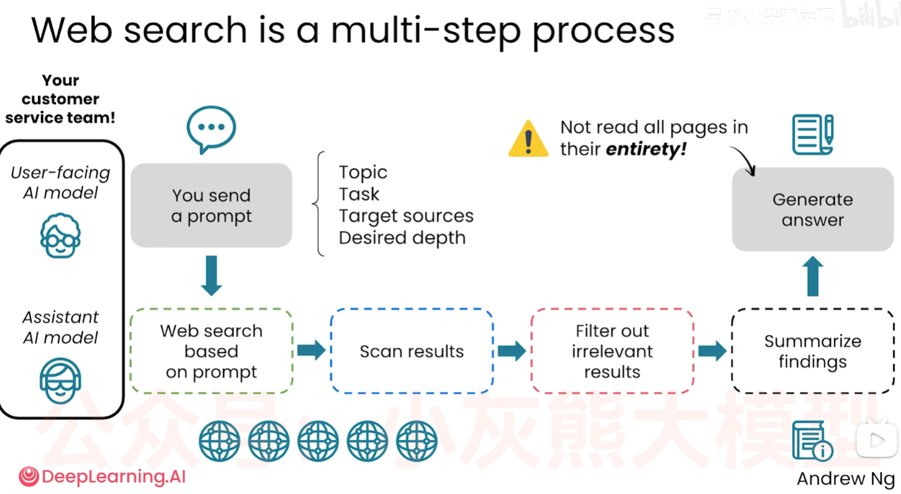

# Web Search：获取最新知识

## 1. 为什么需要 Web Search

AI 的预训练知识有截止日期，而现实世界会持续变化。政策、软件版本、价格、新闻、研究成果、网络流行语和本地商家信息，都可能在模型训练完成后发生变化。

当问题依赖最新、实时、地点或冷门信息时，模型需要通过 Web Search 获取外部资料，再基于搜索结果组织回答。搜索结果是新的信息来源，不代表模型已经自动验证了事实。

## 2. 什么时候需要 Web Search

下表将图片中的示例翻译为中文，并保留“问题—来源—原因”的关系：

| 问题 | 信息来源 | 需要搜索的原因 |
| --- | --- | --- |
| 我的手机掉进汤里了，怎么办？ | 模型预训练知识 | 互联网中的常见知识 |
| 为什么猫会盯着墙看？ | 模型预训练知识 | 互联网中的常见知识 |
| 旅行者 1 号唱片上有什么内容？ | 模型预训练知识 | 互联网中的常见知识 |
| 2025 年的“6 7”网络迷因是什么？ | Web Search | 需要实时信息 |
| 帮我找一家 Mountain View（加利福尼亚州）附近评价很高的健身房。 | Web Search | 需要地点特定的信息 |
| Marquette Mountain Cheese Roll 是什么？ | Web Search | 这是小众、冷门的信息 |

图片中的分类可归纳为：

- **常见知识**：模型通常可以先依赖预训练知识回答，但仍需根据风险决定是否核验。
- **实时信息**：新闻、近期事件、流行语、价格和最新版本等，应搜索最新页面。
- **地点特定信息**：附近商家、当地规定、路线和营业时间，需要位置与时间相关的搜索。
- **小众信息**：专业术语、地方文化、罕见事件或不常见产品，搜索可以补足预训练知识的覆盖不足。

## 3. Web Search 的基本工作流程

### 3.1 课程图示：对话模型与辅助模型的分工



**按图示理解：辅助模型根据提示词搜索、浏览结果、过滤无关内容并汇总发现，再把结果交给面向用户的对话模型生成回答。** 图中用“客服团队”的比喻说明这种分工。

| 阶段 | 图中角色 | 处理内容 |
| --- | --- | --- |
| 接收提示词 | 面向用户的 AI 模型 | 理解主题、任务、目标来源和期望深度 |
| 根据提示词搜索网页 | 辅助 AI 模型 | 通过搜索工具发起查询，获取候选网页 |
| 浏览搜索结果 | 辅助 AI 模型 | 扫描返回的结果，寻找相关内容 |
| 过滤无关结果 | 辅助 AI 模型 | 排除不符合任务要求的内容 |
| 汇总发现 | 辅助 AI 模型 | 将相关信息整理为摘要，交给对话模型 |
| 生成回答 | 面向用户的 AI 模型 | 结合用户问题和检索到的材料组织最终回答 |

**这是一种架构示意，不代表所有产品都使用两个独立模型。** 实际系统也可以由同一个模型多次调用搜索和网页读取工具，或者由多个模型与程序组件协作完成。辅助模型本身也需要通过工具访问网页；单凭界面显示“正在搜索”，无法确定后台采用哪种实现。

搜索结果、网页片段或摘要会作为当前任务的上下文提供给模型，**这不等于重新训练模型，也不会因此自动更新模型参数中的预训练知识**。资料不足时，系统还可能继续搜索，形成多轮检索。

图中特别提醒：**系统未必完整阅读每一个网页。** 它可能仅处理标题、搜索摘要、相关片段或部分正文，因此引用链接不保证已经读完全文。对于关键结论，应要求打开原文、核对相关段落和适用条件；无法访问全文时应说明限制。

### 3.2 实践中的检索与核验步骤

1. **判断时效性**：确认问题是否带有“现在、最新、今年、附近、目前版本”等条件。
2. **拆分搜索意图**：把一个宽泛问题拆成关键词、地点、时间范围和筛选条件。
3. **检索多个来源**：优先查看官方机构、原始论文、产品文档、商家页面和可靠媒体。
4. **提取相关事实**：区分搜索页面中的事实、观点、广告和用户评论。
5. **交叉核对**：比较不同来源的日期、数字、定义和结论；发现冲突时说明冲突。
6. **带来源回答**：标明信息来源和检索时间，对仍无法确认的内容明确说明不确定性。

## 4. 搜索后的可靠性检查

搜索并不等于核实。使用 Web Search 后，仍应检查：

| 检查项 | 需要关注的内容 |
| --- | --- |
| 来源身份 | 是否为官方、原始发布者或可追溯的专业来源 |
| 发布时间 | 内容是否覆盖用户要求的时间点，是否已经过时 |
| 证据类型 | 是原始数据、研究结论、新闻报道，还是个人观点和广告 |
| 多源一致性 | 关键事实是否被多个独立来源支持 |
| 适用范围 | 结论是否只适用于某个地区、版本、时间或人群 |

## 5. 在提示词中指定权威来源

**明确指定目标网站、机构或文献类型，可以引导搜索优先寻找更可靠的证据，减少低质量转载、营销内容和未经核实的传言对回答的影响。** 这对应图中提示词的“目标来源（Target sources）”；还应说明主题、具体任务和期望深度。

| 问题类型 | 可优先指定的来源 | 需要核对的条件 |
| --- | --- | --- |
| 政策、法规与公共统计 | 政府部门、监管机构、法规原文和官方统计发布 | 生效日期、地区、修订情况和统计口径 |
| 科学研究 | 原始论文、同行评审研究、系统综述和专业机构报告 | 研究方法、样本、局限性；区分预印本和已同行评审论文 |
| 软件与技术 | 官方文档、版本发布说明、源码仓库和标准组织 | 软件版本、发布日期及适用环境 |
| 医疗与健康 | 公共卫生机构、专业学会指南和高质量研究 | 证据质量、指南版本和适用人群 |

**不限定来源时，搜索可能返回社交媒体、论坛或大量转载内容，但不能据此断言系统一定优先检索社交媒体。** 结果还取决于查询词、搜索排序、索引覆盖和产品策略。某些主题的原始权威资料确实少于讨论和转载，但数量不是唯一原因，也不能用页面数量代替证据质量。

社交媒体可以帮助了解用户体验、舆情或事件线索；对需要事实依据的结论，应尽量追溯原始出处。多个网站转载同一篇文章不算多个独立证据。权威机构和论文也并非绝对正确，仍要核对日期、方法和结论是否适用于当前问题。

## 6. 可复用提示词

```text
请先判断这个问题是否需要 Web Search：[问题]
主题与具体任务：[需要研究什么、回答什么]
时间、地区或版本范围：[适用范围]
期望深度：[简要结论 / 多源对比 / 阅读关键原文后详细分析]
如果需要搜索，请优先使用以下来源：[指定网站、机构、官方文档或论文类型]。
社交媒体、论坛和无出处转载仅作为线索，不作为关键事实的唯一依据。
请打开关键来源，核对支持结论的原文段落；无法读取全文时请说明。
若指定来源证据不足，请明确指出，不要用低质量来源凑结论。
请给出：
1. 直接结论；
2. 关键事实对应的来源、发布日期和链接；
3. 不同来源之间的冲突；
4. 仍然无法确认或可能过时的内容。
请区分事实、推断和个人评价，不要编造来源或链接。
```

## 7. 一句话总结

当问题涉及实时、地点特定或小众信息时，Web Search 可以补充预训练知识；但最终回答仍需要检查来源、日期、证据和多源一致性。
