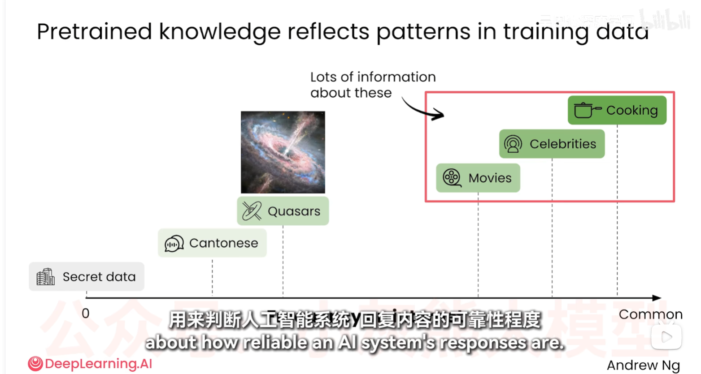

# 预训练知识

## 1. 核心观点

AI 的通用知识主要来自训练阶段接触的大量文本和其他数据。模型通过学习这些数据中的语言模式、事实关联和表达方式，形成可用于生成回答的预训练知识。

预训练知识反映的是训练数据中的模式，而不是一份实时更新、逐条核验的知识库。因此，AI 的回答可能很流畅，但流畅不等于事实一定正确。

## 2. 数据出现频率与回答可靠性

互联网上不同类型的信息数量和重复程度不同。某个主题在公开数据中出现得越多、表述越一致，模型通常越容易形成稳定的相关模式；出现很少、非常专业、地域性强或属于私人领域的信息，模型掌握得可能更弱。

可以用“训练数据中的常见程度”作为**初步判断可靠性的线索**：

| 信息类型 | 公开数据中的常见程度 | 使用 AI 回答时的初步判断 |
| --- | --- | --- |
| 日常常识、常见烹饪方法 | 较高 | 通常较容易得到有用回答，但仍需检查细节 |
| 知名电影、公众人物 | 较高 | 基本事实通常较稳定，具体日期、作品列表仍应核实 |
| 小语种、方言或区域性知识 | 可能较低 | 可能遗漏背景或混淆表达，应提供上下文并核对 |
| 前沿科研、冷门专业问题 | 可能较低且更新快 | 不应只依赖预训练知识，要求来源或使用检索资料 |
| 企业内部数据、个人隐私、秘密数据 | 通常不可见 | 模型无法凭空知道，应直接提供允许使用的材料 |

这是一种**概率上的经验判断**，不是可靠性证明。数据数量多也可能包含错误、偏见或相互复制的错误内容；数据数量少也不代表信息一定错误。

## 3. 过时信息与错误信息

AI 的预训练知识可能包含两类常见问题：

- **过时信息**：训练数据的时间范围有限，模型可能不了解最新的政策、软件版本、价格、人员任职或研究进展。即使模型曾经知道某个事实，现实也可能已经发生变化。
- **错误信息**：训练数据本身可能有错，也可能存在互相复制的错误、歧义、偏见或不完整的描述。模型还可能在缺少信息时生成看似合理但没有依据的内容，这通常被称为“幻觉”。

因此，回答的流畅度、详细程度和自信语气都不能证明内容正确。涉及时间敏感或高风险事实时，应要求最新来源，并进行独立核验。

识别信号包括：回答没有日期或来源、把可能变化的内容说成永久事实、引用无法找到的资料、数字和名称前后不一致，以及面对冷门问题时给出过度确定的结论。

## 4. 图片解析



图中横轴表示信息在公开数据中的常见程度：左侧是秘密数据，右侧是更常见的公开主题。示例从较少见的粤语、类星体，到更常见的电影、名人和烹饪。图示表达的重点是：模型对公开语料中信息较多的主题通常拥有更多相关模式，因此回答更可能稳定；对秘密数据则不能假设模型已经知道。

图示只说明“数据分布与模型表现可能相关”，不能把横轴直接当作回答正确率，也不能替代事实核验。

## 5. 成为 AI Power User 的使用原则

1. **先判断问题类型**：常识问题可以先参考模型；冷门、最新、专业或高风险问题要提高核验级别。
2. **提供缺失上下文**：把内部资料、定义、目标读者和时间范围放进提示词，减少模型依赖泛化知识。
3. **要求区分确定与不确定**：让 AI 标注依据、假设和无法确认的部分。
4. **要求来源或检索**：涉及法律、医疗、财务、版本变化和最新事实时，不把预训练记忆当作唯一依据。
5. **人工检查关键结论**：尤其检查数字、日期、引用、专有名词和因果关系。
6. **检查时效性**：明确给出时间范围，例如“截至 2026 年 9 月”，并要求模型指出可能已经变化的结论。

可复用提示词：

```text
请回答这个问题：[问题]
请先判断它属于常识、专业知识、最新信息、冷门知识还是内部信息。
对每个关键结论说明依据；无法确认的内容请明确标注“不确定”，不要猜测。
请标明结论适用的日期或版本，指出可能过时的内容；无法核实时请明确说明，不要编造来源。
如果问题依赖最新资料，请告诉我需要核对哪些来源或信息。
```

## 6. 一句话总结

预训练知识反映训练数据中的统计模式；信息在公开数据中越常见，AI 往往越容易生成稳定回答，但可靠性仍必须结合来源、时效性、任务风险和人工核验来判断。
