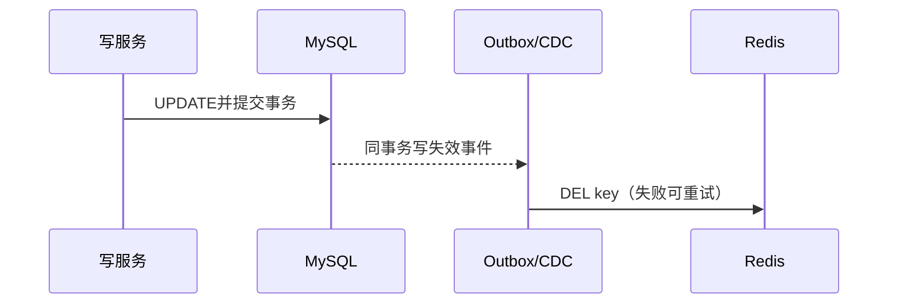

# Redis 与 MySQL 一致性

## 0. 问答总结

### 0.1 一致性的基本做法是什么？
1. **MySQL 是权威，先写库再删缓存。** 读 miss 时从库加载。
2. **缓存只能最终一致。** 删除、消息和回填都有时间窗口。
3. **强一致读直接读主库。** TTL 不是实时保证。

### 0.2 删除失败如何补偿？
1. **同步重试只应对瞬时错误。** 持续失败要持久化任务。
2. **事务 outbox 或 CDC 驱动失效。** 避免写库后发 MQ 前崩溃缺口。
3. **消费者按 key 幂等删除并告警。** TTL 只是兜底。

### 0.3 延时双删是不是银弹？
1. **只能降低旧回填概率。** 延迟无法覆盖所有慢查询。
2. **不能修复消息丢失。** 仍需 outbox、CDC 和重试。

## 1. 时序

读线程可能在写库前 miss 后覆盖新缓存；值中保存 `version`，回填只接受更大版本。直读 MySQL 要区分主库、副本和事务快照。

## 2. 方案比较
|方案|优点|限制|
|---|---|---|
|先库后删+TTL|简单、幂等|最终一致|
|Outbox+重试|不丢失失效事件|维护消费链路|
|CDC/binlog|与业务解耦|存在延迟|
|延时双删|压低旧回填|不能替代可靠事件|

官方：<https://redis.io/docs/latest/commands/del/>、<https://redis.io/docs/latest/commands/expire/>。

## 99. 官方依据

- Redis 7.2.0 配置与源码核对：`notes/.redis-rewrite-sources/redis-7.2.0.conf` 及对应源码缓存。
- Redis 命令参考：https://redis.io/docs/latest/commands/
