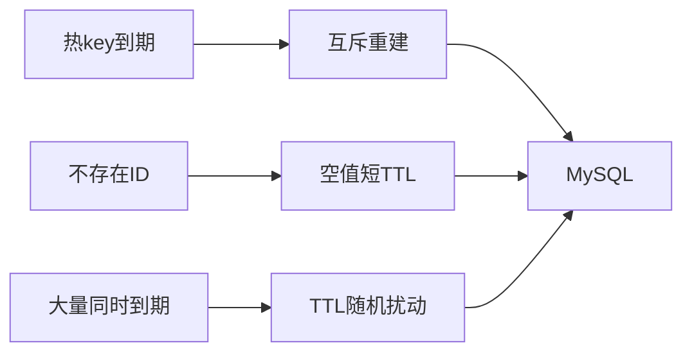

# 缓存击穿、穿透与雪崩

## 0. 问答总结
### 0.1 三者是什么？
1. **击穿是一个热 key 失效。** 并发回源同一条数据。
2. **穿透是查询不存在的数据。** 每次请求都 miss。
3. **雪崩是大量 key 同时失效或缓存不可用。** 回源流量暴涨。
### 0.2 怎么处理？
1. **击穿用 singleflight、互斥回填或逻辑过期。** 只让一个请求重建。
2. **穿透参数校验并缓存空值。** 海量随机 ID 才考虑布隆。
3. **雪崩打散 TTL、预热、限流降级。** 高可用减少故障影响。

## 1. 机制图

逻辑过期将 `expireAt` 放入 value，过期先返旧值并后台刷新。本地 TTL 按业务容忍度设定，不是必须小于 Redis 的硬规则。布隆只有在全集同步、位图完整时才能据 0 判不存在；RedisBloom 是模块，不是 7.x 内核。TTL 过期不是精确时刻。

官方：<https://redis.io/docs/latest/commands/expire/>；Redis 7.2.0 配置：`notes/.redis-rewrite-sources/redis-7.2.0.conf`。

## 99. 官方依据

- Redis 7.2.0 配置与源码核对：`notes/.redis-rewrite-sources/redis-7.2.0.conf` 及对应源码缓存。
- Redis 命令参考：https://redis.io/docs/latest/commands/
