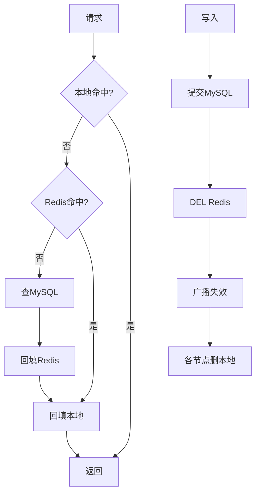

# 多级缓存

## 0. 问答总结
### 0.1 怎么读写？
1. **读按本地缓存→Redis→MySQL 下探。** 回源后逐层回填。
2. **写先提交 MySQL，再删 Redis并广播本地失效。** 每层需重试。
3. **本地只放可接受最终一致的数据。** 余额、实时库存不放本地。
### 0.2 TTL 怎样设置？
1. **按陈旧容忍度设置。** 没有必须小于 Redis 的通用规则。
2. **TTL 是通知丢失时兜底。** 不能替代 MQ/CDC。
3. **版本门槛独立保存。** 防止旧值重新通过。

## 1. 流程

Pub/Sub 断线会丢消息，只能辅助；MQ/CDC 事件携带 key、版本和幂等标识。回填只接受不小于当前版本的数据。官方：<https://redis.io/docs/latest/commands/get/>、<https://redis.io/docs/latest/commands/del/>。

## 99. 官方依据

- Redis 7.2.0 配置与源码核对：`notes/.redis-rewrite-sources/redis-7.2.0.conf` 及对应源码缓存。
- Redis 命令参考：https://redis.io/docs/latest/commands/
