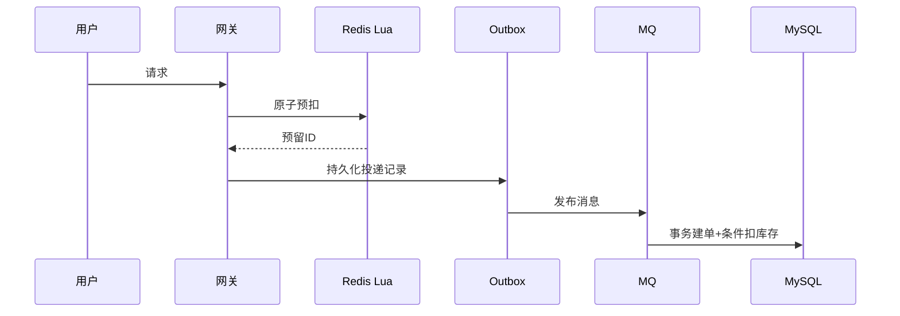

# 秒杀如何防止超卖

## 0. 问答总结
### 0.1 防超卖靠哪几层？
1. **限流削峰控制进入量。** 解决容量，不证明库存正确。
2. **Redis Lua 原子预扣并记录用户。** 校验参数、同槽 KEYS；无跨系统回滚。
3. **数据库条件扣库存和唯一索引最终兜底。** `stock > 0` 与唯一键同事务。
### 0.2 预扣成功但消息没发怎么办？
1. **不能裸依赖客户端重试。** 预扣与 MQ 投递有崩溃缺口。
2. **记录预留 ID并用 outbox/流水补投。** 按预留 ID 幂等释放。
3. **消费者按 request_id 幂等建单。** 竞争消费是队列分工，不是广播。

## 1. 流程

Lua 校验 `need` 为正整数且 KEYS 同槽；原子但无跨系统回滚。数据库使用：`UPDATE seckill_sku SET stock=stock-1 WHERE sku_id=? AND stock>0`，影响行数 1 才成功；唯一索引防重复单。超时取消按预留 ID 幂等恢复，禁止裸 INCR 重复回补。Redis 主从异步切换可能丢预扣，数据库仍须校验。

参考：<https://redis.io/docs/latest/develop/interact/transactions/>、<https://redis.io/docs/latest/commands/decrby/>；配置：`notes/.redis-rewrite-sources/redis-7.2.0.conf`。

## 99. 官方依据

- Redis 7.2.0 配置与源码核对：`notes/.redis-rewrite-sources/redis-7.2.0.conf` 及对应源码缓存。
- Redis 命令参考：https://redis.io/docs/latest/commands/
