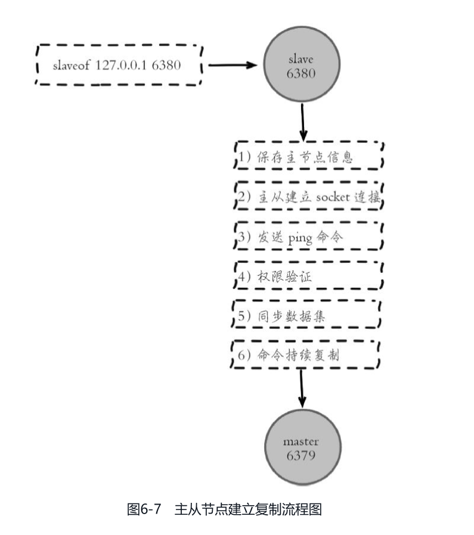
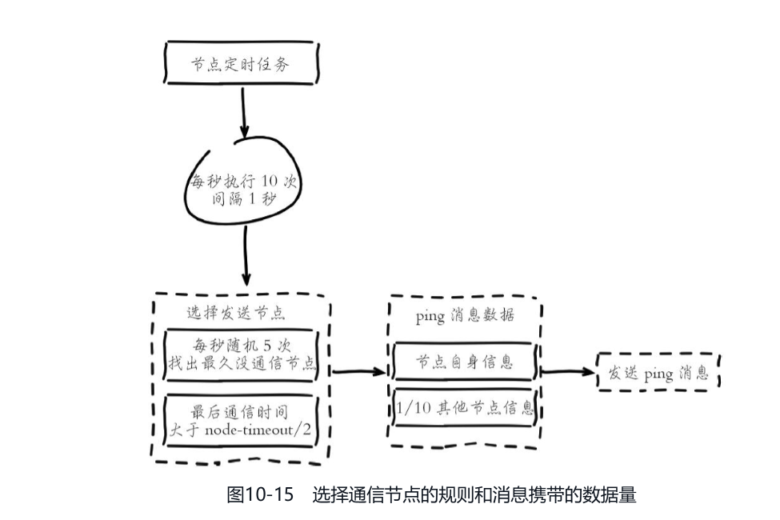

# Redis 高可用：复制基础与部署方案

> 本文以 Redis 7.x 为基准；实现细节以 Redis 7.2.0 官方源码核实。

## 0. 问答总结

### 0.1 Sentinel 和 Cluster 分别解决什么？

1. **Sentinel 管理单主多从的监控、发现和自动切换。** 它不分片。
2. **Cluster 把 key 分到 16384 个槽，并在分片内做复制和故障转移。** 它需要集群客户端。
3. **两者默认都是异步复制。** 故障切换后最近写入可能丢，不能宣传强一致。

### 0.2 Redis 高可用为什么仍可能丢数据？

1. **主节点先向客户端确认，再异步复制。** 确认时从节点可能还没收到。
2. **`WAIT`/`WAITAOF` 只能等待复制或 AOF 条件，不能回滚写入。** 超时也不代表写入失败。
3. **关键数据要有幂等、对账和权威数据库。** 高可用解决的是可用性和恢复，不是业务一致性。

### 0.3 从节点启动后如何建立主从复制？

1. **先保存主节点信息。** 从节点执行 `REPLICAOF <host> <port>`（旧版本命令名为 `SLAVEOF`）后记录主节点地址，并进入连接主节点的状态。
2. **建立 TCP 连接并发送 PING。** 连接成功后先用 `PING` 探测链路；认证配置不匹配时，复制不会进入同步阶段。
3. **完成身份与能力协商。** 从节点按顺序发送 `AUTH`（如需要）、`REPLCONF listening-port`、`REPLCONF capa` 等信息，主节点据此登记副本。
4. **用 `PSYNC` 请求同步。** 首次复制通常请求 `PSYNC ? -1`；重连时携带复制 ID 和偏移量，主节点据此选择部分或全量同步。
5. **先装载快照，再追赶增量命令。** 全量同步传输 RDB，主节点同时把期间产生的写命令放入复制积压缓冲区，副本加载 RDB 后继续执行增量流。
6. **进入持续复制。** 初始同步完成后，主节点持续发送写入、过期和淘汰产生的复制命令；副本周期性回报已处理偏移量。

### 0.4 全量同步和部分重同步怎么区分？

1. **部分重同步优先。** 复制 ID 匹配且断线期间的命令仍在 `repl-backlog` 中时，只补发缺失命令，开销较小。
2. **全量同步是兜底。** 首次连接、复制历史不匹配或 backlog 已覆盖缺失区间时，主节点生成并发送完整 RDB，再补发快照期间的命令。
3. **两者都默认异步。** `FULLRESYNC` 或 `CONTINUE` 表示同步路径，不表示业务写入已经持久化或故障转移时绝不丢失。

## 1. 详细知识点

## 1. 概念层次与方案对比

| 层次 | 机制或方案 | 职责 |
|---|---|---|
| 数据复制机制 | 主从复制 | 将主节点的数据复制到从节点，为故障恢复和读扩展提供副本 |
| 不分片部署 | 主从部署，可配合 Sentinel | 保存一份逻辑数据集，由一个主节点处理写入；Sentinel 提供监控、自动故障转移和主节点发现 |
| 分片部署 | Redis Cluster | 将数据分布到多个主节点，各分片通过主从复制保存副本，由集群内置机制执行故障转移 |

仅配置主从复制不会自动完成故障转移。主节点故障后，需要人工或外部管理系统提升从节点，并更新客户端连接。Sentinel 为这一过程提供自动化能力，但不改变数据分片方式，也不扩展单个主节点的写入能力。

| 对比项 | 主从部署，配合 Sentinel | Redis Cluster，配置从节点 |
|---|---|---|
| 数据分布 | 一份逻辑数据集，主节点写入，从节点复制 | 数据分布在 16384 个哈希槽中，由多个主节点分别负责 |
| 自动故障转移 | Sentinel 协调提升从节点、调整复制关系 | 从节点获得多数有投票权的主节点授权后接管分片 |
| 容量与写入扩展 | 受单个主节点限制 | 可按分片扩展，但单个热 key 仍受所在分片限制 |
| 从节点读取 | 可以使用，但需要接受复制延迟 | 可以使用，需要客户端支持且接受复制延迟 |
| 客户端要求 | 支持 Sentinel 服务发现和故障后重连 | 支持槽路由以及 `MOVED`、`ASK` 重定向 |
| 多 key 操作 | 无跨槽限制 | 多 key 原子操作、事务和 Lua 通常要求相关 key 位于同一槽 |
| 额外组件 | 生产环境通常部署至少 3 个 Sentinel，并分散故障域 | 不需要 Sentinel，节点通过 Cluster bus 协调 |

## 2. 主从复制：连接建立、全量同步与部分重同步

### 2.1 从节点建立复制连接的六步

截图展示的是从节点配置复制目标后，连接主节点并开始同步的简化流程。Redis 7.x 的实际交互可按以下阶段理解：

```text
从节点执行 REPLICAOF 主机 端口
        ↓
保存主节点信息，断开旧复制连接
        ↓
建立 TCP 连接并发送 PING
        ↓
按需 AUTH，发送 REPLCONF 端口/能力信息
        ↓
发送 PSYNC，主节点选择 CONTINUE 或 FULLRESYNC
        ↓
加载 RDB、执行积压命令，进入持续命令复制
```



图 1 主节点建立复制的教学流程图（图中 `slave` 为旧称，Redis 7.x 文档和命令优先使用 `replica`）。图中“权限验证”对应实际协议里的认证与复制权限检查；“同步数据集”可能是全量 RDB，也可能是部分重同步的缺失命令。

从节点建立或恢复复制连接时，通过 `PSYNC` 请求同步。`PSYNC` 能否执行部分重同步，依赖三个配套状态：

1. **主从节点各自维护复制偏移量。** 主节点为复制流推进全局 offset，从节点在处理命令后回报自己已经处理到的 offset；两者的差值用于判断断线期间缺少多少命令。
2. **主节点维护复制积压缓冲区（replication backlog）。** 这是保存近期复制命令流的环形缓冲区。断线期间缺失的命令仍在 backlog 中，主节点才有条件直接补发；缓冲区被覆盖就只能全量同步。容量由 `repl-backlog-size` 等配置影响。
3. **复制历史标识必须匹配。** Redis 7.x 使用复制 ID（`replid`）标识一段复制历史，而不是简单依赖主节点运行 ID。主节点重启或故障切换后可能生成新的 `replid`，保留旧复制 ID 时仍可能支持部分重同步；只有 ID 匹配且 offset 在 backlog 有效范围内，主节点才返回 `CONTINUE`。

因此，首次连接通常发送 `PSYNC ? -1`，主节点返回 `FULLRESYNC`；重连时从节点携带复制 ID 和 offset，主节点根据复制历史和 backlog 判断能否补齐缺失数据。复制历史不匹配或 backlog 已覆盖缺失区间时，执行全量同步。

```text
从节点发送 PSYNC <replid> <offset>
        ↓
主节点检查复制历史与 backlog
  ├─ 历史匹配且所需数据仍保留
  │      → CONTINUE → 补发缺失命令流
  └─ 首次复制、历史不匹配或所需数据已被覆盖
        → FULLRESYNC
              ↓
         生成并传输 RDB 快照（可使用无盘复制）
              ↓
         从节点替换旧数据并加载快照
              ↓
         补发快照生成期间的写命令 → 持续复制
```

### 2.1.1 全量同步时的 RDB 传输与超时

执行 `FULLRESYNC` 时，主节点生成 RDB 并发送给从节点。从节点通常先将数据写入临时文件，接收完成后再加载该 RDB 替换当前数据集；传输期间主节点仍会把新增写命令放入复制缓冲区，供从节点加载快照后追赶。

大数据量实例的主要风险在于 RDB 网络传输耗时。可以结合主节点和从节点日志中的 `Full resync`、`MASTER<->REPLICA`（旧日志可能显示 `MASTER<->SLAVE`）时间点，估算快照生成、传输和切换各阶段的耗时；日志中的字节数或 `INFO replication` 也可用于核对传输规模。

`repl-timeout`（Redis 7.2.0 默认 60 秒）用于判断复制连接在一段时间内是否没有得到有效 I/O 响应。若网络带宽不足、链路拥塞或传输过程中长时间没有进展，从节点会中止同步并清理临时文件，随后重新尝试全量同步。不能仅因为 RDB 总传输时间超过 60 秒，就断定必然超时；只要持续有进展，通常不会触发“无活动超时”。

例如 6 GB 文件在理论 100 MB/s 的千兆网络上，裸传输下限约为 60 秒，实际还要扣除协议开销、磁盘写入、主机负载和网络抖动。因此大 RDB 全量同步前应：

1. **评估真实吞吐和余量。** 按实测带宽估算快照传输时间，避免把网卡理论峰值当成可用带宽。
2. **适当提高 `repl-timeout`。** 同时检查主从节点 CPU、磁盘、网络和慢查询，不能只靠增大超时掩盖链路瓶颈。
3. **优先减少全量同步概率。** 合理设置 `repl-backlog-size`，让短暂断线尽量走部分重同步；必要时采用无盘复制等配置降低磁盘中转开销。

复制默认异步。主节点确认写入不以从节点已经接收、执行或持久化该写入为前提，因此客户端收到成功响应后，数据仍可能尚未到达从节点。

- 一个主节点可以配置多个从节点，也支持级联复制。使用 `REPLICAOF` 设置复制目标，使用 `REPLICAOF NO ONE` 将从节点提升为主节点。
- 全量同步期间，主节点通常继续处理请求，但 `fork` 暂停、写时复制、磁盘和网络开销仍可能影响延迟；从节点加载快照也可能阻塞服务，具体取决于同步与加载配置。
- 从节点默认只读，即 `replica-read-only yes`。直接向可写从节点写入的数据不会反向复制到主节点，并可能在重新同步时被覆盖。
- 复制 ID 与偏移量共同标识复制历史和进度。从节点提升为主节点后会生成新的复制 ID，并保留上一段复制历史的信息，以支持其他从节点在条件满足时进行部分重同步。
- `repl-backlog-size` 决定主节点保留多少近期复制历史。缓冲区过小或断连时间过长会增加全量同步概率，应结合写入速率与预期断连时间设置。

### 2.1.2 复制积压缓冲区不足会导致全量复制

主从链路中断后，从节点重连会携带上次的复制历史标识和偏移量发送 `PSYNC` 请求（协议形式可理解为 `PSYNC <replid> <offset>`）。如果请求 offset 对应的命令已经被主节点复制积压缓冲区覆盖，主节点无法补发缺失命令，只能返回 `FULLRESYNC`，重新传输 RDB。

常见断网场景包括短暂闪断、机房割接和网络分区。容量评估应覆盖预期最长断连时间，并为写入突增、协议开销和测量误差预留余量：

```text
需要保留的复制流容量 ≈ 断连时间 × 断连期间复制流速率
repl-backlog-size ≥ max_disconnect_seconds × peak_repl_bytes_per_second × safety_factor
```

可以在高峰期周期采样 `INFO replication` 的 `master_repl_offset`，用相邻采样的 offset 差值估算复制流速率。若按分钟统计，应先得到 `write_size_per_minute`，再使用 `net_break_time`（分钟）相乘；两者单位必须一致。这里的速率是复制流字节量的近似，不应只按业务命令条数估算。

Redis 7.x 的 `repl-backlog-size` 默认值应以目标小版本的 `redis.conf` 为准；本文核对的 Redis 7.2.0 配置为 1 MB。对高写入量实例，1 MB 往往只能覆盖很短的断连窗口，应通过 `CONFIG SET repl-backlog-size ...` 临时调整并写入配置文件持久化。增大 backlog 会增加主节点内存占用，但通常比频繁 RDB 全量同步带来的网络、磁盘和延迟成本更可控。

### 2.2 从节点读取与一致性

从节点读取可以分担读负载，但异步复制可能使其返回旧值。业务需要在写入后立即读取该写入时，应优先读取当前主节点；即使读取主节点，跨故障转移也不能保证已确认写入一定保留。

过期数据的删除由主节点驱动，并通过复制命令传播。从节点处理普通读请求时也会对逻辑过期的 key 进行判断，因此不能将过期键尚未物理删除直接等同于客户端必然读到过期值。复制延迟、时钟差异和故障转移仍可能影响观察到的数据状态。

### 2.3 持久化与写入限制

主节点关闭持久化并自动重启时，可能以空数据集重新提供服务，随后使从节点通过全量同步清空原有数据。即使配置 Sentinel，若主节点在故障判定前完成重启，也存在这一风险。需要保留数据时，应合理配置主从节点的持久化和恢复流程；无持久化主节点尤其需要避免未经检查就自动恢复服务。

`min-replicas-to-write` 与 `min-replicas-max-lag` 可以要求主节点仅在足够数量的从节点近期有复制确认时接受写入。这能限制部分网络分区下的写入风险，但不是逐条写入的同步复制确认，也不能保证故障转移零丢失。

## 3. 主从部署中的 Sentinel：自动故障转移与发现

Sentinel 是独立运行的管理进程，可以监控一组或多组主从节点，负责故障检测、通知、自动故障转移和当前主节点发现。它不承载业务数据，也不代理客户端的数据读写。

生产环境通常使用至少 3 个 Sentinel，并分散到不同故障域。奇数个节点便于在相同多数派门槛下提高部署效率，但不是协议的硬性要求。常见部署为 1 个主节点、2 个从节点和 3 个 Sentinel。

### 3.1 SDOWN、ODOWN 与多数派授权

| 状态或条件 | 含义 | 判定方式 |
|---|---|---|
| 主观下线（SDOWN） | 单个 Sentinel 判断目标不可用 | 在 `down-after-milliseconds` 指定时间内未收到有效响应 |
| 客观下线（ODOWN） | 足够数量的 Sentinel 同意主节点不可用 | 达到配置的 `quorum` |
| 故障转移授权 | 某个 Sentinel 获得执行本轮故障转移的资格 | 获得多数派选票，同时满足 `quorum` 所要求的票数 |

ODOWN 针对被监控的主节点。从节点或其他 Sentinel 不可用时，可以被标记为 SDOWN，但不会因此触发主节点故障转移。

例如，`sentinel monitor mymaster 10.0.0.1 6379 2` 中的 `2` 是 `quorum`。假设该主节点对应的已知 Sentinel 数量为 N，多数派门槛为 `floor(N/2) + 1`。客观下线判定与故障转移授权是两个阶段，不能只满足前者就执行切换；若 `quorum` 高于多数派门槛，授权还需要达到更高的 `quorum`。

- 3 个 Sentinel、`quorum=2`：2 个同意可以判定 ODOWN，故障转移也至少需要 2 票，可以容忍 1 个 Sentinel 不可用。
- 5 个 Sentinel、`quorum=2`：2 个同意可以判定 ODOWN，但故障转移至少需要 3 票。
- 2 个 Sentinel、`quorum=1`：单个 Sentinel 可以判定 ODOWN，但授权仍需要 2 票。失去任意一个 Sentinel 后，剩余节点无法独立执行故障转移。

### 3.2 故障转移过程

```text
单个 Sentinel 将主节点标记为 SDOWN
        ↓
达到 quorum，主节点进入 ODOWN
        ↓
选出获得授权的 Sentinel 执行本轮故障转移
        ↓
筛除不可用、断连过久或禁止提升的从节点
        ↓
按 replica-priority、复制偏移量、运行 ID 选择从节点
        ↓
将选中的从节点提升为主节点
        ↓
将其他从节点的复制目标改为新主节点
        ↓
传播新拓扑，客户端发现新主节点并重连
```

候选节点中，`replica-priority` 越小越优先，设为 `0` 表示禁止提升；优先级相同时优先选择复制偏移量较大的节点，再以运行 ID 进行确定性选择。

#### 3.2.1 从主观下线到客观下线

1. **每个 Sentinel 独立探测。** Sentinel 按 `down-after-milliseconds` 周期向主节点发送 `PING`，超时、连接错误或收到明确错误时，只在本地将其标记为主观下线（`SDOWN`）。SDOWN 是单个 Sentinel 的观察结果，不代表集群已经同意故障。
2. **询问其他 Sentinel。** 处于 SDOWN 的 Sentinel 向其他 Sentinel 发送 `is-master-down-by-addr`，请求它们报告是否也认为该主节点不可达，并收集其当前配置纪元（configuration epoch）等信息。
3. **达到 quorum 才是 ODOWN。** 汇总到的“主节点下线”票数达到 `sentinel monitor <name> ... <quorum>` 后，该 Sentinel 将主节点标记为客观下线（`ODOWN`），并发布 `+odown`。ODOWN 是故障转移的触发条件，但还不等于某个 Sentinel 已获得执行权限。

网络抖动可能造成某个 Sentinel 进入 SDOWN 后恢复；当重新收到有效响应时，SDOWN 会清除。ODOWN 也会在后续确认主节点恢复或配置变化时被清除，因此不能把一次事件通知当作永久状态。

#### 3.2.2 Sentinel 竞选故障转移 leader

1. **发起者申请授权。** 发现 ODOWN 的 Sentinel 在新的配置纪元中广播 `is-master-down-by-addr`，把自己的 Sentinel ID 作为候选者，请其他 Sentinel 投票。
2. **每个 Sentinel 每个纪元只投一票。** 先到的合法请求获得该 Sentinel 的投票；投票会记录在配置纪元中，防止同一轮重复授权给多个候选者。
3. **多数派才有执行资格。** 候选 Sentinel 需要获得超过半数已知 Sentinel 的票（`floor(N/2)+1`），并且下线确认票数满足 `quorum`。满足后成为本轮故障转移 leader，并发布 `+try-failover`；只有 quorum 而没有多数授权时，仍不能提升从节点。
4. **纪元用于处理并发竞选。** 若多个 Sentinel 同时发起竞选，较新的配置纪元和多数投票决定唯一的执行者；本轮超时或失败后会等待并进入下一纪元重试。

#### 3.2.3 leader 选择新主库

leader 先向从节点发送 `SENTINEL is-master-down-by-addr`/`INFO` 相关探测并刷新状态，然后按以下顺序筛选和排序：

1. **剔除不适合提升的从节点。** 排除已主观下线、与主节点断连时间超过 `down-after-milliseconds * 10`、`replica-priority=0` 或复制状态不正常的节点；具体阈值以目标 Redis 7.x 小版本实现为准。
2. **比较 `replica-priority`。** 数值越小越优先；这是运维显式表达的提升偏好。
3. **比较复制偏移量。** 优先级相同，选择复制偏移量（处理进度）更大的从节点，以减少故障转移时的数据缺口。
4. **比较运行 ID。** 前两项仍相同，按从节点运行 ID 的字典序做确定性选择，保证不同 Sentinel 得到同一结果。
5. **执行提升和重配置。** 对选中从节点发送 `SLAVEOF NO ONE`（Redis 7.x 命令名仍兼容该形式），等待其成为主节点；随后将其他从节点改为复制新主节点，并向 Sentinel 和客户端传播新的主从拓扑。

复制偏移量更大只表示从节点已处理的复制流更多，不表示一定拥有旧主节点最后确认的全部写入；异步复制仍可能导致少量已确认写入丢失。客户端需要重新通过 Sentinel 发现主节点，不能继续固定连接旧地址。

客户端应使用支持 Sentinel 的连接方式，通过 `SENTINEL get-master-addr-by-name` 等接口获取主节点地址。仅固定连接旧主节点地址，不能自动获得故障转移带来的可用性。

旧主节点恢复可达后，Sentinel 会将其重新配置为新主节点的从节点。旧主节点在隔离期间独有的写入不会自动合并到新主节点的数据中。

### 3.3 网络分区与数据丢失

多数派授权限制了少数 Sentinel 独立执行故障转移，但不能立即阻止被隔离的旧主节点接受写入。如果客户端仍能访问旧主节点，就可能出现新旧主节点同时接受写入的窗口。

从节点数量与延迟限制可以缩小部分风险窗口，代价是在副本不足时拒绝写入。它们无法替代业务侧的幂等、数据库约束或必要的一致性控制。主节点已确认但尚未复制的写入，在故障转移后仍可能丢失。

## 4. Cluster：分片与内置故障转移

Redis Cluster 将数据分布到 16384 个哈希槽，每个槽由一个主节点负责。各分片仍采用主从复制保存副本，故障检测与故障转移由集群节点完成，无需部署 Sentinel。

生产环境常见起点是 3 个主节点、每个主节点配置至少 1 个从节点，并将同一分片的主从节点分散到不同故障域。只有主节点而没有从节点时，主节点故障后没有副本可以自动接管其槽。

### 4.1 槽路由与重定向

普通 key 的槽号为 `CRC16(key) % 16384`。若 key 包含有效且非空的 Hash Tag，则只对标签内容计算哈希。例如，`user:{1001}:profile` 与 `user:{1001}:account` 都使用 `1001` 计算槽号，因而位于同一槽。

```text
客户端根据 key 或 Hash Tag 计算槽号
        ↓
查询本地“槽 → 节点”映射并发送请求
  ├─ 路由正确 → 执行命令
  ├─ MOVED → 按节点返回的地址重试，并更新槽映射
  └─ ASK → 向目标节点发送 ASKING 后重试本次请求
           不据此永久修改槽映射
```

`MOVED` 表示应按当前槽归属调整路由；`ASK` 常见于槽迁移期间，只要求临时重定向本次请求。

#### 集群客户端如何定位分片

1. **启动时获取槽位拓扑。** 客户端先连接任意一个可达的 Cluster 节点，发送 `CLUSTER SLOTS`（Redis 7.x 也可使用返回更丰富信息的 `CLUSTER SHARDS`），获得 16384 个槽位到主节点地址以及副本地址的映射，并缓存在本地。连接的第一个节点不必是目标 key 所在的分片。
2. **客户端计算槽位。** 访问 key 时按 `CRC16(key) % 16384` 计算槽号；如果 key 含有效 Hash Tag（例如 `user:{1001}:profile`），只对花括号内的 `1001` 计算哈希，不包含花括号。客户端查本地槽位表，将写请求直接发送到负责该槽的主节点；支持副本读取的客户端可以按配置路由读请求。
3. **处理拓扑变化。** 槽迁移、扩缩容或故障转移期间，旧节点可能返回 `MOVED <slot> <host:port>`。这表示槽的永久归属已经改变，客户端应按返回地址重试，并更新本地该槽映射；后续请求通常可直接访问新节点。
4. **处理迁移中的临时转发。** 节点返回 `ASK <slot> <host:port>` 时，客户端只对当前请求连接目标节点并先发送 `ASKING`，不把该响应当作永久拓扑变更，也不更新槽位缓存。迁移完成后，节点会通过 `MOVED` 告知新的稳定归属。
5. **刷新和重试。** 客户端通常会在收到重定向、连接失败或拓扑版本变化时刷新槽位表，并限制重试次数；收到 `CLUSTERDOWN` 或无法形成多数派时，应返回错误或按业务降级，不能无限重试。

这套机制实现的是客户端侧的透明分片路由，并不代表任意命令都能跨分片执行。`MGET`、事务、Lua/Functions 等涉及多个 key 的操作通常要求这些 key 位于同一槽；Hash Tag 可强制同槽，但使用不当会造成数据倾斜。

### 4.1.1 Cluster 的功能限制

Redis Cluster 的最小路由单位是 key 对应的哈希槽。使用前应明确以下限制：

1. **多 key 批量命令要求同槽。** `MGET`、`MSET`、`DEL` 等涉及多个 key 的命令，只有相关 key 通过普通命令或 Hash Tag 映射到同一个槽时，才能由一个节点执行；跨槽请求通常返回 `CROSSSLOT`。客户端可以拆分请求到多个节点，但拆分后不再具备单次命令的原子性。
2. **事务、Lua 和 Functions 要求同槽。** `MULTI`/`EXEC`、脚本或函数中涉及的多个 key 必须位于同一槽，才能在同一节点完成；跨槽不能提供跨节点事务原子性。使用 Hash Tag 可以让业务相关 key 同槽，但会增加数据倾斜风险。
3. **key 是数据分区的最小粒度。** 一个 Hash、List、Set 或 ZSet 对象不会被拆到多个节点；单个大对象的容量、访问和迁移开销仍由其所在分片承担。
4. **只使用 DB 0。** 单机 Redis 可通过多个逻辑数据库隔离 key，但 Cluster 模式只支持数据库 `db0`。需要逻辑隔离时，应使用 key 前缀、ACL 或不同集群。
5. **分片内复制不用于构建多级树。** Cluster 的副本节点跟随所属主节点并参与该分片的故障转移；不能把一个副本再配置成另一个 Cluster 主节点的级联副本来扩展复制层级。普通非 Cluster Redis 的级联复制是另一种部署能力，不能直接套用到 Cluster。

事务、Lua 以及需要在一个节点执行的多 key 命令通常要求相关 key 位于同一槽。客户端可以把部分批量操作拆分到多个分片执行，但这种拆分不提供跨分片原子性。Hash Tag 可以使业务相关的 key 同槽，也可能因标签设计不当导致数据倾斜。

每个节点使用客户端端口与 Cluster bus 端口，后者默认是客户端端口加 10000，也可通过配置指定。故障检测、拓扑传播和故障转移授权通过 Cluster bus 进行，节点间使用 Gossip 交换状态。

### 4.1.2 Gossip 通信与节点选择

Cluster bus 上的 Gossip 是周期性的状态传播机制。每个节点会在定时任务中主动向其他节点发送 `PING`，对端用 `PONG` 回复；消息除携带当前节点状态外，还会附带部分其他节点的状态摘要，帮助节点传播拓扑、PFAIL/FAIL 等信息。

Gossip 并不是免费广播：发送频率越高、每次携带的节点状态越多，Cluster bus 的带宽和节点解析开销越大；发送过少又会延迟故障判定和新节点发现。Redis 7.x 的 Cluster cron 通常每秒运行 10 次（约每 100 ms 一次），因此每轮选择哪些目标节点会直接影响实时性和成本。



图 2 Gossip 通信节点选择与消息携带数据量示意图。图中“随机 5 个、优先最久未通信节点”和“最后通信时间大于 `node-timeout/2`”是对源码选择逻辑的教学化概括；实际候选筛选还会结合节点状态、连接状态和当前故障检测流程，不能把 5 视为所有 Redis 7.x 小版本的固定协议常数。

可以从三个角度理解这套策略：

1. **优先补齐通信空档。** 更久没有交换信息的节点优先被选中，避免部分节点长期收不到新拓扑。
2. **控制每轮通信规模。** 单轮只选择有限目标节点，并通过 Gossip 转发部分节点状态，避免全连接广播的带宽开销。
3. **用 `cluster-node-timeout` 约束时效。** 节点需要在故障超时窗口内持续交换心跳；调整该参数会同时影响故障判定速度、误判概率和通信压力，不能只按“越小越快”设置。

#### 消息发送数量与 `cluster-node-timeout` 的权衡

可以把每个节点的发送逻辑拆成两类：

1. **周期性随机探测。** Cluster cron 默认每秒运行约 10 次，每轮从候选节点中选择通信时间较久的节点发送 `PING`，以保持 Gossip 的随机传播。
2. **超时前主动补探测。** 每次调度扫描本地节点列表；如果某节点最近一次收到 `PONG` 的时间超过 `cluster-node-timeout / 2`，就立即向它发送 `PING`，避免状态长时间没有更新。

在把每轮随机探测折算为固定基线后，每个节点每秒的 `PING` 数量可以用下面的近似式理解：

```text
每秒 PING 数量 ≈ 1 + 10 × N
N = 最近一次收到 PONG 的时间 > cluster-node-timeout / 2 的节点数
```

其中 `1` 表示周期性探测的近似基线，`10 × N` 表示每秒 10 次调度对超时前主动补探测的放大效果。该公式用于容量规划，不是跨版本保证的精确计数；实际值还会受候选节点数量、节点状态、连接状态和实现细节影响。集群总消息量还会随节点数增加，通常需要同时评估单节点和 Cluster bus 的整体带宽。

当 Cluster bus 带宽紧张时，可以适当增大 `cluster-node-timeout`，例如从 15 秒调整到 30 秒，减少节点频繁进入“超过一半超时窗口未收到 PONG”的补探测次数。但调大该参数也会延长故障判定、故障转移、槽信息传播和新节点发现的时间；应结合业务可接受的故障恢复时延、网络抖动和误判风险压测后确定，而不是单纯追求更低的消息量。

### 4.2 故障检测与故障转移

节点在超时后先将不可达节点标记为疑似故障（PFAIL）；汇总足够的主节点故障报告后，可将其确认为故障（FAIL）。符合条件的从节点随后发起选举，获得多数有投票权的主节点授权后提升为主节点，并接管原主节点的槽。

切换时间取决于 `cluster-node-timeout`、故障报告传播、选举和客户端恢复，不能等同于单个超时参数。可达的有投票权主节点不足多数时，无法完成正常的自动故障转移。

`cluster-require-full-coverage yes` 默认要求所有槽都由可用节点覆盖；存在未覆盖槽时，集群会停止正常服务。设置为 `no` 可以允许继续服务已覆盖的槽，但不会取消多数派等其他可用性条件。

### 4.2.1 集群完整性与 `cluster-require-full-coverage`

Redis Cluster 默认开启全槽覆盖检查（`cluster-require-full-coverage yes`）。发现槽未分配或槽所属主节点已被标记为故障时，节点会将集群状态判为不可用；默认普通键命令会被拒绝。注意区分两类错误：

```text
(error) CLUSTERDOWN The cluster is down
(error) CLUSTERDOWN Hash slot not served
```

前者表示集群整体状态不可用；后者表示请求命中的槽没有指派节点，例如关闭全槽覆盖检查后访问未分配槽。不能把所有故障都描述为固定返回 `Hash slot not served`。管理命令也不等于普通键命令。

该默认值要求全槽覆盖，但不保证数据强一致。代价是：故障状态被识别后，到副本完成接管并恢复集群状态前，健康分片的普通键请求也可能被拒绝；不是主节点刚断线就必然全局停服。

将 `cluster-require-full-coverage` 设置为 `no` 后，只要多数派等条件仍满足，健康分片可以继续处理请求。这适合更看重部分业务可用性的场景，但有以下边界：

1. **不是自动修复故障。** 故障主节点负责的槽仍然不可用，直到副本成功提升并接管槽位。
2. **不绕过 Cluster 安全条件。** 多数派通信、故障检测、故障转移选举和副本存在等条件仍可能阻止自动切换。
3. **客户端必须正确处理错误。** 对未覆盖槽收到 `CLUSTERDOWN`、`MOVED` 或重试错误时，应按客户端策略降级、重试或返回业务错误，不能把部分可用当成全量可用。

是否关闭全槽覆盖检查，应按业务容忍度选择：需要全局数据路由完整性时保留 `yes`；能够接受部分 key 暂时不可用、希望其他分片继续提供服务时，可评估 `no`，并配合故障演练和监控验证。

### 4.3 一致性边界

Cluster 的分片副本同样默认异步复制，已确认写入可能在故障转移时丢失。配置纪元与多数派机制用于协调拓扑和故障转移，不能据此认定业务数据具有强一致性。

`WAIT` 可以等待指定数量的从节点确认当前连接此前的写入已复制，减少部分丢失风险，但会增加延迟。它不保证从节点已经持久化，也不保证故障转移一定选择包含该写入的副本；超时不会回滚此前的写入。

## 5. 选型与运维检查

先判断数据容量和写入负载是否需要分片，再确定副本与故障转移方式。

```text
单实例容量与写入能力是否满足需求？
  ├─ 满足 → 主从部署
  │          ├─ 需要自动故障转移与服务发现 → 配合 Sentinel
  │          └─ 允许人工恢复 → 配置主从复制并明确切换流程
  └─ 不满足 → Redis Cluster
               为各分片配置从节点，使用支持集群路由的客户端
```

如果主要瓶颈是单个热 key，增加分片通常不能直接解决，需要结合本地缓存、业务拆分或请求合并。若数据可以重建，可以按业务恢复时间要求调整持久化和副本策略，同时评估 Redis 故障后集中回源对数据库的影响。

运维时重点检查以下事项：

- 主从节点、Sentinel 是否分散在不同故障域，单个故障是否会同时影响副本与投票能力。
- 客户端是否支持故障后的地址发现、路由更新、重连与有界重试，写入重试是否满足业务幂等要求。
- 从节点复制延迟、backlog 大小和全量同步成本是否符合负载与恢复目标。
- 持久化、自动重启与恢复流程是否可能导致空主节点覆盖副本。
- Cluster 是否为每个分片配置副本，是否存在跨槽操作和 Hash Tag 数据倾斜。
- 是否通过故障演练验证恢复时间，并明确已确认写入仍可能丢失的业务处理方式。


## 99. 官方依据

- Redis 官方复制文档（Redis 7.x）：复制连接、`PSYNC`、全量/部分重同步、异步确认与 `WAIT`：`notes/.redis-rewrite-sources/guide-docs-management-replication.md`。
- Redis 7.2.0 源码：`src/replication.c`（复制状态机、`PSYNC`、复制积压缓冲区、偏移量和副本确认）。
- Redis 7.2.0 配置：`notes/.redis-rewrite-sources/redis-7.2.0.conf`（`replicaof`、`masterauth`、`repl-backlog-size`、`min-replicas-to-write`、`min-replicas-max-lag`）。
- Redis 官方命令文档：`CLUSTER SLOTS`、`CLUSTER SHARDS`（槽位拓扑返回格式）、`MOVED`、`ASK`、`ASKING`（永久与临时重定向语义）。
- Redis 7.2.0 源码：`src/multi.c`（事务入队、EXECABORT、WATCH 冲突）。
- Redis 7.2.0 源码：`src/eval.c`、`src/functions.c`、`src/script.c`（Lua/Functions 串行执行、超时与 SCRIPT KILL 限制）。
- Redis 7.2.0 源码：`src/aof.c`（Multi-Part AOF 重写、BASE/INCR/manifest）。
- Redis 7.2.0 源码：`src/replication.c`（WAIT、WAITAOF 复制与本地 AOF 确认）。
- Redis 7.2.0 源码：`src/sentinel.c`（`sentinelCheckObjectivelyDown`、`sentinelAskMasterStateToOtherSentinels`、`sentinelStartFailover`、`sentinelSelectSlave`：SDOWN/ODOWN、故障转移授权、leader 执行和从节点排序）。
- Redis 7.2.0 配置：`sentinel.conf`（`sentinel monitor` 的 quorum、`down-after-milliseconds`、`failover-timeout` 和 `replica-priority`）。
- Redis 官方命令文档：ZSET、Streams、Pub/Sub、Sentinel、Cluster、SET NX/PX。
