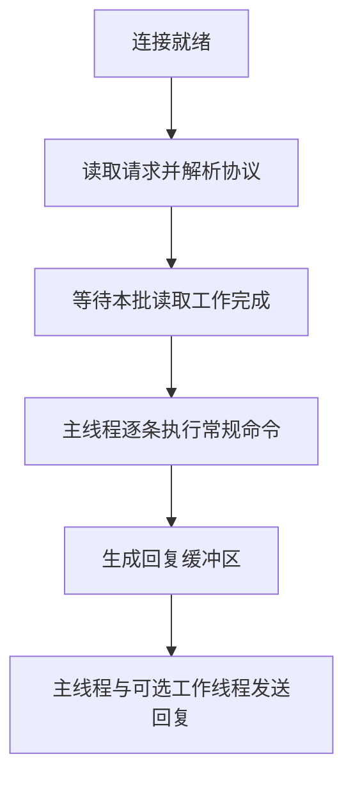

# Redis 单线程模型：哪些工作串行，哪些可以后台做

## 0. 问答总结

### 0.1 Redis 是单线程的吗？

1. **常规命令主要串行执行。** 内置数据命令通常由主线程执行，共享键空间的修改因此按顺序发生。
2. **整个服务不是单线程。** 还有可选 I/O 线程、后台任务线程，以及持久化子进程。

### 0.2 I/O 多路复用与 I/O 线程有什么区别？

1. **多路复用解决等待。** 同时监视多个连接，处理已经就绪的事件。
2. **I/O 线程分担工作。** Redis 7.2.0 可把部分网络读写和协议解析分给线程，常规命令仍回主线程执行。

### 0.3 io-threads 配大就能并行执行命令吗？

1. **不能。** 它不把 HGETALL、Lua 等数据操作分发给多个执行线程。
2. **主线程也参与 I/O。** 7.2.0 配成 N 时，总共有 N 个 I/O 参与者，其中包含主线程，额外创建 N−1 个工作线程。

### 0.4 阻塞命令会把 Redis 卡住吗？

1. **等待型阻塞通常只挂起客户端。** 例如空列表上的 BLPOP，Redis 还能服务其他连接。
2. **耗时计算会占住主线程。** 大集合遍历和长脚本让其他普通数据请求排队。不要把两种“阻塞”混为一谈。

### 0.5 什么时候考虑开启 I/O 线程？

1. **先确认网络处理成本。** 命令很轻但网络读写消耗明显时，才值得用实际负载比较。
2. **收益不是保证。** CPU 核数、回包大小、连接量和同步开销都会影响收益。

## 1. 按职责理解，而不是数线程

本文以 Redis 7.x 为基准，以下实现和配置核对 **7.2.0**。讨论范围是 Redis 内核常规命令；模块可能另有后台任务，不能用“任何代码都只在一个线程执行”概括整个进程。[1][2]

| 执行者 | 工作 | 关键限制 |
|---|---|---|
| 主线程 | 事件循环、常规命令、部分 I/O、定时任务 | 长命令影响其他数据请求 |
| 可选 I/O 线程 | 部分网络读写和协议解析 | 不并行执行普通数据命令 |
| bio 后台线程 | 异步释放、部分 AOF fsync、关闭文件等 | 不是任意慢任务都能丢给 bio |
| 持久化子进程 | BGSAVE、AOF 重写的主体工作 | fork 与写时复制仍有成本 |

不能把“AOF 刷盘交给后台”写成无条件规则：例如 `appendfsync always` 与 `everysec` 的路径、延迟代价不同。子进程也不是线程。[2]

## 2. 一批请求怎样流转

图示开启多线程读取时的简化流程。源码 `handleClientsWithPendingReadsUsingThreads` 先分配客户端，主线程也处理一份，等待其他读取任务完成，再处理请求。**网络阶段的并行，没有扩大成键空间操作的并行。**[1]

`io-threads 1` 表示只使用主线程；大于 1 可启用额外 I/O 线程。`io-threads-do-reads no` 是 7.2.0 默认读取行为，启用后才会把部分读取与协议解析线程化。负载较小时实现还会避免启用多线程写入的同步开销，因此不是每个连接都固定分到某个永久工作线程。[1][2]

## 3. “串行”保证了什么，没有保证什么

两个客户端的普通命令不会同时修改内置键空间，因此单个 `INCR` 不会出现应用层“读旧值后覆盖”的竞争。但客户端分两次发送 `GET` 和 `SET`，中间仍可能插入其他请求；需要原子读改写时应选单命令、事务条件检查或脚本。

事务与脚本涉及不可交错的数据操作，但不代表能回滚所有错误，也不代表主从强一致。空列表的 `BLPOP` 则会登记等待关系、让出执行机会；有数据到来再唤醒对应客户端。这与循环计算占住主线程完全不同。参见[事务](70-redis事务.md)与[Pipeline 和 Lua](75-pipeline事务和lua.md)。

## 4. 排查与旧说法纠正

先用 `INFO cpu`、`INFO commandstats`、`SLOWLOG GET 16` 配合系统 CPU 和网络监控，判断是计算、传输还是外部等待。慢日志不能覆盖完整网络延迟。不要按“有 8 核就配 7 个线程”固定套数，应保留系统和后台任务余量并比较压测结果。[2]

旧文“所有客户端都被阻塞”应限定为长命令占住主线程时的普通请求执行；“BLPOP 把服务卡住”不成立；“全部 AOF 刷盘都在 bio”也不成立。

## 5. 官方依据

1. [Redis 7.2.0 networking.c](https://github.com/redis/redis/blob/7.2.0/src/networking.c)：`IOThreadMain`、`initThreadedIO`、`handleClientsWithPendingReadsUsingThreads`、`stopThreadedIOIfNeeded`，线程数量与阶段同步。
2. [Redis 7.2.0 redis.conf](https://github.com/redis/redis/blob/7.2.0/redis.conf)：THREADED I/O、APPEND ONLY MODE 配置注释；[bio.c](https://github.com/redis/redis/blob/7.2.0/src/bio.c)：`bioProcessBackgroundJobs`，后台任务类型。
3. [Redis 7.2.0 t_list.c](https://github.com/redis/redis/blob/7.2.0/src/t_list.c)：`blockingPopGenericCommand`，空列表调用 `blockForKeys` 挂起客户端，而非原地等待。

## 99. 官方依据

- Redis 7.2.0 配置与源码核对：`notes/.redis-rewrite-sources/redis-7.2.0.conf` 及对应源码缓存。
- Redis 命令参考：https://redis.io/docs/latest/commands/
