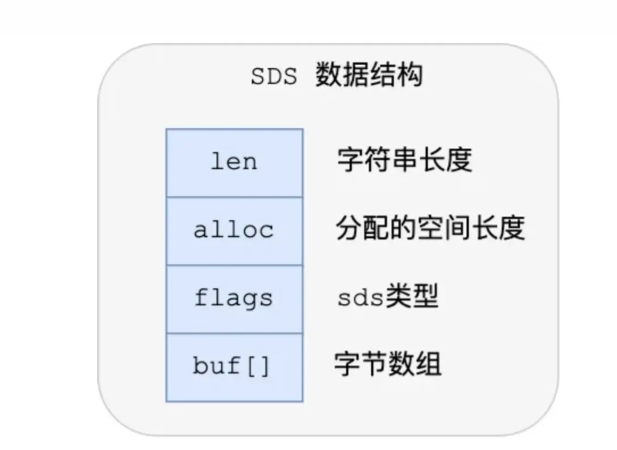
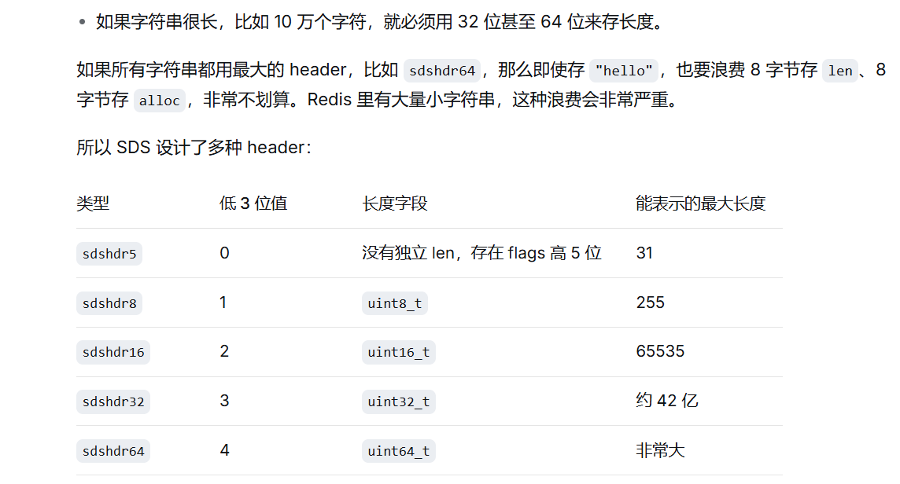
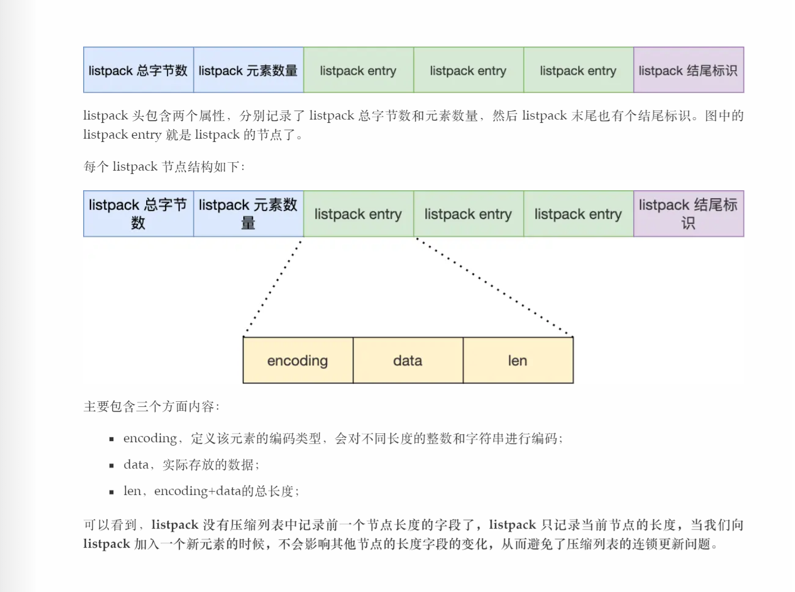
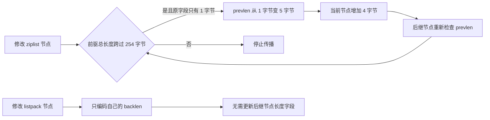
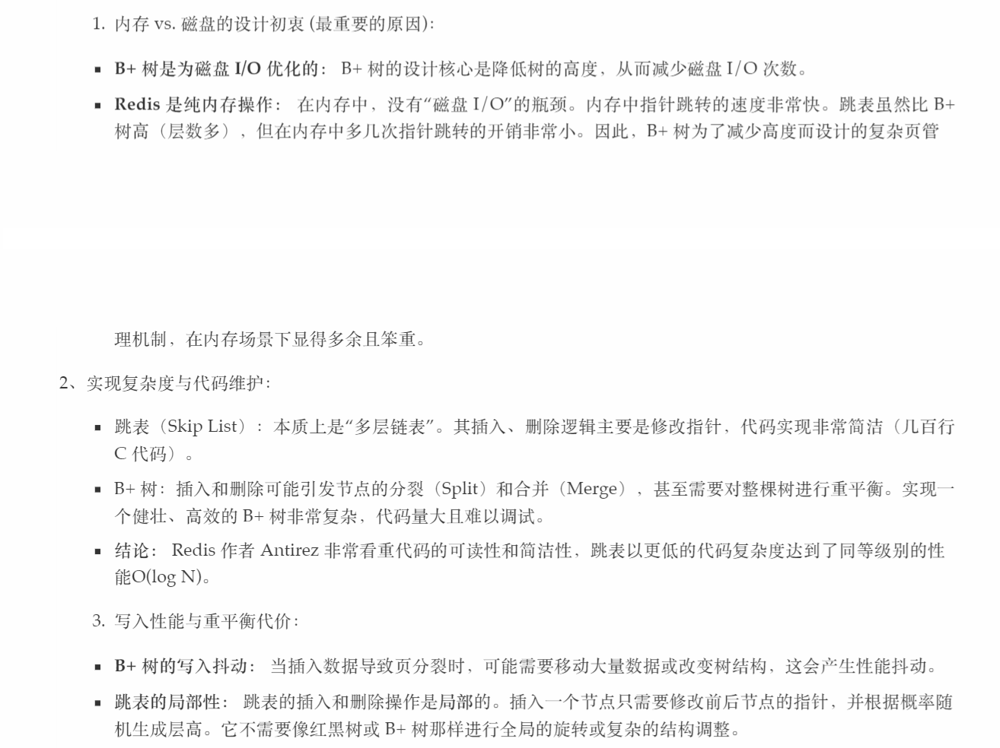
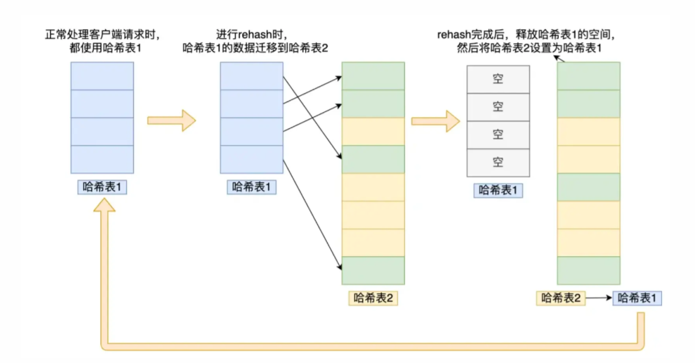
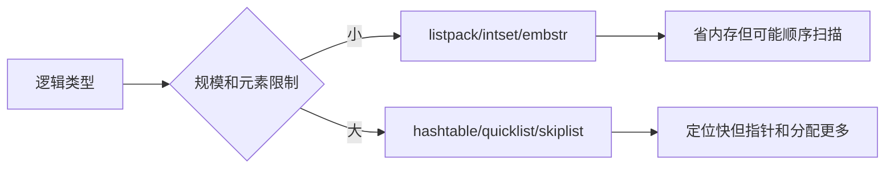

# Redis 数据类型与底层编码

## 0. 问答总结

### 0.1 类型和编码是一回事吗？

1. **两层概念。** String、Hash 等是命令层类型，listpack、hashtable 等是内部编码。
2. **按规模转换。** 小对象节省指针，大对象换取定位能力；用 OBJECT ENCODING 检查实例。

### 0.2 String 使用什么存储？为什么不用 C 字符串？

1. **String 有三种编码。** `int` 直接存放满足编码条件的整数；`embstr` 和 `raw` 使用 SDS，分别适合短字符串和较长字符串，不能说所有 String 都是 SDS。
2. **SDS 保存长度和容量。** 获取长度为 O(1)，而 C 字符串通常通过 `strlen` 扫描到 `\0`，复杂度为 O(N)。
3. **SDS 二进制安全。** 有效内容由显式长度确定，可以保存包含 `\0` 的任意字节；C 字符串函数会把 `\0` 当作结束。
4. **SDS 管理扩容与复用。** 追加前检查容量，必要时扩容并可预留空间；部分缩短操作保留容量，减少重复分配。调用方仍须正确使用 SDS API。

### 0.3 listpack 的整体结构是什么？

1. **头部 + entries + 结束标记。** 头部包含总字节数和元素数量，后面依次存放 listpack entry，末尾是结束标记。
2. **每个 entry 包含自身编码和长度。** 可概括为 `[encoding | data | backlen]`；`backlen` 记录当前 entry 的 `encoding + data` 长度，不包含 `backlen` 自身。
3. **避免连锁更新。** listpack 没有 ziplist 的 `prevlen` 字段，不记录前一个节点的长度；插入或删除不会因相邻节点长度变化而连续扩张后继元数据。

### 0.4 Redis 7 为什么用 listpack 替代 ziplist？

1. **根本原因：消除连锁更新。** ziplist 每个节点保存前一个节点的长度，前驱节点跨过 253/254 字节边界时，后续节点的长度字段可能连续扩大。
2. **listpack 记录自身长度。** listpack 节点保存自己的内容长度（`backlen`），节点之间没有“前一个节点长度”依赖，因此插入或删除不会沿后续节点逐个扩张元数据。
3. **仍有连续内存成本。** listpack 仍可能因中间插入、删除或扩容而移动后续字节；它解决的是长度字段的级联依赖，不是让所有修改都变成 O(1)。

### 0.5 连锁更新具体是什么意思？

1. **触发条件。** ziplist 的 `prevlen` 在前一节点总长度小于 254 字节时占 1 字节，达到 254 字节时占 5 字节。
2. **级联过程。** 某节点变大 4 字节后，后继节点的 `prevlen` 可能从 1 字节变成 5 字节；后继节点再次变大，又可能触发更后面的节点。
3. **典型例子。** 若 A、B、C 的总长度都在 250～253 字节，插入一个 254 字节节点到 A 前面，A 的 `prevlen` 先扩张，A 变大后又迫使 B 扩张，随后 C 也可能扩张。

### 0.6 intset 有什么特点？

1. **有序且不重复。** 使用连续整数数组保存 Set 成员，通过二分查找定位。
2. **统一宽度。** 全体元素采用 16、32 或 64 位有符号整数，宽度必须覆盖所有值，包括负数。
3. **升级有成本。** 更宽的整数会触发整体升级，插入和删除可能移动元素；并非所有操作都是 O(log N)。

### 0.7 quicklist 为什么适合 List？

1. **分段存储。** 双向链表连接多个紧凑节点，通常每个 PACKED 节点保存一个 listpack。
2. **控制搬移范围。** 修改主要影响相关节点，仍可能分裂、合并或分配内存；按下标访问通常需要遍历。
3. **存在例外。** Redis 7.0.0 还支持存放单个大元素的 PLAIN 节点，不能说所有节点都是 listpack。

### 0.8 Redis 为什么使用跳表而不是 B+ 树？

1. **场景匹配。** Redis 的 ZSet 主要在内存中执行增删改查、排名和范围查询，B+ 树为磁盘页 I/O 设计的主要优势不是决定性因素。
2. **实现简单。** 跳表插入、删除主要修改查找路径上的指针和跨度；B+ 树还要维护节点分裂、借位、合并及祖先路径更新。
3. **性能目标相当。** 跳表提供期望 O(log N) 的查找、插入和删除，范围查询通常为 O(log N + M)；B+ 树也能达到类似数量级，选择跳表是工程取舍，不是 B+ 树不能用于内存。
4. **不要绝对化。** 跳表的指针跳转可能带来缓存未命中，随机层高提供的是期望复杂度；不能简单断言跳表始终比 B+ 树更快或更稳定。

### 0.9 dict 和 Hash 类型是一回事吗？

1. **类型与结构不同。** Hash 是用户可操作的数据类型，dict 是通用哈希表实现。
2. **用途广泛。** dict 可用于数据库键空间、大 Hash、Set 和大 ZSet 的成员索引；小 Hash 可以使用 listpack。

### 0.10 Redis 哈希表扩容时，读请求如何查找？

1. **渐进式 rehash 使用两张表。** `ht[0]` 保存旧表，`ht[1]` 保存扩容后的新表；迁移期间两张表同时有效。
2. **读请求先查旧表，再查新表。** 计算 key 的哈希桶后先在 `ht[0]` 对应桶查找；未找到且正在 rehash，才在 `ht[1]` 对应桶查找。
3. **新写入进入新表。** rehash 期间新增 key 放入 `ht[1]`，避免旧表产生新的待迁移数据；删除操作需要在两张表中检查。
4. **请求会顺带推进迁移。** 常规字典操作会执行有限的 rehash step；后台任务还可按时间预算继续搬迁，避免一次性迁移阻塞主线程。
5. **迁移完成后切换表。** `ht[0]` 的所有桶迁移到 `ht[1]` 后释放旧表，把 `ht[1]` 提升为 `ht[0]`，重新创建空的 `ht[1]`。

### 0.11 ZSet 的底层数据结构是什么？

1. **小 ZSet 使用单个 listpack。** 默认元素数量不超过 128，且每个 member 的字节长度不超过 64 时，可以使用 listpack；这两个阈值可配置，边界是“`<=`”，不是严格“小于”。
2. **大 ZSet 使用 skiplist + dict。** skiplist 维护按 score 和 member 的有序关系、范围和排名；dict 按 member 平均 O(1) 找到 score。
3. **两者服务不同操作。** `ZSCORE` 主要走 dict，`ZRANK` 和分值范围查询主要走 skiplist；`OBJECT ENCODING` 返回 `skiplist` 时，内部仍包含 dict。
4. **不要把旧说法直接套用。** Redis 7.0 的 ZSet 紧凑编码是 listpack，ziplist 路径已由它替代；这不表示源码中所有 ziplist 代码在该版本都完全消失。

### 0.12 为什么不能背一个永久阈值？

1. **阈值可配置。** 7.2.0 默认 hash/zset 是 128/64 或 512/64 等配置，redis.conf 可修改。
2. **版本会演进。** 7.x 小版本和未来版本可能改变实现，引用时必须注明标签。

### 0.13 如何选类型？

1. **先看操作。** 要字段查找用 Hash，要排序区间用 ZSet，要成员交并用 Set。
2. **再看规模。** 全量遍历、超大 value 和大成员集合会产生主线程与网络成本。

本文以 Redis 7.x 为基准；结构细节以文末 Redis 7.0.0 来源为依据，编码总览和配置以 Redis 7.2.0 为依据。学习顺序：String/SDS → listpack → intset → quicklist → skiplist → dict → 逻辑类型组合。

## 1. String 与 SDS

### 1.1 三种 String 编码

| 编码 | 存储方式 |
|---|---|
| `int` | 满足编码条件的整数直接存放在 Redis 对象的指针字段中 |
| `embstr` | Redis 对象头和 SDS 一次连续分配，适合短字符串 |
| `raw` | Redis 对象头和 SDS 分开分配，适合较长字符串 |

### 1.2 SDS 结构



*图：适用于 `sdshdr8/16/32/64` 的概括结构；`sdshdr5` 没有独立的 len 和 alloc 字段。*

`len` 是已使用字节数，不含末尾 `\0`；`alloc` 是内容容量，不含头部和末尾 `\0`；`flags` 的低 3 位表示头部类型；`buf[]` 存放实际字节。SDS 指针指向 buf 的起始位置，通过前面的头部读取元数据。可用容量通常为 `alloc - len`。

### 1.3 为什么有多种头部



*图：按所需容量使用不同宽度的元数据，减少小字符串开销。10 万字节用 32 位长度字段就足够，不需要因此使用 64 位。字段表示范围不等于 Redis String 对外允许的大小上限。*

| 类型 | 长度记录方式 | 头部字节数 |
|---|---|---:|
| `sdshdr5` | flags 高 5 位记录长度，无独立 len、alloc | 1 |
| `sdshdr8` | 8 位 len、alloc | 3 |
| `sdshdr16` | 16 位 len、alloc | 5 |
| `sdshdr32` | 32 位 len、alloc | 9 |
| `sdshdr64` | 64 位 len、alloc | 17 |

### 1.4 与 C 字符串的区别

| 对比点 | C 字符串 | SDS |
|---|---|---|
| 获取长度 | `strlen` 扫描，O(N) | 读取长度，O(1) |
| 内嵌零字节 | 字符串函数提前结束 | 以显式长度为准，二进制安全 |
| 追加 | 调用者保证容量 | SDS API 检查并按需扩容 |
| 反复修改 | 调用者管理分配 | 可预留、复用容量 |

例如五个字节 `A B \0 C D`，`strlen` 得到 2，SDS 的 len 可以是 5。SDS 在有效内容末尾仍补一个 `\0`，方便兼容部分 C 函数，但含内嵌零字节的数据必须使用带长度的 API。这里的长度单位是字节，不是汉字或 Unicode 字符数。

## 2. listpack 与 ziplist

### 2.1 两种节点布局



*图：listpack 头部记录总字节数和元素数量，entry 连续排列，末尾有结束标记。图中的 `len` 对应源码中的 `backlen`，表示当前 entry 的 `encoding + data` 长度，不包括自身占用的字节。*

listpack 的头部总计 6 字节：总字节数占 4 字节、元素数量占 2 字节；结束标记占 1 字节（`0xFF`）。每个 entry 的 `encoding` 决定字符串或整数的编码方式，`data` 是实际内容；某些整数直接编码在 encoding 中，可以没有独立的 data 区域。

```text
ziplist:  [ prevlen | encoding | data ] -> [ prevlen | encoding | data ]
listpack: [ encoding | data | backlen ] [ encoding | data | backlen ]
```



**边界说明：** listpack 消除了 ziplist 的连锁更新问题，但没有消除连续内存结构的搬移和 `realloc` 成本。Redis 7.x 的 List 通常是 quicklist，节点内使用 listpack；Hash、ZSet 的小对象路径也可使用 listpack。

### 2.2 用 253 字节节点演示传播

这里的长度是**节点总长度，包含元数据，不是 data 的长度**。假设 A、B、C 原本各占 253 字节，且各自的 `prevlen` 都占 1 字节。在 A 前面插入总长度为 254 字节的 X：

| 步骤 | 必须调整的字段 | 节点总长度变化 |
|---|---|---|
| 插入 X | A 的 `prevlen` 要记录 254，从 1 字节扩大到 5 字节 | A：253 → 257 |
| A 变大 | B 的 `prevlen` 要记录 257，从 1 字节扩大到 5 字节 | B：253 → 257 |
| B 变大 | C 的 `prevlen` 要记录 257，从 1 字节扩大到 5 字节 | C：253 → 257 |

A、B、C 的业务数据没有变化，却都需要调整存储布局，这就是连锁更新。连续节点原本在 250～253 字节且相关 `prevlen` 占 1 字节时，增加 4 字节可以连续跨过阈值；遇到无需扩大字段的节点，传播就会停止。删除节点也可能使一个较大的前驱与后继相邻，从而触发扩张，并非只有插入会触发。

### 2.3 listpack 如何反向遍历？

`backlen` 记录**本节点的 `encoding + data` 长度，不包含 `backlen` 自身**。从 B 的起始地址往前退一个字节，就到达 A 的 `backlen` 末尾；反向解码后，加上 `backlen` 自身占用的字节数，即可确定 A 的完整长度并定位 A 的起始地址。对应源码为 `lpPrev`。

因此，A 的内容变长，只会改变 A 自己的编码和 `backlen`，不会迫使 B 修改长度字段；即使 A 的 `backlen` 自身扩大，也没有跨节点依赖。

### 2.4 复杂度与版本边界

**没有连锁更新不等于插入是 O(1)。** 两者都使用连续内存，中间插入、删除通常仍需移动后续字节，扩容也可能发生整块复制；listpack 消除的是额外的跨节点元数据扩张。

“ziplist 连锁更新必然反复 realloc，最坏 O(n²)”不能直接套用到 Redis 7.0.0。本次核对的 `__ziplistCascadeUpdate` 会先扫描并统计增加的空间，再统一扩容，将受影响节点从后向前搬移、修正。连锁依赖仍存在，但不能用旧实现逐次扩容搬移的分析代替该版本的批量处理。

## 3. intset：整数集合

intset 只保存可以表示为整数的 Set 成员，元素按整数升序存储，并根据所有成员所需的范围选择 16、32 或 64 位有符号整数编码。查找通常需要二分查找；插入新元素可能升级整体编码并搬移数据。混入非整数成员或超过配置阈值时，Set 会转换为其他编码。

## 4. quicklist：List 的分段容器

Redis 7.x 的 List 通常使用 quicklist。quicklist 是双向链表，普通 PACKED 节点内部保存一个 listpack，从而把连续内存的搬移限制在节点范围内，同时保留两端 push/pop 的效率。节点大小受 `list-max-listpack-size` 等配置影响。

Redis 7.0.0 还存在保存单个大元素的 PLAIN 节点，因此不能把所有 quicklist 节点都画成 listpack。节点分裂、合并、压缩或解压也有成本，两端操作不能无条件视为零搬移。

## 5. ZSet 跳表与 B+ 树的取舍

Redis ZSet 的大对象编码是 `skiplist + dict`。其中跳表按 score 和 member 维护有序关系、范围和排名，dict 按 member 平均 O(1) 找 score。跳表节点的 `span` 用于沿查找路径累加排名，底层链表便于顺序和范围遍历。



*图：内存有序数据场景下，跳表通过多层链表索引定位；B+ 树通过节点和页组织索引。图片中的“B+ 树会对整棵树重新平衡”应修正为“插入或删除可能沿祖先路径触发分裂、合并或调整”，通常不需要重建整棵树。*

### 5.1 跳表的查找、更新和排名

从最高层开始向右移动，若下一个节点会越过目标则下降一层；到达底层后得到目标位置。插入和删除沿各层的 update 路径调整 forward 指针、底层 backward 指针和 span。排名查询沿路径累加 span，期望 O(log N)；范围返回 K 个元素通常为 O(log N + K)。

### 5.2 为什么不是直接采用 B+ 树

B+ 树当然可以实现内存索引，且连续节点布局可能改善缓存局部性；但 Redis 选择跳表，是因为跳表以较少的结构维护代码满足 ZSet 的核心操作，并适合频繁更新。B+ 树的页分裂、合并和父节点维护带来更复杂的边界逻辑，而其降低磁盘 I/O 的优势在 Redis 内存场景中不再是主要收益。

**图中需要纠正的两点：** B+ 树的更新通常是局部或沿祖先路径传播，不是每次都调整整棵树；“跳表性能一定更稳定”也不成立，应表述为“跳表以期望 O(log N) 提供足够的性能和较简单的实现”。

## 6. dict/hashtable：按 key 定位的哈希结构

dict 由哈希桶数组和桶内链表节点组成，平均 O(1) 查找、插入和删除。Redis 使用两张表支持渐进式 rehash；扩容期间旧表和新表并存，读请求依次检查两张表，写入进入新表。dict 解决的是按 key/member 定位，不负责排序和范围查询。

### 6.1 哈希表扩容与渐进式 rehash

Redis 字典扩容时不会把所有键一次性搬到新表。扩容先分配更大的 `ht[1]`，将 `rehashidx` 设为 0，然后分批把 `ht[0]` 的桶迁移到 `ht[1]`。迁移的是整个桶中的链表节点，不改变 key 和 value 本身。



*图：rehash 期间旧表和新表并存，完成后释放旧表并交换角色。*

### 6.2 读、写、删的路径

查找流程可概括为：

```text
正在 rehash？
  否：只查 ht[0]
  是：先查 ht[0]，未找到再查 ht[1]
```

这保证了迁移过程中读请求仍能找到 key，无需暂停服务。`dictFind` 在 Redis 7.0.0 源码中正是按 table 0、table 1 的顺序检查；在 rehash 中且未暂停迁移等条件下，查找还可能执行 `_dictRehashStep`。

写入时，如果字典正在 rehash，新 key 直接插入 `ht[1]`。删除时则要在两张表中查找并删除，因为目标 key 可能尚未迁移。

### 6.3 为什么叫“渐进式”

每次字典操作只迁移有限数量的桶，服务器定时维护还可针对数据库字典调用 `dictRehashMilliseconds` 按时间预算推进，这不是独立后台线程，也不是对每个嵌套 Hash 字典都定时扫描。空桶也会被跳过，但源码会限制连续访问空桶的数量，避免一次操作在稀疏表上耗时过长。这样可以把一次性 O(N) 的搬迁成本摊到多个请求中，降低延迟尖刺。

### 6.4 扩容、收缩与边界

扩容通常由负载因子和字典使用情况触发，具体阈值受版本、配置和是否允许 rehash 影响，不能把某个固定倍数当成所有 Redis 版本的永久规则。扩容期间 `ht[0]` 与 `ht[1]` 的桶下标由各自的掩码计算，不能用旧表下标直接访问新表。

单步迁移通常按桶推进，同一桶内的整条冲突链需要搬移，所以不保证单步严格 O(1)。完成后复用新表并把备用表重置为空状态，不会立即再分配一张新桶数组。更新已有 key 时在其实际所在表更新，只有新增 key 放入新表。

## 7. 编码总览

| 逻辑类型 | Redis 7.2.0 常见编码 | 主要取舍 |
|---|---|---|
| String | int、embstr、raw | 整数或短串省分配；长串用 SDS |
| List | quicklist，节点内为 listpack | 两端操作快；按下标可能遍历 |
| Hash | listpack 或 hashtable | 小 Hash 连续存储；大 Hash 按字段定位 |
| Set | intset、listpack 或 hashtable | 整数集合省空间；普通成员可哈希定位 |
| ZSet | listpack 或 skiplist + dict | 跳表做分值/排名，dict 按成员查分值 |



### 7.1 关键边界

7.2.0 `hash-max-listpack-entries 512`、`hash-max-listpack-value 64`，`set-max-listpack-entries 128`、`set-max-listpack-value 64`，`zset-max-listpack-entries 128`、`zset-max-listpack-value 64`。这些是默认配置，不是命令契约。List 的节点大小由 `list-max-listpack-size` 控制；不能简单写成“List 小于某个元素数就是 listpack”。

字符串的 `embstr` 上限由源码常量 `OBJ_ENCODING_EMBSTR_SIZE_LIMIT` 决定；不要在未核对标签时把 44 字节当永久规则。Set 的 intset 只适用于可表示为整数且规模满足限制的成员；混入非整数会转换。

### 7.2 使用建议

用 `OBJECT ENCODING key`、`MEMORY USAGE key` 实际观察。避免对大 Hash 使用 `HGETALL`，对大 ZSet 使用无限范围；渐进 `SCAN` 只降低单次工作量，不改变总数据量。编码升级可能一次搬迁整对象，发布高峰应预估这种成本。

## 99. 官方依据

1. [7.2.0 redis.conf](https://github.com/redis/redis/blob/7.2.0/redis.conf)：Hash、Set、ZSet、List 编码默认阈值。
2. [7.2.0 object.c](https://github.com/redis/redis/blob/7.2.0/src/object.c)：`tryObjectEncodingEx`、String 编码。
3. [7.2.0 t_set.c](https://github.com/redis/redis/blob/7.2.0/src/t_set.c)：`setTypeCreate` 与编码转换；[t_list.c](https://github.com/redis/redis/blob/7.2.0/src/t_list.c)：Listpack/quicklist。
4. [7.2.0 t_zset.c](https://github.com/redis/redis/blob/7.2.0/src/t_zset.c)：ZSet 的 listpack、skiplist 与 dict 路径。
5. [Redis 7.0.0 `src/ziplist.c`](https://github.com/redis/redis/blob/7.0.0/src/ziplist.c)：节点布局、`prevlen` 编码与 `__ziplistCascadeUpdate`。
6. [Redis 7.0.0 `src/listpack.c`](https://github.com/redis/redis/blob/7.0.0/src/listpack.c)：`backlen` 编码与 `lpPrev` 反向遍历。
7. Redis 7.2.0 配置与源码核对：`notes/.redis-rewrite-sources/redis-7.2.0.conf` 及对应源码缓存；命令参考：https://redis.io/docs/latest/commands/
8. [Redis 7.0.0 `src/dict.c`](https://github.com/redis/redis/blob/7.0.0/src/dict.c)：`dictFind` 双表查找、`dictRehash`、`_dictRehashStep` 与渐进式迁移。
9. [Redis 7.0.0 `src/sds.h`](https://github.com/redis/redis/blob/7.0.0/src/sds.h)：`sdshdr5/8/16/32/64` 布局、类型标志与 `sdslen`。
10. [Redis 7.0.0 `src/intset.c`](https://github.com/redis/redis/blob/7.0.0/src/intset.c)：有序整数存储、二分查找与编码升级。
11. [Redis 7.0.0 `src/quicklist.h`](https://github.com/redis/redis/blob/7.0.0/src/quicklist.h)：quicklist 节点容器和压缩配置。

