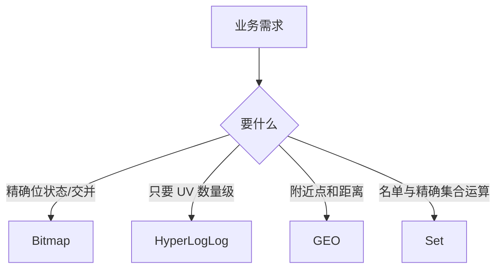

# Bitmap、HyperLogLog 与 GEO 怎么选

## 0. 问答总结

### 0.1 三者分别解决什么？

1. **Bitmap 精确存位。** 适合稠密整数偏移的签到、布尔标记。
2. **HLL 估算基数。** 内存固定量级但有误差，不提供成员名单。
3. **GEO 查附近。** 坐标编码后借助 ZSet 查询，不能替代 GIS。

### 0.2 Bitmap 为什么会突然变大？

1. **空间按最高偏移分配。** 中间的 0 也占字节，稀疏大 ID 不适合直接做偏移。
2. **换稠密 ID。** 或改用 Set；哈希取模会碰撞，不能当精确名单。

### 0.3 HLL 能对账吗？

1. **不能。** Redis 7.2.0 使用 16384 个寄存器，标准误差约 0.81%，结果不可逆。
2. **要精确名单用 Set。** 报表可用 HLL 做趋势，权威对账放数据库或数仓。

### 0.4 布隆过滤器是什么？

1. **它是允许误判的成员存在性结构。** 由长度为 `m` 的位数组和 `k` 个哈希位置组成；写入元素时把 `k` 个位置置为 1，查询时只要有一个位置为 0，就可以确定元素不存在。
2. **只能误报存在，不能误报不存在。** 查询结果为“可能存在”时，仍需访问数据库或缓存确认；前提是过滤器没有被错误清空、哈希参数一致且没有直接删除造成结构破坏。
3. **Redis OSS 没有内置 BF 命令。** Redis 中通常安装 RedisBloom 模块后使用 `BF.ADD`、`BF.EXISTS` 等命令；也可以由应用自行维护位图和哈希函数，但删除、扩容和参数管理更复杂。

本文以 Redis 7.x 为基准；配置和源码细节核对 Redis 7.2.0，不能把单一补丁版本推成整个系列。

## 1. 选型表

| 能力 | Bitmap | HyperLogLog | GEO |
|---|---|---|---|
| 数据 | 精确 0/1 | 近似不同元素数 | 地点成员与距离 |
| 底层 | String | String 特殊编码 | ZSet + GeoHash score |
| 主要边界 | 稀疏偏移、大 BITOP | 不可逆、有误差 | 无多边形/道路网络；大范围扫描昂贵 |



## 2. 实现要点

Bitmap 的偏移上限和空间由 String/位操作命令约束；`BITCOUNT`、大 `BITOP` 仍在主线程完成。HLL 7.2.0 源码定义 `HLL_P 14`、16384 个寄存器，密集表示约 12 KB；“约 12 KB”是核心结构量级，不应当写成任何配置下绝对固定的对象大小。`PFMERGE` 合并估算结果，不能删除单个成员。

GEO 命令把经纬度编码进 ZSet score；一个 member 再次 `GEOADD` 会更新坐标。优先使用 `GEOSEARCH`（Redis 6.2+），旧的 `GEORADIUS` 仍可能兼容但新代码应按文档迁移。详情通常只存 ID，回源业务数据库。

### 2.1 布隆过滤器原理与使用边界

布隆过滤器由位数组和多个哈希函数构成。假设位数组长度为 8，使用 3 个哈希函数对元素 `x` 计算并取模后得到 1、4、6，则写入时把第 1、4、6 位设为 1：

```text
hash1(x) % 8 = 1 ─┐
hash2(x) % 8 = 4 ─┼─> 位数组：0 1 0 0 1 0 1 0
hash3(x) % 8 = 6 ─┘       下标：0 1 2 3 4 5 6 7
```

查询 `x` 时重新计算相同的 `k` 个位置：

- **任一位为 0：一定不存在。** 该位从未被任何已写入元素覆盖。
- **所有位为 1：可能存在。** 其他元素的哈希冲突可能恰好把这些位都置为 1，产生假阳性。

标准布隆过滤器不保存原始成员，也不支持安全删除：直接把某一位改回 0 可能误判仍存在的其他元素。需要删除时应使用计数布隆过滤器，或采用 RedisBloom 的 `CF.*`（Cuckoo Filter）等支持删除的结构，但它们的空间、性能和误判特性不同。

#### 误判率与哈希函数数量

在位数组长度为 `m`、预计插入 `n` 个元素、使用 `k` 个相互独立且近似均匀的哈希位置时，查询一个实际上不存在的元素却被判断为“可能存在”的假阳性率近似为：

```text
p ≈ (1 - e^(-kn/m))^k
```

当 `k=1` 时，`p ≈ 1 - e^(-n/m)`；继续增加 `k` 会先降低误判率，但并不是越多越好。对上式取最优值可得：

```text
k* ≈ (m/n) ln 2 ≈ 0.693 × m/n
```

因此，哈希函数数量由“每个元素分配的位数 `m/n`”和目标误判率共同决定。实际系统会根据预计容量、可接受误判率、CPU 开销和具体实现取整；RedisBloom 的参数应通过 `BF.RESERVE` 指定错误率与容量，不要机械套用示例中的 3 个哈希函数。公式是理论近似，扩容后的多子过滤器、非理想哈希和实际容量变化都会使观测值有所偏离。

#### 哈希函数怎么选

1. **通用场景优先选择成熟的非加密哈希。** MurmurHash3 通常是稳定的综合选项；xxHash（XXH64/XXH3）适合更看重吞吐和低延迟的场景；FNV 实现简单，适合依赖少、资源受限的场景。具体应以目标语言和库的基准测试为准，不能把某一种算法写成所有系统的固定默认值。
2. **输入不可信且可能被攻击时考虑 SipHash。** 它使用密钥降低攻击者构造大量碰撞的风险，但通常比非加密哈希更慢；它解决的是哈希碰撞攻击风险，不会消除布隆过滤器本身的假阳性。
3. **用双重哈希减少计算成本。** Kirsch–Mitzenmacher 方法先计算两个基础哈希值 `h1`、`h2`，用 `h_i = (h1 + i × h2) mod m` 生成第 `i` 个位置，通常可用两次哈希近似得到 `k` 个位置。需要确认所用库是否已经内部实现，避免应用层和库重复计算或破坏其参数约定。
4. **安全哈希与高质量随机性不是一回事。** 布隆过滤器要求位置分布均匀、不同输入尽量少相关；选择算法时要同时评估分布质量、吞吐、种子/密钥管理、跨语言兼容性和升级后的数据兼容问题。

#### 参数与工程实践

1. **容量先按峰值元素数规划。** 元素数量超过初始化容量会使误判率上升；RedisBloom 的 `BF.RESERVE` 可指定容量、错误率和扩容步长，扩容会增加底层子过滤器。
2. **错误率是概率而非绝对保证。** 位数组长度 `m`、哈希次数 `k` 和实际元素数 `n` 共同决定假阳性率，不能把示例中的 3 个哈希函数当作固定最佳值。
3. **过滤器只做快速拦截。** 典型读流程是“先查 BF，判定不存在则直接返回；判定可能存在再查缓存/数据库”，不能把 BF 当作权威数据源。
4. **注意数据生命周期。** 数据库删除、过滤器重建、版本切换和多实例写入必须有一致的维护策略；过滤器通常适合防缓存穿透，不适合要求精确集合、频繁删除或需要枚举成员的场景。

## 3. 官方依据

1. [7.2.0 bitops.c](https://github.com/redis/redis/blob/7.2.0/src/bitops.c)：位操作实现。
2. [7.2.0 hyperloglog.c](https://github.com/redis/redis/blob/7.2.0/src/hyperloglog.c)：`HLL_P`、寄存器和估算流程。
3. [7.2.0 geo.c](https://github.com/redis/redis/blob/7.2.0/src/geo.c)：`georadiusGeneric`、GEOSEARCH 参数与 ZSet 查询。
4. [RedisBloom 官方文档：Bloom Filter](https://redis.io/docs/latest/develop/data-types/probabilistic/bloom-filter/)：`BF.RESERVE`、`BF.ADD`、`BF.EXISTS`、容量与错误率配置；RedisBloom 属于模块能力，不是 Redis OSS 7.2.0 内置数据类型。


## 99. 官方依据

- Redis 7.2.0 配置与源码核对：`notes/.redis-rewrite-sources/redis-7.2.0.conf` 及对应源码缓存。
- Redis 命令参考：https://redis.io/docs/latest/commands/
