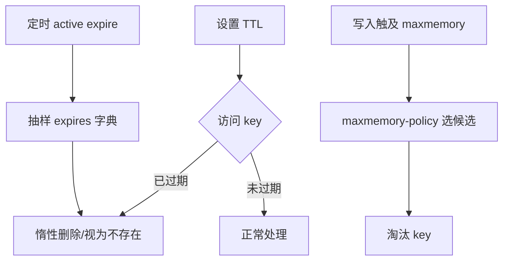

# Redis 过期与内存淘汰

## 0. 问答总结

### 0.1 过期和淘汰有什么区别？

1. **过期看 TTL。** key 到时间后逻辑上不存在，Redis 用访问检查和主动周期回收。
2. **淘汰看内存。** 达到 maxmemory 且需要写入时，按 maxmemory-policy 选择牺牲 key。

### 0.2 过期会在到点瞬间删除吗？

1. **不保证。** 惰性删除等访问，主动周期抽样；两者都存在短暂滞后。
2. **主从有差异。** 主库传播删除；只读副本不会自行删除主库控制的过期 key，但查询可把它视为不存在。

### 0.3 LRU/LFU 是精确的吗？

1. **是近似策略。** Redis 从候选样本维护淘汰池，不维护全局精确 LRU 链表。
2. **LFU 会衰减。** 访问计数按对数增加并随时间衰减，避免旧热点永久占用。

### 0.4 lazyfree 相关配置默认是什么，应该怎么选？

1. **Redis 7.2.0 默认全部关闭。** 四项配置在官方 `redis.conf` 中均为 `no`；关闭时由主线程同步释放对象。
2. **通常开启过期删除、内部覆盖删除和副本全量同步清库的异步释放。** 这样可降低大对象回收造成的命令延迟，但内存实际释放会滞后。
3. **内存淘汰通常保持关闭。** 淘汰发生在内存紧张路径，异步释放可能造成瞬时内存峰值甚至 OOM；只有压测确认有余量时才开启。

本文以 Redis 7.x 为基准；实现细节核对 Redis 7.2.0 源码和 redis.conf。默认值不是整个 7.x 的永久契约。

## 1. 两条生命周期

Redis 7.2.0 `activeExpireCycle` 每轮从 expires 字典抽样，基准每个数据库循环 20 个 key，并受时间上限和 `active-expire-effort` 调整；它不是每次全表扫描。访问路径 `expireIfNeeded` 会判断并在主库删除、传播删除操作。副本遵循主库删除以保持复制一致，查询仍可判断逻辑过期。[1][2]

## 2. maxmemory-policy

`noeviction`、`allkeys-lru`、`volatile-lru`、`allkeys-lfu`、`volatile-lfu`、`allkeys-random`、`volatile-random`、`volatile-ttl` 共八种。`volatile-*` 只从带 TTL 的候选中选择；如果没有符合条件的 key，写入仍可能失败。LRU/LFU 都是采样近似，不应承诺严格全局顺序。

过期删除和淘汰可能叠加：一个 key 因 TTL 过期，不等于触发了淘汰；maxmemory 也不会替代 TTL 生命周期。大对象过期释放可使用 `lazyfree-lazy-expire`，但异步回收意味着内存指标暂时滞后。

## 3. 运营建议

缓存 TTL 加随机抖动，降低同一时刻主动过期压力；监控 `expired_keys`、`evicted_keys`、命令延迟和内存碎片。不要用 `volatile-lru` 保存全部永久 key 后再期待 Redis 自动腾空间。详见[大 key](60-redis为什么不能存大key.md)。

## 4. lazyfree 配置：默认值、推荐值与理由

以下默认值以 Redis 7.2.0 官方 `redis.conf` 为准；不同发行版或托管服务可能覆盖默认配置，线上应以 `CONFIG GET` 实际值为准。

| 配置 | 作用 | 默认 | 建议 | 理由与边界 |
| --- | --- | --- | --- | --- |
| `lazyfree-lazy-expire` | TTL 过期删除时后台异步释放 | `no` | **开启** | 降低大对象过期造成的主线程延迟；后台积压时内存释放会滞后。 |
| `lazyfree-lazy-eviction` | 内存淘汰时后台异步释放 | `no` | **谨慎开启，通常关闭** | 内存紧张时可能出现“已淘汰但未释放”的峰值，导致继续淘汰、分配失败或 OOM；需压测并预留余量。 |
| `lazyfree-lazy-server-del` | `RENAME`、`MOVE` 覆盖旧值等内部删除异步释放 | `no` | **开启** | 避免隐式删除大值阻塞命令；逻辑删除完成，内存稍后归还。 |
| `replica-lazy-flush` | 副本全量同步时异步清空旧数据库 | `no` | **开启** | 降低清空大量旧数据时的阻塞；加载新 RDB 期间需为旧对象释放任务预留内存。 |

这些开关只改变内存释放的调度方式，不改变 TTL、淘汰或复制的逻辑结果；异步释放也不代表 RSS 立即下降。

## 5. 官方依据

1. [7.2.0 db.c](https://github.com/redis/redis/blob/7.2.0/src/db.c)：`expireIfNeeded`、副本过期行为。
2. [7.2.0 expire.c](https://github.com/redis/redis/blob/7.2.0/src/expire.c)：`activeExpireCycle` 抽样、时间限制和 effort。
3. [7.2.0 evict.c](https://github.com/redis/redis/blob/7.2.0/src/evict.c)：淘汰池、近似 LRU/LFU；[redis.conf](https://github.com/redis/redis/blob/7.2.0/redis.conf)：八种 policy 和相关配置。
4. [7.2.0 redis.conf](https://github.com/redis/redis/blob/7.2.0/redis.conf)：`lazyfree-lazy-eviction`、`lazyfree-lazy-expire`、`lazyfree-lazy-server-del`、`replica-lazy-flush` 默认值及异步释放说明。

## 99. 官方依据

- Redis 7.2.0 配置与源码核对：`notes/.redis-rewrite-sources/redis-7.2.0.conf` 及对应源码缓存。
- Redis 命令参考：https://redis.io/docs/latest/commands/
