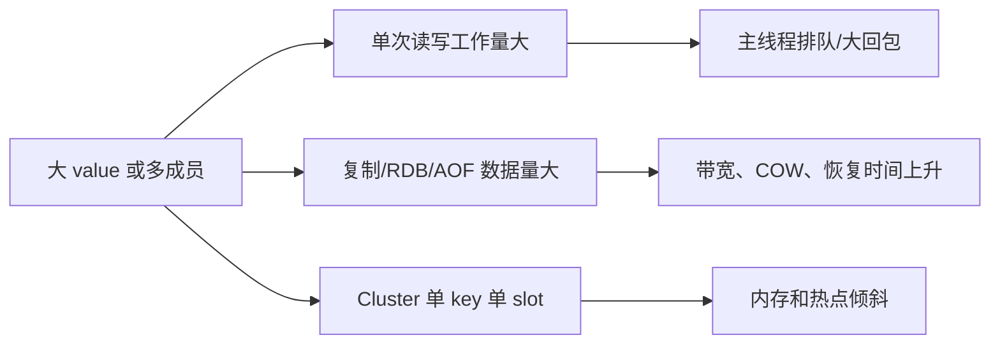

# Redis 大 key 的风险与治理

## 0. 问答总结

### 0.1 大 key 是不能存吗？

1. **不是绝对不能。** 风险在一次命令、复制、持久化或迁移要处理太多数据。
2. **风险分两类。** value 体积大影响网络和复制；成员多影响遍历、删除和主线程。

### 0.2 怎样发现大 key？

1. **先看统计命令。** MEMORY USAGE、STRLEN、HLEN、SCARD、ZCARD 可定点检查。
2. **再做渐进扫描。** redis-cli --bigkeys 使用 SCAN 思路，生产要限速并避开高峰。

### 0.3 UNLINK 能彻底避免阻塞吗？

1. **只把释放工作异步化。** 主线程先摘除 key，bio 线程随后释放对象。
2. **有阈值和代价。** 7.2.0 `LAZYFREE_THRESHOLD` 为 64 个释放工作量估计；小对象可能同步释放，内存回收也会滞后。

本文以 Redis 7.x 为基准；实现细节核对 Redis 7.2.0 源码和 redis.conf。默认值不是整个 7.x 的永久契约。

## 1. 为什么大 key 危险

大 String 常见问题是传输、复制和持久化；大 Hash/Set/ZSet 的 `HGETALL`、`SMEMBERS`、全范围 `ZRANGE` 与删除还需要处理大量成员。集群扩容不能把一个 key 拆到多个 slot。

## 2. 读、删、迁移的正确姿势

用 `HSCAN`、`SSCAN`、`ZSCAN` 或分页读取，避免一次倒出整个集合。按业务把对象分桶，详情和文件放数据库/对象存储，Redis 保留热字段或 ID。拆桶后可用 Pipeline 降低额外往返，但跨桶聚合由应用承担。

7.2.0 `freeObjAsync` 计算 `lazyfreeGetFreeEffort`；Hash/Set/ZSet/quicklist 等按内部分配数量估算，超过 64 才排入 lazyfree bio 队列。`UNLINK` 不是“零成本删除”，内存统计、淘汰压力和后台队列要一起监控。

## 3. 大 key 与热 key

大 key 关注单次工作量和对象体积；热 key 关注访问频率，值可以很小。两者叠加时危害更大，应同时拆分数据和降低访问集中度。

## 4. 官方依据

1. [7.2.0 lazyfree.c](https://github.com/redis/redis/blob/7.2.0/src/lazyfree.c)：`lazyfreeGetFreeEffort`、`LAZYFREE_THRESHOLD`、`freeObjAsync`。
2. [7.2.0 networking.c](https://github.com/redis/redis/blob/7.2.0/src/networking.c)：回复缓冲和网络写入路径。
3. [Redis MEMORY USAGE](https://redis.io/docs/latest/commands/memory-usage/)、[redis-cli --bigkeys](https://redis.io/docs/latest/commands/scan/)：检查命令契约。

## 99. 官方依据

- Redis 7.2.0 配置与源码核对：`notes/.redis-rewrite-sources/redis-7.2.0.conf` 及对应源码缓存。
- Redis 命令参考：https://redis.io/docs/latest/commands/
