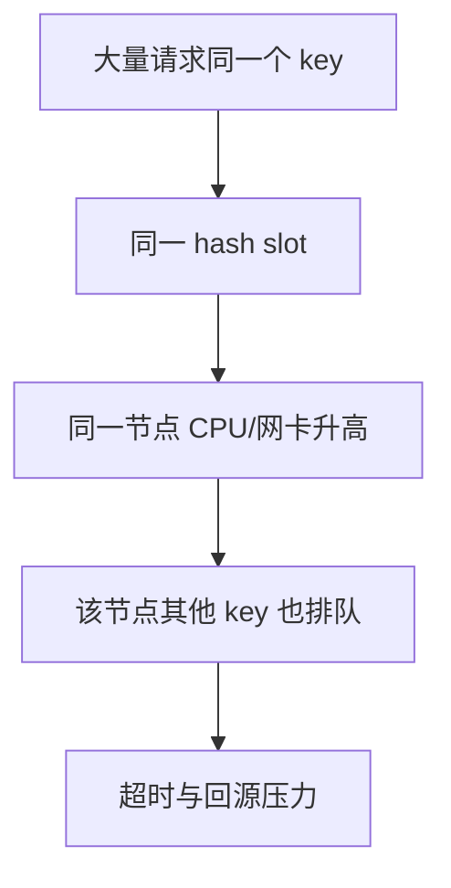

# Redis 热 key 的发现与治理

## 0. 问答总结

### 0.1 热 key 是什么？

1. **访问高度集中。** 同一个 key 的 QPS 集中到它所在 slot 和节点。
2. **不等于大 key。** value 很小也可能成为热 key；大 key 则关注体积和成员数。

### 0.2 怎么发现？

1. **已知热点先预热。** 业务知道的促销、榜单 key 直接纳入监控。
2. **未知热点分层采集。** 客户端或代理计数更接近流量；`redis-cli --hotkeys` 在 LFU 统计下可临时排查。
3. **慎用 MONITOR。** 它复制命令流，长期开启会增加实例压力。

### 0.3 怎样治理单 key 热点？

1. **优先本地缓存。** 短 TTL 加失效广播，挡住大部分读。
2. **读多写少可复制 key。** 写多份、读随机后缀，换内存和一致性窗口来分散 slot。
3. **不要只扩容。** 一个 key 仍映射一个 slot，扩容不能自动拆分它。

本文以 Redis 7.x 为基准；实现细节核对 Redis 7.2.0 源码和 redis.conf。默认值不是整个 7.x 的永久契约。

## 1. 热点形成链路

Cluster 的路由粒度是 key；给副本扩容并不会把一个主 key 的默认读写自动均匀拆开。热点可能是读热点、写热点或二者叠加，治理方案应先区分读写比例与一致性要求。

## 2. 发现手段的边界

7.2.0 `redis-cli --hotkeys` 的实现会 `SCAN` 全部 key，再 Pipeline `OBJECT FREQ`，依赖 LFU 访问频率。它是运维排查工具，不是实时全局热点广播，也不适用于把 LRU 策略误当 LFU。业务客户端统计滑动窗口通常更实时，但需采样、限额并保护上报链路。

## 3. 治理方案

本地缓存适合读多写少、允许短暂旧值的数据；写入路径应广播失效，短 TTL 作为丢消息兜底。复制后缀 key 时不要使用同一 hash tag，否则仍在同一 slot；写放大为 N 份且存在短暂不一致。备份集群提供隔离和容量，代价是内存与同步延迟。

## 4. 官方依据

1. [7.2.0 redis-cli.c](https://github.com/redis/redis/blob/7.2.0/src/redis-cli.c)：`findHotKeys`、`getKeyFreqs`，`SCAN` 与 `OBJECT FREQ`。
2. [Redis Cluster specification](https://github.com/redis/redis/blob/7.2.0/cluster-spec.md)：key 到 hash slot 的路由与 hash tag。
3. [7.2.0 evict.c](https://github.com/redis/redis/blob/7.2.0/src/evict.c)：LFU 频率编码和衰减逻辑。

## 99. 官方依据

- Redis 7.2.0 配置与源码核对：`notes/.redis-rewrite-sources/redis-7.2.0.conf` 及对应源码缓存。
- Redis 命令参考：https://redis.io/docs/latest/commands/
