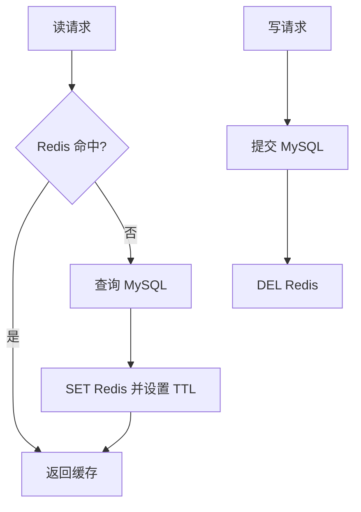

# 缓存更新策略

本文以 Redis 7.x 为基准，实现细节参考 Redis 7.2.0。缓存不是权威数据源，MySQL 才是。

## 0. 问答总结

### 0.1 Redis 和 MySQL 通常怎么更新？
1. **默认 Cache Aside。** 读请求先查 Redis，未命中查 MySQL 后回填。
2. **写请求先提交 MySQL，再删除 Redis。** 下次读取时重建。
3. **它只提供最终一致。** 删除失败、并发回填要靠重试、版本校验和 TTL 兜底。

### 0.2 为什么不直接更新缓存？
1. **缓存值常是多表拼装。** 写路径难以复用完整查询逻辑。
2. **并发写入会乱序覆盖。** 旧请求可能把旧值写回新缓存。
3. **删除更容易幂等。** `DEL` 重试不会引入错误值。

### 0.3 三种 Through/Behind 有何区别？
1. **Read Through 由缓存组件负责 miss 加载。** 业务只调用 `Get`。
2. **Write Through 同步写缓存和数据库后返回。** 要求所有写路径都经过缓存层。
3. **Write Behind 先写缓存、异步刷库。** 吞吐高但可能丢数据，只适合可恢复的计数类场景。

## 1. Cache Aside 流程



写库成功到删除完成前可能读旧值；读线程若在写库前已查库，完成查询后可能把旧值回填。高一致场景应直读主库，或携带版本号只接受更新值。

## 2. 选型

|策略|特点|适用边界|
|---|---|---|
|Cache Aside|应用控制读写，先库后删|Redis+MySQL 默认|
|Read Through|组件统一 loader|简单 KV|
|Write Through|同步写缓存和库|所有写均经缓存|
|Write Behind|异步落库|计数、频控；需日志、重试、幂等、对账|

TTL 只限制最坏陈旧时长，不保证到期瞬间删除。官方命令：<https://redis.io/docs/latest/commands/>；配置证据：`notes/.redis-rewrite-sources/redis-7.2.0.conf`。

**在 Redis 配 MySQL 的读多写少场景，一次读请求先查 Redis，未命中时查询 MySQL 并回填 Redis；一次写请求先提交 MySQL，提交成功后删除 Redis，后续读请求再按同一路径回填。这个 Cache Aside 流程是业务系统的默认选择。**

**这套流程只保证缓存最终与数据库一致，MySQL 仍然是权威数据源；删除失败、并发回填和重试造成的短暂旧值，需要通过异步补偿、版本校验或 TTL 收敛。** 读穿、写穿和写回适用于缓存组件能够代管数据访问，或业务愿意用一致性、耐久性换取吞吐的场景。缓存与数据库的一致性窗口和补偿方式，见 `100-redis和mysql怎么保持一致.md`；Redis 持久化只能减少数据丢失，不能改变数据库是权威数据源这一事实，见 `80-redis持久化.md`。

## 1. Cache Aside：业务系统的默认方案

**读路径由应用负责，写路径先改库再删缓存。** 例如广告投放系统读取 `creative:{10086}:info` 时，命中 Redis 就直接返回；未命中时查询 MySQL、回填 Redis，再把结果返回。

```text
读取
  ├─ Redis 命中 → 直接返回
  └─ Redis 未命中 → 查询 MySQL → SET Redis → 返回

写入
  └─ UPDATE MySQL → DEL Redis → 下次读取时回填
```

写入时只删除缓存，不直接改缓存值。缓存通常由多张表或多段规则拼接而成，写路径很难完整复刻读取逻辑；并发回填还可能发生旧请求覆盖新请求。

### 为什么先更新数据库，再删除缓存

| 顺序 | 并发结果 | 结论 |
|---|---|---|
| 先更新库，再删缓存 | 删除前可能读到短暂旧值；极少数情况下旧读请求会回填旧值 | **默认方案** |
| 先删缓存，再更新库 | 删除后读请求可能查到旧库值并重新写回，脏数据窗口更大 | 不作为默认方案 |
| 更新库后直接改缓存 | 需要准确重算完整缓存值，并处理并发覆盖 | 一般不采用 |

“先删再改”的典型竞态如下：

```text
线程 A：DEL cache:key
线程 B：缓存未命中，读取尚未提交或仍为旧值的 MySQL，并回填 Redis
线程 A：UPDATE MySQL 为新值
结果：Redis 保留旧值，直到 TTL 到期或再次删除
```

“先改库再删”仍不是强一致方案：读请求可能卡在数据库更新和删除缓存之间，随后把旧值回填。但该窗口通常更短，因此作为业务默认选择。对一致性要求更高的场景，需要删除重试、消息队列、订阅 Binlog 或版本校验等补偿机制。

## 2. Read Through 与 Write Through：由缓存组件代管

### Read Through

**Read Through 的读流程仍然是“命中直接返回、未命中查询并回填”，区别在于加载逻辑由缓存组件统一实现，而不是每个业务服务各自编写。**

| 方案 | 未命中时由谁查库并回填 |
|---|---|
| Cache Aside | 每个业务服务自己执行 `if miss { 查库; SET }` |
| Read Through | 缓存组件调用统一 loader，应用只调用 `cache.Get` |

```text
应用 Get product:{10086}:price
        ↓
缓存未命中 → 组件调用 loader 查询 MySQL → 写入缓存并返回
```

它可以减少重复的回填代码，但 loader 需要理解完整的数据模型。简单 KV 适合使用；多表拼接、依赖请求参数的视图和报表查询通常不适合。Read Through 只解决读，不会自动处理数据库写入；写路径仍需配合删除、写穿或其他更新策略。

### Write Through

**Write Through 在一次写请求中先更新缓存并同步写数据库，只有两边都成功后请求才返回；它要求所有写入都经过同一个缓存层。**

```text
写入缓存 → 同步写 MySQL → 两边成功后返回
```

它适合低频写入且缓存值可以一次计算完整的场景，例如修改计划状态或预算。代价是写延迟增加，而且所有写入都必须经过缓存层；任何绕过缓存直接写数据库的路径都会破坏一致性。对于由多表数据拼接的缓存视图，通常仍采用“更新数据库后删除缓存”。

## 3. Write Behind：异步刷库换取吞吐

**Write Behind 先写缓存并立即返回，再由后台批量或定时写入数据库。**

```text
请求 → 写 Redis → 立即返回
             ↓
       后台批量刷 MySQL
```

它适合广告曝光、频控计数等高频写入，并且业务可以接受数据库延迟数秒。数据库在刷库前不是最新状态，Redis 宕机或刷库任务失败还可能造成数据丢失，因此必须设计持久化、重试、幂等、对账和恢复机制。订单、余额、支付等不能丢失的数据不应直接采用纯 Write Behind；除非另有可靠日志或 `fsync` 机制兜底。

## 4. 不要混淆 Write Through 与 Write Behind

| 例子 | 读模式 | 写模式 | 关键原因 |
|---|---|---|---|
| InnoDB Buffer Pool | 读穿 | 写回 | 内存页标脏后由 checkpoint 刷盘，redo log 提供恢复依据 |
| OS 页缓存 | 读穿 | 通常写回 | `write` 进入页缓存即可返回，`fsync` 才要求落盘 |
| 在线文档自动保存 | 近似读穿 | 写回 | 先修改内存状态，再防抖或定时同步服务器 |
| CPU Cache | 读穿 | 主流为写回 | 写穿会放大内存带宽压力 |

这些系统能使用写回，是因为存在日志、刷盘或恢复机制。只有 Redis 缓存、没有可靠刷库链路的“先写缓存后落库”，不能与它们视为同一可靠性等级。

## 5. 选型对照

| 模式 | 未命中处理 | 写入方式 | 一致性与耐久性 | 适用场景 | 主要代价 |
|---|---|---|---|---|---|
| **Cache Aside** | 应用查库并回填 | 先写库，再删缓存 | 最终一致 | Redis + MySQL 的业务默认 | 业务重复编写回填逻辑，存在短暂脏读 |
| **Read Through** | 缓存组件调用 loader | 由其他策略负责 | 取决于写策略 | 简单 KV、组件具备 loader | loader 难以覆盖复杂模型 |
| **Write Through** | 通常配合读穿 | 写缓存并同步写库 | 返回前两边对齐 | 低频写、缓存值可完整计算 | 写延迟高，绕过缓存即失效 |
| **Write Behind** | 通常配合读穿 | 只写缓存，异步刷库 | 弱一致，故障可能丢数据 | 计数、频控、高吞吐写入 | 数据库落后，需处理恢复与幂等 |

**记忆方式：**业务默认是“先写库、再删缓存”；缓存组件能统一加载时考虑 Read Through；需要写后立即对齐时考虑 Write Through；能接受延迟和丢失风险时才使用 Write Behind。


## 99. 官方依据

- Redis 7.2.0 配置与源码核对：`notes/.redis-rewrite-sources/redis-7.2.0.conf` 及对应源码缓存。
- Redis 命令参考：https://redis.io/docs/latest/commands/
